# Database design

**Design the facts, invariants and ownership boundaries before distributing data.** This note covers modelling, normalisation, partitioning and sharding. [SQL optimisation](sql-optimisation.md) covers execution plans and measured query tuning.

Start with the order-system design below. [Exercise 006](../practice/order-service/requirements/006-normalise-suppliers-and-optimise-orders.md) applies the schema-design part inside the existing app.

## Design from operations and invariants

Start with what the system must do, rather than drawing tables from API response fields. For an order, identify the facts that must survive a restart, the rules concurrent requests must preserve, and the reads users expect.

| Design question | Order-system example | Consequence for the model |
|---|---|---|
| What has its own identity? | Customer, product, order, order line | Separate identities and explicit relationships |
| What must be unique? | One request key per customer operation | A database uniqueness rule, with an explicit scope |
| What changes together? | Reserve stock and record the order | A transaction boundary, not just related class names |
| What is current versus historical? | Current product name versus agreed sale price | References for current facts; deliberate snapshots for history |
| What must be read efficiently? | A customer's newest 50 orders | A query contract and a suitable access path |
| How long must it exist? | Financial records outlive inactive catalog items | Retention rules; avoid accidental cascading deletion |

A race illustrates why this matters: requests A and B both observe that a request key is absent. Application checks alone admit duplicates. A unique constraint arbitrates the competing inserts, while application code decides what to return after a conflict. See [durable idempotency](../software-design/reliable-asynchronous-operations.md).

### Choose keys, types and missing-value rules

A generated ID identifies a row; a business key expresses domain uniqueness. Often both are needed. For tenant-scoped data, decide whether an external reference is unique globally or only within `(tenant_id, external_reference)`. Include tenant identity in relevant joins and constraints to prevent accidental cross-tenant relationships; routing does not itself provide authorization.

| Choice | Useful default reasoning | Failure to avoid |
|---|---|---|
| Primary key | Stable identity that references can retain | A mutable display name as identity |
| Money | Exact decimal or integer minor units plus currency | Binary floating-point rounding; assuming every currency has two decimals |
| Time | An instant for events; a date for calendar-only facts | Losing the business time zone when defining a day |
| NULL | Give absence one documented meaning | Treating unknown, zero and empty text as interchangeable |
| Relationships | Foreign keys and deliberate deletion rules | Orphans or deleting financial history with a customer |
| JSON | Flexible ancillary payload with a clear owner | Hiding core identities and invariants in unchecked documents |

Integer minor units require a defined currency scale and overflow bounds. PostgreSQL `numeric` supports exact decimal calculations; floating-point types are approximate. [Numeric types](https://www.postgresql.org/docs/17/datatype-numeric.html)

A check such as `quantity > 0` does not replace `NOT NULL`: SQL's unknown result can pass a check. Database constraints enforce declared rules; application validation adds useful feedback. Cross-row rules may require transactions and locking rather than a simple row check. See [database constraints](https://www.postgresql.org/docs/17/ddl-constraints.html) and [transactions](../java/database-transactions-and-spring-transactional.md).

## One fact, one authority

Imagine a contact card photocopied into every product folder. Changing one copy leaves conflicting instructions. Normalisation gives the contact an authoritative record and makes products refer to it. The analogy describes ownership; database constraints and transactions still have to enforce the relationships.

| Product | Supplier code | Current supplier name | Current email |
|---|---|---|---|
| Tote | S7 | North Supply | old@north.example |
| Mug | S7 | North Supply | old@north.example |

Updating only Tote to `new@north.example` makes the supplier ambiguous. Deleting both products also deletes the only supplier contact; inserting a supplier requires inventing a product. These are update, deletion and insertion anomalies.

The rule `supplier_code → supplier_name, supplier_email` means equal codes must have equal current details in every valid state. It comes from the business rule, not a coincidence in today's rows. A candidate key is a minimal set identifying a row; a superkey can include extra attributes. A chosen primary key is one candidate key. [Functional dependencies](https://www.cs.rpi.edu/academics/courses/fall24/csci4380/fall2024/course_notes/normalization.html)

## From repeating groups to normal forms

Use a separate illustrative sales model: each order has numbered lines, one customer, and one current customer name; each product has one current name. A line's quantity and sale price belong to that specific sale.

Read downward: each split moves a fact to the identity that determines it. This is a simplified path for the stated sales rules; the definitions below apply to all candidate keys. [Editable Mermaid source](assets/database-design/normal-forms.mmd).

| Stage | Problem removed | Resulting responsibility |
|---|---|---|
| 1NF | Lists such as `product_ids = "4,9"` or repeating product columns | One line per row, values appropriate to their domains |
| 2NF | Non-prime attributes depending on only part of a candidate key | Order facts leave the table keyed by `(order_id, line_no)` |
| 3NF | Dependencies through non-key determinants | Current customer details leave the order table |
| BCNF | Any nontrivial dependency whose determinant is not a superkey | Stronger rule, including dependencies between overlapping keys |

A prime attribute belongs to some candidate key. Formally, 3NF permits `X → A` when the dependency is trivial, X is a superkey, or A is prime. Check **all candidate keys**: adding an artificial ID does not remove existing dependencies. BCNF can require decompositions that lose dependency preservation. [Normalisation overview](https://opentextbc.ca/dbdesign01/chapter/chapter-12-normalization/)

A worked decomposition, shown as relationships and then keys:

A bar pair means exactly one; a circle with a fork means zero or many. Each line belongs to one order and references one product. Its two PK fields form one composite key. Draft orders may have no lines; requiring a placed order to contain a line needs an additional rule. [Editable Mermaid source](assets/database-design/sales-relationships.mmd).

| Table | Key | Facts owned here |
|---|---|---|
| Customer | customer_id | current_customer_name |
| SalesOrder | order_id | customer_id, placed_at |
| Product | product_id | current_product_name |
| SalesLine | order_id, line_no | product_id, quantity, unit_price_at_sale |

For order 42, line 1 records product 9, quantity 2, price 1200. Raising product 9's current catalogue price to 1500 must leave that sale at 2400. Historical sale price and current catalogue price are different facts. Similarly, a receipt's customer-name snapshot may intentionally differ from the customer's current name.

A valid split must be **lossless**: joining reconstructs the original facts without inventing combinations. Preserve enforceable dependencies where possible. Splitting sales into independent order-to-product and order-to-quantity tables would lose which quantity belongs to which product. Keep the line identity and its associated facts together. [Decomposition](https://www.cs.rpi.edu/academics/courses/fall24/csci4380/fall2024/course_notes/normalization.html)

## Make the model enforceable

Schema design is developer work. PostgreSQL enforces declared primary keys, uniqueness, non-nullability and foreign keys; it does not infer that a supplier code determines an email. Primary and unique constraints create supporting unique indexes; referencing foreign-key columns do not automatically get indexes. [Constraints](https://www.postgresql.org/docs/17/ddl-constraints.html)

When migrating live data, first find codes with conflicting contacts. Do not silently pick an arbitrary winner. Define the resolution rule, backfill, validate references, switch readers and writers, then retire old fields. Concurrent old writers can reintroduce inconsistency during a rolling deployment: coordinate the transition or temporarily maintain both representations transactionally. See [transaction boundaries](../java/database-transactions-and-spring-transactional.md).

Denormalise only for a measured need. A cached order total or supplier projection needs an owner, refresh mechanism, freshness contract and repair path. A join alone is not evidence that the model needs duplication.

## Scale the bottleneck: database and table sharding

The terms describe different boundaries. **Splitting tables changes data layout; distributing across independent instances changes coordination and failure boundaries.** A second database name on the same PostgreSQL server does not add another CPU or disk budget by itself.

| Technique | What is split or copied? | Example | Main purpose and cost |
|---|---|---|---|
| Vertical table split | Columns of one entity | Product core versus large optional descriptions | Narrow frequent reads; extra join for full entity |
| Vertical database split | Business domains | Orders and billing have separate owning databases | Independent scaling/ownership; cross-domain coordination |
| Horizontal table split | Rows of the same shape | Audit events by month | Smaller working sets and manageable retention |
| Horizontal database sharding | Row groups across database instances | Tenant groups on separate nodes | More aggregate capacity; routing and distributed operations |
| Read replicas | Copies of the same data | Primary writes, standby reads | Offload eligible reads; lag and failover handling |

A vertical split is not automatically normalisation: moving a large description to a 1:1 table can be a physical-access decision with the same logical dependencies. A domain split requires an explicit owner: billing cannot depend on an ordinary local transaction also committing in an independently owned order database. Reuse [outbox and reconciliation patterns](../software-design/reliable-asynchronous-operations.md) for the cross-boundary workflow.

### Partitioning inside one database

The application addresses one logical table; the database uses bounds to skip irrelevant pieces. This diagram represents local PostgreSQL partitions, not separate database servers. [Editable source](assets/database-design/partition-pruning.mmd).

**Worked input:** audit events from May, June and July; a query requests June 10 through June 12. Monthly range partitions allow the database to prune May and July; a suitable index inside June can narrow the remaining days. Without the time predicate, it may visit every partition.

PostgreSQL 17 supports range, list and hash partitioning. Range boundaries are start-inclusive/end-exclusive. Prepare future partitions or a deliberate default partition; an unmatched insert otherwise fails. Partition pruning does not require an index. Local indexes address work inside surviving partitions. A partitioned primary/unique constraint must include all partition-key columns, so partitioning an existing globally unique ID needs careful redesign. [PostgreSQL partitioning](https://www.postgresql.org/docs/17/ddl-partitioning.html)

Partitioning is especially useful when data lifetime follows the partition key: retiring a month's data can avoid row-by-row deletion. Check legal retention, references and concurrent readers before detaching or dropping data. It does not automatically distribute writes across independent machines or repair a bad join.

### Shard by the operations that must stay together

Tenant-scoped work stays local when related rows share a placement rule. A request without a routing key needs a lookup or multiple shards. The diagram is a design sketch, not the current Order Lab deployment. [Editable source](assets/database-design/shard-routing.mmd).

**Worked design:** route tenant 42's orders, lines and payments to shard B. A transaction creating an order and its lines can then run locally. If lines are independently sharded by `line_id`, that same operation may require multiple nodes even for one tenant. This is why co-location matters; Citus is one PostgreSQL extension that implements distribution-column routing and related-table co-location. It is not a feature automatically supplied by ordinary PostgreSQL tables. [Citus distribution design](https://docs.citusdata.com/en/v13.0/sharding/data_modeling.html)

| Shard-key candidate | What stays local? | What becomes difficult? |
|---|---|---|
| tenant_id / customer_id | One tenant's reads, joins and transactions | A very large tenant can overload one placement |
| order_id | Order-centric requests, if children follow the order | Customer-wide history needs routing metadata or fan-out |
| Time range | Recent/old data separation | Newest range can receive most writes |
| Hash of a stable business identity | Many keys spread across placements | Range queries and global reporting cross placements |

Choose using representative traffic, not just row counts. If tenant 42 contributes 60% of requests, evenly hashing other tenants cannot split that tenant's load. A tenant-specific split could help, but it changes which transactions and queries remain local. Hash distribution balances keys only to the extent that the keys' sizes and traffic permit.

**Routing example:** a deliberately simple `tenant_id % 2` assigns 42 to slot 0. Changing to `% 3` moves tenant 44 from slot 0 to slot 2: placement rules cannot be changed without moving affected rows. Prefer a stable logical-bucket map or a system-managed distribution scheme when growth requires relocation. More shards increase placement flexibility but also planning, connection and management overhead; measure imbalance and use the platform's rebalancing mechanism rather than assuming adding a node moves data automatically. [Citus cluster management](https://docs.citusdata.com/en/v13.0/admin_guide/cluster_management.html)

### Design the operations that cross shards

| Operation | Concrete difficulty | Design choice to make explicit |
|---|---|---|
| Lookup by order ID alone | The ID may not reveal its location | Carry a trusted routing key, maintain a directory, or encode routability |
| Globally unique business key | Two local UNIQUE constraints can both accept the same value | A global authority, routed uniqueness domain, or supported distributed constraint |
| Transaction touching two shards | One node can fail after another has changed state | Supported distributed commit or a recoverable workflow with idempotency |
| Global newest 50 records | Each shard has only a local ordering | Fetch candidates from each, merge by one total order; define consistency |
| Global totals | Partial sums are local; exact distinct counts are not simply additive | Correct aggregation, or an asynchronous reporting projection |
| Secondary search without shard key | Many placements may qualify | A separate lookup/read model, with an explicit freshness contract |

A UUID can make collisions unlikely, but it does not enforce business uniqueness such as “one invoice per external reference” across independent databases. If a parent row and its child reside on different shards, a local foreign key cannot validate that remote relationship without additional system support. Avoid presenting all sharding platforms as having the same SQL and transaction guarantees.

For a two-shard global top 2, shard A returns timestamps `[12, 8]` and B returns `[11, 10]`. Merge gives `[12, 11]`, rather than concatenating local pages. Fetching each shard's top K is sufficient for the global top K when each produces the same total ordering under an acceptable snapshot; deep offsets or inconsistent snapshots add different problems.

### Move data while writes continue

Treat relocation as a recoverable state transition, not “copy then switch.” One possible protocol is:

1. Record the source owner and routing generation; start a consistent copy with a known change-stream position.
2. Copy historical rows and replay subsequent changes idempotently. Preserve deletes and ordering where required.
3. Verify counts plus keyed content/checksums and lag; counts alone cannot prove equality.
4. Catch up and fence or briefly pause old-owner writes during final handover. Publish the new routing generation and handle stale requests explicitly.
5. Observe the new owner and retain a controlled recovery path before retiring the old copy. After new writes, rollback needs reverse replication or reconciliation, not merely changing a pointer back.

This is an architectural example, not a universal database command sequence. Uncoordinated dual writes can diverge after partial failure. A writer using stale routing can recreate a record on the old shard after cutover; [version checks and fencing](../software-design/distributed-concurrency.md) explain how ownership must reject stale work. Verify migrations with concurrent writes and a cutover failure, not only a quiet bulk copy.

### Choose the smallest change that addresses measured pressure

| Observed pressure | First candidates | Evidence before a bigger split |
|---|---|---|
| One endpoint scans/sorts too much | Query/index/statistics work | Lower buffers and repeated execution time for equivalent results |
| Most data is old and retention is expensive | Archive or time partitioning | Queries prune partitions; retention operations meet their budget |
| Read load dominates | Query tuning, caching, eligible replica reads | Freshness requirements and primary read load |
| One primary's write/size limits remain exhausted | Vertical/domain split or horizontal sharding | Per-key load, headroom, cross-shard operations and recovery costs |

Replica reads can lag the primary. A just-created order may be absent from an asynchronous standby; route read-after-write traffic appropriately or define a synchronization strategy. Replication copies writes and does not divide primary write authority. [PostgreSQL standby replication](https://www.postgresql.org/docs/17/warm-standby.html)

There is no universal “shard at N rows” threshold. A billion narrow archival events and a million constantly updated hot records create different pressure. For the current four-product Order Lab, demonstrate the expensive read and fix its work before introducing distributed storage.

## Check your understanding

1. Two products share a supplier code but have different current supplier emails. Is this fixed by adding an inventory row ID?

   

   
Show answer

   No. The identity of the product row does not enforce the dependency between supplier code and current contact details. Establish one authoritative supplier record and enforce the product's reference to it.

   

2. Why keep a sale price on the order line instead of always joining the current catalogue price?

   

   
Show answer

   They describe different times and obligations. Changing a catalogue must not rewrite the price already agreed for an order. State the meaning of each fact before deciding that two values are redundant.

   

3. Would monthly partitions make a query by shipment ID alone visit only one month?

   

   
Show answer

   Not from that predicate alone when the partition key is time. The system needs enough information to prune months; a local index can still help inside each candidate partition. Supply the time/routing information when the API knows it, or evaluate the cost of the cross-partition lookup.

   

4. Orders are sharded by tenant, but one tenant generates most writes. Does adding more shards guarantee relief?

   

   
Show answer

   No. Keeping that tenant together also keeps its pressure together. Splitting it requires a finer routing boundary, which may make its previous local joins and transactions distributed. Measure the hot tenant and identify operations that must remain atomic before choosing the new key.

   

5. During resharding, the copy matches the source row count. Can routing switch safely immediately?

   

   
Show answer

   No. Matching counts can hide different content, and writes or deletes may have happened after the copy. Validate keyed content, catch up the change stream, and coordinate ownership so a stale writer cannot continue on the old shard. Recovery after writes reach the new owner must preserve those writes too.

   

