# SQL optimisation

**Reduce the work needed to return the correct result, and verify the improvement with a representative plan.** This note covers diagnosis, indexes and seven worked SQL examples. For modelling, normalisation, partitioning and sharding, read [Database design](database-design.md).

[Exercise 006](../practice/order-service/requirements/006-normalise-suppliers-and-optimise-orders.md) leaves the actual Orders query for you to optimise; the examples here use a separate illustrative domain.

## Investigate the work before rewriting SQL

| Step | Evidence to capture | Decision it supports |
|---|---|---|
| Fix the contract | Exact rows, duplicates, nulls, ordering and page size | What must survive a rewrite |
| Reproduce | Representative volume, skew and parameters | Whether the slow case is realistic |
| Read the plan | Estimates versus actual rows, loops, buffers and sorts | Where work multiplies |
| Change one cause | Query shape, statistics or an index | Whether the hypothesis explains the cost |
| Compare | Same results and comparable repeated runs | Whether the change helps the real workload |

Separate SQL execution from network latency, connection-pool waiting and application serialization; see [request investigation](../production/production-request-lifecycle.md).

In PostgreSQL 17, `EXPLAIN` shows estimates; `EXPLAIN (ANALYZE, BUFFERS)` executes the statement. Costs are planner units, not milliseconds. Actual rows and time are per-loop averages: 3 rows across 800 loops means about 2400 rows processed at that node. Buffer hits still represent work. Parent metrics include child work, so do not add every node's metrics. `ANALYZE table_name` refreshes statistics; it is distinct from the EXPLAIN option. [Reading plans](https://www.postgresql.org/docs/17/using-explain.html)



Hypothetical arithmetic, not a captured application plan. Row processing counts repeated visits, not distinct rows. Child time is already included in an inclusive parent time. [Editable Mermaid source](assets/sql-optimisation/repeated-query-work.mmd).

<details>
<summary>Show illustrative plan-reading SQL</summary>

```sql
-- Illustrative; adapt to a representative development database.
EXPLAIN (ANALYZE, BUFFERS)
SELECT id, created_at
FROM purchase_order
ORDER BY created_at DESC, id
LIMIT 100;
```

This is a diagnostic example, not the exercise solution. The note's SQL was not executed as a standalone example.

</details>

With hypothetical plan output `rows=1` estimated but `actual rows=5000`, investigate selectivity, skew and correlated predicates before forcing a join strategy. A nested loop can be excellent for a few outer rows with cheap indexed probes; repeated large inner scans can be costly. Hash joins can suit larger sets but consume memory. A sequential scan can be optimal when most rows are needed. [Plan interpretation](https://www.postgresql.org/docs/17/using-explain.html)

Run data-changing EXPLAIN statements only where their effects are acceptable: ANALYZE actually performs writes. A rollback can undo transactional writes, but not every external side effect or sequence advance.

## Index the access pattern

For a separate illustrative query, consider a customer's recent shipments. An index on `(customer_id, shipped_at DESC)` groups one customer's entries and orders their shipment times. Equality on the first column narrows the range before a time condition is applied. Reversing the columns changes the range scanned. An index on a trailing column alone is not equivalent. [PostgreSQL 17 multicolumn indexes](https://www.postgresql.org/docs/17/indexes-multicolumn.html)



Schematic index keys, not a physical B-tree page layout. Equality narrows to one customer, then the date bound selects part of that group. The actual plan depends on selectivity and cost. [Editable Mermaid source](assets/sql-optimisation/composite-index-range.mmd).

| Symptom | Investigate | Tradeoff |
|---|---|---|
| Function or cast applied to indexed values | Keep compatible types; consider an expression index when necessary | Extra storage and write cost |
| Many irrelevant rows discarded before LIMIT | Align filtering and ordering with an access path | Index choice depends on workload |
| Correlated subquery repeated many times | Whether repeated work can be avoided | Preserve existence versus multiplicity semantics |
| Deep OFFSET pagination | A cursor using a deterministic ordering tuple | Different navigation contract |
| Few queries but huge payloads, or many tiny queries | Projection, bounded retrieval and batching | Bound application memory too |

Changing an existence check to a join can duplicate orders if multiple matches are possible. Aggregation before versus after a join can also change totals. Prove equivalence before measuring speed.

Partial indexes cover only qualifying rows and need predicates the planner can establish; prepared statement plans may affect eligibility. Covering indexes can reduce heap access, but index-only scans also depend on visibility information. Every additional index consumes space and increases write maintenance. [Partial indexes](https://www.postgresql.org/docs/17/indexes-partial.html), [index-only scans](https://www.postgresql.org/docs/17/indexes-index-only-scans.html)

## Worked SQL optimisation examples

The examples use illustrative shipment tables with these relationships:

| Table | Fields used | Relationship |
|---|---|---|
| shipment | id, customer_id, shipped_at, status | One shipment per ID |
| delivery_attempt | shipment_id, succeeded | Many attempts per shipment |
| shipment_charge | shipment_id, amount_minor | Many charges per shipment |
| shipment_tag | shipment_id, tag | Many tags per shipment |
| customer | id, email | One customer per ID |

Parent IDs and shipment timestamps are non-null; `shipped_at` is a timestamp with time zone. The child reference is nullable in example 5. SQL uses PostgreSQL 17 syntax. Snippets were reviewed but not executed against these tables; work counts are hypothetical, not benchmark results. Exercise 006's app query remains learner work.

For each candidate change, compare result rows and `EXPLAIN (ANALYZE, BUFFERS)` on representative data. A rewrite creates an opportunity; it does not guarantee a faster plan.

### 1. Turn a date extraction into an indexable range

**Input:** shipments at June 10 00:00 UTC, June 10 23:59 UTC, and June 11 00:00 UTC. The request means June 10 in UTC, so only the first two qualify. A half-open interval includes the start and excludes the next day, without guessing timestamp precision.

<details>
<summary>Show date-filter SQL before and after</summary>

```sql
-- Baseline: extracting a date from every timestamp.
SELECT id FROM shipment
WHERE (shipped_at AT TIME ZONE 'UTC')::date = DATE '2026-06-10';

-- Candidate: compare the stored timestamp to explicit bounds.
SELECT id FROM shipment
WHERE shipped_at >= TIMESTAMPTZ '2026-06-10 00:00:00+00'
  AND shipped_at <  TIMESTAMPTZ '2026-06-11 00:00:00+00';

CREATE INDEX shipment_time_idx ON shipment (shipped_at);
```

</details>

The candidate exposes a range on the indexed column. Inspect the index condition and rows discarded; a broad date range may still favour a scan. For a local business day, calculate both local-midnight instants in the intended zone—daylight-saving days need not last 24 hours. An expression index is another option when the expression itself is the required access pattern. [Indexable clauses](https://www.postgresql.org/docs/17/indexes-intro.html)

### 2. Align equality, ordering and a small LIMIT

**Input:** 1,000,000 shipments, 12,000 belonging to customer 8, but the screen needs only that customer's newest 50. An unordered access path may find the 12,000 and sort them. A matching ordered range may let execution stop after enough visible qualifying entries.

<details>
<summary>Show composite-index example</summary>

```sql
SELECT id, shipped_at FROM shipment
WHERE customer_id = 8
ORDER BY shipped_at DESC, id DESC
LIMIT 50;

CREATE INDEX shipment_customer_recent_idx
ON shipment (customer_id, shipped_at DESC, id DESC);
```

</details>

The ID resolves timestamp ties. Verify sort removal and how much of the range is scanned; filters absent from the index can still force substantial work. This mixed-purpose index also costs space and write maintenance. It is not equivalent to three independent indexes. [Index ordering](https://www.postgresql.org/docs/17/indexes-ordering.html)

### 3. Replace deep OFFSET with a cursor when the API permits it

**Input:** descending `(shipped_at, id)` values `(June 12, 105)`, `(June 12, 104)`, `(June 11, 103)`. After a page ending at `(June 12, 104)`, the next row is `(June 11, 103)`; the tie-breaker prevents losing the other June 12 row.

<details>
<summary>Show OFFSET and keyset pagination</summary>

```sql
-- Baseline: the skipped rows still have to be computed.
SELECT id, shipped_at FROM shipment
WHERE customer_id = 8
ORDER BY shipped_at DESC, id DESC
LIMIT 50 OFFSET 100000;

-- Next-page candidate: cursor values come from the previous last row.
SELECT id, shipped_at FROM shipment
WHERE customer_id = 8
  AND (shipped_at, id) < (TIMESTAMPTZ '2026-06-12 00:00:00+00', 104)
ORDER BY shipped_at DESC, id DESC
LIMIT 50;
```

</details>

Use the previous example's index. A cursor changes the navigation contract: it does not directly jump to page 2001. Both ordering columns are non-null here; descending columns use `<`. Mixed ascending/descending ordering needs a matching explicit predicate. Concurrent changes to sort keys can still cause omissions or repeats; an immutable sort key or a consistent snapshot addresses a different requirement than speed. [LIMIT/OFFSET](https://www.postgresql.org/docs/17/queries-limit.html), [row comparisons](https://www.postgresql.org/docs/17/functions-comparisons.html)

### 4. Express existence without multiplying parent rows

**Input:** shipment 9 has two successful delivery attempts. Joining attempts gives two shipment rows; applying DISTINCT afterwards first creates duplicates and then removes them.

<details>
<summary>Show parent-row existence filtering</summary>

```sql
-- Baseline: expand the parent rows, then deduplicate.
SELECT DISTINCT s.id
FROM shipment s JOIN delivery_attempt a ON a.shipment_id = s.id
WHERE a.succeeded;

-- Candidate: only ask whether at least one qualifying attempt exists.
SELECT s.id FROM shipment s
WHERE EXISTS (
    SELECT 1 FROM delivery_attempt a
    WHERE a.shipment_id = s.id AND a.succeeded
);

CREATE INDEX delivery_attempt_success_idx
ON delivery_attempt (shipment_id) WHERE succeeded;
```

</details>

Both return shipment 9 once. EXISTS describes the required semantics; the planner may choose a semi-join or another strategy, so correlation in the SQL does not automatically mean a slow per-row scan. Inspect the actual plan. If attempt details are needed, define which attempt or return a child collection instead. [EXISTS](https://www.postgresql.org/docs/17/functions-subquery.html), [partial indexes](https://www.postgresql.org/docs/17/indexes-partial.html)

### 5. Preserve NULL semantics when finding missing children

**Input:** shipments 9 and 10, with attempts referencing 9 and one unassigned attempt whose `shipment_id` is NULL. `NOT IN (9, NULL)` cannot establish that 10 is absent: the result is unknown, so 10 is filtered out.

<details>
<summary>Show an anti-match with explicit NULL behaviour</summary>

```sql
-- Incorrect for this nullable child column and the intended contract.
SELECT s.id FROM shipment s
WHERE s.id NOT IN (SELECT shipment_id FROM delivery_attempt);

-- Returns shipment 10, which has no matching assigned attempt.
SELECT s.id FROM shipment s
WHERE NOT EXISTS (
    SELECT 1 FROM delivery_attempt a WHERE a.shipment_id = s.id
);

CREATE INDEX delivery_attempt_shipment_idx
ON delivery_attempt (shipment_id);
```

</details>

This first fixes correctness; benchmark the resulting access path separately. If the subquery column is guaranteed non-null, the baseline's semantics change accordingly. Replacing every IN with EXISTS is not a universal performance rule. [Subquery NULL behaviour](https://www.postgresql.org/docs/17/functions-subquery.html)

### 6. Reduce rows before joining independent child collections

**Input:** shipment 9 has charges 100 and 200, and three tags. Joining both child collections produces six rows: each charge appears three times, so the naive sum becomes 900 instead of 300.

| Operation | Intermediate rows for shipment 9 | Charge total |
|---|---|---|
| Charges joined directly to tags | 2 × 3 = 6 | 900: incorrect |
| Charges grouped first; tag checked for existence | One charge summary, one parent | 300: correct |

<details>
<summary>Show aggregation at the correct grain</summary>

```sql
-- Baseline: wrong total when more than one tag exists.
SELECT s.id, sum(c.amount_minor)
FROM shipment s
JOIN shipment_charge c ON c.shipment_id = s.id
JOIN shipment_tag t ON t.shipment_id = s.id
GROUP BY s.id;

-- Candidate: one summary row per shipment; tags only establish eligibility.
SELECT s.id, c.total_minor
FROM shipment s
JOIN (
    SELECT shipment_id, sum(amount_minor) AS total_minor
    FROM shipment_charge GROUP BY shipment_id
) c ON c.shipment_id = s.id
WHERE EXISTS (SELECT 1 FROM shipment_tag t WHERE t.shipment_id = s.id);
```

</details>

The contract here requires at least one charge and one tag. To include shipments with no charges, use an appropriate outer join and explicitly decide whether the total is zero or unknown. Pre-aggregating an entire large charge table can cost more than indexed probes for a tiny selected set; push a valid scope into the aggregation when useful and inspect the plan. [Join and grouping semantics](https://www.postgresql.org/docs/17/queries-table-expressions.html)

### 7. Index the expression when the expression is intentional

**Input:** `Maya@Example.com` must match `maya@example.com` under a defined case-insensitive lookup policy. Removing `lower()` just to use an ordinary index changes the result.

<details>
<summary>Show a matching expression index</summary>

```sql
SELECT id FROM customer
WHERE lower(email) = lower('Maya@Example.com');

CREATE INDEX customer_email_lower_idx ON customer (lower(email));
```

</details>

The query keeps its comparison rule and gains a matching access path. Check the actual index condition. If case-insensitive uniqueness is also a business requirement, evaluate a unique expression index after resolving existing conflicts. Define normalization/collation semantics deliberately; this simplified example is not a complete email identity policy. [Expression indexes](https://www.postgresql.org/docs/17/indexes-expressional.html)

### Diagnose estimates and round trips as well as SQL shape

Suppose 90% of shipments in one region use one carrier. Independent-column estimates may miss that correlation and choose a poor plan. Refresh statistics after large changes, then consider extended statistics for supported within-table dependencies; they are not a general cure for join estimates. [Planner statistics](https://www.postgresql.org/docs/17/planner-stats.html)

An N+1 read can also be slow while every query is fast: one shipment-list call followed by 50 customer calls means 51 round trips. A bounded batch lookup or a suitable join can remove round trips. Measure endpoint latency, query count and payload size together, avoiding a giant join that duplicates entire object graphs.

## Check your understanding

1. A plan reports an inner operation taking 0.2 ms with 10,000 loops. Is the operation insignificant?

   <details>
   <summary>Show answer</summary>

   Its accumulated time is approximately 2000 ms. Repeated inexpensive work can dominate a request; inspect the outer row count and the inner access path. Do not add this time again to an inclusive parent time.

   </details>

2. A rewrite runs faster but returns duplicate orders. Can a DISTINCT make it acceptable?

   <details>
   <summary>Show answer</summary>

   First explain why the rewrite multiplied rows and establish the required semantics. DISTINCT might hide a wrong join, alter the projection's meaning or add a sort/hash cost. Validate rows, flags and ordering before accepting any speedup.

   </details>

3. Would you add five indexes to avoid every sequential scan?

   <details>
   <summary>Show answer</summary>

   No. Measure representative reads and writes. A scan can be appropriate for a small table or broad query. Add indexes for useful access patterns and account for storage, write throughput and deployment impact.

   </details>

4. An event feed needs deep pages. When is keyset pagination appropriate, and what can still change between requests?

   <details>
   <summary>Show answer</summary>

   It suits next/previous navigation with a stable, indexed total order and a cursor containing all ordering values. It avoids computing a large skipped prefix, but does not give arbitrary page-number jumps. Concurrent changes to ordering fields or differing snapshots still affect which records appear; pagination speed alone does not provide a frozen dataset.

   </details>

5. A charges report becomes faster after a rewrite but shipment 9's total changes from 300 to 900. What should you inspect first?

   <details>
   <summary>Show answer</summary>

   Inspect join cardinality and the aggregation grain. Two charges crossed with three tags form six rows, repeating each charge three times. Establish the required one-row-per-shipment result, then measure a design that preserves it. A faster wrong total is not an optimisation.

   </details>
