# SQL optimisation

**Reduce the work needed to return the correct result, and verify the improvement with a representative plan.** This note covers diagnosis, indexes and seven worked SQL examples. For modelling, normalisation, partitioning and sharding, read [Database design](database-design.md).

Start the [production query track at 007](../practice/order-service/requirements/007-explain-production-order-queries.md). Exercises 007–011 use the actual Orders history and report features; the worked examples below use an illustrative shipment domain.

## Investigate the work before rewriting SQL

| Step | Evidence to capture | Decision it supports |
|---|---|---|
| Fix the contract | Exact rows, duplicates, nulls, ordering and page size | What must survive a rewrite |
| Reproduce | Representative volume, skew and parameters | Whether the slow case is realistic |
| Read the plan | Estimates versus actual rows, loops, buffers and sorts | Where work multiplies |
| Change one cause | Query shape, statistics or an index | Whether the hypothesis explains the cost |
| Compare | Same results and comparable repeated runs | Whether the change helps the real workload |

Separate SQL execution from network latency, connection-pool waiting and application serialization; see [request investigation](../production/production-request-lifecycle.md).

### Start with the question EXPLAIN answers

SQL describes the result you want. PostgreSQL chooses the steps used to produce it: read rows, filter, join, sort and so on. **A plan is a tree of those operations.** An indented child supplies rows to its parent. Read from the leaf operations upward to understand the data flow; execution can request rows on demand rather than completing each whole step first.

| Command | Plain-English question | Executes the query? |
|---|---|---|
| EXPLAIN | What steps would PostgreSQL choose, and what does it estimate? | No, for the ordinary SELECT used here |
| EXPLAIN ANALYZE | What happened when PostgreSQL ran those steps? | Yes |
| EXPLAIN (ANALYZE, BUFFERS) | What happened, including database buffer activity? | Yes |

### Follow 10,000 rows through a simple plan

Suppose `shipment` contains 10,000 rows and customer 8 owns 100 of them. We want those 100 shipment IDs, sorted by ID. Assume this example uses a sequential scan.



The filter is part of the scan node in the printed plan; the separate boxes expose its work. All numbers below are illustrative, not captured benchmark output. [Editable source](assets/sql-optimisation/explain-row-flow.mmd).

<details>
<summary>Show the query and its illustrative EXPLAIN output</summary>

```sql
EXPLAIN (ANALYZE, BUFFERS)
SELECT id
FROM shipment
WHERE customer_id = 8
ORDER BY id;
```

```text
Sort  (cost=192.32..192.57 rows=100 width=8)
      (actual time=1.600..1.605 rows=100 loops=1)
  Sort Key: id
  Sort Method: quicksort  Memory: 25kB
  Buffers: shared hit=64
  -> Seq Scan on shipment  (cost=0.00..189.00 rows=100 width=8)
                          (actual time=0.010..1.500 rows=100 loops=1)
       Filter: (customer_id = 8)
       Rows Removed by Filter: 9900
       Buffers: shared hit=64
Planning Time: 0.100 ms
Execution Time: 1.650 ms
```

This is a deliberately formatted teaching plan, not an executed query. Line wrapping makes the estimated and measured parts easier to compare.

</details>

Read the example in this order:

| Step | Plan field | What happened |
|---|---|---|
| 1. Read and filter | Seq Scan; Filter; Rows Removed by Filter: 9900 | Read the table sequentially, keeping 100 matching rows and rejecting 9,900 |
| 2. Sort | Sort; Sort Key: id | Order the 100 matching IDs; this sort must consume its input before returning the first sorted row |
| 3. Return | Top node actual rows=100 | Produce 100 result rows; execution time is about 1.65 ms in this hypothetical run |

**The scan's actual rows=100 means rows emitted after filtering. It does not mean only 100 rows were examined.** In this fully consumed, single-loop scan, 100 kept + 9,900 removed = 10,000 examined. This arithmetic is specific to this simple plan, not a general formula for every node.

### Decode one node without mixing estimates and measurements

| Field from the scan | Meaning |
|---|---|
| cost=0.00..189.00 | Estimated work to produce the first row, then all rows. These are planner cost units, not milliseconds. |
| rows=100 before actual | Estimated output row count if this node runs to completion |
| width=8 | Estimated average size of an output row in bytes |
| actual time=0.010..1.500 | Measured milliseconds to first output, then completion, averaged per execution |
| rows=100 inside actual | Measured output rows per execution |
| loops=1 | This node executed once |
| shared hit=64 | 64 shared-buffer block accesses were satisfied from PostgreSQL's buffer cache; these are not row counts |

Compare estimated versus measured rows first. Here both are 100, so this node's row estimate was accurate. If it estimated 100 and actually emitted 50,000 after full consumption, investigate data distribution and statistics. A LIMIT may stop a child early, so fewer actual rows do not always mean a bad estimate.

The sort's time includes obtaining rows from the scan: do not add 1.500 ms and 1.605 ms as independent work. Planning Time is time to prepare the plan; Execution Time measures execution with EXPLAIN overhead and does not represent the whole HTTP request. [PostgreSQL plan fields and LIMIT behaviour](https://www.postgresql.org/docs/17/using-explain.html)

### Use the plan to form a hypothesis

For the example, ask: **is examining 10,000 rows to find 100 a meaningful cost at the real workload's scale?** An index beginning with `customer_id` could make a narrower lookup possible; whether that beats a scan depends on selectivity, table size and other work. It does not automatically remove the sort. Compare equivalent results, scan work, sort work and repeated execution time after a candidate change.

A sequential scan is reasonable for a small table or when much of it is needed. An index scan finds entries through an index and may fetch table rows. Neither name alone proves that a query is good or bad. A Filter checks candidate rows; an Index Cond helps navigate the index's access path.

### Read repetition and buffers after the basic row flow



Hypothetical arithmetic: 3 output rows per execution × 800 loops means about 2,400 rows emitted across executions. These can include repeat visits to the same underlying rows. Likewise, a node's total measured time is approximately its per-loop completion time × loops. Parent timings include child work. [Editable Mermaid source](assets/sql-optimisation/repeated-query-work.mmd).

A nested loop may execute its inner operation once per outer row. A few indexed probes can be efficient; thousands of repeated broad scans can be costly. A hash join has different memory and scan costs. Inspect actual cardinality and repeated work before changing the strategy.

BUFFERS helps distinguish repeated cached accesses from blocks PostgreSQL had to read into its buffers. A shared read may still be served by the operating system cache; it does not prove physical disk I/O. Parent buffer counts include child accesses, so avoid summing the whole tree. Buffer totals are not divided by loops like actual rows/time. [Buffer reporting](https://www.postgresql.org/docs/17/sql-explain.html)

`ANALYZE shipment` is a separate command that updates planner statistics. `EXPLAIN ANALYZE SELECT ...` measures a running query. Despite the shared word, they do different jobs.

EXPLAIN ANALYZE also executes data-changing statements. Run those only where their effects are acceptable. A rollback can undo transactional writes, but not every external side effect or sequence advance.

## Index the access pattern

For a separate illustrative query, consider a customer's recent shipments. An index on `(customer_id, shipped_at DESC)` groups one customer's entries and orders their shipment times. Equality on the first column narrows the range before a time condition is applied. Reversing the columns changes the range scanned. An index on a trailing column alone is not equivalent. [PostgreSQL 17 multicolumn indexes](https://www.postgresql.org/docs/17/indexes-multicolumn.html)



Schematic index keys, not a physical B-tree page layout. Equality narrows to one customer, then the date bound selects part of that group. The actual plan depends on selectivity and cost. [Editable Mermaid source](assets/sql-optimisation/composite-index-range.mmd).

| Symptom | Investigate | Tradeoff |
|---|---|---|
| Function or cast applied to indexed values | Keep compatible types; consider an expression index when necessary | Extra storage and write cost |
| Many irrelevant rows discarded before LIMIT | Align filtering and ordering with an access path | Index choice depends on workload |
| Correlated subquery repeated many times | Whether repeated work can be avoided | Preserve existence versus multiplicity semantics |
| Deep OFFSET pagination | A cursor using a deterministic ordering tuple | Different navigation contract |
| Few queries but huge payloads, or many tiny queries | Projection, bounded retrieval and batching | Bound application memory too |

Changing an existence check to a join can duplicate orders if multiple matches are possible. Aggregation before versus after a join can also change totals. Prove equivalence before measuring speed.

Partial indexes cover only qualifying rows and need predicates the planner can establish; prepared statement plans may affect eligibility. Covering indexes can reduce heap access, but index-only scans also depend on visibility information. Every additional index consumes space and increases write maintenance. [Partial indexes](https://www.postgresql.org/docs/17/indexes-partial.html), [index-only scans](https://www.postgresql.org/docs/17/indexes-index-only-scans.html)

## Keep the baseline and improve a separate version

Use **V1** for the original working query and **V2** for your candidate. Query-version names are separate from Flyway migration numbers and API compatibility versions. Keep the V1 SQL readable and executable; do not replace it with a comment containing an obsolete query.

| Record | V1 baseline | V2 candidate |
|---|---|---|
| SQL and parameters | Preserve the original and explain each expensive node | State the specific change and its hypothesis |
| Dataset and indexes | Record the initial schema/index state | Record new index definitions or statistics changes |
| Result contract | Record expected rows, flags, ordering and page boundaries | Establish equivalence, or explicitly document a pagination contract change |
| Measurements | Save plans and repeated timings before adding indexes | Compare plans, buffers, loops and timings under comparable conditions |
| Conclusion | Identify measured work rather than declaring every scan bad | Explain improvements, regressions, write cost and limitations |

Adding an index changes the environment for **both** versions. Preserve the pre-index V1 plan, then optionally run V1 and V2 with the same new indexes to separate query-shape effects from index effects. Do not remove a shared production index merely to recreate an experiment; use the development dataset or recorded evidence.

In code, annotate V1 with what you observed after EXPLAIN, and implement the change in V2. Keep the complete sanitised plan and parameters in the exercise evidence file. A temporary comparison selector is useful in this learning app; choosing how to release a production version is a separate versioning/change-control topic.

## Materialized views and Redis caching

Optimising a live query reduces its work. Materialization and caching instead **reuse previously computed results**, introducing a freshness contract.

| Source | What a read does | What can be stale? | Additional work to measure |
|---|---|---|---|
| Live SQL | Computes the current query result under its database snapshot | Other concurrent commits outside that snapshot | Query work on each request |
| PostgreSQL materialized view | Reads stored query results, potentially through its own indexes | Source changes after the last refresh snapshot | Refresh work, reader blocking and storage |
| Redis result cache | Returns a stored application result on a hit | Database changes after the cached computation | Cold misses, serialization, network time, expiry and invalidation |

**Worked timeline:** a report totals 100 at 10:00. A new order adds 20 at 10:01. A live query can see 120; a materialized view or cached result may still show 100 until its refresh/invalidation policy takes effect. Show the computation/refresh time separately from the current request time; serving an old value quickly does not make it current.

PostgreSQL materialized views are not automatically kept up to date. Ordinary refresh can block readers. Concurrent refresh has prerequisites: an already populated view and an eligible unique index covering all rows using plain columns. Even concurrent refresh is a database workload to budget and monitor. [Materialized view refresh](https://www.postgresql.org/docs/17/sql-refreshmaterializedview.html)

For Redis, cache-aside means checking the cache, computing on a miss and storing an expiring result. A TTL limits key lifetime, not the number of concurrent misses, and is not a complete invalidation strategy. Choose stable namespaced keys, a serialization version and bounded expiry deliberately. Spring Data Redis supports TTL configuration, but its cache defaults do not supply an expiration automatically. [Redis cache configuration](https://docs.spring.io/spring-data/redis/reference/redis/redis-cache.html)

| Failure or race | Decision to demonstrate |
|---|---|
| Many requests miss an expired key | How to bound repeated recomputation without claiming exactly-once execution |
| An order commits during refresh/fill | Which snapshot the result represents and how stale values are repaired |
| A delayed fill arrives after invalidation | Whether it can republish stale data; use a defined ownership/version/invalidation strategy |
| Redis is unavailable or contains malformed JSON | Whether to fail, serve a bounded stale value, or fall back with a protected database budget |
| A cached schema changes between V1 and V2 | How key/payload versions avoid incompatible deserialization or mixed results |
| Cache contents disappear | How the system rebuilds without losing authoritative database state |

Do not label a cache miss as a hit, stamp stale results with a new generation time, or benchmark only warm-cache requests. Exercise 012 implements the materialized report path; 013 implements Redis caching of the same real report after live-query evidence exists.

## Worked SQL optimisation examples

The examples use illustrative shipment tables with these relationships:

| Table | Fields used | Relationship |
|---|---|---|
| shipment | id, customer_id, shipped_at, status | One shipment per ID |
| delivery_attempt | shipment_id, succeeded | Many attempts per shipment |
| shipment_charge | shipment_id, amount_minor | Many charges per shipment |
| shipment_tag | shipment_id, tag | Many tags per shipment |
| customer | id, email | One customer per ID |

Parent IDs and shipment timestamps are non-null; `shipped_at` is a timestamp with time zone. The child reference is nullable in example 5. SQL uses PostgreSQL 17 syntax. Snippets were reviewed but not executed against these tables; work counts are hypothetical, not benchmark results. The app's tuned queries and cursor implementation remain learner work in 007–011.

For each candidate change, compare result rows and `EXPLAIN (ANALYZE, BUFFERS)` on representative data. A rewrite creates an opportunity; it does not guarantee a faster plan.

### 1. Turn a date extraction into an indexable range

**Input:** shipments at June 10 00:00 UTC, June 10 23:59 UTC, and June 11 00:00 UTC. The request means June 10 in UTC, so only the first two qualify. A half-open interval includes the start and excludes the next day, without guessing timestamp precision.

<details>
<summary>Show date-filter SQL before and after</summary>

```sql
-- Baseline: extracting a date from every timestamp.
SELECT id FROM shipment
WHERE (shipped_at AT TIME ZONE 'UTC')::date = DATE '2026-06-10';

-- Candidate: compare the stored timestamp to explicit bounds.
SELECT id FROM shipment
WHERE shipped_at >= TIMESTAMPTZ '2026-06-10 00:00:00+00'
  AND shipped_at <  TIMESTAMPTZ '2026-06-11 00:00:00+00';

CREATE INDEX shipment_time_idx ON shipment (shipped_at);
```

</details>

The candidate exposes a range on the indexed column. Inspect the index condition and rows discarded; a broad date range may still favour a scan. For a local business day, calculate both local-midnight instants in the intended zone—daylight-saving days need not last 24 hours. An expression index is another option when the expression itself is the required access pattern. [Indexable clauses](https://www.postgresql.org/docs/17/indexes-intro.html)

### 2. Align equality, ordering and a small LIMIT

**Input:** 1,000,000 shipments, 12,000 belonging to customer 8, but the screen needs only that customer's newest 50. An unordered access path may find the 12,000 and sort them. A matching ordered range may let execution stop after enough visible qualifying entries.

<details>
<summary>Show composite-index example</summary>

```sql
SELECT id, shipped_at FROM shipment
WHERE customer_id = 8
ORDER BY shipped_at DESC, id DESC
LIMIT 50;

CREATE INDEX shipment_customer_recent_idx
ON shipment (customer_id, shipped_at DESC, id DESC);
```

</details>

The ID resolves timestamp ties. Verify sort removal and how much of the range is scanned; filters absent from the index can still force substantial work. This mixed-purpose index also costs space and write maintenance. It is not equivalent to three independent indexes. [Index ordering](https://www.postgresql.org/docs/17/indexes-ordering.html)

### 3. Replace deep OFFSET with a cursor when the API permits it

**Input:** descending `(shipped_at, id)` values `(June 12, 105)`, `(June 12, 104)`, `(June 11, 103)`. After a page ending at `(June 12, 104)`, the next row is `(June 11, 103)`; the tie-breaker prevents losing the other June 12 row.

<details>
<summary>Show OFFSET and keyset pagination</summary>

```sql
-- Baseline: the skipped rows still have to be computed.
SELECT id, shipped_at FROM shipment
WHERE customer_id = 8
ORDER BY shipped_at DESC, id DESC
LIMIT 50 OFFSET 100000;

-- Next-page candidate: cursor values come from the previous last row.
SELECT id, shipped_at FROM shipment
WHERE customer_id = 8
  AND (shipped_at, id) < (TIMESTAMPTZ '2026-06-12 00:00:00+00', 104)
ORDER BY shipped_at DESC, id DESC
LIMIT 50;
```

</details>

Use the previous example's index. A cursor changes the navigation contract: it does not directly jump to page 2001. Both ordering columns are non-null here; descending columns use `<`. Mixed ascending/descending ordering needs a matching explicit predicate. Concurrent changes to sort keys can still cause omissions or repeats; an immutable sort key or a consistent snapshot addresses a different requirement than speed. [LIMIT/OFFSET](https://www.postgresql.org/docs/17/queries-limit.html), [row comparisons](https://www.postgresql.org/docs/17/functions-comparisons.html)

### Pagination under production traffic

A cursor must describe the **same ordering and filters** as the query. A timestamp alone is insufficient when rows share that timestamp. Keep the full timestamp precision supplied by the server rather than converting it through a browser date object and losing fractional digits.



Read each branch as a second request after the first page returned A and B. The cursor promises continuation after B in a stable order; it does not freeze the whole dataset. The letters represent ordered records. [Editable source](assets/sql-optimisation/pagination-under-inserts.mmd).

| Contract choice | Production consequence |
|---|---|
| Offset/page number | Supports jumps; deep requests compute skipped rows and inserts can shift positions |
| Cursor/next page | Uses a boundary; arbitrary page-number jumps need another mechanism |
| Mixed sort directions | Derive the boundary from each field's direction; a simple tuple inequality may be wrong |
| Filter or sort changes | Reset pagination; the old cursor describes a different result set |
| Concurrent insertion | Define whether newer rows appear only after refresh; continuation is not a snapshot |
| Deletion or mutable sort fields | Rows can disappear or move across boundaries; define the consistency contract |
| Exact total count | May add a full counting query even when retrieving one page is cheap |
| Has-next flag | Fetch a bounded look-ahead row; form the continuation from the last row actually returned |

For a mixed-direction example, records ordered by time descending and ID ascending include `(12:00, 10)`, `(12:00, 11)`, `(12:00, 12)`, `(11:59, 9)`. After `(12:00, 11)`, continuation must include ID 12 at the same time and then older times. Excluding all equal timestamps loses a row. Repeating the first page's last row duplicates it. The target exercise leaves the actual predicate for you to derive.

Query parameters should use placeholders, and server-side page limits must be bounded. A cursor is navigation data, not authorization. Reapply authorization and filters on every request. When a client supplies both boundary fields, validate them together rather than interpreting half a cursor. [PostgreSQL ordering](https://www.postgresql.org/docs/17/queries-order.html), [LIMIT and OFFSET](https://www.postgresql.org/docs/17/queries-limit.html)

### 4. Express existence without multiplying parent rows

**Input:** shipment 9 has two successful delivery attempts. Joining attempts gives two shipment rows; applying DISTINCT afterwards first creates duplicates and then removes them.

<details>
<summary>Show parent-row existence filtering</summary>

```sql
-- Baseline: expand the parent rows, then deduplicate.
SELECT DISTINCT s.id
FROM shipment s JOIN delivery_attempt a ON a.shipment_id = s.id
WHERE a.succeeded;

-- Candidate: only ask whether at least one qualifying attempt exists.
SELECT s.id FROM shipment s
WHERE EXISTS (
    SELECT 1 FROM delivery_attempt a
    WHERE a.shipment_id = s.id AND a.succeeded
);

CREATE INDEX delivery_attempt_success_idx
ON delivery_attempt (shipment_id) WHERE succeeded;
```

</details>

Both return shipment 9 once. EXISTS describes the required semantics; the planner may choose a semi-join or another strategy, so correlation in the SQL does not automatically mean a slow per-row scan. Inspect the actual plan. If attempt details are needed, define which attempt or return a child collection instead. [EXISTS](https://www.postgresql.org/docs/17/functions-subquery.html), [partial indexes](https://www.postgresql.org/docs/17/indexes-partial.html)

### 5. Preserve NULL semantics when finding missing children

**Input:** shipments 9 and 10, with attempts referencing 9 and one unassigned attempt whose `shipment_id` is NULL. `NOT IN (9, NULL)` cannot establish that 10 is absent: the result is unknown, so 10 is filtered out.

<details>
<summary>Show an anti-match with explicit NULL behaviour</summary>

```sql
-- Incorrect for this nullable child column and the intended contract.
SELECT s.id FROM shipment s
WHERE s.id NOT IN (SELECT shipment_id FROM delivery_attempt);

-- Returns shipment 10, which has no matching assigned attempt.
SELECT s.id FROM shipment s
WHERE NOT EXISTS (
    SELECT 1 FROM delivery_attempt a WHERE a.shipment_id = s.id
);

CREATE INDEX delivery_attempt_shipment_idx
ON delivery_attempt (shipment_id);
```

</details>

This first fixes correctness; benchmark the resulting access path separately. If the subquery column is guaranteed non-null, the baseline's semantics change accordingly. Replacing every IN with EXISTS is not a universal performance rule. [Subquery NULL behaviour](https://www.postgresql.org/docs/17/functions-subquery.html)

### 6. Reduce rows before joining independent child collections

**Input:** shipment 9 has charges 100 and 200, and three tags. Joining both child collections produces six rows: each charge appears three times, so the naive sum becomes 900 instead of 300.

| Operation | Intermediate rows for shipment 9 | Charge total |
|---|---|---|
| Charges joined directly to tags | 2 × 3 = 6 | 900: incorrect |
| Charges grouped first; tag checked for existence | One charge summary, one parent | 300: correct |

<details>
<summary>Show aggregation at the correct grain</summary>

```sql
-- Baseline: wrong total when more than one tag exists.
SELECT s.id, sum(c.amount_minor)
FROM shipment s
JOIN shipment_charge c ON c.shipment_id = s.id
JOIN shipment_tag t ON t.shipment_id = s.id
GROUP BY s.id;

-- Candidate: one summary row per shipment; tags only establish eligibility.
SELECT s.id, c.total_minor
FROM shipment s
JOIN (
    SELECT shipment_id, sum(amount_minor) AS total_minor
    FROM shipment_charge GROUP BY shipment_id
) c ON c.shipment_id = s.id
WHERE EXISTS (SELECT 1 FROM shipment_tag t WHERE t.shipment_id = s.id);
```

</details>

The contract here requires at least one charge and one tag. To include shipments with no charges, use an appropriate outer join and explicitly decide whether the total is zero or unknown. Pre-aggregating an entire large charge table can cost more than indexed probes for a tiny selected set; push a valid scope into the aggregation when useful and inspect the plan. [Join and grouping semantics](https://www.postgresql.org/docs/17/queries-table-expressions.html)

### 7. Index the expression when the expression is intentional

**Input:** `Maya@Example.com` must match `maya@example.com` under a defined case-insensitive lookup policy. Removing `lower()` just to use an ordinary index changes the result.

<details>
<summary>Show a matching expression index</summary>

```sql
SELECT id FROM customer
WHERE lower(email) = lower('Maya@Example.com');

CREATE INDEX customer_email_lower_idx ON customer (lower(email));
```

</details>

The query keeps its comparison rule and gains a matching access path. Check the actual index condition. If case-insensitive uniqueness is also a business requirement, evaluate a unique expression index after resolving existing conflicts. Define normalization/collation semantics deliberately; this simplified example is not a complete email identity policy. [Expression indexes](https://www.postgresql.org/docs/17/indexes-expressional.html)

### Choose related-data retrieval from the actual boundary

A join is a normal relational operation. Teams may restrict particular joins because data belongs to another service, lives on separate shards, or creates unacceptable transfer or execution costs. These are different problems: measure the local query, and identify the ownership/placement boundary before choosing an alternative.

| Approach | When it can fit | Evidence and correctness risks |
|---|---|---|
| Local join | Related data shares one database boundary | Join cardinality, uniqueness, row width and plan work |
| Correlated indexed lookup | A small parent page needs cheap related probes | Subplan loops, buffers and selectivity; one SQL request can do many internal probes |
| Two bounded queries and a map | Fetch a page, then related rows for that page's IDs | Extra round trip and merge work; preserve parent order and missing-child semantics |
| Batch service API | Another service owns the related data | Bounded batch size, timeouts, partial responses and authorization |
| Materialized/read projection | Repeated cross-boundary reporting tolerates staleness | Refresh delay, durable change capture, rebuild and reconciliation |

**Worked batching example:** a page contains orders A, B and C; the related invoice batch returns B and C. Merge into the original parent sequence: A=false, B=true, C=true. Do not drop A because it has no invoice, and do not page the invoice result instead of the order result. Batching should replace per-order round trips with a bounded batch, not load the entire invoice table into memory.

Two queries can observe different committed states. An invoice created between the page read and the invoice batch may appear in the enrichment; decide whether that is acceptable. If a same-database snapshot is required, choose the transaction/isolation boundary explicitly. Across services, document the consistency contract instead of claiming a local transaction covers both. See [transaction snapshots](../java/database-transactions-and-spring-transactional.md).

For reporting, first state the **grain**: one row per product, order, customer, or day. Counts, currency amounts, zero-child rows and ordering must survive any rewrite. Exact totals and global dashboards can dominate resource usage even when individual entity lookups are fast. A cache or projection changes freshness and invalidation work; it does not make the original correctness obligations disappear.

### Diagnose estimates and round trips as well as SQL shape

Suppose 90% of shipments in one region use one carrier. Independent-column estimates may miss that correlation and choose a poor plan. Refresh statistics after large changes, then consider extended statistics for supported within-table dependencies; they are not a general cure for join estimates. [Planner statistics](https://www.postgresql.org/docs/17/planner-stats.html)

An N+1 read can also be slow while every query is fast: one shipment-list call followed by 50 customer calls means 51 round trips. A bounded batch lookup or a suitable join can remove round trips. Measure endpoint latency, query count and payload size together, avoiding a giant join that duplicates entire object graphs.

## Check your understanding

1. A plan reports an inner operation taking 0.2 ms with 10,000 loops. Is the operation insignificant?

   <details>
   <summary>Show answer</summary>

   Its accumulated time is approximately 2000 ms. Repeated inexpensive work can dominate a request; inspect the outer row count and the inner access path. Do not add this time again to an inclusive parent time.

   </details>

2. A rewrite runs faster but returns duplicate orders. Can a DISTINCT make it acceptable?

   <details>
   <summary>Show answer</summary>

   First explain why the rewrite multiplied rows and establish the required semantics. DISTINCT might hide a wrong join, alter the projection's meaning or add a sort/hash cost. Validate rows, flags and ordering before accepting any speedup.

   </details>

3. Would you add five indexes to avoid every sequential scan?

   <details>
   <summary>Show answer</summary>

   No. Measure representative reads and writes. A scan can be appropriate for a small table or broad query. Add indexes for useful access patterns and account for storage, write throughput and deployment impact.

   </details>

4. An event feed needs deep pages. When is keyset pagination appropriate, and what can still change between requests?

   <details>
   <summary>Show answer</summary>

   It suits next/previous navigation with a stable, indexed total order and a cursor containing all ordering values. It avoids computing a large skipped prefix, but does not give arbitrary page-number jumps. Concurrent changes to ordering fields or differing snapshots still affect which records appear; pagination speed alone does not provide a frozen dataset.

   </details>

5. A charges report becomes faster after a rewrite but shipment 9's total changes from 300 to 900. What should you inspect first?

   <details>
   <summary>Show answer</summary>

   Inspect join cardinality and the aggregation grain. Two charges crossed with three tags form six rows, repeating each charge three times. Establish the required one-row-per-shipment result, then measure a design that preserves it. A faster wrong total is not an optimisation.

   </details>

6. A fully consumed scan shows actual rows=100, loops=1, and Rows Removed by Filter: 9900. Did it examine only 100 rows?

   <details>
   <summary>Show answer</summary>

   No. It emitted 100 matching rows after rejecting 9,900. For this simple single-loop scan it examined 10,000 rows. The sort above it receives only the 100 matches. Distinguish work performed from rows returned.

   </details>

7. A scan has cost=0.00..189.00 and actual time=0.010..1.500. Did it take 189 milliseconds?

   <details>
   <summary>Show answer</summary>

   No. The estimated cost is in planner units. Its measured completion time was 1.500 ms per execution, including work below that node. Use actual timings and loops to understand measured execution, and costs to understand the planner's estimates.

   </details>

8. A rule prohibits a cross-service join. Is making one HTTP request per order an adequate replacement?

   <details>
   <summary>Show answer</summary>

   It can create N+1 round trips and partial failures. First fetch a bounded parent page, then use a bounded batch API for the related identities and merge without losing parents or changing their order. Define missing results, authorization, timeouts and freshness. A durable read projection may fit frequent reporting instead.

   </details>

9. Why might an endpoint with a fast 25-row query still be slow after pagination is added?

   <details>
   <summary>Show answer</summary>

   It may also execute an expensive exact count, perform per-row remote calls, serialize large child collections, wait for a connection or block behind other work. Capture all queries and round trips for the request; optimise the measured bottleneck while preserving the API contract.

   </details>

10. You saved the V1 SQL but added an index before capturing its plan. Can a later V1/V2 comparison isolate the index's contribution?

   <details>
   <summary>Show answer</summary>

   Not by itself: the index can change both plans. Record the environment with each measurement. Preserve a pre-index baseline, then compare both query versions under the same post-index conditions if useful. Do not attribute every timing difference to the SQL rewrite.

   </details>

11. Why is a fast materialized-view or Redis read not enough evidence of an improved report?

   <details>
   <summary>Show answer</summary>

   It may serve old or incorrect data. Demonstrate the allowed age, result correctness for the represented snapshot, refresh/fill work, cold misses and failure behaviour. The write/refresh/invalidation paths and rebuild cost are part of the design, not just the warm read.

   </details>
