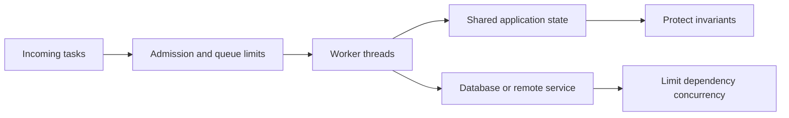
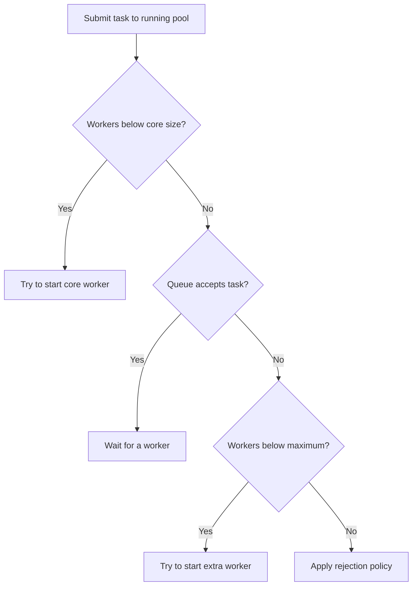
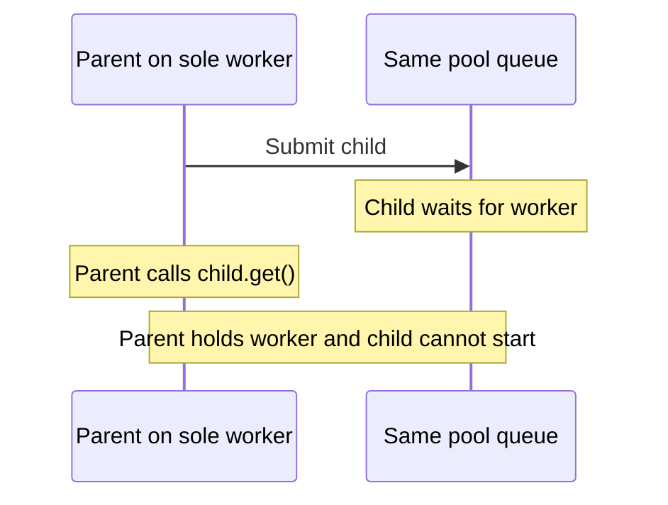

# Concurrency and thread pool design

Concurrency means multiple tasks make progress during overlapping periods. Parallelism means tasks actually execute at the same time. One CPU core can interleave concurrent tasks; multiple cores can run tasks in parallel.

A useful analogy is a service desk: tasks are requests, workers are threads, and the queue is the waiting area. More desks help only while the next dependency can handle more work. Unlike physical desks, threads share process memory, so they can corrupt shared state unless access is coordinated.

## 1. Separate correctness from capacity

A pool controls where and how much work runs. It does not make the work thread-safe.



Read this as three separate design decisions: admit affordable work, protect shared state, and respect dependency capacity. A perfectly bounded pool can still lose updates; perfectly synchronized code can still accumulate an unaffordable backlog.

### A race, one step at a time

Suppose two tasks increment a counter initially equal to 10. An increment consists of reading, calculating, and writing; the whole operation must be atomic to prevent a lost update.

| Step | Task A | Task B | Shared counter |
| --- | --- | --- | --- |
| 1 | Reads 10 | | 10 |
| 2 | | Reads 10 | 10 |
| 3 | Calculates 11, writes 11 | | 11 |
| 4 | | Calculates 11, writes 11 | 11, although 12 was expected |

Serializing the complete read-modify-write operation produces `10 → 11 → 12`. Atomicity protects an operation from interference; visibility makes another thread's updates observable; ordering determines which actions are guaranteed to precede others.

| Technique | Useful for | Limit |
| --- | --- | --- |
| Immutable data or task ownership | Avoiding shared mutable state | Mutable objects referenced inside an immutable container still need care |
| `synchronized` or a lock | Protecting an invariant involving multiple fields | Every access participating in that invariant must follow the same locking protocol |
| `AtomicInteger.incrementAndGet()` | One atomic counter update | Several atomic variables do not make a multi-field update atomic |
| `volatile` | Visibility and ordering for a field, such as a stop flag | `volatile int count; count++` still has the race above |
| Concurrent collections | Supported concurrent operations | A separate check followed by a write is still a compound operation; use the documented atomic operation |

### How the shared-state techniques work

Choose the technique around the invariant: what must another task never observe or change halfway through? Expand a technique for its mechanism and a worked example.

<details>
<summary>How immutable data and ownership work: remove competing writers</summary>

**Immutability:** build a complete value, then share it without changing it. Readers can inspect the same value concurrently because there is no update to interleave. A configuration change can create a new immutable snapshot and publish its reference through a suitable boundary, such as a volatile field. A reader captures that reference once to use one consistent snapshot.

| Step | Configuration reference | Existing reader | New reader |
| --- | --- | --- | --- |
| 1 | Snapshot A | Captures A | — |
| 2 | Writer builds B separately | Continues reading unchanged A | — |
| 3 | Writer publishes B | Finishes using A | Captures B |

A `final` reference prevents reassignment of that field; it does not freeze the referenced object. A final list can still be mutable, and an unmodifiable list can still contain mutable elements. Use immutable contents or defensive copies as appropriate, and do not expose a partially constructed object. See [final-field construction guarantees](https://docs.oracle.com/javase/specs/jls/se25/html/jls-17.html#jls-17.5).

**Ownership:** mutable state belongs to one task or one serial worker. Other tasks send it commands instead of changing the state directly. For example, one owner processes `Add(2)` followed by `Add(3)`, moving a total from `0 → 2 → 5`. No two tasks write that total concurrently.

The boundary matters: passing a mutable list to another task while continuing to modify it breaks exclusive ownership. Transfer ownership, copy the data, or coordinate access. A thread-safe mailbox provides a handoff mechanism, but a shared reference inside a message can still expose mutable state.

</details>

<details>
<summary>How synchronized and explicit locks work: protect a whole invariant</summary>

A lock grants one thread at a time access to a protected critical section. Threads following the same protocol cannot interleave their protected updates. Releasing and subsequently acquiring the same lock also provides the visibility boundary needed by the next owner.

Suppose two accounts contain 100 and 50, and a transfer moves 10 between them. The invariant is that their combined balance stays 150.

| Step | Transfer task holding the lock | Reader using the same lock |
| --- | --- | --- |
| 1 | Reads balances 100 and 50 | Waits for lock |
| 2 | Changes first balance to 90 | Still waits; cannot observe halfway state |
| 3 | Changes second balance to 60, releases lock | Acquires lock and sees 90 + 60 = 150 |

Both fields, the validation, and a reader's combined snapshot must use the same lock. Locking only the writer leaves readers outside the protocol. A lock provides no rollback: validate before mutation and design exception handling so failed operations preserve the invariant.

Illustrative Java fragments; not executed. Assume these statements are inside methods and every balance access follows the stated protocol.

```java
// synchronized releases the monitor when the block exits, including by exception.
synchronized (balanceLock) {
    if (fromBalance < amount) {
        throw new IllegalStateException("Insufficient funds");
    }
    fromBalance -= amount;
    toBalance += amount;
}

// An explicit lock requires explicit release.
lock.lock();
try {
    // Read or change the invariant protected by this lock.
} finally {
    lock.unlock();
}
```

`ReentrantLock` offers features such as timed acquisition and interruptible acquisition. These are useful when a caller has a wait budget. They do not prevent deadlock automatically. Keep lock ordering consistent and avoid slow I/O inside critical sections. See [ReentrantLock](https://docs.oracle.com/en/java/javase/25/docs/api/java.base/java/util/concurrent/locks/ReentrantLock.html).

</details>

<details>
<summary>How atomic variables work: commit one conditional update without a user-held lock</summary>

An atomic counter exposes operations that behave as one indivisible update to that counter. Two concurrent `incrementAndGet()` calls change `10 → 11 → 12`; neither can overwrite the other's increment with a stale calculation.

Compare-and-set (CAS) is a useful mechanism to understand: replace a value only if it still equals an expected value. A custom retry loop rereads and recomputes after failure.

| Step | Task A | Task B | Atomic value |
| --- | --- | --- | --- |
| 1 | Reads 10; computes 11 | Reads 10; computes 11 | 10 |
| 2 | CAS expected 10, update 11 succeeds | | 11 |
| 3 | | CAS expected 10, update 11 fails | 11 |
| 4 | | Rereads 11; CAS expected 11, update 12 succeeds | 12 |

This is a conceptual CAS trace; an increment's actual machine implementation need not literally run this loop. Atomic classes provide documented memory-ordering guarantees as well as indivisible operations.

Illustrative Java fragments; not executed:

```java
AtomicInteger remaining = new AtomicInteger(1);

// Broken compound decision: two threads can both read 1 before decrementing.
if (remaining.get() > 0) {
    remaining.decrementAndGet();
}

// Alternative to the block above: exactly one caller can claim this one slot.
boolean claimed = remaining.compareAndSet(1, 0);
```

Atomic methods do not automatically combine: `get()` followed by `set()` is still two operations. Two atomic account balances do not make a transfer atomic. Protect a multi-field invariant with a lock, or represent it as one immutable value updated through an atomic reference with a carefully designed protocol.

Update functions may be reevaluated under contention. Keep retryable calculations free of external side effects: charging a card inside a retry function can charge it more than once. Contention can also cause repeated retries, so atomic does not mean every caller has a bounded completion time. See [AtomicInteger](https://docs.oracle.com/en/java/javase/25/docs/api/java.base/java/util/concurrent/atomic/AtomicInteger.html).

</details>

<details>
<summary>How volatile works: publish an update without mutual exclusion</summary>

A volatile write and a subsequent read of that field establish a happens-before relationship. Earlier writer actions become visible through that publication boundary. No lock is acquired, so two writers can still execute compound operations concurrently.

A one-shot handoff makes the distinction concrete. Initially `payload = 0` and volatile `ready = false`. One writer publishes once; no thread changes the payload after publication.

| Step | Writer | Reader |
| --- | --- | --- |
| 1 | Writes ordinary `payload = 42` | Has not observed publication yet |
| 2 | Writes volatile `ready = true` | |
| 3 | | Reads `ready` as true |
| 4 | | Reads `payload`; the publication guarantees 42 |

Illustrative Java fragments; not executed. These fields and methods belong to the same shared object:

```java
private int payload;
private volatile boolean ready;

void publish() { // Called once by the writer.
    payload = 42;
    ready = true;
}

int readIfReady() {
    return ready ? payload : -1;
}
```

Without a suitable synchronization boundary, observing a flag does not establish that earlier ordinary writes are visible. The guarantee is a memory-model relationship, not a promise that a thread will be scheduled immediately or that a reader will wait for publication.

The earlier lost-update example still applies to `volatile count++`: A reads 10, B reads 10, A writes 11, B writes 11. Volatile makes the individual reads and writes visible and ordered according to its contract; it does not merge the increment's steps. It also does not make an object referenced by a volatile field thread-safe.

Use volatile for simple independent flags or publishing immutable snapshots. Repeated handoffs involving a mutable payload need a stronger protocol: flipping a boolean back and forth does not prevent a writer changing data while a reader uses it. See the [happens-before rules](https://docs.oracle.com/javase/specs/jls/se25/html/jls-17.html#jls-17.4.5).

</details>

<details>
<summary>How concurrent collections work: coordinate documented collection operations</summary>

A concurrent collection coordinates its supported operations internally, using techniques such as atomic updates and locking where needed. Callers rely on its operation-level contract, rather than treating the whole collection as one transaction.

Consider storing one mapping for a missing key:

| Step | Task A | Task B | Map entry |
| --- | --- | --- | --- |
| 1 | `containsKey(key)` returns false | | Missing |
| 2 | | `containsKey(key)` returns false | Missing |
| 3 | Builds and puts A's value | | A's value |
| 4 | | Builds and puts B's value | B's value |

The map remains structurally valid, but the application performed duplicate creation and overwrote a value. `putIfAbsent` makes conditional insertion atomic, although constructing a value before calling it can still duplicate construction work. `ConcurrentHashMap.computeIfAbsent` combines the missing-key decision and computation within its documented atomic operation.

Illustrative Java fragment; not executed:

```java
ConcurrentHashMap<String, String> labels = new ConcurrentHashMap<>();
String label = labels.computeIfAbsent("order-42", key -> "Label for " + key);
```

Keep the mapping computation short and simple: updates can block while it runs. Avoid slow network calls or recursive map updates inside it. A computation returning null, throwing, or a mapping later being removed can lead to future computation again; this is not a durable exactly-once side-effect mechanism.

The collection does not protect arbitrary mutable contents. Putting an ordinary `ArrayList` inside a concurrent map does not make concurrent `add()` calls on that list safe. Choose immutable values, independently thread-safe values, or a documented locking protocol. Updating two keys together also needs an explicit invariant strategy. See [ConcurrentHashMap](https://docs.oracle.com/en/java/javase/25/docs/api/java.base/java/util/concurrent/ConcurrentHashMap.html).

</details>

Submission safely publishes prior actions to an executor task, and successful result retrieval through `Future.get()` provides a corresponding completion boundary. These guarantees do not protect later unsynchronized mutations. See the [Java concurrency memory consistency guarantees](https://docs.oracle.com/en/java/javase/25/docs/api/java.base/java/util/concurrent/package-summary.html#MemoryVisibility).

For invariants shared across processes, a Java lock is insufficient. Use appropriate [database concurrency controls](database-transactions-and-spring-transactional.md#5-choose-a-concurrency-tool).

## 2. Understand how a Java pool admits work

For a running `ThreadPoolExecutor`, the ordinary admission order is **core workers → queue → extra workers → rejection**. Shutdown can cause rejection independently of capacity. Worker creation is normally lazy.



This diagram assumes worker creation succeeds and omits shutdown races. Crucially, `maximumPoolSize` is not a target the executor reaches before queuing. See the [executor admission implementation](https://github.com/openjdk/jdk/blob/master/src/java.base/share/classes/java/util/concurrent/ThreadPoolExecutor.java).

### Worked burst: core 2, maximum 4, queue capacity 2

Assume every task stays blocked while all seven submissions occur, with no completions or shutdown.

| Submission | Outcome | Running | Queued |
| --- | --- | --- | --- |
| T1 | Starts a core worker | T1 | — |
| T2 | Starts a core worker | T1, T2 | — |
| T3 | Enqueued | T1, T2 | T3 |
| T4 | Enqueued | T1, T2 | T3, T4 |
| T5 | Queue full: starts extra worker | T1, T2, T5 | T3, T4 |
| T6 | Queue full: starts extra worker | T1, T2, T5, T6 | T3, T4 |
| T7 | Queue and pool full: rejected | Unchanged | Unchanged |

T5 can start before T3. Even a FIFO waiting queue does not guarantee global submission-order execution.

| Configuration | Behavior and risk |
| --- | --- |
| Fixed workers with an unbounded queue | Bounds workers while backlog, retained memory, and waiting time can grow |
| Bounded queue with finite maximum workers | Bounds queued task count and workers; requires explicit overload handling |
| `SynchronousQueue` | No stored backlog: hand off directly, grow if permitted, or reject |
| Cached pool | Can grow platform threads aggressively; resource exhaustion is possible |

With an unbounded queue, normal admission does not grow beyond the core size. `Executors.newFixedThreadPool(n)` uses an unbounded queue. Consult [executor factory definitions](https://github.com/openjdk/jdk/blob/master/src/java.base/share/classes/java/util/concurrent/Executors.java) before assuming a factory bounds all resources.

## 3. Size for work and dependencies

Start with the bottleneck, then measure under realistic load. There is no universal thread count.

| Workload | Starting approach | What to measure |
| --- | --- | --- |
| CPU-heavy independent tasks | Platform worker count near available CPU capacity | Throughput, CPU saturation, throttling, context switching |
| Blocking I/O on platform threads | Enough workers to overlap waits, within resource limits | Blocking time, connection waits, memory, dependency capacity |
| Many blocking I/O tasks on Java 21+ | Consider one virtual thread per task plus explicit resource limits | In-flight tasks, memory, dependency concurrency, deadlines |
| Mixed short and long tasks | Consider separate bounded pools by workload or dependency | Queue age and latency per class; total resource usage |

For a simplified steady workload, required in-service concurrency is approximately:

`arrival rate × average service time`

At 100 tasks/second and 0.2 seconds per task, the average in-service concurrency is 20. Twenty fully occupied workers provide no spare capacity for variability. If the task instead takes 0.5 seconds under contention, the same pool sustains only about 40 tasks/second; backlog grows by about 60 tasks/second at the original arrival rate. This arithmetic assumes homogeneous work and stable service times; benchmark to find the actual sustainable rate.

A rough platform-thread heuristic is `CPU capacity × target utilization × (1 + wait time / compute time)`. It assumes waits can overlap and compute scales. It is a starting estimate, not permission to exceed a database connection budget or remote service limit.

### A queue is a latency and memory budget

With four workers and deterministic 100 ms tasks, one full wave completes about every 100 ms. A task behind 20 queued tasks waits about 500–600 ms before starting, depending on the current workers' remaining time, then needs its own service time. A 200 ms deadline cannot be rescued by accepting it into this queue.

Bound both task count and retained payload size. A queue of 1,000 tiny IDs differs greatly from 1,000 captured request bodies. When downstream capacity is scarce, enforce a concurrency limit near that dependency. A rate limit controls starts per interval; a concurrency limit controls simultaneous work. Often both are needed.

## 4. Make overload visible

A bounded executor's normal submission path does not wait for queue space. A full queue triggers growth or rejection according to the rules above.

| Policy | Effect | Design consequence |
| --- | --- | --- |
| `AbortPolicy` | Throws `RejectedExecutionException` | Caller must translate overload into a visible result |
| `CallerRunsPolicy` | Runs the task on the submitting thread unless shut down | Can slow producers, but can block request threads, event loops, or lock holders; shutdown discards the task |
| `DiscardPolicy` | Silently drops the task | Unsafe when completion matters |
| `DiscardOldestPolicy` | Drops a queued task and retries admission | Can lose earlier accepted work; avoid assuming queue order always means oldest |

Silent discard with `submit()` can leave the returned future incomplete because its wrapper never executes or gets cancelled. Backpressure requires the upstream producer to actually slow down or stop admitting work; merely bounding a queue does not ensure that.

Possible boundary responses include explicit overload errors, bounded admission waits within a deadline, or durable handoff where persistence and acknowledgement are designed together. Retries need a budget, backoff, jitter, and safe repetition; see [reliable asynchronous operations](../software-design/reliable-asynchronous-operations.md).

## 5. Schedule tasks by priority

Task priority answers **which waiting task gets the next available worker**. It does not normally interrupt a task already running. A high-priority request can still miss its deadline when every worker is occupied by long tasks.

### Follow one urgent task through the queue

Assume one worker, non-preemptive execution, and no further arrivals. B and C are background tasks; U is urgent. All three are waiting before A finishes.

| Snapshot | Running | FIFO: next to run → last | Strict priority: next to run → last |
| --- | --- | --- | --- |
| 1. A is busy; B and C arrive | A | B, C | B, C |
| 2. U arrives | A continues | B, C, U | U, B, C |
| 3. A finishes | Next task starts | B starts; C, U wait | U starts; B, C wait |

Priority removes U's wait behind B and C, but cannot remove A's remaining execution time. With multiple workers, dequeue order also does not guarantee start or completion order because workers progress independently.

### Choose a scheduling policy

| Policy | Example | Tradeoff |
| --- | --- | --- |
| FIFO | Process accepted work in queue order | Simple, but urgent work waits behind background work |
| Strict priority | Always take urgent before background | Background tasks can starve under continuous urgent traffic |
| Weighted service | When both queues have work, dispatch up to 3 urgent tasks, then 1 background task | Gives background work a share of dispatches; task counts are not CPU-time shares |
| Aging | Promote a background task after it waits beyond a threshold | Requires explicit promotion or reordering logic |
| Earliest deadline first | Choose the waiting task with the nearest deadline | Needs meaningful deadlines, expiry handling, and admission control; no automatic deadline guarantee |
| Reserved capacity | Give urgent work dedicated workers or dependency permits | Protects access to reserved resources but may leave capacity idle without a borrowing policy |

The following examples assume non-preemptive tasks: selecting a task gives it a worker until it finishes or yields through an explicitly designed mechanism. Queue orders show the next task on the left.

<details>
<summary>How FIFO works: serve the head of one queue</summary>

Append each accepted task to the tail. Whenever a worker becomes available, remove the head. Priority labels do not affect selection.

| Event | Waiting queue | Selection |
| --- | --- | --- |
| Background B1 and B2 arrive | B1 → B2 | Worker is still busy |
| Urgent U1 arrives | B1 → B2 → U1 | U1 joins the tail |
| Worker becomes free | B2 → U1 | B1 starts |

FIFO gives earlier queued work precedence over later arrivals. A long task at the front can delay urgent tasks behind it, and a bounded waiting position still does not bound waiting time unless execution times and resource waits are bounded. Multiple workers preserve dequeue order at the queue boundary, not completion order.

</details>

<details>
<summary>How strict priority works: always choose the highest nonempty class</summary>

Maintain a FIFO queue for each class, such as urgent and background. At every dispatch, inspect urgent first; take background work only when urgent is empty. A single ordered queue can express the same selection rule using a priority key and a tie-breaker.

| Dispatch | Urgent queue before selection | Background queue before selection | Selected |
| --- | --- | --- | --- |
| 1 | U1 → U2 | B1 | U1 |
| 2 | U2 → U3, after U3 arrives | B1 | U2 |
| 3 | U3 → U4, after U4 arrives | B1 | U3 |

If urgent work is available at every dispatch, B1 never runs. Use strict priority when this preference is intentional and lower-priority progress is handled separately, or when urgent traffic is constrained enough to leave capacity. It does not displace background work already running.

</details>

<details>
<summary>How weighted service works: alternate classes using a dispatch budget</summary>

One simple weighted round-robin scheduler maintains a shared cycle: three urgent selections followed by one background selection. Each class is FIFO internally. When both remain nonempty, the dispatch pattern is:

| Cycle | Selection 1 | Selection 2 | Selection 3 | Selection 4 |
| --- | --- | --- | --- | --- |
| 1 | U1 | U2 | U3 | B1 |
| 2 | U4 | U5 | U6 | B2 |

If a class is empty, a work-conserving scheduler skips it and serves available work. The implementation must define how credits reset when the class becomes active again. With multiple workers, coordinate selection and credit updates so each worker does not independently spend the same budget.

This reserves one in four dispatches for background work while both classes are backlogged. It does not reserve one quarter of elapsed time: three urgent tasks taking 10 ms each and one background task taking 300 ms consume 30 ms versus 300 ms on one worker. When task costs vary greatly, use cost-aware accounting or separate resource budgets rather than interpreting dispatch weights as time shares.

</details>

<details>
<summary>How aging works: increase preference as a task waits</summary>

Record enqueue time, then explicitly promote old tasks or select using an age-aware policy. For example, use three classes and promote waiting work one class every two seconds: background → normal → urgent. Within each class, order by original enqueue sequence so newly arriving urgent work does not repeatedly jump ahead of an already promoted task.

| Time waiting | B1's class | Effect at the next dispatch |
| --- | --- | --- |
| 0 seconds | Background | Normal and urgent work have precedence |
| 2 seconds | Normal | New background arrivals no longer precede B1 |
| 4 seconds | Urgent | Later urgent arrivals follow B1 under the stated tie-break rule |

A scheduler must actually apply promotions before selection, for example by moving due tasks between class queues under coordinated access. Merely updating a field inside a heap entry does not restore heap order. Promotion must retain cancellation, capacity accounting, and task identity.

Aging can prevent endless overtaking under this policy, assuming finitely many tasks are ahead and running tasks eventually finish. It cannot promise a fixed completion deadline under unlimited overload. Cap admission and monitor waiting age even when aging is enabled.

</details>

<details>
<summary>How earliest deadline first works: choose the closest absolute deadline</summary>

Attach an absolute deadline to each task and select the waiting task with the smallest deadline. Use a consistent clock basis; for local elapsed-time budgets, use a monotonic time source. Break equal deadlines with a defined secondary key.

At time 100 ms, suppose one worker becomes available:

| Task | Deadline | Estimated execution time | Initial selection rank |
| --- | --- | --- | --- |
| A | 180 ms | 100 ms | 1 |
| B | 220 ms | 20 ms | 2 |

Blind selection runs A first, finishing at 200 ms and missing A's deadline; B then finishes at 220 ms. If policy permits rejecting A as infeasible based on a trustworthy estimate, B can instead finish at 120 ms. This illustrates why ordering and admission are separate decisions. Execution estimates are uncertain, so a scheduler needs explicit rules for already expired work, likely deadline misses, and completion reporting.

A near deadline does not imply short execution time. Non-preemptive earliest deadline first cannot interrupt a long task, and guarantees from idealized real-time scheduling models do not automatically apply to a general Java executor with blocking I/O.

</details>

<details>
<summary>How reserved capacity works: keep resources available for a class</summary>

Split a total worker budget of four into one urgent-only worker and three background-only workers, each with a bounded queue. Even when all three background workers are busy, urgent work can start on its reserved worker if that worker is available.

| Situation | Urgent worker | Three background workers | Consequence |
| --- | --- | --- | --- |
| No urgent traffic | Idle | Busy | Reserved capacity is unused |
| U1 arrives | Runs U1 | Continue background work | U1 avoids waiting for a background worker |
| U2 arrives while U1 runs | Busy with U1 | Continue background work | U2 still waits in the urgent queue |

Allowing background work to borrow the urgent worker improves utilization, but a long borrowed task delays the next urgent arrival. In a non-preemptive design, reclaim capacity only after that task finishes, or restrict borrowing to short cooperative work with an explicit contract. Worker reservation alone does not reserve CPU execution time.

Protect the whole required path: an urgent worker may still block if background tasks hold every database connection. Dependency permits can also be reserved, within the dependency's total safe capacity. Monitor utilization and queue age per class to tune the reservation.

</details>

For interactive requests mixed with batch jobs, separate bounded queues and a small number of service classes are often easier to reason about than arbitrary numeric priorities. Reserve capacity when urgent work must not wait for every batch worker to finish. Budget shared CPU, database connections, and remote concurrency across all classes; separate executors still contend for those resources.

### Java priority queue integration traps

`ThreadPoolExecutor` can use a `PriorityBlockingQueue<Runnable>` ordered by a comparator or comparable task wrappers. Define a convention such as smaller numbers mean more urgent. Equal-priority tasks need an explicit sequence-number tie-breaker if stable ordering matters. The constructor's initial capacity is **not a bound**. See the [priority queue contract](https://docs.oracle.com/en/java/javase/25/docs/api/java.base/java/util/concurrent/PriorityBlockingQueue.html).

| Trap | What happens | Design response |
| --- | --- | --- |
| Assuming every task passes through the queue | New workers can receive a submitted task directly | Queue priority applies only to queued work; inspect worker creation and admission paths |
| Making the original `Runnable` comparable, then using ordinary `submit()` | `submit()` normally wraps it in a `FutureTask`, losing the original comparison interface | Use a priority-aware future wrapper and submission API, or a compatible comparator; cover every allowed submission path |
| Using an unbounded priority queue | Backlog can grow; normal admission does not expand past core workers | Add explicit bounded admission or use a scheduler with bounded class queues |
| Letting background work consume every admission slot | An urgent task cannot enter even if it would rank first in the queue | Reserve admission capacity per class or implement explicit eviction and completion rules |
| Applying `DiscardOldestPolicy` to a priority queue | It removes the queue head, which can be the most urgent task | Use an overload policy designed for priority and report rejection or eviction |
| Mutating a queued task's priority or using a changing comparator | The heap does not automatically rebuild its order | Implement coordinated remove/reinsert, periodic promotion, or class-queue scheduling |

The wrapping behavior comes from [AbstractExecutorService](https://github.com/openjdk/jdk/blob/master/src/java.base/share/classes/java/util/concurrent/AbstractExecutorService.java); worker creation and head removal follow the [ThreadPoolExecutor implementation](https://github.com/openjdk/jdk/blob/master/src/java.base/share/classes/java/util/concurrent/ThreadPoolExecutor.java). A priority queue alone is not a complete scheduler: admission, fairness, cancellation, and failure reporting still need ownership.

### Starvation and priority inversion

**Starvation:** U1, U2, U3, … keep arriving, so waiting background task B is never selected. Weighted service, aging, or reserved capacity can provide progress, provided the system has capacity and tasks eventually finish. Track oldest waiting age and rejections by priority class; aggregate latency can hide one class starving.

**Priority inversion:** urgent U needs a lock or connection held by background B. Selecting U first does not help until B releases the resource. Keep critical sections and connection ownership short, avoid waiting on other work while holding them, and reserve dependency capacity where justified. Cancellation cannot safely steal an arbitrary lock or undo B's external side effects.

Changing a worker's `Thread.setPriority()` does not implement business task ordering. It affects platform-thread scheduling rather than choosing which queued request runs next; virtual threads have fixed priority. Use an explicit task scheduling policy and measure its latency under overload. See the [thread priority API](https://docs.oracle.com/en/java/javase/25/docs/api/java.base/java/lang/Thread.html#setPriority(int)).

## 6. Recognize common failure patterns

### Starvation deadlock inside one pool



With one worker, the parent cannot finish until the child runs, and the child cannot run until the parent releases the worker. With N workers, N waiting parents can cause the same failure. Increasing N postpones the problem.

Prefer composing completion stages without blocking the worker, executing small child work directly, or designing separate capacity with a dependency graph that cannot cycle. Separate pools alone do not prove freedom from deadlock. A timeout can break a wait but does not fix the dependency design or automatically cancel the child.

### Other symptoms and causes

| Symptom | Likely mechanism | Useful response |
| --- | --- | --- |
| CPU low, latency high | Workers blocked on I/O, locks, connections, or child tasks | Inspect thread dumps, dependency latency, and connection waits |
| CPU high, throughput flat | CPU saturation or excessive scheduling | Reduce contention and concurrency; profile hot paths |
| Heap rises during bursts | Backlog retains task inputs | Bound admission and payloads; reject expired work |
| Short tasks wait behind slow tasks | Head-of-line blocking | Isolate workloads where justified; allocate total capacity deliberately |
| Requests finish but remote work continues | Caller timed out without stopping work | Propagate deadlines, cancel cooperatively, set I/O timeouts |
| Background task fails silently | Exception stored in an ignored future | Observe completion and record failures |
| One request sees another request's context | Reused thread retains `ThreadLocal` state | Install and clear context in `finally`; propagate only intended data |
| Two threads never progress | Each holds a lock needed by the other | Consistent lock ordering; avoid blocking I/O while holding locks |

## 7. Own task completion and shutdown

Track the lifecycle from admission through queueing, execution, completion or failure, cancellation, and cleanup. Acceptance into an in-memory executor does not survive process failure.

- **Failures:** standard `submit()` wraps the task in a future; retrieve or otherwise observe its failure. `FutureTask` captures exceptions, so a worker's uncaught exception handler alone is insufficient.
- **Deadlines:** `Future.get(timeout, unit)` limits the caller's wait; it does not automatically cancel execution. Include queue wait in the request budget, check expiry before starting expensive work, and pass remaining time downstream.
- **Cancellation:** `cancel(true)` requests interruption where supported; it cannot guarantee work stops or undo external side effects. Tasks must cooperate and release resources. Restore interrupt status when catching interruption without propagating it.
- **Shutdown:** stop admission, call `shutdown()`, wait within a shutdown budget, then consider `shutdownNow()`. The latter attempts interruption and returns tasks that never started; decide how their callers and futures will be completed or cancelled. It does not forcibly terminate arbitrary code.

These behaviors follow the [executor lifecycle contract](https://docs.oracle.com/en/java/javase/25/docs/api/java.base/java/util/concurrent/ExecutorService.html) and [FutureTask implementation](https://github.com/openjdk/jdk/blob/master/src/java.base/share/classes/java/util/concurrent/FutureTask.java).

### A deterministic admission example

The latch prevents completion during submission, making the burst above reproducible. This demonstrates admission rules, rather than benchmarking performance.

<details>
<summary>Show Java example: four running, two queued, one rejected</summary>

Illustrative standalone example using standard Java concurrency APIs. Compiled and executed locally; output matched the expected result below.

```java
import java.util.concurrent.*;

public class PoolAdmissionDemo {
    public static void main(String[] args) throws InterruptedException {
        CountDownLatch release = new CountDownLatch(1);
        ThreadPoolExecutor pool = new ThreadPoolExecutor(
            2, 4, 30, TimeUnit.SECONDS,
            new ArrayBlockingQueue<>(2),
            new ThreadPoolExecutor.AbortPolicy());
        int rejected = 0;
        try {
            for (int i = 0; i < 7; i++) {
                try {
                    pool.execute(() -> {
                        try {
                            release.await();
                        } catch (InterruptedException e) {
                            Thread.currentThread().interrupt();
                        }
                    });
                } catch (RejectedExecutionException e) {
                    rejected++;
                }
            }
            System.out.printf("workers=%d queued=%d rejected=%d%n",
                pool.getPoolSize(), pool.getQueue().size(), rejected);
        } finally {
            release.countDown();
            pool.shutdown();
            if (!pool.awaitTermination(5, TimeUnit.SECONDS)) {
                pool.shutdownNow();
            }
        }
    }
}
```

Expected output: `workers=4 queued=2 rejected=1`. The executor's worker count is not a guarantee that all four threads are simultaneously using CPU.

</details>

## 8. Virtual threads change thread cost, not dependency capacity

Virtual threads became final in Java 21. They make large numbers of blocking tasks practical without allocating one operating-system thread per task. They do not accelerate CPU calculations, make shared state safe, or create database connections.

Use a virtual thread per task rather than pooling virtual threads. Limit access to scarce resources explicitly, for example with a semaphore. A semaphore bounds permit holders, but waiting tasks can still consume memory: bound total admitted work and waiting time too. See the [virtual-thread executor API](https://docs.oracle.com/en/java/javase/25/docs/api/java.base/java/util/concurrent/Executors.html#newVirtualThreadPerTaskExecutor()) and [virtual thread guidance](https://docs.oracle.com/en/java/javase/25/core/virtual-threads.html).

## 9. Verify the design in operation

Record queue depth **and oldest-task age**, active workers, completions/second, rejections, failures, cancellations, queue wait, execution time, and end-to-end latency. Include dependency latency and connection/semaphore waits. A small queue can still contain one very old task.

Exercise normal traffic, bursts, sustained overload, slow dependencies, failed tasks, and shutdown. Check that memory stabilizes, overload becomes visible, deadlines are honored, and the system recovers when dependencies recover. Connect pool measurements to [request lifecycle telemetry](../production/production-request-lifecycle.md).

## Check your understanding

1. A pool has core size 4, maximum size 100, and an unbounded queue. Why are tasks waiting while only four workers exist?

   <details>
   <summary>Show answer</summary>

   Once four workers exist, admission prefers the queue. Because the queue keeps accepting tasks, the condition for growing toward 100 is never reached during normal operation. Raising the maximum alone does not fix this; revisit core capacity, queue bounds, and downstream limits.

   </details>

2. All eight workers wait on a database pool with two connections. Should you add more workers?

   <details>
   <summary>Show answer</summary>

   First inspect connection holding time, database capacity, and other users of those connections. Extra workers may only add waiters. Shorten connection ownership where appropriate and align admission with the dependency budget. Other independent task phases may benefit from concurrency, so measure the actual critical path before choosing a count.

   </details>

3. A caller times out after 200 ms. Has its queued or running task stopped?

   <details>
   <summary>Show answer</summary>

   No. A waiting timeout only ends that wait. Request cancellation where appropriate, propagate an absolute deadline or remaining budget, and use I/O timeouts. Cancellation is cooperative; an external side effect may already have occurred, so retries still need idempotency or reconciliation.

   </details>

4. All workers are running background tasks when an urgent task arrives. Will a priority queue make it start immediately?

   <details>
   <summary>Show answer</summary>

   No. Queue priority selects the next waiting task when a worker becomes available; it does not preempt running work. Shorter task units or reserved worker capacity can reduce that wait. If the urgent task then needs a connection held by background work, dependency capacity must also be addressed.

   </details>
