# Database transactions and Spring @Transactional

**A transaction accepts related database changes together, or discards them together.** Start with the database concepts below; Spring appears in section 7.

SQL behavior is illustrated with PostgreSQL. Diagrams are original explanations; linked official documentation provides further detail.

## 1. One operation, several changes

Alice transfers RM100 to Bob. The rule (**invariant**) is that their combined RM700 stays RM700.

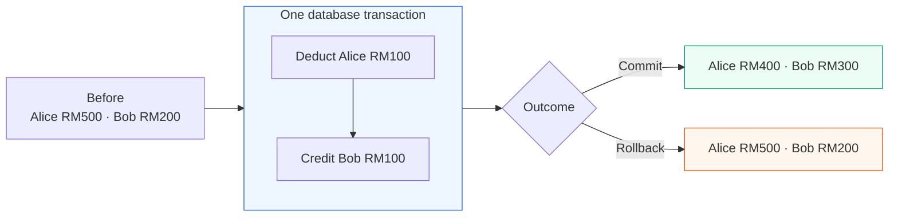

Without a shared transaction, a crash after the deduction can leave Alice RM400 and Bob RM200.

| ACID property | What it contributes |
|---|---|
| **Atomicity** | Both transactional changes commit, or neither does |
| **Consistency** | Constraints and correct logic preserve the rule |
| **Isolation** | Defines how overlapping operations interact |
| **Durability** | Accepted changes survive failures under the configured guarantees |

**Choose the boundary around the complete rule.** Two independent connections are not automatically one transaction. Database rollback cannot reverse a completed external charge.

## 2. Commit, rollback, and savepoints

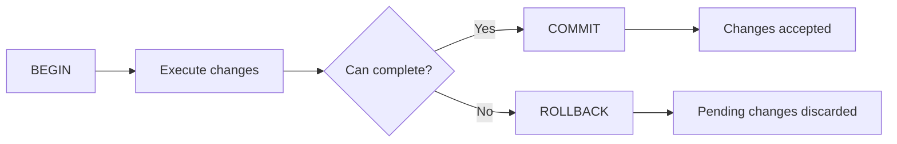

```sql
BEGIN;
UPDATE account SET balance = balance - 100.00 WHERE id = 1;
UPDATE account SET balance = balance + 100.00 WHERE id = 2;
COMMIT; -- Choose ROLLBACK instead if the operation cannot complete.
```

This sketch groups writes; real transfer logic must also validate accounts, funds, concurrency, and duplicate requests. **Statement success is not transaction commit.** With autocommit, individual statements can commit separately.

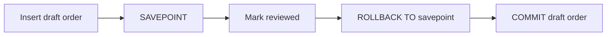

A savepoint discards later work while retaining earlier pending work. It is not an independent commit. After commit, reversing an operation requires another operation. [Database transaction tutorial](https://www.postgresql.org/docs/current/tutorial-transactions.html)

## 3. What happens inside the database

### Snapshots: which version can I read?

**MVCC** keeps row versions so a reader can see an appropriate snapshot while a writer changes data.

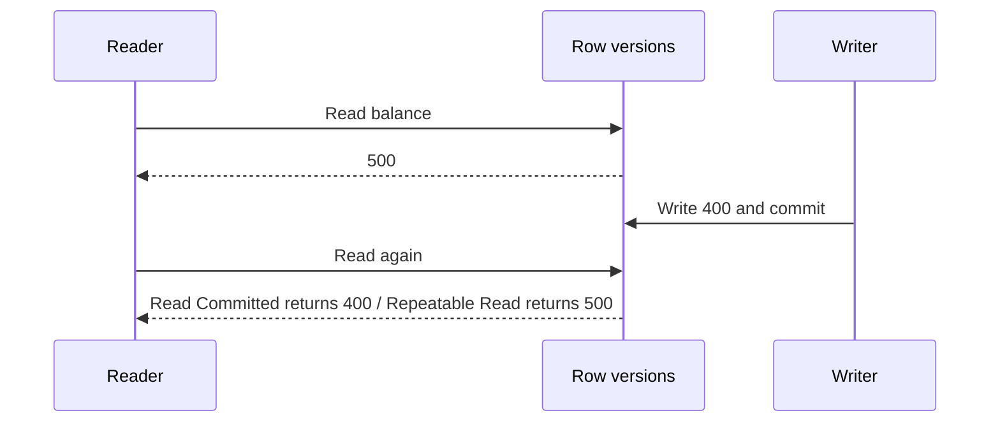

This PostgreSQL example assumes the reader stays in one transaction and makes no writes. Writers still contend; long snapshots can delay cleanup. [MVCC](https://www.postgresql.org/docs/current/mvcc-intro.html)

### Logging: how does committed data survive?

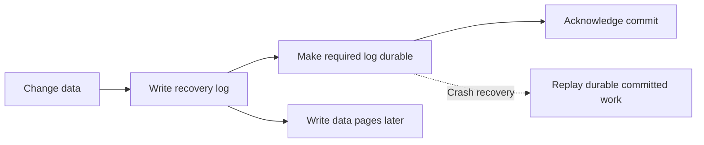

**Write-ahead logging (WAL)** allows recovery without forcing every changed data page to disk at commit. The diagram assumes normal durable commit settings; asynchronous settings weaken crash guarantees. Replication durability is a separate choice. [WAL](https://www.postgresql.org/docs/current/wal-intro.html)

## 4. Concurrency: a transaction can still make a wrong decision

### Two buyers, one item

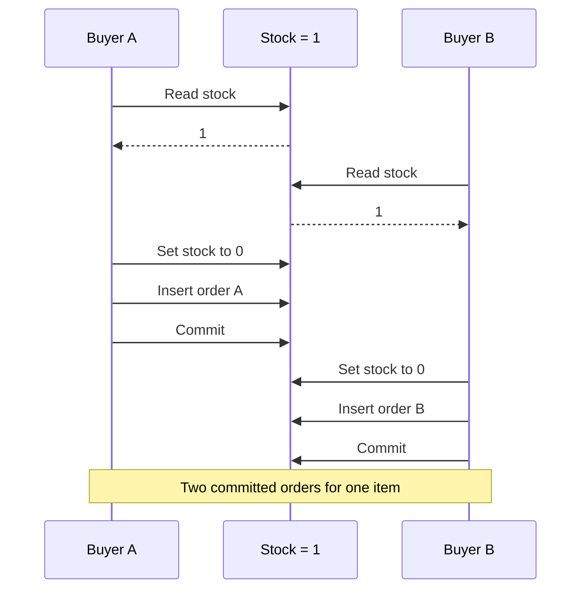

Both transactions were atomic. Their read-check-write decisions were unprotected.

**Fix for this single-row rule:** express the check and deduction in one conditional update.

```sql
UPDATE inventory
SET available = available - :quantity
WHERE product_id = :id AND available >= :quantity;
```

Validate positive quantity and require exactly one affected row. In PostgreSQL Read Committed, the second competing update waits, then reevaluates its condition; after the first buyer commits, it cannot deduct the last item again.

| Isolation in PostgreSQL | What reads see | Important limit |
|---|---|---|
| Read Committed | A fresh snapshot per statement | Successive reads can differ |
| Repeatable Read | A stable transaction snapshot | Cross-row write skew remains possible |
| Serializable | Committed results match some serial order | Conflicts can abort; retry whole transaction |

PostgreSQL maps Read Uncommitted to Read Committed and prevents phantoms at Repeatable Read. Other databases differ. [Isolation behavior](https://www.postgresql.org/docs/current/transaction-iso.html)

### Write skew: different rows, one shared rule

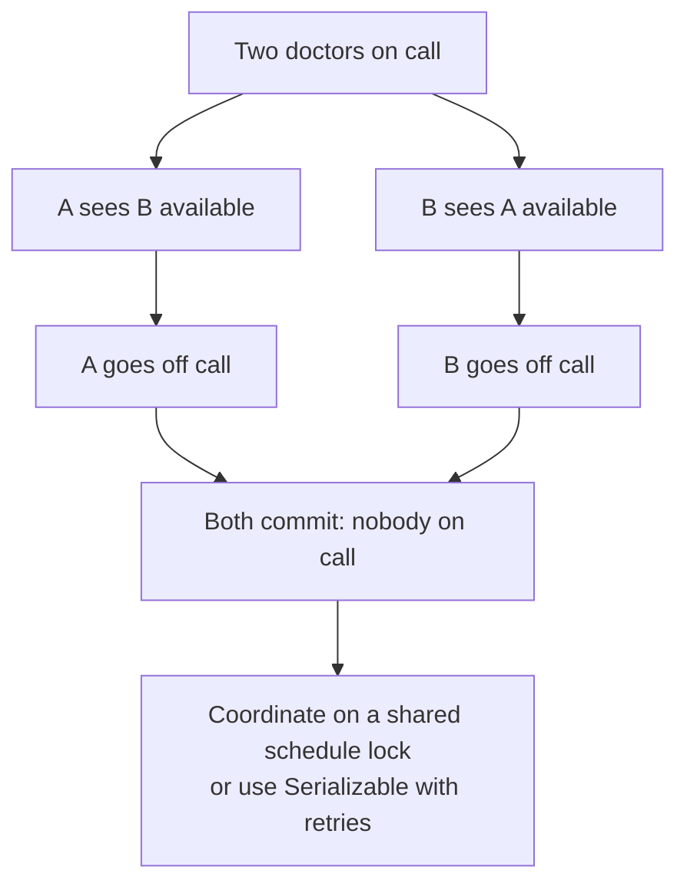

Locking only each doctor's own row does not protect “at least one stays.”

## 5. Choose a concurrency tool

| Tool | Mechanism | Good fit |
|---|---|---|
| Conditional update | Check and change together | Stock and counters |
| Pessimistic lock | Lock before deciding | Coordinated updates to known rows |
| Optimistic version | Reject a write based on stale data | Edits with tolerable conflicts |
| Constraint | Database rejects invalid stored state | Unique request IDs, nonnegative stock |
| Serializable | Detect incompatible concurrent decisions | Rules across rows or predicates |

### Lock before deciding

```sql
BEGIN;
SELECT balance FROM account WHERE id = 1 FOR UPDATE;
SELECT balance FROM account WHERE id = 2 FOR UPDATE;
-- Verify both exist and funds suffice; otherwise ROLLBACK.
UPDATE account SET balance = balance - 100.00 WHERE id = 1;
UPDATE account SET balance = balance + 100.00 WHERE id = 2;
COMMIT;
```

Lock both accounts in ascending ID order, including reverse transfers. Locks last through transaction completion; snapshot readers can still read older versions.

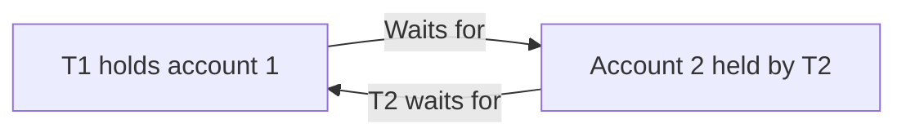

That cycle is a **deadlock**. Consistent lock order reduces it; if the database aborts a participant, retry the complete operation. Keep remote calls outside held locks. [Locking and deadlocks](https://www.postgresql.org/docs/current/explicit-locking.html)

### Check the version before accepting

```sql
UPDATE inventory
SET available = :newValue, version = version + 1
WHERE product_id = :id AND version = :versionRead;
```

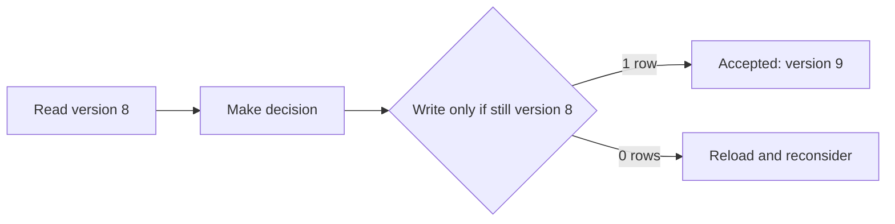

All writers must follow the version protocol. Updating the expected version without reconsidering the decision is unsafe. Per-row versions do not automatically protect cross-row rules.

## 6. Failures, retries, and external systems

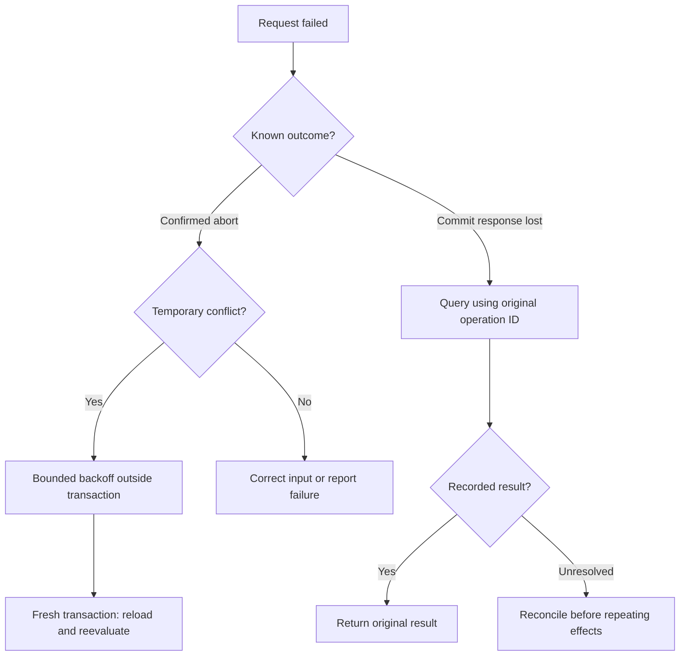

A timeout does not prove rollback. Use a stable request ID plus a unique constraint; replay the stored result only when the payload matches. PostgreSQL `40001` identifies serialization failure and `40P01` deadlock. Retry known aborts, not arbitrary connection failures. [Error codes](https://www.postgresql.org/docs/current/errcodes-appendix.html)

### Commit the intent; deliver later

Sending before commit can announce rolled-back data. Sending after commit can be skipped by a crash. An **outbox** makes outgoing work durable alongside the business change:

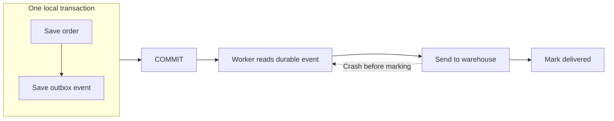

Delivery can repeat: receivers need duplicate-safe effects. Workers need claiming and crash recovery. A refund compensates for a completed charge; it does not erase it. For detailed payment scenarios, see [workflow recovery](../software-design/state-machines-and-business-workflows.md).

## 7. Spring applies these database concepts

**`@Transactional` declares a boundary.** Spring coordinates it; the database enforces the underlying guarantees.

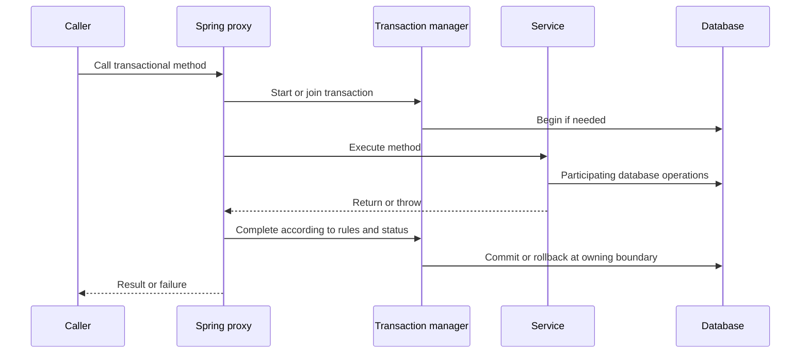

The target method returning is earlier than commit completion. Joined methods do not each commit independently. Imperative transactions are thread-bound; reactive transactions use Reactor context. [Spring implementation](https://docs.spring.io/spring-framework/reference/data-access/transaction/declarative/tx-decl-explained.html)

| Resource | Typical manager |
|---|---|
| JDBC DataSource | `JdbcTransactionManager` |
| JPA EntityManagerFactory | `JpaTransactionManager` |
| Compatible enlisted XA resources | `JtaTransactionManager` |
| R2DBC | Reactive transaction manager |

For local JDBC, the manager binds a connection to the transaction; participating `JdbcTemplate` calls reuse it. At completion it commits/rolls back, restores state, and releases the resource. Opening an unrelated connection can escape the boundary. [Resource synchronization](https://docs.spring.io/spring-framework/reference/data-access/transaction/tx-resource-synchronization.html)

### The proxy must intercept the call

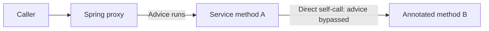

Use injected Spring beans and public boundary methods. `new Service()` and self-invocation bypass advice; class-based proxies cannot override final methods. A self-called method can still use an existing transaction, but its annotation settings are not intercepted. [Annotation behavior](https://docs.spring.io/spring-framework/reference/data-access/transaction/declarative/annotations.html)

## 8. Propagation and rollback

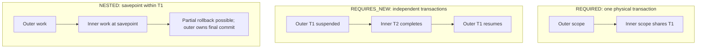

| Mode | Typical use | Important cost or limit |
|---|---|---|
| `REQUIRED` — default | One business unit across several calls | Inner failure can invalidate shared work |
| `REQUIRES_NEW` | Independently durable attempt/audit record | Extra connection; outer locks remain held |
| `NESTED` | Partial rollback with savepoints | Resource support required; not portable JPA nesting |
| `SUPPORTS` / `MANDATORY` | Participate optionally / require existing work | `MANDATORY` fails without a transaction |
| `NOT_SUPPORTED` / `NEVER` | Suspend / forbid transactional execution | `NEVER` fails if a transaction exists |

Joined scopes normally inherit the outer isolation and timeout. Independent audit work must not depend on an uncommitted outer order. [Official Spring propagation diagrams and semantics](https://docs.spring.io/spring-framework/reference/data-access/transaction/declarative/tx-propagation.html)

### Why catching an exception may still roll back

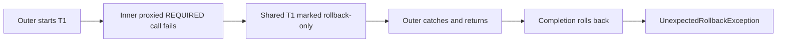

Default rules roll back on `RuntimeException` and `Error`, not ordinary checked exceptions. Configure a checked failure explicitly:

```java
@Transactional(rollbackFor = IOException.class)
public void importFile() throws IOException { /* database work */ }
```

A locally caught application exception may allow commit if the transaction remains usable. Catching cannot clear an existing rollback-only/aborted state. Database rollback also does not rewind Java objects or external effects. [Rollback rules](https://docs.spring.io/spring-framework/reference/data-access/transaction/declarative/rolling-back.html)

## 9. Example: order, stock, and outbox

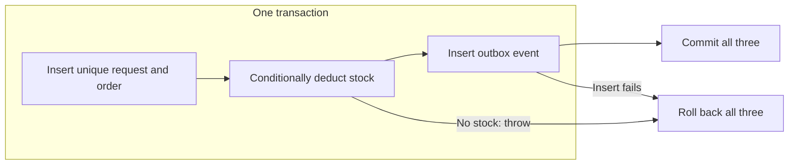

The request uniqueness check happens before stock deduction. The example rejects duplicates; replaying the original response requires handling that failure outside the failed transaction, then reading and validating the committed result.

<details>
<summary>Expand implementation: configuration, PostgreSQL tables, and Spring JDBC service</summary>

Assumes Java text blocks, a configured `DataSource`, and one shared JDBC transaction manager. Spring Boot may configure the infrastructure automatically. This teaching example omits pricing, authorization, and full order lines.

```java
@Configuration
@EnableTransactionManagement
class TransactionConfig {
    @Bean
    PlatformTransactionManager transactionManager(DataSource dataSource) {
        return new JdbcTransactionManager(dataSource);
    }

    @Bean
    JdbcTemplate jdbcTemplate(DataSource dataSource) {
        return new JdbcTemplate(dataSource);
    }
}
```

```sql
CREATE TABLE inventory (
    product_id BIGINT PRIMARY KEY,
    available INTEGER NOT NULL CHECK (available >= 0)
);

CREATE TABLE purchase_order (
    id UUID PRIMARY KEY,
    request_id UUID NOT NULL UNIQUE,
    product_id BIGINT NOT NULL REFERENCES inventory(product_id),
    quantity INTEGER NOT NULL CHECK (quantity > 0),
    status TEXT NOT NULL CHECK (status IN ('PLACED', 'CANCELLED'))
);

CREATE TABLE outbox (
    event_id UUID PRIMARY KEY,
    order_id UUID NOT NULL REFERENCES purchase_order(id),
    event_type TEXT NOT NULL,
    created_at TIMESTAMPTZ NOT NULL DEFAULT now(),
    published_at TIMESTAMPTZ
);
```

```java
@Service
public class OrderService {
    private final JdbcTemplate jdbc;

    public OrderService(JdbcTemplate jdbc) {
        this.jdbc = jdbc;
    }

    @Transactional(timeout = 5)
    public UUID placeOrder(UUID requestId, long productId, int quantity) {
        Objects.requireNonNull(requestId, "requestId");
        if (quantity <= 0) {
            throw new IllegalArgumentException("Quantity must be positive");
        }

        UUID orderId = UUID.randomUUID();
        jdbc.update("""
            INSERT INTO purchase_order
                (id, request_id, product_id, quantity, status)
            VALUES (?, ?, ?, ?, 'PLACED')
            """, orderId, requestId, productId, quantity);

        int changed = jdbc.update("""
            UPDATE inventory
            SET available = available - ?
            WHERE product_id = ? AND available >= ?
            """, quantity, productId, quantity);

        if (changed != 1) {
            throw new OutOfStockException(productId);
        }

        jdbc.update("""
            INSERT INTO outbox (event_id, order_id, event_type)
            VALUES (?, ?, 'OrderPlaced')
            """, UUID.randomUUID(), orderId);

        return orderId;
    }
}

class OutOfStockException extends RuntimeException {
    OutOfStockException(long productId) {
        super("No sufficient stock for product " + productId);
    }
}
```

Imports: Spring configuration/context and transaction annotations, `PlatformTransactionManager`, `JdbcTransactionManager`, `JdbcTemplate`, `Service`, `javax.sql.DataSource`, `java.util.UUID`, and `java.util.Objects`.

Name the request-ID constraint explicitly in production to identify its violation reliably. Match duplicate-request payloads; do not classify every integrity violation as a replay. Rejected attempts are not retained by this schema. The outbox worker still needs claiming, retries, and idempotent delivery.

</details>

## 10. JPA, operational limits, and verification

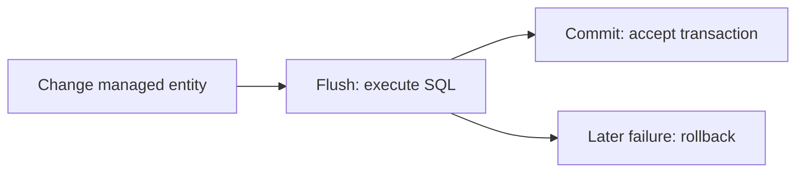

`save()` and `flush()` do not imply commit. `@Version` implements optimistic conflict checks; after a conflict, reload and reconsider in a fresh transaction. Savepoint rollback does not rewind a JPA persistence context. [JPA specification](https://jakarta.ee/specifications/persistence/3.2/jakarta-persistence-spec-3.2.html), [JPA manager limitations](https://docs.spring.io/spring-framework/docs/current/javadoc-api/org/springframework/orm/jpa/JpaTransactionManager.html)

| Situation | Practice |
|---|---|
| Several repository writes | Put one boundary around the business unit |
| Read-only work | `readOnly` is an optimization hint, not a portable write prohibition or snapshot guarantee |
| Long HTTP call | Release database locks before remote waiting |
| Async execution | Worker enters its own boundary; parent transaction is not inherited |
| Timeout | Resource-supported limit; does not interrupt arbitrary Java work |
| Large import | Choose whole-file atomicity or explicit resumable chunks; flush alone does not commit |
| Two databases | Two local managers do not make one atomic commit |
| After-commit event | In-process listener alone is not durable delivery |

See [repository defaults and read-only behavior](https://docs.spring.io/spring-data/jpa/reference/jpa/transactions.html), [transaction attributes](https://docs.spring.io/spring-framework/docs/current/javadoc-api/org/springframework/transaction/annotation/Transactional.html), and [transaction-bound events](https://docs.spring.io/spring-framework/reference/data-access/transaction/event.html).

<details>
<summary>Expand retry boundary and verification cases</summary>

Each retry must enter a fresh transaction. From a **nontransactional coordinator**, use a configured `TransactionTemplate`:

```java
for (int attempt = 1; ; attempt++) {
    try {
        return tx.execute(status -> orderAttempt.execute(command));
    } catch (RuntimeException failure) {
        if (!isRetryableDatabaseAbort(failure) || attempt >= maxAttempts) {
            throw failure;
        }
        backoffWithJitter(attempt); // Outside the completed transaction.
    }
}
```

Helpers are application-specific. Classify known-aborted conflicts, bound elapsed time too, and avoid external effects in the retried callback. Default `REQUIRED` would join an existing outer transaction, defeating fresh attempts. Catch outside `execute` to include commit failures. [Programmatic transactions](https://docs.spring.io/spring-framework/reference/data-access/transaction/programmatic.html)

| Verify using the real database engine | Expected evidence |
|---|---|
| Failure after stock deduction | No order/event; stock unchanged |
| Two buyers, one item | One success; stock zero |
| Concurrent duplicate request | One order and deduction |
| Inner shared scope fails | Outer cannot silently commit |
| Worker crashes after delivery | Duplicate delivery produces no duplicate effect |

Call the injected proxy. Test-level transactions can mask missing boundaries and defer commit errors. Assert from a fresh transaction; use separate connections for concurrent actors and bounded waits. Avoid barriers that require a blocked actor to pass a held lock. [Transaction testing](https://docs.spring.io/spring-framework/reference/testing/testcontext-framework/tx.html)

</details>
