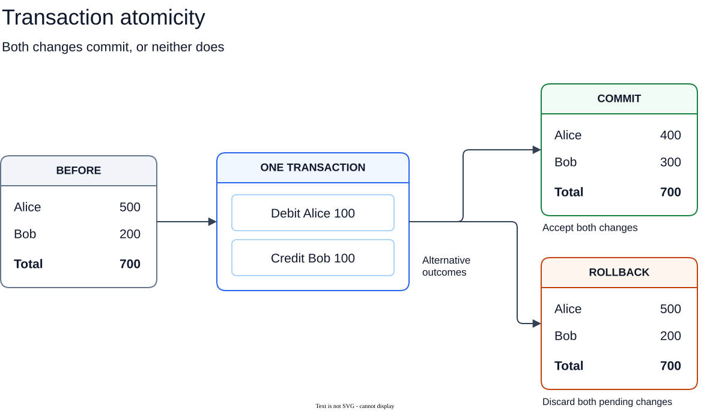
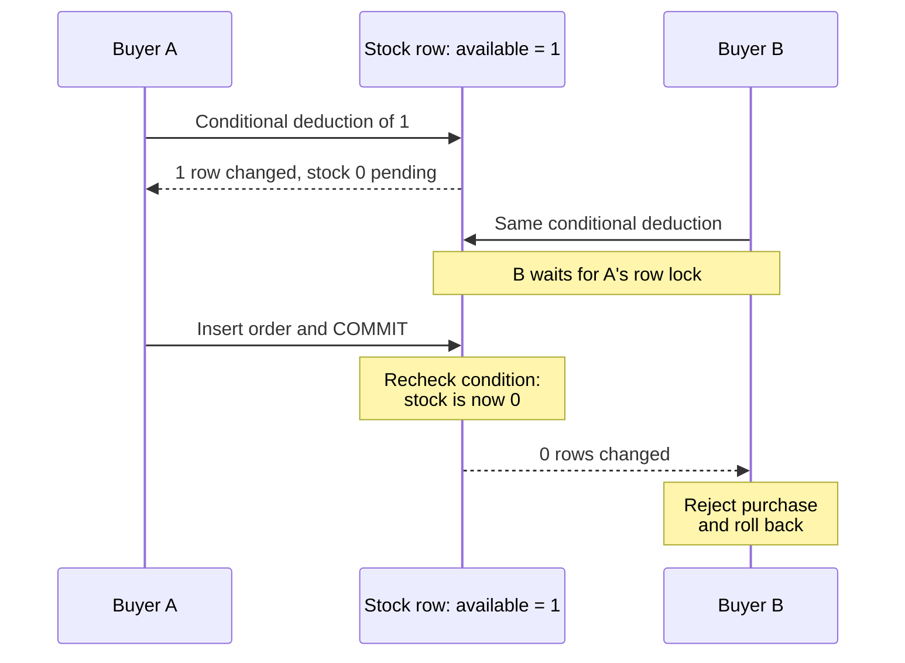
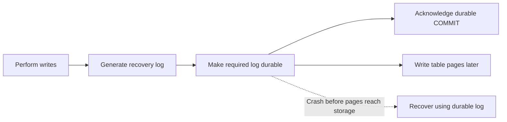
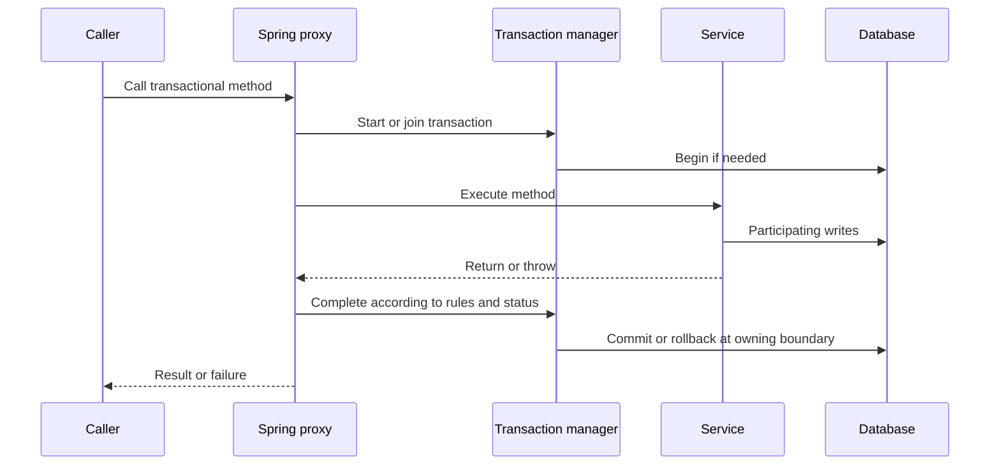
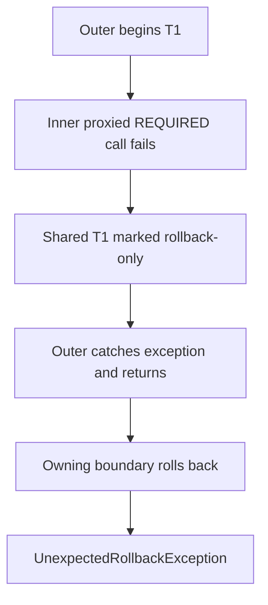
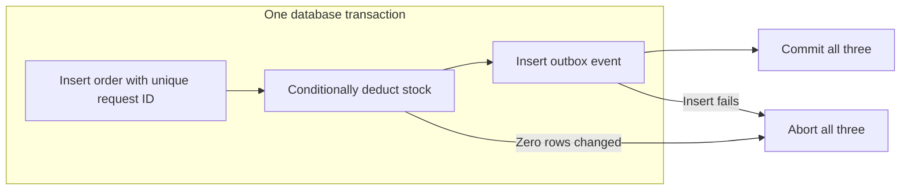
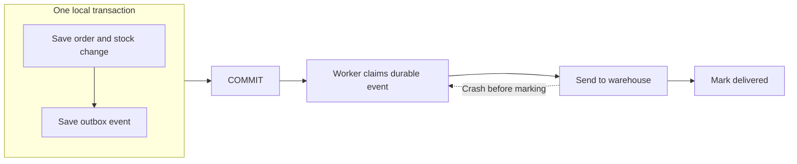

# Database transactions and Spring @Transactional

A **transaction** groups database work into one unit. **ACID** describes its guarantees. **`@Transactional`** lets Spring coordinate that unit from application code.

[Boundary](#1-the-transaction-boundary) · [ACID](#2-acid-from-guarantees-to-production-mechanisms) · [Spring](#3-how-spring-applies-the-boundary) · [Order implementation](#4-applying-the-concepts-to-an-order) · [Recovery and testing](#5-recovery-and-verification)

Examples use PostgreSQL 18 and imperative Spring JDBC transactions. Code is illustrative and was not executed against a database.

---

## 1. The transaction boundary

Alice transfers **RM100** to Bob. The debit and credit must share one outcome:



| During the transaction | At completion |
|---|---|
| Statements can execute; changes remain pending | **Commit** accepts the participating changes |
| This transaction can see its intermediate work | **Rollback** discards its pending transactional changes |

Choose the boundary around the **complete business operation**. Separate commits leave a failure window between steps. After commit, reversal requires a new operation. PostgreSQL autocommit gives each standalone statement its own transaction. [Transaction lifecycle](https://www.postgresql.org/docs/18/tutorial-transactions.html)

<details>
<summary>Show illustrative PostgreSQL transaction</summary>

```sql
BEGIN;
UPDATE account SET balance = balance - 100.00 WHERE id = 1;
UPDATE account SET balance = balance + 100.00 WHERE id = 2;
COMMIT;
```

Use `ROLLBACK` instead of committing when the operation cannot complete. This sketch demonstrates grouping only: it omits account existence, funds checks, concurrent access, and request identity. These must be designed explicitly.

</details>

[Editable diagram](assets/database-transactions-and-spring-transactional/transaction-atomicity.drawio).

---

## 2. ACID: from guarantees to production mechanisms

Use one production scenario below: **request R1 buys 2 units from stock 3**. Success records an order, deducts stock, and saves an event for later delivery.

| Guarantee | What must hold for R1? |
|---|---|
| **Atomicity** | Order, deduction, and event commit together |
| **Consistency** | The completed operation obeys the business rules |
| **Isolation** | Competing requests cannot reuse the same stock |
| **Durability** | An acknowledged durable commit survives a crash |

---

### Atomicity — one outcome

> If a required step fails, no part of this transaction remains committed.

**Example.** The order insert and stock deduction succeed, but the event insert fails:

| Outcome | Stock | Order | Event |
|---|---|---|---|
| Before R1 | 3 | Absent | Absent |
| Commit all steps | 1 | Present | Present |
| Abort after event failure | 3 | Absent | Absent |

**Implementation.** The engine tracks changes and transaction outcome. Recovery prevents aborted work from having committed effects, including after a crash. Engines may restore earlier values using undo information or exclude aborted row versions from visibility; rollback need not erase every changed byte immediately. PostgreSQL combines transaction status with MVCC visibility. [Transaction status](https://www.postgresql.org/docs/18/transaction-id.html), [MVCC](https://www.postgresql.org/docs/18/mvcc-intro.html)

**Production decision.** Include every required write in one participating transaction. Abort when a required step fails, including an unexpected affected-row count. The database cannot detect a step the application forgot to execute.

A **savepoint** allows rollback of later pending work while retaining earlier pending work. It is not a separate commit: an outer rollback still discards the remaining transaction. [Savepoints](https://www.postgresql.org/docs/18/tutorial-transactions.html)

---

### Consistency — preserve the rules

> A valid starting state must lead to a valid committed state.

An **invariant** is a business rule that must remain true. For R1, writing all three records is insufficient if the quantities are wrong:

| Attempt from stock 3 | Result | Assessment |
|---|---|---|
| Record quantity 2; deduct 2 | Stock 1 | Correct |
| Record quantity 2; deduct only 1 | Stock 2 | Atomic writes can still encode incorrect logic |
| Order 4; attempt deduction of 4 | Proposed stock −1 | Must reject and abort |

**Implementation.** Assign each rule an enforcement point:

| Rule | Database protection | Application responsibility |
|---|---|---|
| Quantity is positive | `NOT NULL`, `CHECK (quantity > 0)` | Validate input and report useful errors |
| Stock is nonnegative | `NOT NULL`, `CHECK (available >= 0)` | Use a guarded deduction; check its result |
| Product exists | Foreign key | Check authorization and eligibility |
| R1 creates at most one order | Unique request ID | Reuse R1 on retry; compare replay payloads |
| Deduction equals ordered quantity | No automatic constraint in this example | Use the same quantity in both writes |

If the −1 update reaches the database, the constraint rejects it; the application aborts, leaving stock 3 and no order or event. Constraints protect writes from API handlers, jobs, and other writers using the same tables.

**Production decision.** Declare enforceable rules in the schema and implement the remaining rules explicitly. PostgreSQL `CHECK` cannot safely enforce arbitrary conditions across other rows, and `CHECK` alone permits null. Cross-row rules need suitable constraints or coordination. [Constraint limits](https://www.postgresql.org/docs/18/ddl-constraints.html)

Consistency does not mean “every reader sees the latest value.” It also does not replace isolation: a valid check can become stale before a later write.

---

### Isolation — protect competing decisions

> Transactions must interact under guarantees strong enough for the business rule.

**Example.** Two requests each want 2 units from stock 3. Both read 3, then each sets stock to 1 and inserts an order. Both commits can succeed: **4 units sold, stock still 1**. Atomicity and a nonnegative-stock constraint do not prevent this.

**Implementation.** Check availability during the deduction, then require exactly one changed row:

<details>
<summary>Show illustrative conditional stock deduction</summary>

```sql
UPDATE inventory
SET available = available - :quantity
WHERE product_id = :productId
  AND available >= :quantity;
```

Named parameters are illustrative. The Spring JDBC example later uses positional parameters.

</details>

The same race with one last item makes the ordering visible:



Under PostgreSQL **Read Committed**, the competing updater waits and rechecks its condition after the first commits. With stock 3 and two requests for 2, one leaves stock 1; the other changes zero rows and must abort its order. If the first rolls back, the waiting request can proceed. [Concurrent updates](https://www.postgresql.org/docs/18/transaction-iso.html#XACT-READ-COMMITTED)

#### Read visibility and decision protection

**MVCC** keeps row versions for snapshots. It improves read concurrency but does not reserve stock when the application reads it.

| PostgreSQL isolation | Reads and conflicts | Consequence |
|---|---|---|
| Read Committed | Fresh snapshot per statement | Later reads may change |
| Repeatable Read | Stable transaction snapshot | Cross-row write skew remains possible |
| Serializable | Committed effects match a serial ordering | Conflicts may abort; retry the whole transaction |

PostgreSQL maps Read Uncommitted to Read Committed and prevents phantoms at Repeatable Read. Other engines differ. [Isolation levels](https://www.postgresql.org/docs/18/transaction-iso.html)

<a id="5-choose-a-concurrency-tool"></a>

**Production decision.** Match protection to the invariant:

| Tool | Use when | Important limit |
|---|---|---|
| Conditional update | Check and change fit one row | Inspect affected rows |
| Pessimistic lock | Decide from known shared rows | All writers must coordinate; locks last through completion |
| Optimistic version | Reject stale edits | Reload and reconsider after conflict |
| Constraint | Rule fits a declared schema constraint | Protects only the rule actually declared |
| Serializable | Rule spans rows or predicates | Handle whole-transaction retries |

For multi-row locking, use a consistent order to reduce **deadlocks**. T1 holding row 1 while waiting for row 2, and T2 holding row 2 while waiting for row 1, creates a wait cycle. Retry a confirmed database abort as a complete operation. [Locking](https://www.postgresql.org/docs/18/explicit-locking.html)

<details>
<summary>Show illustrative locking and optimistic version patterns</summary>

```sql
BEGIN;
-- Both transfers use the same ascending account-ID order.
SELECT id, balance FROM account WHERE id = 1 FOR UPDATE;
SELECT id, balance FROM account WHERE id = 2 FOR UPDATE;
-- Validate both accounts and funds while locks are held.
UPDATE account SET balance = balance - 100.00 WHERE id = 1;
UPDATE account SET balance = balance + 100.00 WHERE id = 2;
COMMIT;
```

An alternative for a versioned inventory row:

```sql
UPDATE inventory
SET available = :newValue, version = version + 1
WHERE product_id = :productId AND version = :versionRead;
```

One changed row accepts the write; zero means the expected version no longer matches or the row is absent. All writers must follow the version protocol. Replacing the expected version and retrying the old decision is unsafe: reload and reevaluate.

</details>

**Write skew** occurs when transactions change different rows but jointly break a shared rule. Per-row versions or locks on separate rows may miss it; use shared coordination or Serializable with retries.

---

### Durability — retain the accepted result

> After a durable commit is acknowledged, a crash must not erase it under the configured guarantees.

**Example.** R1 commits: stock 1, one order, one event. A database restart must retain that result.

**Implementation.** Write-ahead logging (**WAL**) makes recovery information persistent before the corresponding data pages reach storage. Required log records become durable before a durable commit is acknowledged:



Recovery uses durable log records and transaction status. It need not wait for every table page to be written at commit. [WAL](https://www.postgresql.org/docs/18/wal-intro.html)

**Production decision.** Keep durability settings appropriate to the operation. PostgreSQL asynchronous commit can lose recently acknowledged transactions after a crash. Replication and failover guarantees require separate configuration; backups address storage loss and accidental deletion. [Asynchronous commit](https://www.postgresql.org/docs/18/wal-async-commit.html)

A lost commit response leaves the **caller uncertain**; it does not prove the database lost or rolled back the transaction.

---

## 3. How Spring applies the boundary

Spring coordinates the transaction; the database implements its guarantees.



The method body returns **before** transaction completion. Commit can still fail afterward; a joined method does not own an independent commit.

### Entry and resource participation

| Requirement | Failure if missed |
|---|---|
| Call through an injected Spring proxy | A self-call or `new Service()` bypasses transaction advice |
| Use participating resources | An unrelated connection can escape the boundary |
| Start a boundary in an async worker | Imperative transactions do not propagate to a new thread |

A self-called method may use an existing transaction, but its annotation settings are not intercepted. Public service methods are a straightforward boundary convention; class-based proxies cannot override final methods. [Proxy behavior](https://docs.spring.io/spring-framework/reference/data-access/transaction/declarative/annotations.html)

For JDBC, `JdbcTransactionManager` and `JdbcTemplate` share the transaction-bound connection for the configured `DataSource`. JPA typically uses `JpaTransactionManager`. Two local transaction managers do not create one atomic transaction across databases; XA requires suitable coordination and enlisted resources. [Resource participation](https://docs.spring.io/spring-framework/reference/data-access/transaction/tx-resource-synchronization.html)

### Propagation and rollback

An outer order service calls an audit service through another proxy. Audit returns; the outer service then fails and rolls back:

| Audit propagation | Arrangement | What survives? |
|---|---|---|
| `REQUIRED` | Shares outer T1 | Neither order nor audit |
| `REQUIRES_NEW` | Independent T2; T1 suspended | Audit only |
| `NESTED` | Savepoint inside T1 | Neither |

`REQUIRES_NEW` consumes extra connection capacity while outer resources remain held. `NESTED` needs savepoint support and is not portable JPA nesting. Joined scopes normally inherit the outer transaction’s characteristics. [Propagation](https://docs.spring.io/spring-framework/reference/data-access/transaction/declarative/tx-propagation.html)

Other modes control participation: `SUPPORTS` joins optionally, `MANDATORY` requires a transaction, `NOT_SUPPORTED` suspends it, and `NEVER` forbids one.

Default rollback applies to escaping `RuntimeException` and `Error`, not ordinary checked exceptions. Configure checked business failures when necessary. [Rollback rules](https://docs.spring.io/spring-framework/reference/data-access/transaction/declarative/rolling-back.html)

<details>
<summary>Show illustrative rollback rule for a checked exception</summary>

```java
@Transactional(rollbackFor = IOException.class)
public void importFile() throws IOException {
    // Participating database work.
}
```

</details>

Catching an exception cannot clear an existing rollback-only state:



A locally handled error may allow commit if the transaction remains usable. Rollback does not rewind Java objects or external effects.

### Common implementation limits

| Mechanism | Production meaning |
|---|---|
| JPA `flush()` | Executes pending changes; does not commit |
| `@Version` | Detects stale updates; reload and reconsider after conflict |
| Savepoint with JPA | Does not rewind the persistence context |
| `readOnly` | Infrastructure hint; not a portable write ban or snapshot guarantee |
| Timeout | Resource-supported limit; does not interrupt arbitrary Java or HTTP work |
| Chunked import | Requires explicit commit boundaries; flushing is insufficient |

Keep remote waits outside held database locks where the protocol permits. Reactive transactions use Reactor context rather than imperative thread binding. [JPA limits](https://docs.spring.io/spring-framework/docs/current/javadoc-api/org/springframework/orm/jpa/JpaTransactionManager.html), [transaction attributes](https://docs.spring.io/spring-framework/docs/current/javadoc-api/org/springframework/transaction/annotation/Transactional.html)

---

## 4. Applying the concepts to an order

For **R1: buy 2 from stock 3**, the service performs these writes in one transaction:



| State | Stock | Order / event |
|---|---|---|
| Before | 3 | Absent / absent |
| After deduction, before event insert | 1 pending | Pending / absent |
| Commit succeeds | 1 | Committed / committed |
| Alternative: event insert fails and transaction aborts | 3 | Absent / absent |

Pending values are this transaction’s own work. The final two rows are alternative outcomes.

The example checks request uniqueness **before** deduction and rejects duplicates. To replay an earlier success, catch the named request-ID conflict outside the failed transaction, read the committed result, and compare its payload. Do not classify every integrity violation as a replay.

<details>
<summary>Expand implementation: configuration, PostgreSQL tables, and Spring JDBC service</summary>

Assumes Java text blocks, a configured `DataSource`, and one shared JDBC transaction manager. Spring Boot may configure the infrastructure automatically. This teaching example omits pricing, authorization, and full order lines.

```java
@Configuration
@EnableTransactionManagement
class TransactionConfig {
    @Bean
    PlatformTransactionManager transactionManager(DataSource dataSource) {
        return new JdbcTransactionManager(dataSource);
    }

    @Bean
    JdbcTemplate jdbcTemplate(DataSource dataSource) {
        return new JdbcTemplate(dataSource);
    }
}
```

```sql
CREATE TABLE inventory (
    product_id BIGINT PRIMARY KEY,
    available INTEGER NOT NULL CHECK (available >= 0)
);

CREATE TABLE purchase_order (
    id UUID PRIMARY KEY,
    request_id UUID NOT NULL CONSTRAINT uq_purchase_order_request UNIQUE,
    product_id BIGINT NOT NULL REFERENCES inventory(product_id),
    quantity INTEGER NOT NULL CHECK (quantity > 0),
    status TEXT NOT NULL CHECK (status IN ('PLACED', 'CANCELLED'))
);

CREATE TABLE outbox (
    event_id UUID PRIMARY KEY,
    order_id UUID NOT NULL REFERENCES purchase_order(id),
    event_type TEXT NOT NULL,
    created_at TIMESTAMPTZ NOT NULL DEFAULT now(),
    published_at TIMESTAMPTZ
);
```

```java
@Service
public class OrderService {
    private final JdbcTemplate jdbc;

    public OrderService(JdbcTemplate jdbc) {
        this.jdbc = jdbc;
    }

    @Transactional(timeout = 5)
    public UUID placeOrder(UUID requestId, long productId, int quantity) {
        Objects.requireNonNull(requestId, "requestId");
        if (quantity <= 0) {
            throw new IllegalArgumentException("Quantity must be positive");
        }

        UUID orderId = UUID.randomUUID();
        jdbc.update("""
            INSERT INTO purchase_order
                (id, request_id, product_id, quantity, status)
            VALUES (?, ?, ?, ?, 'PLACED')
            """, orderId, requestId, productId, quantity);

        int changed = jdbc.update("""
            UPDATE inventory
            SET available = available - ?
            WHERE product_id = ? AND available >= ?
            """, quantity, productId, quantity);

        if (changed != 1) {
            throw new OutOfStockException(productId);
        }

        jdbc.update("""
            INSERT INTO outbox (event_id, order_id, event_type)
            VALUES (?, ?, 'OrderPlaced')
            """, UUID.randomUUID(), orderId);

        return orderId;
    }
}

class OutOfStockException extends RuntimeException {
    OutOfStockException(long productId) {
        super("No sufficient stock for product " + productId);
    }
}
```

Imports: Spring configuration/context and transaction annotations, `PlatformTransactionManager`, `JdbcTransactionManager`, `JdbcTemplate`, `Service`, `javax.sql.DataSource`, `java.util.UUID`, and `java.util.Objects`.

Identify the named `uq_purchase_order_request` violation when handling duplicate requests. Match duplicate-request payloads; do not classify every integrity violation as a replay. Rejected attempts are not retained by this schema. The outbox worker still needs claiming, retries, and idempotent delivery.

</details>

---

## 5. Recovery and verification

### Retry according to the known outcome

<a id="6-failures-retries-and-external-systems"></a>

| Observation | Response |
|---|---|
| Confirmed serialization or deadlock abort | Bounded retry: fresh transaction, fresh reads, new decision |
| Invalid quantity or insufficient stock | Return a domain result |
| Connection lost during commit | Reconcile using the original request ID |
| Duplicate request ID | Read and validate its result outside the failed transaction |

PostgreSQL codes `40001` and `40P01` identify serialization failure and deadlock. Retry confirmed aborts, not arbitrary connection errors. A missing record during an unresolved attempt does not prove the original cannot still commit. [Error codes](https://www.postgresql.org/docs/18/errcodes-appendix.html)

Catch failures outside the attempt, including commit errors. Bound retries and elapsed time; back off after releasing locks and connections.

<details>
<summary>Show illustrative Spring retry boundary</summary>

Assume a nontransactional coordinator, a configured `TransactionTemplate` named `tx`, and no outer transaction for its default `REQUIRED` behavior to join.

```java
for (int attempt = 1; ; attempt++) {
    try {
        return tx.execute(status -> orderAttempt.execute(command));
    } catch (RuntimeException failure) {
        if (!isRetryableDatabaseAbort(failure) || attempt >= maxAttempts) {
            throw failure;
        }
        backoffWithJitter(attempt); // After completion, outside the transaction.
    }
}
```

The classifier, time budget, backoff, and command handling are application-specific. `orderAttempt` must not perform non-idempotent external effects that could repeat. [Programmatic transactions](https://docs.spring.io/spring-framework/reference/data-access/transaction/programmatic.html)

</details>

### Deliver external effects after committing their intent

Sending before commit can announce rolled-back work. Sending only after commit can be skipped by a crash. An **outbox** stores outgoing intent alongside the order:



A crash after sending but before marking delivery causes a retry. Receivers need duplicate-safe effects, usually by committing event identity with their local change. Workers need claiming and abandoned-claim recovery. An in-process after-commit listener alone is not durable delivery.

Database rollback cannot undo a completed external payment; a refund is a separate compensating operation. See [asynchronous reliability](../software-design/reliable-asynchronous-operations.md) and [workflow recovery](../software-design/state-machines-and-business-workflows.md).

### Verify persisted outcomes

Use the real database engine, enter through the Spring proxy, and assert from a fresh transaction.

| Test | Expected evidence |
|---|---|
| Buy 2 from stock 3 | One order, stock 1, one event |
| Fail after deduction | No order/event; stock 3 |
| Two buyers, last item | One success; stock 0 |
| Concurrent attempts with R1 | At most one order and deduction |
| Write invalid quantity directly | Constraint rejects it |
| Catch failure from inner shared scope | Rollback-only transaction cannot silently commit |
| Crash after event delivery | Duplicate delivery produces no duplicate effect |
| Lose commit response | Recovery retains the original operation identity |

Test-level transactions can mask missing boundaries and defer commit errors. For races, use separate connections, controlled ordering, and bounded waits. Avoid barriers that require a blocked actor to pass a held lock. [Transaction testing](https://docs.spring.io/spring-framework/reference/testing/testcontext-framework/tx.html)

Monitor transaction duration, lock waits, deadlocks, pool pressure, constraint violations, and outbox age. Validate crash recovery and failover against the deployed durability settings.

---

## 6. Check your understanding

1. R1 records quantity 2 but deducts only 1. Both writes commit. What failed?

   <details>
   <summary>Show answer</summary>

   Consistency: atomicity kept the writes together, but the logic broke the stock rule. The application must use the same quantity for the order and deduction.

   </details>

1. Can two methods with `@Transactional` oversell stock?

   <details>
   <summary>Show answer</summary>

   Yes. Both can read the same availability and make conflicting decisions. A guarded deduction checks during the write; the losing request must abort its other work.

   </details>

1. Does a self-call to a `REQUIRES_NEW` method create T2?

   <details>
   <summary>Show answer</summary>

   Not in default proxy mode: self-invocation skips transaction advice. It may continue inside T1, but the inner annotation does not create T2.

   </details>

1. Commit’s response is lost. Should the caller retry with a new request ID?

   <details>
   <summary>Show answer</summary>

   No. The database may have committed. Reconcile using the original identity; a new identity can create a second operation.

   </details>

1. Delivery succeeds, then the worker crashes before marking it. What happens?

   <details>
   <summary>Show answer</summary>

   Delivery may repeat because the sender still sees pending work. The receiver must recognize the event and avoid applying its effect twice.

   </details>
