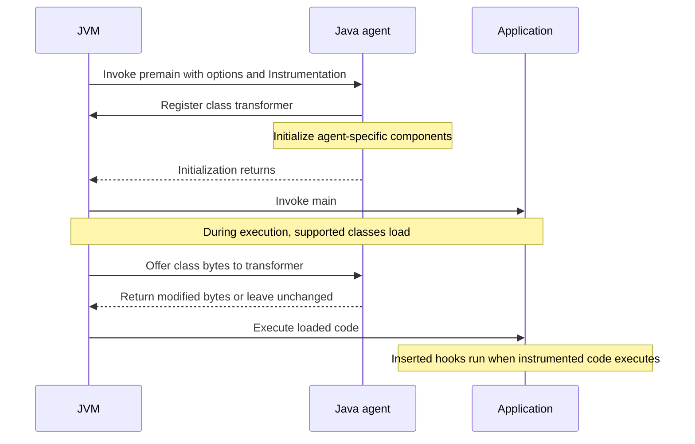
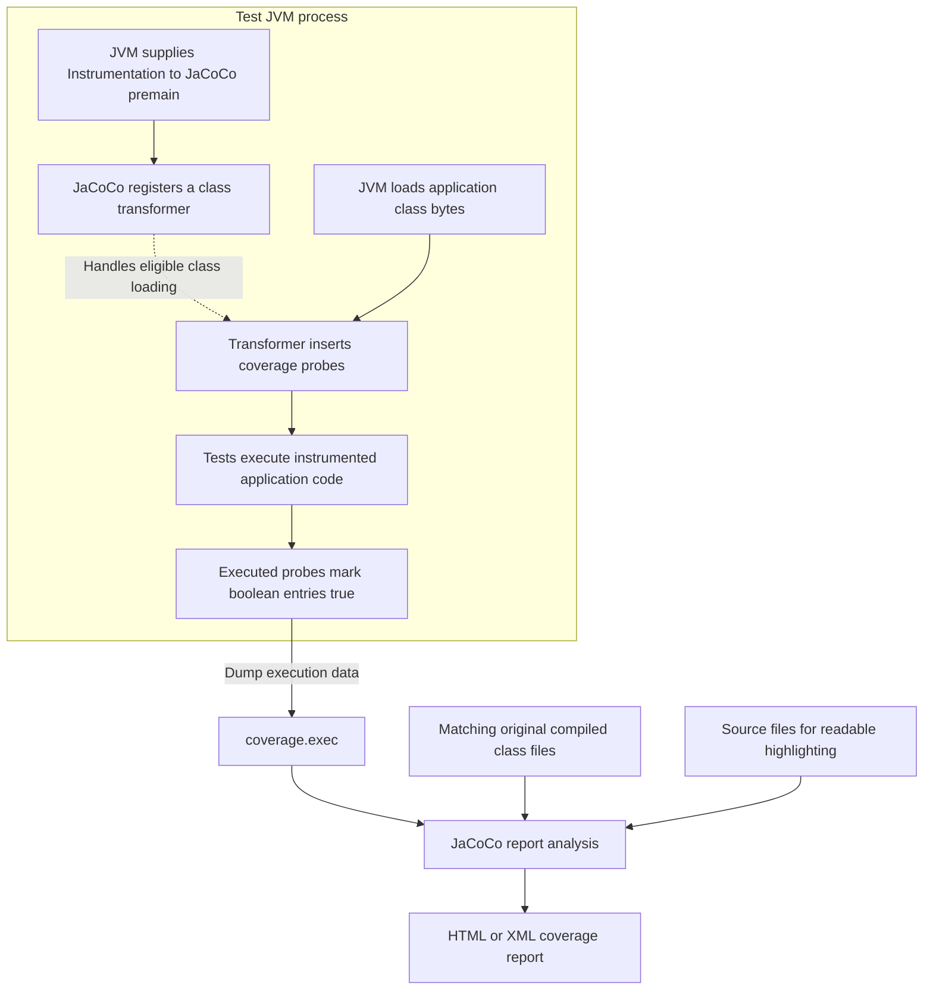
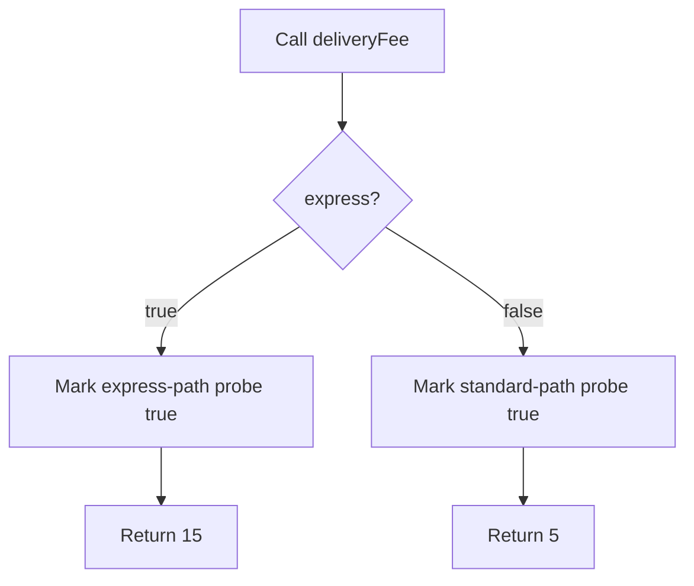
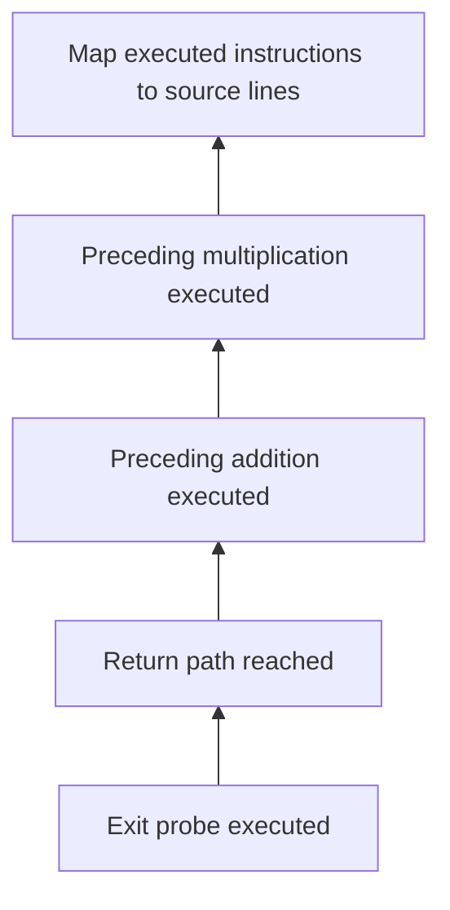

# Java agents — purpose, lifecycle, and use cases

A **Java agent is an extension packaged as a JAR that runs inside an application's JVM**. Its purpose depends on its implementation. Registering instrumentation hooks is one capability, rather than its entire job.

For a production tracing example, see [request lifecycle and tracing](../production/production-request-lifecycle.md).

Some capabilities need to apply across application and library code: tracing requests, measuring execution, or tracking test coverage. An agent can add recording at those boundaries without manually editing every method.

An ordinary library is typically called by your application. An agent also has a JVM-recognized entry point and access to instrumentation capabilities. Merely placing a JAR on the classpath does not activate it as an agent.

## Startup and premain

```bash
java -javaagent:agent.jar -jar application.jar
```

For this launch mode, the agent JAR manifest identifies its entry class through `Premain-Class`. The JVM invokes that class's `premain` before the application's `main`. Think of it as the agent's initialization entry point. [Java agent startup specification](https://docs.oracle.com/en/java/javase/25/docs/api/java.instrument/java/lang/instrument/package-summary.html)

An illustrative manifest entry:

```text
Premain-Class: example.MonitoringAgent
```

The usual entry point signature is:

```java
public static void premain(String agentArgs, Instrumentation instrumentation)
```

`Instrumentation` is from `java.lang.instrument`. The JVM supplies this object, allowing the agent to register class transformers and use supported instrumentation operations. `agentArgs` carries options from the launch command. The one-argument `premain(String agentArgs)` form is also supported. [Startup signatures](https://docs.oracle.com/en/java/javase/25/docs/api/java.instrument/java/lang/instrument/package-summary.html)

Agent options can be supplied as `-javaagent:agent.jar=options`. The JVM passes the options string to `premain`; the individual agent decides how to interpret it.



This diagram illustrates classes loaded after application startup. Class loading and transformation can also occur during initialization.

`premain` configures behavior; it is not called again for each request. Registered transformers, inserted hooks, and supporting components can continue working after it returns. You normally configure an existing agent, rather than implement its `premain` yourself.

Some JVMs support loading an agent into a running process. That mode uses `Agent-Class` in the manifest and the `agentmain` entry point. Availability and configuration depend on the JVM and runtime policy. [Dynamic agent startup](https://docs.oracle.com/en/java/javase/25/docs/api/java.instrument/java/lang/instrument/package-summary.html)

| Mode | Entry point | Typical use |
|---|---|---|
| Startup through `-javaagent` | `premain` | Configure observation from application launch |
| Attachment to a running JVM | `agentmain` | Add supported diagnostics after launch |

## JVM instrumentation

**JVM instrumentation** is the process of adding observation code to the bytecode executed by the JVM. Java's **`Instrumentation` interface** gives an agent access to services that enable this process. The interface itself does not calculate coverage or measure latency.

The responsibilities are distinct:

| Component | Responsibility |
|---|---|
| JVM | Load classes and execute bytecode |
| Java agent | Initialize additional capabilities |
| `Instrumentation` API | Provide access to JVM instrumentation services |
| Class transformer | Inspect class bytes and return modifications when needed |
| Inserted hooks | Perform agent-specific behavior when the application executes |

The inserted behavior depends on the agent: timing, execution recording, or other operations.

The `Instrumentation` API supports inspecting loaded classes, registering transformers, and—in supported configurations—retransforming or redefining classes. It also offers an implementation-specific approximation of an object's size. [Instrumentation API](https://docs.oracle.com/en/java/javase/25/docs/api/java.instrument/java/lang/instrument/Instrumentation.html)

Bytecode is compiled code in `.class` files. Transformation can insert instructions into the bytes loaded into the JVM; it need not rewrite your `.java` sources or original JAR on disk. Changes to already-loaded classes have restrictions, and not every class is modifiable. [Instrumentation API](https://docs.oracle.com/en/java/javase/25/docs/api/java.instrument/java/lang/instrument/Instrumentation.html)

An agent is not omniscient. Its integrations, configuration, and JVM capabilities determine what it can observe or modify. Java agents are also distinct from native JVM agents; different diagnostic tools may use different mechanisms.

## Common use cases

| Use case | What the agent adds | Practical question |
|---|---|---|
| Tracing and application monitoring | Operation timing, context propagation, telemetry export | Which dependency dominates this request? |
| Test coverage | Execution probes | Which code paths did tests exercise? |
| Performance investigation | Targeted execution measurements | Which instrumented operations are expensive? |
| Runtime diagnostics | Inspection or extra recording | What is happening inside the running application? |
| Behavior modification | Additional checks or logic around selected methods | Can a shared policy be applied without editing every caller? |

The concrete agent determines the measurement technique and detail. [Instrumentation API](https://docs.oracle.com/en/java/javase/25/docs/api/java.instrument/java/lang/instrument/Instrumentation.html)

For tracing, the OpenTelemetry Java agent records supported HTTP and database operations. [OpenTelemetry agent](https://opentelemetry.io/docs/zero-code/java/agent/)

## Real-life example: JaCoCo test coverage

JaCoCo uses the general agent mechanism to answer **which code executed during a test run?** Its probes record execution rather than request duration.

```bash
java -javaagent:jacocoagent.jar=destfile=coverage.exec -jar application.jar
```

Here, `destfile=coverage.exec` tells JaCoCo where to write execution data. This command assumes a downloaded agent and an executable application JAR; a test runner can attach the same agent to its test JVM. [JaCoCo agent options](https://www.jacoco.org/jacoco/trunk/doc/agent.html)



The agent records execution inside the test JVM. Report generation is a separate step that combines execution data with matching original class files. Source files make the result readable; debug line information in the classes enables line mapping. The `.exec` file is binary execution data, not the final HTML report. [JaCoCo coverage counters](https://www.jacoco.org/jacoco/trunk/doc/counters.html)

### Probes and execution recording

JaCoCo analyzes the compiled bytecode's control flow and inserts small recording instructions called **probes** at selected locations, including method exits and certain paths that merge. Additional probes help limit the effect of exceptions between source lines containing method calls. You normally do not choose probe locations yourself. [Probe analysis](https://www.jacoco.org/jacoco/trunk/doc/flow.html)

Each probe marks a boolean entry when execution reaches it, conceptually `probes[probeId] = true`. The flag means **reached at least once during the recording period**, not that a business condition was true or a test passed. Repeated execution leaves it true until reset; probes record neither execution counts nor elapsed time.

Consider:

```java
int deliveryFee(boolean express) {
    if (express) {
        return 15;
    }
    return 5;
}
```



This is a teaching model, not the literal generated probe layout. Calling only `deliveryFee(true)` exercises the express path; calling both values exercises both decision outcomes. The original result remains 15 or 5. A test that later fails—or checks nothing—can still increase coverage, because execution recording does not establish correctness.

### Coverage measurements

JaCoCo combines execution flags with analysis of the original class files to derive multiple measurements:

| Coverage type | What counts as executed |
|---|---|
| Instruction | A bytecode instruction |
| Branch | A decision outcome for `if` or `switch` |
| Line | At least one instruction assigned to the source line |
| Method | At least one instruction in the method |
| Class | At least one method in the class |

A method without branches still contributes to instruction, line, method, and class coverage. Exception handling is not counted as branches in JaCoCo's branch counter. [Coverage definitions](https://www.jacoco.org/jacoco/trunk/doc/counters.html)

JaCoCo does not normally insert one probe per source line. Consider a straight-line method:

```java
int total(int price, int quantity) {
    int subtotal = price * quantity;
    int result = subtotal + 5;
    return result;
}
```

For this simple path, think of a probe near the return recording that execution reached the exit. Control-flow analysis can infer execution of preceding instructions and map them to source lines using the compiled class's line-number information.



This inference is a simplified model for uninterrupted, sequential execution. Branches and exceptions require more careful analysis. Debug line information is required for line mapping. A line is red when none of its instructions executed, yellow when some executed, and green when all executed. Even a covered line can contain missed instructions or decision outcomes. [Coverage counters](https://www.jacoco.org/jacoco/trunk/doc/counters.html), [Control-flow analysis](https://www.jacoco.org/jacoco/trunk/doc/flow.html)

Configuring the JaCoCo Maven integration can handle agent attachment for you: prepare the agent arguments, run tests in the instrumented JVM, then generate the report. You do not implement `premain`, a transformer, or probes to use it. Recording and data output happen after initialization; report generation is a separate analysis step. [JaCoCo agent](https://www.jacoco.org/jacoco/trunk/doc/agent.html)

## Runtime implications

- The agent shares the application's process resources. Inserted recording, buffers, and threads can add CPU or memory overhead.
- A startup agent that cannot initialize can prevent application startup. Multiple agents are permitted, but their transformations and configuration may interact.
- Measurement results depend on coverage and configuration. JaCoCo can only record probes that were inserted and executed; a tracing agent can only expose recorded spans.

An agent is a JVM extension mechanism. AOP concerns separating cross-cutting behavior from business logic. Bytecode instrumentation can add that surrounding behavior, but agents are not limited to AOP, and AOP does not require a Java agent. AOP will be explored in a separate note.

## Check your understanding

Answer from memory, then revisit the relevant sections:

1. How do a Java agent, `Instrumentation`, and a class transformer differ?
2. Who invokes `premain`, and what keeps working after it returns?
3. Who chooses JaCoCo probe positions, and what makes a probe flag true?
4. How can a single executed probe support coverage information for several instructions or lines?
5. Why can a failing test increase coverage, and why does high coverage not establish correctness?
6. What does report generation need besides the `.exec` file?

## References

- [Java SE 25: Java Agent Specification](https://docs.oracle.com/en/java/javase/25/docs/api/java.instrument/java/lang/instrument/package-summary.html)
- [Java SE 25: Instrumentation API](https://docs.oracle.com/en/java/javase/25/docs/api/java.instrument/java/lang/instrument/Instrumentation.html)
- [OpenTelemetry Java Agent](https://opentelemetry.io/docs/zero-code/java/agent/)
- [JaCoCo Java Agent](https://www.jacoco.org/jacoco/trunk/doc/agent.html)
- [JaCoCo: Control Flow and Probes](https://www.jacoco.org/jacoco/trunk/doc/flow.html)
- [JaCoCo: Coverage Counters](https://www.jacoco.org/jacoco/trunk/doc/counters.html)
