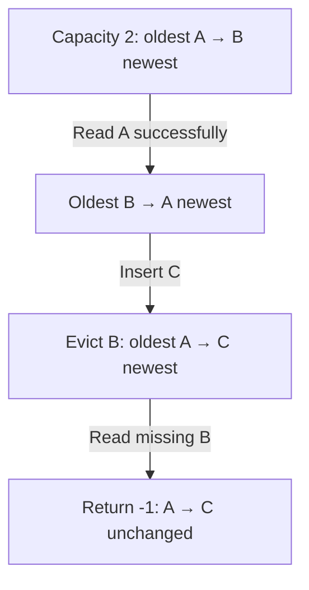
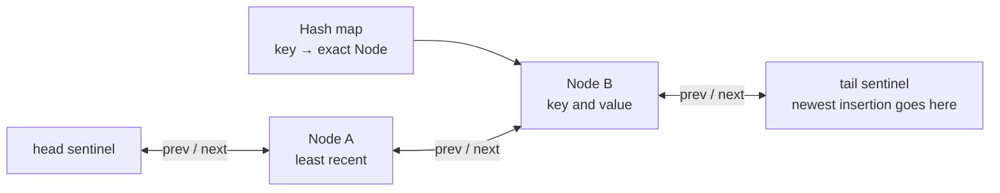

# 146. LRU Cache

Problem: [LeetCode 146 — LRU Cache](https://leetcode.com/problems/lru-cache/description/) · Medium

Language: Java

Status: Revising

## Problem understanding

Build a cache that stores integer key-value pairs up to a fixed positive capacity. Capacity counts entries. When inserting a new entry would exceed capacity, remove the entry whose most recent use happened furthest in the past: the least recently used (LRU) entry.

The required interface is:

| Operation | Required behavior |
|---|---|
| `LRUCache(capacity)` | Initialize an empty cache with this capacity. |
| `get(key)` | Return the stored value, or `-1` if absent. A successful lookup makes the entry most recently used. |
| `put(key, value)` | Insert a new entry or replace an existing value. Either makes that entry most recently used. Evict the LRU entry if necessary. |

A missing lookup does not change recency. Updating an existing key does not add another entry. Recency follows operation order, rather than the numerical size of a key or value. Both `get` and `put` must take average `O(1)` time: their work should not grow with the number of stored entries.

### Example walkthrough

For capacity `2`, the following table shows the behavior. The ordering column describes logical recency, not a required implementation.

| Operation | Return | Entries, oldest use → newest use |
|---|---|---|
| `put(1, 10)` | None | `1=10` |
| `put(2, 20)` | None | `1=10, 2=20` |
| `get(1)` | `10` | `2=20, 1=10` |
| `put(3, 30)` | None | `1=10, 3=30`; key `2` was evicted |
| `get(2)` | `-1` | `1=10, 3=30` |

### Constraints

- Capacity: `1` through `3000`.
- Keys: `0` through `10000`.
- Values: `0` through `100000`.
- At most `200000` combined calls to `get` and `put`.

## Background concepts

A cache avoids repeated work by retaining reusable data. With limited capacity, **Least Recently Used (LRU)** evicts the entry whose last successful use is oldest. Think of books on a short shelf: move a book to the newest end when you use it. If the shelf is full, remove the one untouched for longest. This models recency, not how useful a book really is; LRU is not ideal for every workload.



A successful read or write refreshes recency. Creation time, key size, and value size do not choose the eviction victim.

A stack follows last-in, first-out order: its top is the last pushed entry. In this attempt, popping therefore favors removal of a recent insertion rather than the oldest use. A queue alone would also be insufficient: reading an existing entry must change its position in the recency order.

## Attempt 1 — 2026-10-18

Source: saved local file `/home/derricksaw/.leetcode/146.lru-cache.java`. This is a local attempt, not a fetched online submission. The following snapshot preserves the saved file at the start of review, with trailing whitespace normalized for Markdown. The assistant did not edit the working Java file.

<details>
<summary>Expand preserved learner code snapshot</summary>

```java
/*
 * @lc app=leetcode id=146 lang=java
 *
 * [146] LRU Cache
 */
import java.util.Stack;

// @lc code=start
class LRUCache {

    private int capacity;
    private Stack<Integer> keyStack;
    private HashMap<Integer,Integer> cache;

    public LRUCache(int capacity) {
        keyStack = new Stack<>(2);
        cache = new HashMap<>(capacity);
    }

    public int get(int key) {
        cache.getOrDefault(key, -1);
    }

    public void put(int key, int value) {
        if (cache.size() >= capacity) {
            cache.remove(keyStack.pop());
        }
        cache.put(key, value);
        keyStack.put(key);
    }
}

/**
 * Your LRUCache object will be instantiated and called as such:
 * LRUCache obj = new LRUCache(capacity);
 * int param_1 = obj.get(key);
 * obj.put(key,value);
 */
// @lc code=end
```

</details>

During review, the learner added the missing `HashMap` import to the working file. The original snapshot above is retained; the remaining findings still apply.

### Approach and useful starting points

The attempt uses a map for key-value lookup and a separate stack to track keys. Separating lookup from ordering is useful. `getOrDefault(key, -1)` also expresses the missing-key behavior, although its result must be returned.

### Compilation and initialization

| Expression or location | Issue | Correction |
|---|---|---|
| `HashMap` declarations | The saved file does not import `HashMap`; standalone compilation fails. LeetCode may supply collection imports. | Include `import java.util.HashMap;` for standalone Java. |
| `new Stack<>(2)` | Java `Stack` has no constructor taking a capacity. | `new Stack<>()` fixes this API error, but a stack still cannot provide the required LRU behavior. |
| `keyStack.put(key)` | `Stack` has no `put` method. | `push(key)` is the stack operation; this alone does not fix the design. |
| `get` body | The fetched value is discarded and the method has no return. | `return cache.getOrDefault(key, -1);` fixes the return, but still does not refresh recency. |
| Constructor | The parameter is never assigned to the field, which remains Java's default integer value `0`. | Assign `this.capacity = capacity;`. Passing capacity to `HashMap` neither assigns the cache field nor enforces an entry limit. |

After fixing compilation only in a temporary copy, `new LRUCache(2).put(1, 10)` throws `EmptyStackException`: `0 >= 0` is true, so the first insertion pops an empty stack. Expected behavior is to store the entry normally.

### Behavioral issues

The following executed checks used another temporary copy with compilation and capacity assignment fixed, preserving the original stack-based logic.

| Case | Expected | Observed |
|---|---|---|
| Capacity 2: `put(1,10)`, `put(2,20)`, `put(3,30)` | Remove key 1; retain key 2. | Key 1 remains with value 10; key 2 is missing. `pop()` removes the newest pushed key. |
| Capacity 2: `put(1,10)`, `put(2,20)`, `get(2)`, `put(3,30)` | Key 2 remains with value 20. | `get(2)` returns `-1` afterward. Recently used key 2 was evicted. |
| Capacity 2: `put(1,10)`, `put(2,20)`, `put(1,11)` | Update key 1 and retain key 2, since no new entry is added. | Key 2 is evicted by the unconditional full-cache check. |
| Capacity 3: `put(1,10)`, `put(1,11)`, `put(2,20)`, `put(3,30)`, `put(4,40)` | Key 1 is oldest and should be gone. | Key 1 remains with value 11. Repeated pushes also create duplicate bookkeeping entries for the same key. |

Independently, `get` never changes the ordering structure: even if the insertion-order eviction direction were corrected, reading an older key would not make it recent. Every successful `get` and every `put` must refresh recency. Existing keys must reuse their ordering entry, not accumulate duplicate entries.

## Attempt 2 — 2026-10-18: LinkedList constructor and field initialization

The learner reported a LeetCode Compile Error on `new LinkedList<>(capacity)` and supplied the test input. This platform result is learner-provided, not fetched through MCP. The revised saved local code is preserved below.

<details>
<summary>Expand preserved learner code snapshot</summary>

```java
/*
 * @lc app=leetcode id=146 lang=java
 *
 * [146] LRU Cache
 */
import java.util.LinkedList;
import java.util.HashMap;

// @lc code=start
class LRUCache {

    private int capacity;
    private LinkedList<Integer> keyList;
    private HashMap<Integer,Integer> cache;

    public LRUCache(int capacity) {
        LinkedList<Integer> keyList = new LinkedList<>(capacity);
        HashMap<Integer,Integer> cache = new HashMap<>(capacity);
    }

    public int get(int key) {
        cache.getOrDefault(key, -1);
    }

    public void put(int key, int value) {
        if (cache.size() >= capacity) {
            cache.remove(keyList.pollFirst());
        }
        cache.put(key, value);
        keyList.add(key);
    }
}

/**
 * Your LRUCache object will be instantiated and called as such:
 * LRUCache obj = new LRUCache(capacity);
 * int param_1 = obj.get(key);
 * obj.put(key,value);
 */
// @lc code=end
```

</details>

The reported platform input was:

```text
["LRUCache","put","put","get","put","get","put","get","get","get"]
[[2],[1,1],[2,2],[1],[3,3],[2],[4,4],[1],[3],[4]]
```

Compilation failed before that input could run; the empty expected-answer field does not indicate an expected result for the cache.

Java `LinkedList` provides an empty constructor and a constructor accepting an existing collection, but no integer-capacity constructor. Its nodes are allocated as entries are added. The diamond-operator diagnostic is caused by an unsupported constructor argument, not by needing to write out `Integer` inside the diamond. Changing it to `new LinkedList<Integer>(capacity)` would still fail. See the [official constructor documentation](https://docs.oracle.com/en/java/javase/21/docs/api/java.base/java/util/LinkedList.html#constructor-summary).

The constructor also declares new local variables named `keyList` and `cache`, shadowing the fields and leaving them `null`. Assign the instance fields instead, and store the capacity:

```java
public LRUCache(int capacity) {
    this.capacity = capacity;
    this.keyList = new LinkedList<>();
    this.cache = new HashMap<>(capacity);
}
```

This repairs initialization, not the complete LRU algorithm. The `get` method still needs to return its result; its existing expression discards the value. The previously discussed recency and existing-key update requirements remain relevant. The learner is revising; this snapshot was not executed locally and the working Java file was not edited by the assistant.

## Attempt 3 — 2026-10-18: key 1 disappears before lookup

The learner asked why `get(1)` returns `-1`. The saved revision now initializes the collection fields and returns the lookup result, but still omits `this.capacity = capacity;`.

<details>
<summary>Expand preserved learner code snapshot</summary>

```java
/*
 * @lc app=leetcode id=146 lang=java
 *
 * [146] LRU Cache
 */
import java.util.LinkedList;
import java.util.HashMap;

// @lc code=start
class LRUCache {

    private int capacity;
    private LinkedList<Integer> keyList;
    private HashMap<Integer,Integer> cache;

    public LRUCache(int capacity) {
        this.keyList = new LinkedList<>();
        this.cache = new HashMap<>(capacity);
    }

    public int get(int key) {
        return cache.getOrDefault(key, -1);
    }

    public void put(int key, int value) {
        if (cache.size() >= capacity) {
            cache.remove(keyList.pollFirst());
        }
        cache.put(key, value);
        keyList.add(key);
    }
}

/**
 * Your LRUCache object will be instantiated and called as such:
 * LRUCache obj = new LRUCache(capacity);
 * int param_1 = obj.get(key);
 * obj.put(key,value);
 */
// @lc code=end
```

</details>

The constructor parameter `capacity` receives `2`, but the separate instance field stays at its default value `0`. `new HashMap<>(capacity)` configures the map's initial allocation; it neither assigns the instance field nor enforces the cache's entry limit. In `put`, `capacity` refers to the field, so the eviction test is effectively `cache.size() >= 0`.

For the beginning of the learner's previously supplied input, the behavior is:

| Operation | What the saved code does | Map afterward |
|---|---|---|
| `LRUCache(2)` | Initializes the collections; leaves the capacity field at 0. | Empty |
| `put(1,1)` | The eviction condition is true, but `pollFirst()` returns null and removing null changes nothing; then inserts key 1. | `{1=1}` |
| `put(2,2)` | The condition is true again; removes key 1 from the list and map, then inserts key 2. | `{2=2}` |
| `get(1)` | Key 1 is already absent, so `getOrDefault` returns its fallback. | `{2=2}` |

The immediate correction is to assign `this.capacity = capacity;` in the constructor. The lookup is reporting an earlier erroneous eviction; the fallback itself is behaving correctly. After fixing this, recency updates on reads and existing-key writes still need attention, as discussed above.

Validation: compiled this saved revision in a temporary directory and executed the sequence locally. `get(1)` returned 1 immediately after the first insertion, then -1 after inserting key 2. This was not a LeetCode execution. The assistant did not edit the working Java file.

## Attempt 4 — 2026-10-18: refreshing reads with a LinkedList

The updated local attempt assigns capacity correctly, returns lookup results, and moves read keys to the list's newest end. Its saved snapshot at the start of review is:

<details>
<summary>Expand preserved learner code snapshot</summary>

```java
/*
 * @lc app=leetcode id=146 lang=java
 *
 * [146] LRU Cache
 */
import java.util.LinkedList;
import java.util.HashMap;

// @lc code=start
class LRUCache {

    private int capacity;
    private LinkedList<Integer> keyList;
    private HashMap<Integer,Integer> cache;

    public LRUCache(int capacity) {
        this.capacity = capacity;
        this.keyList = new LinkedList<>();
        this.cache = new HashMap<>(capacity);
    }

    public int get(int key) {
        keyList.remove(new Integer(key));
        keyList.add(key);
        return cache.getOrDefault(key, -1);
    }

    public void put(int key, int value) {
        if (cache.size() >= capacity) {
            cache.remove(keyList.pollFirst());
        }
        cache.put(key, value);
        keyList.add(key);
    }
}

/**
 * Your LRUCache object will be instantiated and called as such:
 * LRUCache obj = new LRUCache(capacity);
 * int param_1 = obj.get(key);
 * obj.put(key,value);
 */
// @lc code=end
```

</details>

### Progress and remaining failures

The code compiles locally, with a warning that `new Integer(int)` is deprecated and marked for removal. The supplied example's lookups return `1, -1, -1, 3, 4` as expected. The following boundary cases still fail in executed local checks:

| Sequence | Expected | Actual and cause |
|---|---|---|
| Capacity 1: `get(99)`, `put(1,10)`, `put(2,20)`, `get(1)` | Final lookup returns -1. | Returns 10. `get(99)` appends a nonexistent key; the next eviction removes that phantom entry from the list and removes nothing from the map, allowing it to exceed capacity. |
| Capacity 2: `put(1,10)`, `put(2,20)`, `put(2,22)`, `get(1)` | Final lookup returns 10. | Returns -1. Updating key 2 evicts key 1 before checking whether the write adds an entry. |
| Capacity 2: `put(1,10)`, `put(1,11)`, `put(2,20)`, `put(3,30)`, `put(4,40)`, `get(2)` | Final lookup returns -1. | Returns 20. Repeated writes create duplicate list entries; eventually an eviction removes a stale key that is already absent from the map. |

### Minimal behavioral correction

Keep one list entry per live map key, ordered by last successful read or write. A missing read returns immediately. An existing-key write removes the old list position and adds a new one without evicting another key. Only a new-key write into a full cache evicts the oldest entry.

These replacement methods retain the learner's collections and constructor:

```java
    public int get(int key) {
        if (!cache.containsKey(key)) return -1;
        keyList.remove(Integer.valueOf(key));
        keyList.addLast(key);
        return cache.get(key);
    }

    public void put(int key, int value) {
        if (cache.containsKey(key)) {
            keyList.remove(Integer.valueOf(key));
        } else if (cache.size() == capacity) {
            cache.remove(keyList.removeFirst());
        }
        cache.put(key, value);
        keyList.addLast(key);
    }
```

`Integer.valueOf(key)` selects `remove(Object)` and avoids the deprecated constructor. Do not change this to `keyList.remove(key)`: an `int` argument selects `remove(int index)`, which removes a position rather than a key value.

This correction compiled and produced the expected outputs for the example and all three cases above in a temporary copy. The working Java file was not changed and no platform execution or acceptance is claimed.

### Remaining complexity requirement

The corrected list-and-map approach is behaviorally consistent for these checks, but not the required efficient solution. Removing a key value requires searching up to `C` list entries, so a successful `get` or existing-key `put` is `O(C)` in the worst case. Space is `O(C)`. The map locates a value without locating that value's internal list node. To meet average `O(1)` operations, use the earlier reference design mapping keys directly to nodes in a doubly linked list, or a suitable access-ordered library map.

The focus is now the invariant: exactly one ordering entry per cached key, with only successful reads and writes changing recency. The learner's implementation remains in revision; the temporary correction is assistant-provided, not a successful learner retry.

## Reference solution

Use a hash map from keys to nodes for lookup and a doubly linked list for recency. `head` and `tail` are sentinel nodes, not cache entries. The node immediately after `head` is least recent; the node immediately before `tail` is most recent.

A successful read or update detaches the known node and inserts it before `tail`. A new entry is inserted at that end too. If size then exceeds capacity, remove `head.next` from both structures. Checking size after insertion avoids evicting another key during an update.

<details>
<summary>Expand efficient Java reference implementation</summary>

```java
import java.util.HashMap;
import java.util.Map;

class LRUCache {
    private static class Node {
        int key, value;
        Node prev, next;

        Node(int key, int value) {
            this.key = key;
            this.value = value;
        }
    }

    private final int capacity;
    private final Map<Integer, Node> cache = new HashMap<>();
    private final Node head = new Node(0, 0);
    private final Node tail = new Node(0, 0);

    public LRUCache(int capacity) {
        this.capacity = capacity;
        head.next = tail;
        tail.prev = head;
    }

    public int get(int key) {
        Node node = cache.get(key);
        if (node == null) return -1;
        remove(node);
        addMostRecent(node);
        return node.value;
    }

    public void put(int key, int value) {
        Node node = cache.get(key);
        if (node != null) {
            node.value = value;
            remove(node);
            addMostRecent(node);
            return;
        }
        node = new Node(key, value);
        cache.put(key, node);
        addMostRecent(node);
        if (cache.size() > capacity) {
            Node oldest = head.next;
            remove(oldest);
            cache.remove(oldest.key);
        }
    }

    private void remove(Node node) {
        node.prev.next = node.next;
        node.next.prev = node.prev;
    }

    private void addMostRecent(Node node) {
        Node previous = tail.prev;
        previous.next = node;
        node.prev = previous;
        node.next = tail;
        tail.prev = node;
    }
}
```

</details>

### Locate once, reorder directly



For a cache ordered `A → B`, a successful `get(A)` moves its known node before `tail`:

| Step | List from oldest to newest | Work |
|---|---|---|
| Locate A | A → B | Map lookup returns A’s node |
| Detach A | B | Reconnect A’s two neighbours |
| Append A | B → A | Reconnect A at the newest end |
| Return | B → A | Read A’s stored value |

Only neighbours change; there is no list search. A plain `LinkedList.remove(value)` must first find the value, which is why the earlier correction remains linear-time.

### Why it works

Maintain two invariants: each live key maps to exactly one node in the list, and the list orders entries from oldest to newest last use. The empty cache satisfies both. A hit or update moves its node to the newest end, preserving the relative order of all other entries. An insertion adds one map entry and one newest node. If eviction is necessary, the oldest node is exactly the LRU entry; removing it from both structures restores the capacity bound without breaking either invariant. A miss leaves both structures unchanged.

For capacity 2, `put(1,10)`, `put(2,20)` gives logical order `1 → 2`. `get(1)` changes it to `2 → 1`. Inserting key 3 gives `2 → 1 → 3`, then evicting the oldest leaves `1 → 3`.

### Complexity and tradeoff

Let `C` be the capacity. Each operation performs a constant number of map operations and pointer changes: average `O(1)` time per `get` or `put`, with `O(C)` auxiliary space. Hash map performance assumes suitable hash distribution; see the [Java HashMap documentation](https://docs.oracle.com/en/java/javase/25/docs/api/java.base/java/util/HashMap.html). A stack scan to locate and reposition a key would instead take `O(C)` time. Java's access-ordered `LinkedHashMap` is a shorter library-based alternative; explicit nodes make the lookup and ordering mechanics visible for this exercise.

## Validation

- Compiled the original local snapshot with `javac`: failed on the missing map import and invalid stack APIs. After correcting those in a temporary copy, compilation separately exposed the missing return.
- Executed the temporary variants described above to reproduce the first-insertion exception and incorrect evictions. These variants are diagnostic experiments, not corrected solutions.
- Compiled and ran the reference implementation against targeted checks for recency, updates, missing keys, capacity 1, and zero keys and values. It also passed 50000 deterministic random operations across capacities 1–5 against an access-ordered `LinkedHashMap` model.
- The assistant did not change the working Java file. No new code was run or submitted on LeetCode, and no platform acceptance is claimed.
- Java stack behavior was checked against the [official Stack API](https://docs.oracle.com/en/java/javase/21/docs/api/java.base/java/util/Stack.html).

## Takeaways

- Constructor parameters and instance fields are distinct; assign the field explicitly.
- Correct lookup is only one responsibility: recency must also update on successful reads and writes.
- An update must not increase entry count or evict an unrelated key.
- Efficient reordering requires direct access to the ordering node; a plain stack does not provide that.

1. Predict: does put(existingKey, newValue) evict another entry when the cache is full?

   <details>
   <summary>Show answer</summary>

   No. Update its existing node and move it to the newest end. Entry count stays unchanged. Evict only when inserting a new key exceeds capacity.

   For capacity 2 with recency A → B, put(B, newValue) leaves two entries and keeps B newest. Evicting A first would discard valid data even though no additional slot is needed. Reuse B’s existing ordering node; adding another node would break the one-node-per-live-key invariant and could later evict the wrong entry.

   </details>

Recall prompt: after a successful lookup of an old entry, which relationships change, and why do they require only constant work?

The learner is revising the LinkedList approach. The latest local attempt compiles and matches the supplied example, but missing reads, updates, and duplicate ordering entries still cause incorrect evictions. An assistant-provided behavioral correction passes the focused checks but retains linear-time removal; the efficient reference solution is recorded above.

*This presentation update preserved the Java snapshots and earlier validation records; no new Java or LeetCode tests were run.*
