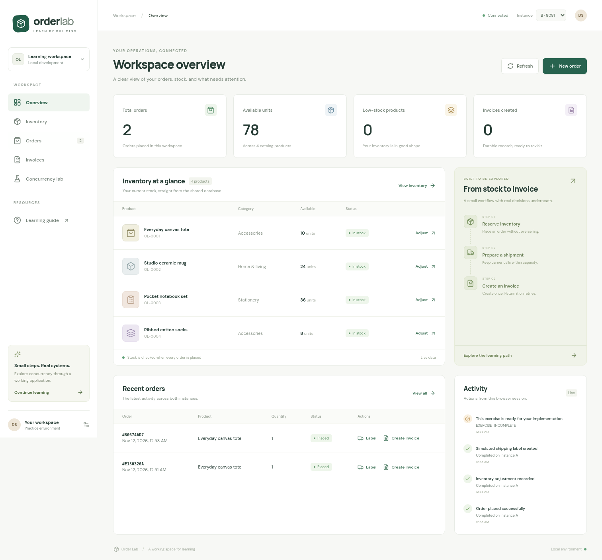

# Order Lab

A working operations workspace for learning transactions, concurrency, and durable idempotency. The React console talks to two Spring Boot instances sharing PostgreSQL and Redis. Your completed implementations are preserved; exercises 005 and 006 leave focused implementation TODOs.

## Run with Docker Compose

Requires Docker Engine with Compose, and Python 3 to generate a local password. From this directory:

```bash
./scripts/init-env.sh
docker compose --profile app up -d --build --wait
```

Open **http://localhost:5173**. API A is on `localhost:8080`, API B on `localhost:8081`. Dependencies bind only to loopback: PostgreSQL `5433`, Redis `6380`. The generated `.env` is ignored and is never committed. The first build downloads Java and Node dependencies.

```bash
docker compose --profile app logs -f --tail=80
docker compose --profile app down
```

Stopping preserves the database volume. `docker compose down -v` deletes it; that is a deliberate reset, not a normal stop command. Do not run the Compose stack and rootless stack simultaneously on the same ports.

## Run without administrator access

On Debian 13 with Java 21+, Node 22.12+ (Node 24 recommended), Python 3, `apt-get`, `dpkg-deb`, `gcc`, `make`, `curl`, and `tar`:

```bash
./scripts/bootstrap-local.sh
./scripts/dev.sh up
```

The bootstrap downloads PostgreSQL 17 packages and builds Redis **8.4.8** from its checksum-verified upstream source into ignored `.local/tools/`, without installing system services. Compose uses the same pinned Redis version. Redis 8.4+ supports native conditional deletion through `compareAndDelete`; on older Redis, use Lua or a `WATCH` transaction instead. Run `./scripts/install-redis.sh` to upgrade an existing local tool installation, then restart with `./scripts/dev.sh restart`. The runner initializes a private database with a generated password, starts both APIs, and serves the frontend at **http://localhost:5173**. It keeps credentials, data, PID records, and logs under `.local/`.

```bash
./scripts/dev.sh status
./scripts/dev.sh restart
./scripts/dev.sh down
```

Restart after backend changes. The frontend has live reload. The runner verifies process identity before stopping its background process groups; it does not stop system-wide PostgreSQL or Redis services. See the [runbook](docs/runbook.md) for recovery, logs, and configuration.



[Mobile preview](docs/assets/workspace-mobile.png) · Screenshots show actual local development data.

## Inspect the database with pgAdmin

Local `./scripts/dev.sh up` also starts **pgAdmin at http://127.0.0.1:5050**. Expand **Local development → Order Lab → Databases → orders** to browse the live schema. Right-click **orders → ERD For Database** to generate its table/foreign-key diagram, or open **Query Tool** to run SQL.

The local tool uses single-user mode, so there is no separate pgAdmin login. The Order Lab database connection is preconfigured using the existing local database password. Settings and the owner-readable password file stay under ignored `.local/state/pgadmin/`. This instance manages the rootless database; Compose startup does not start pgAdmin.

The bootstrap installs pinned pgAdmin into its own Python environment. An existing checkout can simply run `./scripts/dev.sh up`; it installs pgAdmin on first use. Installation requires internet and either `uv` or Python's venv/pip support (`python3-venv` on Debian). `./scripts/dev.sh status`, `down` and `restart` include pgAdmin. Installation can also be run separately with `./scripts/install-pgadmin.sh`.

## Use the workspace

- **Overview:** live stock, order and invoice totals, recent orders, and this browser's action feed.
- **Inventory:** search products and record signed stock adjustments with a reason.
- **Orders:** place an order through the real reservation transaction; request a simulated shipping label or an invoice.
- **Invoices:** inspect stored invoices and generate/open simulated text documents after exercise 005 is implemented.
- **Concurrency lab:** capture inventory through A and B, save A's correction, then observe B's stale-version conflict. These actions change local stock.
- **Learning guide:** find the six exercises and their implementation targets.

The instance selector routes requests explicitly through A or B. Both see the same database. All inventory/order mutations use the existing exercise services; the frontend does not simulate a successful save or hide server failures. Exercise 005 returns `501 / EXERCISE_INCOMPLETE` until its TODOs are solved. No real postage, billing, or legal invoice generation occurs.

The development profile seeds a four-product catalog once. Existing stock and orders survive restarts; no startup script silently clears learner data.

## Project layout

```text
frontend/                 React + TypeScript + Vite console, Docker/Nginx deployment
src/main/java/            Spring API, exercise implementations and focused TODOs
src/main/resources/db/    Flyway schema migrations and development-only fixtures
src/test/                 Existing checks; no new exercise tests are required
requirements/             Stable exercise IDs, targets and review criteria
docs/                     Architecture, API contract and operating instructions
scripts/                  Rootless bootstrap, lifecycle runner and Compose environment setup
compose.yaml              Shared dependencies and optional full-app profile
Dockerfile                Backend build and non-root runtime image
```

The backend remains in its existing location to preserve source paths and learner work. This project shares the parent learning repository's Git history.

## Build and validate

```bash
# Frontend dependency installation and type-checked production build
npm --prefix frontend ci
npm --prefix frontend run build

# Backend production package, without running tests
./mvnw -DskipTests package

# Existing regression suite, when wanted
./mvnw verify
```

Review is the default exercise verification. CI builds the frontend and runs the existing backend suite; no new exercise tests were added. The current verification record is in [docs/verification.md](docs/verification.md).

To develop against containerized dependencies only, start `docker compose up -d --wait` without the `app` profile, export your database password from your local configuration, run the APIs with the `dev` profile on 8080 and 8081, and run `npm --prefix frontend run dev`. Vite forwards `/api/a` and `/api/b`; Nginx provides the same routes in Compose. Both use a same-origin API boundary, so there is no permissive CORS configuration.

## Design and exercises

Read the [design document](docs/design.md), [API contract](docs/api.md), and [runbook](docs/runbook.md). Follow the [requirements index](requirements/README.md); start with [005 — Invoice idempotency and Redis ownership](requirements/005-invoice-idempotency-and-redis-lease.md) for the current unfinished exercise.

This is a loopback-only development workspace. Before exposing it publicly, add authentication, authorization, TLS, and deployment-specific secret management. Those are not supplied by the local UI.

Exercise [006](requirements/006-normalise-suppliers-and-optimise-orders.md) uses the real Inventory supplier contacts and deliberately slow Orders SQL. Optional workload data is supplied for the application tables.

## Production query exercises

Exercises [007–011](requirements/007-explain-production-order-queries.md) form a production SQL optimisation track: plan diagnosis, filters/search/indexes, pagination, related-data retrieval and aggregate reporting. In **Orders**, use **Order history** for bounded filtered pages and **Order totals by product** for reporting. Offset mode works; cursor mode reports exercise 009's missing implementation until completed. Work in `OrderHistoryRepository`; your 006 solution remains separate.

Optional development workload data in `scripts/seed-production-query-workload.sql` populates the same application tables with skew, timestamp ties and partially invoiced orders. It changes the app's history/counts without reserving stock. Read the exercise instructions before seeding. See the [API contract](docs/api.md) for filters and page metadata.

### Keep V1 and implement V2

The history and report panels have separate query-version selectors. V1 preserves the baseline for EXPLAIN comments; V2 initially returns an explicit unfinished-exercise error. Keep both implementations and use the [comparison template](docs/query-evidence/comparison-template.md). Shared indexes can affect both plans, so save the original V1 evidence first.

Report source options add [012 — Materialized reports](requirements/012-materialize-product-order-reports.md) and [013 — Redis report caching](requirements/013-cache-product-order-reports.md), with refresh/invalidation controls and actual generation/cache-status metadata. These paths remain 501 until implemented. Version rollout and change control is queued as a later topic in the root learning index.
