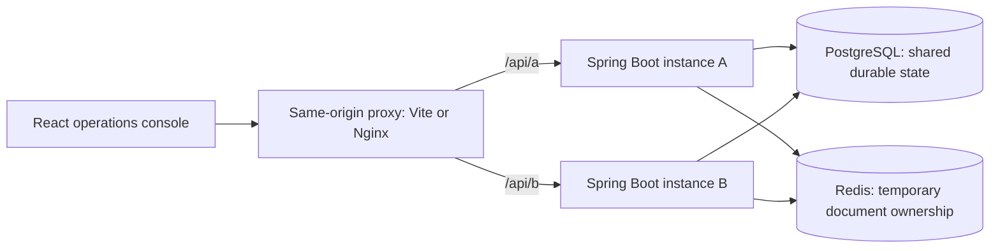
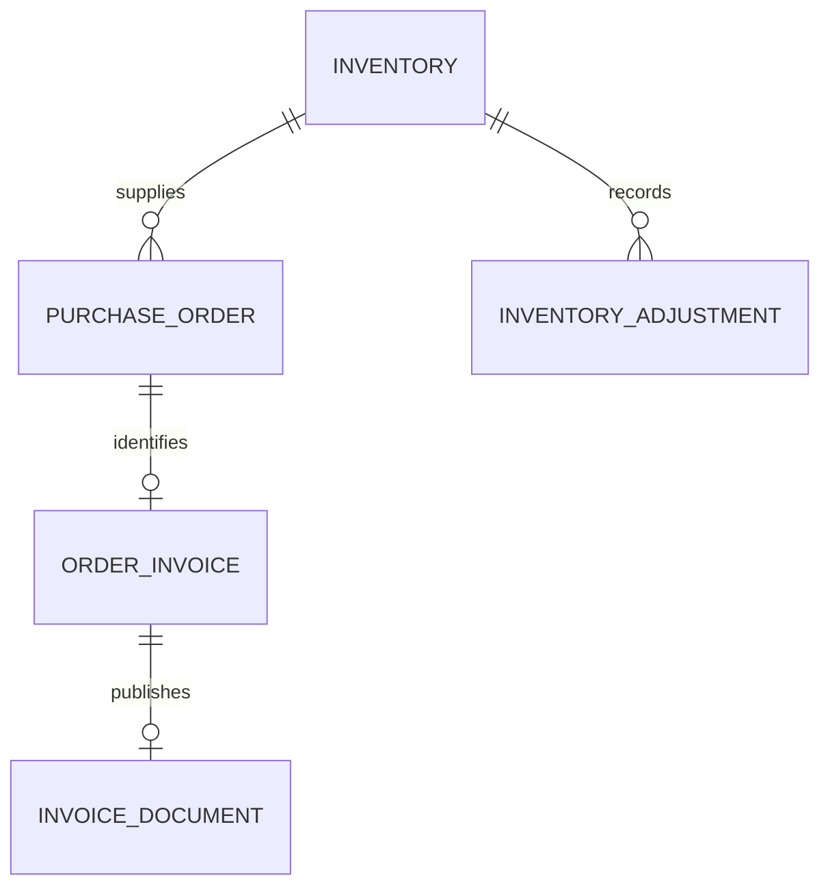

# Order Lab design

Order Lab makes backend concurrency mechanisms observable through an operations console. It is a learning application with working infrastructure and explicit exercise gaps, not a hosted commerce product.

## Architecture

The UI selects an instance explicitly so two-process behavior is visible without a load balancer obscuring the route. Two independent JVMs share database and Redis endpoints; Java objects and local capacity counters remain private to each instance.

Backend package boundaries:

| Package | Responsibility |
| --- | --- |
| `controller` | Request parsing, validation, HTTP mapping |
| `service` / `repository` | Transactional order and inventory behavior and persistence |
| `concurrency` | Local atomic capacity budget |
| `shipping` | Bounded, simulated carrier operations |
| `invoicing` | Durable invoice identity, document rendering and Redis lease lifecycle |
| `workspace` | Read-only projections for the dashboard |

The frontend lives beside the backend source tree without moving existing Java files. It uses React/TypeScript and purpose-built CSS. Local font files ship with the build. Its API client preserves status/error codes, applies a request timeout, and never substitutes fake success data. Dashboard reads refresh every 10 seconds and after mutations; older responses cannot overwrite a newer refresh. Dashboard projections are informational, not the boundary enforcing an inventory rule.

## Data model and invariants

| Rule | Enforcement |
| --- | --- |
| Stock cannot become negative | Guarded database reservation plus a schema constraint |
| Order and reservation succeed together | A short service transaction |
| Adjustment audit describes exact before/after values | Row locking through the complete adjustment transaction |
| A stale absolute correction cannot overwrite a newer write | Version predicate and version advancement by all application writers |
| At most two active simulated carrier calls per instance | One local capacity object, atomic claims, release on all exits |
| One invoice for an order | Unique order business identity and idempotent creation; exercise 005 TODO |
| Document requests avoid overlapping expensive work while ownership is valid | Shared expiring Redis lease; exercise 005 acquisition/release TODOs |
| A late renderer cannot replace an existing document | Immutable database publication with a unique invoice key |

V1–V6 are schema migrations. V2 and V7 are development-profile fixtures and are not applied in a production profile. The catalog migration extends inventory metadata without changing the learner's stock/version algorithms. Order timestamps support recent-order read models.

## Request boundaries

An order request validates input, conditionally reserves stock, inserts the order, and commits. No remote service call runs inside that transaction. The controller then returns the stored order. A competing reservation must pass the database predicate, independently of the application instance used.

An adjustment locks the inventory row, calculates a nonnegative next balance, updates it and the version, and inserts an audit record in the same transaction. A correction instead uses an expected version from the screen; the concurrency lab keeps captured versions fixed so a stale save is observable.

A shipping-label request reads an order, claims local capacity, calls a slow simulator outside a database transaction, and closes the claim on every exit. This is per-instance capacity, not a fleet-wide quota.

Invoice creation has a short database transaction that returns the durable winner for a business identity. Document creation reads the durable result first, acquires a lease only on a miss, rechecks after acquisition, renders outside a database transaction, publishes once, then releases only its own ownership token. Lease expiry can allow duplicate rendering. The database publication guard preserves one immutable result; it does not claim exactly-once execution.

## UI design

The visual hierarchy is an operational workspace: persistent navigation, instance selection, four summary metrics, a live inventory table, and recent orders. Green denotes normal state, amber attention or unfinished work, and red failures; text labels carry the same meaning. Empty states lead to meaningful actions rather than seeded fake activity.

The inventory and order screens have real search, forms, and server-side results. Native dialogs support keyboard dismissal and focus containment. Layouts collapse from a full sidebar into compact navigation on narrow screens. Form errors are surfaced without discarding input. The guide clearly separates implemented mechanisms from pending exercise 005. Local fonts and icons require no runtime asset service.

## Runtime and delivery

Compose's default services are PostgreSQL and Redis, preserving the existing exercise setup. The `app` profile adds two backend containers and a frontend/Nginx container, with health-gated dependencies. Backend containers run as a non-root user. Host ports bind to loopback. A rootless Debian runner supports this workspace without Docker or administrator access; it uses the same ports, APIs, Flyway migrations, and application profile.

PostgreSQL data survives normal stops. Redis ownership is deliberately ephemeral. `.local/`, `.env`, dependencies, build outputs, credentials, and logs are ignored. The GitHub workflow builds the frontend and runs the existing backend suite; it does not supply solutions or create exercise tests.

## Intentional limits

The app has no authentication, tenant boundary, payment integration, tax model, legal invoice numbering or real PDF renderer. The current price is an explicitly labelled fixture. Read projections return the latest 100 orders/invoices rather than an unbounded history. The API has not been load-tested or hardened for public exposure. Redis is one development node with no fencing or renewal; it reduces duplicate work rather than proving strict exclusive execution during partitions or failover.

These boundaries are part of the exercise design. Review [the distributed-concurrency note](../../../software-design/distributed-concurrency.md) for the guarantees and [the requirement index](../requirements/README.md) for learner-owned implementation work.
