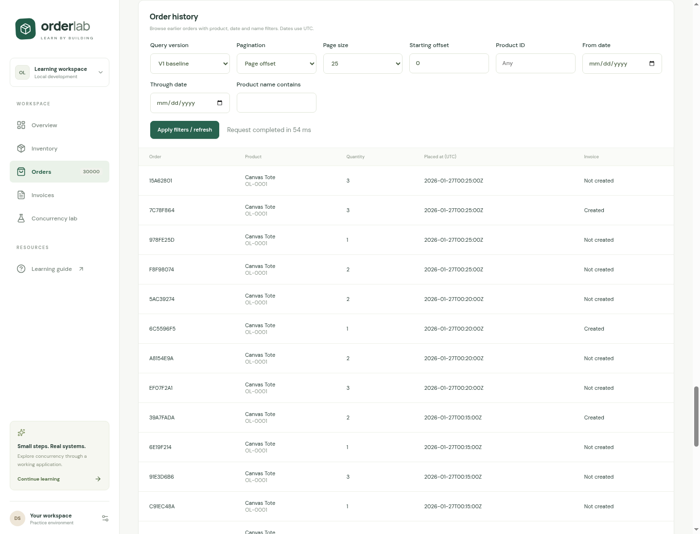
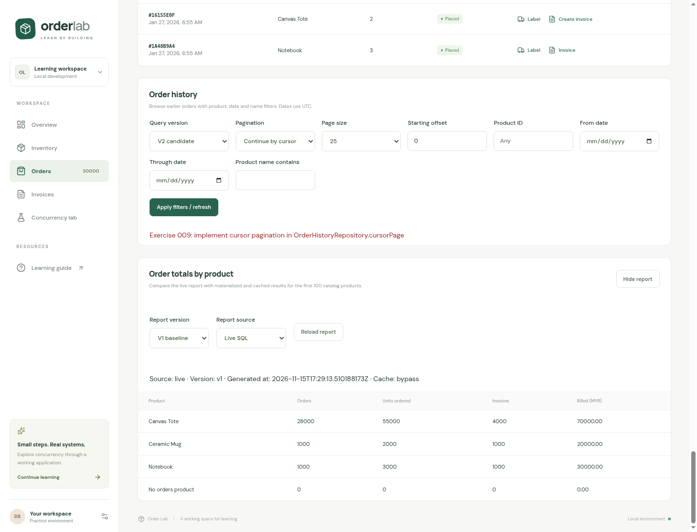

# Query evidence

Exercises 007–013 use this directory for sanitised plans and measured comparisons. Add the exercise's named Markdown file when you start it; no benchmark result or completed optimisation is supplied.

## V1/V2 comparison workflow

1. Keep V1 runnable, capture EXPLAIN and add your interpretation as comments next to its SQL.
2. Write the proposed improvement in V2 and state the measured hypothesis.
3. Compare results, plans, query count and timing under documented dataset/index/cache conditions.
4. Preserve both versions and their evidence; explain improvements and regressions instead of overwriting history.

Use the [comparison template](comparison-template.md). The app's version selectors expose V1 baseline and V2 candidate paths. Version/payload/schema compatibility and production rollout are a later learning topic in the repository queue, not supplied release automation.

For each comparison, record:

- PostgreSQL version, table/index sizes, row counts and relevant skew.
- The full SQL, bind values, page position, filters and expected result contract.
- `EXPLAIN (ANALYZE, BUFFERS)` output and your interpretation of rows, loops, buffers and sort work.
- Repeated comparable runs, cache/load conditions, query count and end-to-end request duration.
- Before/after result equivalence, including empty/missing children, ties and concurrent-change scenarios where relevant.
- The chosen tradeoff: database work, write/index/storage cost, application memory, round trips and consistency.

Do not commit credentials, real customer records or invented timings. Plans are observations for the captured dataset, not universal performance guarantees.

## Preparation validation

The new frontend production build and backend package build passed. Manual HTTP checks against a temporary PostgreSQL 17 database using the published V1–V8 schema passed for empty/default/next/filtered pages, literal substring search, invalid-input 400s, explicit cursor-mode 501, zero-order product totals and report sums. Running the new workload twice preserved 30,000 orders and 6,000 invoices. The temporary database was stopped after the check; the user's database and uncommitted V9 were not used.

This validates support behaviour, not learner implementation or performance improvement. The existing backend suite was not rerun for these exercise gaps; no new automated exercise tests were added.

The staged preparation also built successfully from a clean checkout excluding local learner solutions. Browser checks against that build passed for Next-page navigation, report loading and visible cursor-mode 501, with no uncaught browser errors. Desktop and mobile layouts were inspected. These screenshots show synthetic development data and support behaviour, not completed exercise solutions.

[Mobile preview with the explicit unfinished cursor path](assets/order-history-mobile.png).

## V1/V2 and report-source preparation checks

The frontend production build and backend package build passed, including a clean staged checkout excluding learner solutions. Manual API checks confirmed the original V1 pages/report, live report metadata, invalid-version/source 400s and explicit 501s for V2, cursor, materialized reads/refresh and Redis reads/invalidation. Browser checks confirmed page navigation, report source selectors, visible refresh/invalidation gaps and no uncaught browser errors. The revised note was rendered and inspected. Materialized refresh/caching themselves remain unimplemented and unverified learner work.

