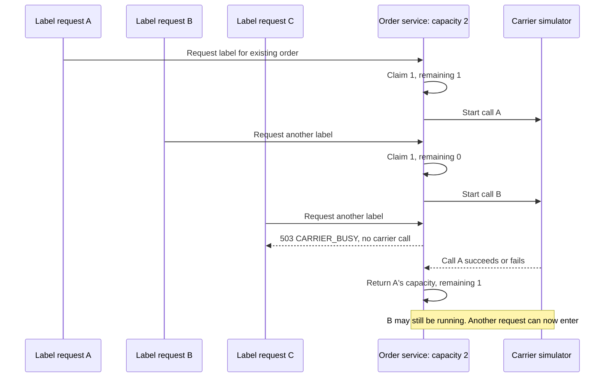

# 003 — Protect carrier calls with local CAS capacity

**Status:** in-review

**Learning:** [Lock selection and CAS](../../../java/concurrency-and-thread-pool-design.md#choose-a-lock-or-atomic-mechanism-by-its-boundary)

**Dependencies:** Java 21 and the existing order service. Unit checks require no database; HTTP checks start temporary PostgreSQL automatically. The manual flow uses an existing order from 001.

## Business requirement

Warehouse staff request a shipping label for an order. Carrier calls are slow and consume connections and memory. Each order-service instance may have **at most two active carrier calls**. If both slots are occupied, reject another label request with **503 / CARRIER_BUSY**, without calling the carrier. Capacity becomes available again when a call finishes, including when it fails.

This is a real resource-protection pattern exercised through the application's HTTP API. The supplied carrier is a **local simulator**, not a paid integration: it waits for a configured duration and returns `simulated: true` with a `DEMO-` reference. No postage is purchased, label saved, or order shipped. The capacity guard has passed code review by inspection; runtime verification of the completed integration remains pending.



The limit applies to all orders sharing one service instance. It must not be recreated for every request or held only while submitting work. Do not serialize the entire carrier call: two requests should overlap when capacity is two.

## API and supplied pieces

| Endpoint/result | Behavior |
| --- | --- |
| `POST /orders/{orderId}/shipping-labels` | No request body; successful simulated call returns `200` |
| Missing order | `404 / NOT_FOUND` before reaching the carrier |
| Invalid UUID | `400 / INVALID_REQUEST` |
| Capacity exhausted | Required `503 / CARRIER_BUSY`; no waiting queue or automatic retry |
| Carrier unavailable | Supplied translation to `502 / CARRIER_UNAVAILABLE` |

Success contains `orderId`, `carrierReference`, and `simulated`. Stock and order status must remain unchanged.

Supplied: controller, order lookup, error mapping, carrier interface and simulator, configuration, the shared capacity instance, claim/release implementation, and tests. Your completed [LocalCapacity.tryClaim](../src/main/java/dev/learning/orders/concurrency/LocalCapacity.java) is preserved.

## Reviewed implementation

The implementation passed code review by inspection in [ShippingLabelService.createWithCapacity](../src/main/java/dev/learning/orders/shipping/ShippingLabelService.java):

- Claim one unit from the existing shared `capacity` before invoking `callCarrier(order)`.
- On insufficient capacity, throw an `OrderProblem` with `HttpStatus.SERVICE_UNAVAILABLE` and code `CARRIER_BUSY`; do not call the carrier.
- Return the carrier result and release the successful claim on all exits, including unexpected exceptions.
- Keep the claim alive throughout the synchronous call. Avoid a database transaction or database lock around the slow carrier operation.

The reviewed code holds the successful claim with try-with-resources around `callCarrier`, rejects exhaustion before calling the carrier, and uses the shared capacity instance. The completed TODO and redundant null check were removed.

`LocalCapacity.tryClaim(1)` returns an `Optional<Claim>`; an empty value means admission failed. `Claim` implements `AutoCloseable`, and repeated close calls release only once. Java try-with-resources closes an acquired resource on both normal and exceptional exit; choose a scope covering the whole operation.

`@Service` makes `ShippingLabelService` a Spring-managed object, singleton by default. Spring injects the order service and carrier through its constructor, so requests use one shared capacity object. `@Value` reads the two settings below. `@PostMapping` connects the controller method to HTTP POST; `@PathVariable` binds the order UUID. Existing `ApiErrors` converts `OrderProblem` to JSON and its selected HTTP status. [Spring dependency injection](https://docs.spring.io/spring-framework/reference/core/beans/dependencies/factory-collaborators.html), [Spring MVC request mapping](https://docs.spring.io/spring-framework/reference/web/webmvc/mvc-controller/ann-requestmapping.html)

| Setting | Default | Purpose |
| --- | --- | --- |
| `shipping.max-concurrent` | `2` | Positive per-instance carrier limit |
| `shipping.demo-delay-millis` | `1000` | Simulator latency; nonnegative |

## Checks and manual use

From `practice/order-service/`:

```bash
# Supplied pieces and existing order API.
./mvnw -Dtest=ShippingLabelSupportTests,ScaffoldTests,LocalCapacitySupportTests test

# Your CAS component and new application behavior.
# Verify the reviewed shipping-label integration.
./mvnw -Dtest=CasExerciseTests,ShippingLabelExerciseTests,ShippingLabelHttpExerciseTests test
```

| Check | Required result |
| --- | --- |
| Two callers enter when limit is two | Both carrier calls overlap |
| Third request while two calls remain active | Prompt capacity rejection; only two calls reached the carrier |
| A call completes | Its slot can be reused |
| Carrier failure | `502`; its slot can be reused |
| Unexpected client exception | Slot still restored |
| HTTP label request for existing order | `200`, matching order ID, clearly simulated result; no stock or status change |
| Existing atomic checks | No oversubscription, correct retries and idempotent release |

Contention tests use latches to hold two carrier calls open; they do not rely on guessing a sleep duration. Unit tests exercise the service boundary; the HTTP test exercises controller wiring, order lookup, JSON output, and unchanged database state.

For manual use, follow the application README to start PostgreSQL, then increase simulator latency to make overlapping requests easy to observe:

```bash
./mvnw spring-boot:run -Dspring-boot.run.profiles=dev \
  '-Dspring-boot.run.arguments=--shipping.demo-delay-millis=10000'
```

Place an order through the existing API and copy its UUID. To verify the reviewed implementation, run the following command in two terminals, then a third terminal while the first two are still waiting:

```bash
curl -i -X POST http://127.0.0.1:8080/orders/REPLACE_WITH_ORDER_UUID/shipping-labels
```

Expect the third request to return `503` before the first two complete. A later request should succeed after a slot is released.

## Production boundaries

CAS protects a local memory budget. Three instances with limit two can collectively make six calls; a provider-wide quota needs shared coordination or partitioned budgets. A real carrier adapter also needs bounded connection/read deadlines. A slot should represent the actual outstanding call: an HTTP caller disconnecting does not automatically cancel work already executing.

This exercise protects concurrency, not duplicate purchases or uncertain external outcomes. Labels are simulated, unpersisted, and may be requested repeatedly. Before using a paid carrier, add durable operation identity, provider-supported idempotency, and outcome recovery as described in [reliable asynchronous operations](../../../software-design/reliable-asynchronous-operations.md). A `503` here means the carrier was not called; a provider failure or timeout can have a different meaning. A standard semaphore is normally preferable when its permit semantics meet the production need; the custom CAS budget remains here to practise the mechanism.

## Verification record

Compilation and application startup passed. The focused run passed 11 checks: `ScaffoldTests` (5), `ShippingLabelSupportTests` (2), `LocalCapacitySupportTests` (1), and your completed `CasExerciseTests` (3). The new shipping-label checks reported 4 expected assertion failures and 1 expected error across 5 tests because the service TODO then returned `501 / EXERCISE_INCOMPLETE`. Those results predate the completed service implementation. The service has now passed code review by inspection, but its runtime acceptance checks have not been rerun; status is in-review. Earlier transaction/locking exercise suites and the manual terminal walkthrough were not rerun.
