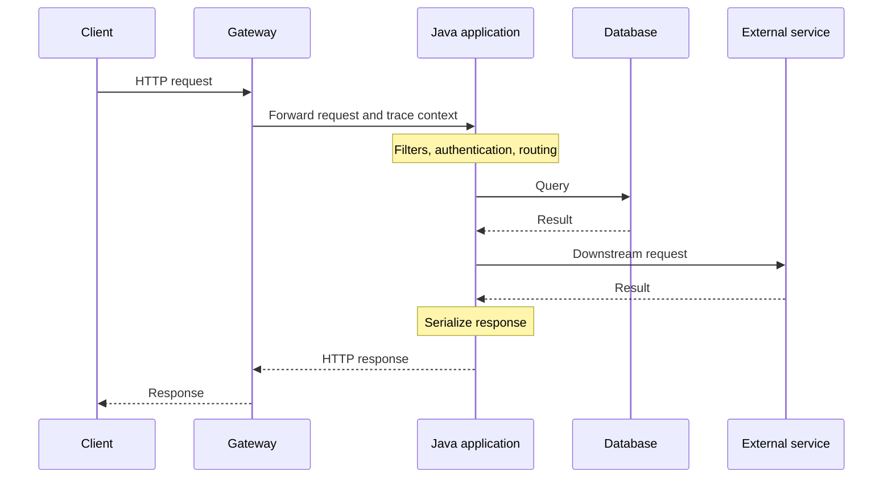
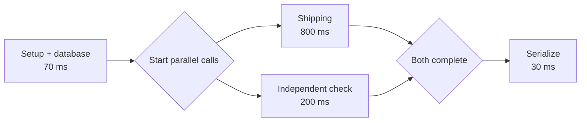
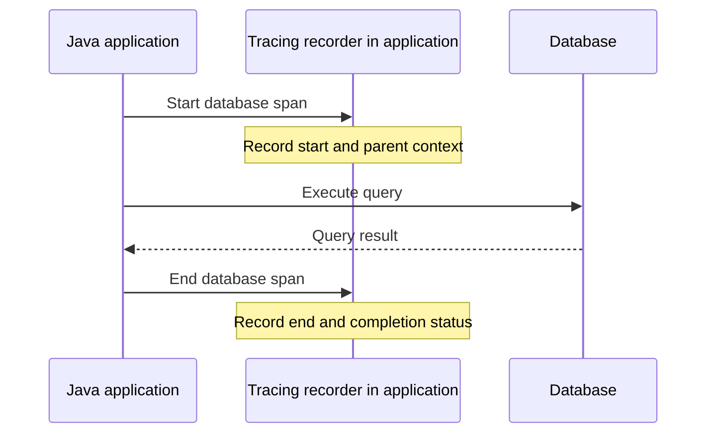
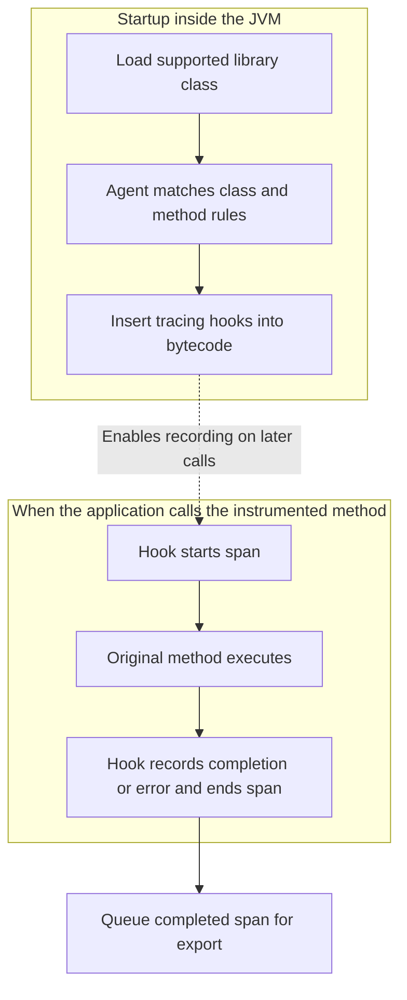
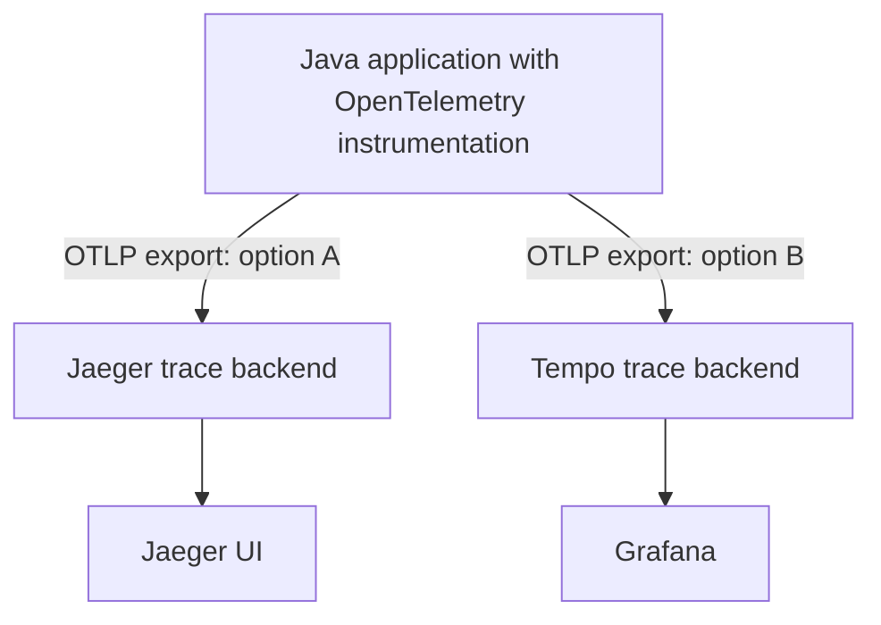
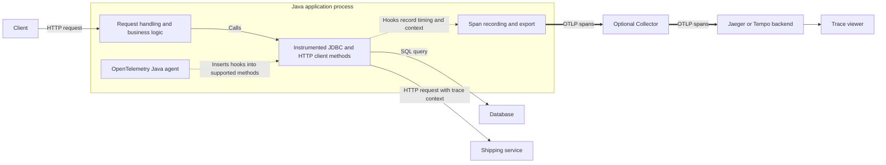

# Production request lifecycle — latency, logs, metrics, and traces

A request can be slow even when the Java business logic runs quickly. Understand the full path and the measurement boundaries before choosing what to optimize.

## Request lifecycle



This is a synchronous example. Real applications may add caches, parallel calls, retries, or asynchronous work.

## Latency measurement boundaries

Latency is elapsed time between two chosen events. Always ask: **where does the timer start, and where does it stop?** There is no single latency measurement that automatically covers everything.

| Measurement | Typical start and end | What it helps explain |
|---|---|---|
| User-perceived action time | User clicks → useful result appears | Overall experience, including frontend work and possibly multiple requests |
| Client HTTP duration | Client begins request → response body received | Request round trip, including server time and relevant transport/setup costs |
| Gateway request duration | Gateway receives request → finishes responding | Work inside and downstream of the gateway |
| Application request duration | Server instrumentation starts → ends request handling | Work and waiting within that instrumented boundary |
| Dependency call duration | Application starts DB/HTTP operation → operation completes | One dependency operation, including the waiting covered by its timer |

Exact boundaries vary by implementation. Time to first byte is different from time to receive the whole response. A controller timer may exclude filters and response serialization. A server timer may miss waiting that occurs before instrumentation begins. OpenTelemetry defines separate server and client HTTP duration metrics; inspect the instrumentation to understand what your application records. [HTTP metric conventions](https://opentelemetry.io/docs/specs/semconv/http/http-metrics/)

For an illustrative user action, read the nesting as contained time, not additional time:

```text
User action to visible result:       1,200 ms
  Frontend work before request:        100 ms
  Client HTTP duration:             1,000 ms
    Work within server boundary:      800 ms
    Remaining transport/edge work:    200 ms
  Frontend work after response:        100 ms
```

The outer pieces deliberately do not overlap. The 200 ms remainder could include transport, edge processing, buffering, or mismatched boundaries; it does not prove a network problem.

Choose the boundary for the question, then keep its definition consistent. A 100 ms application timer does not rule out a 2-second user action. Prefer a label such as **HTTP server request duration, p95** over just “latency.”

Elapsed time may be spent on:

- Connection setup, routing, and transport.
- Queues, connection acquisition, locks, and downstream responses.
- Authentication, business logic, query execution, and serialization.

Follow the **critical path**: the work and waiting that determine when the response can finish. Parent timers include their children; parallel work overlaps.



In this illustrative parallel version, elapsed time is `70 + max(800, 200) + 30 = 900 ms`, assuming no extra scheduling overhead. It is not `1,100 ms`. Optimizing the 200 ms check alone cannot shorten the 800 ms branch.

## Operation timing and instrumentation

**Instrumentation is code that records what an application does.** An agent, a library, or your own code places recording around an operation. The recording has a start and an end, so it can calculate elapsed time without printing timestamps to a log.

For Java timing within one process, use a monotonic elapsed-time source:

```java
long started = System.nanoTime();
try {
    performOperation();
} finally {
    long elapsedNanos = System.nanoTime() - started;
    // Record elapsedNanos in a timer or duration histogram.
}
```

This measures elapsed time, including waits, rather than CPU time alone. It is a timing illustration, not a substitute for request instrumentation. Do not subtract `nanoTime()` values from different machines.

The same wrapping idea applies to tracing, but tracing also records the operation's identity and relationships. Starting a span records its beginning; ending it records completion. The operation still runs normally between those events.

The following diagram shows that mechanism for one database call. The tracing recorder represents instrumentation running inside the application; it is not another network service called before every query.



With automatic instrumentation, the agent or library performs the recording. With manual instrumentation, you add it around a meaningful operation. The diagram is conceptual: the actual code and API depend on the tool.

## Spans and trace structure

A **span** is one recorded operation. A **trace** connects related spans into a request journey. It is different from a Java exception stack trace.

For example, an application retrieves an order and then asks a shipping service for its status. Instrumentation can produce records like these:

| Operation | Trace ID | Span ID | Parent span ID | Start offset | End offset | Duration |
|---|---|---|---|---:|---:|---:|
| HTTP request | T1 | A | — | 0 ms | 900 ms | 900 ms |
| Database query | T1 | B | A | 20 ms | 70 ms | 50 ms |
| Shipping call | T1 | C | A | 70 ms | 870 ms | 800 ms |

The IDs here are shortened for illustration, and times are relative to the application request start.

- The trace ID groups work belonging to this request.
- The parent span ID shows which operation contains or initiated another.
- Timing determines the length and position of each bar in the viewer.

```text
Time →       0       20   70                         870  900 ms

Request      [===========================================]
Database              [==]
Shipping                  [===========================]
```

Instrumentation records and exports structured spans. The viewer reconstructs the timeline from those records; it does not need to parse printed log lines. [OpenTelemetry traces](https://opentelemetry.io/docs/concepts/signals/traces/)

To continue the trace across an HTTP service boundary, instrumentation propagates context, commonly through request headers. The receiving service uses that context when creating its spans. Sharing only an ordinary request ID does not automatically establish these tracing relationships.

**Trace detail depends on instrumentation support and configuration.** A backend can display the spans it receives, but cannot reconstruct operations that were never recorded.

| Part | Responsibility |
|---|---|
| Agent, instrumented library, or manual code | Decide where spans start and end; record timing and context |
| Exporter and optional Collector | Send and process telemetry |
| Trace backend and viewer | Store spans and display timing and relationships |

The same 900 ms request can expose different evidence:

| Instrumentation | What the viewer can show | What remains unknown |
|---|---|---|
| HTTP server only | Request: 900 ms | Internal breakdown |
| HTTP server + JDBC + HTTP client | Request: 900 ms; query: 50 ms; shipping: 800 ms | Uninstrumented gaps and downstream internals |

More recorded detail changes the explanation available to you, not the request’s elapsed time.

Automatic instrumentation typically targets supported frameworks and libraries. It does not necessarily produce a span for your `calculateDiscount()` method, database connection acquisition, or every retry attempt. Add manual spans when those distinctions matter.

Standards make telemetry interoperable; they do not guarantee identical coverage or timing boundaries across tools. Ask what is instrumented and exactly where each timer starts and ends.

### Java instrumentation

For the general agent lifecycle, `premain`, and a coverage example, see [Java agents](../java/java-agents.md). This section focuses on tracing.

A **Java agent** is a helper JAR attached to the JVM through `-javaagent`. It runs inside the same process as your application and can add recording hooks to supported classes. Here, “agent” means an attached software component, not an AI agent.

You usually configure existing instrumentation first, then implement missing business-level detail.

| Approach | What you do | How recording is added |
|---|---|---|
| Java agent | Attach and configure the agent | Transform supported classes to insert recording hooks |
| Framework integration | Add dependencies and configuration | Use framework filters, interceptors, or observation callbacks |
| Manual instrumentation | Start and end spans in your code | Explicitly record meaningful business operations |

The OpenTelemetry Java agent uses a class transformer to modify bytecode as supported classes load. Integrations identify specific library classes and methods; the agent is not guessing what every method does. Source files remain unchanged. [Agent internals](https://github.com/open-telemetry/opentelemetry-java-instrumentation/blob/main/docs/contributing/javaagent-structure.md)



Startup inserts the hooks; later calls execute them. The original method still performs the operation, and errors continue back to the caller. The recorder measures time inside the application; it does not call Jaeger to start a stopwatch.

For a synchronous query, the effect is conceptually:

```text
start database span
try:
    execute original query
on error:
    record error and rethrow
finally:
    end span
```

For asynchronous work, completion callbacks may end the span later. Instrumentation must also carry context into that work to preserve tracing relationships.

## Tracing ecosystem and tool responsibilities

These tools occupy different layers. **OpenTelemetry records and exports; a backend stores; a viewer displays.** OpenTelemetry provides instrumentation, APIs, SDKs, and a Collector. It is not a searchable trace database.

| Tool | Responsibility |
|---|---|
| OpenTelemetry Java agent | Instrument supported operations, record spans, and export telemetry |
| Micrometer Tracing | Integrate tracing with Spring Boot observations |
| OpenTelemetry Collector | Optionally receive, process, and forward telemetry |
| Jaeger | Receive and store traces; provide a trace investigation UI |
| Grafana Tempo | Receive and store traces |
| Grafana | Query data sources such as Tempo and visualize results |



The branches illustrate alternative setups. You do not need both backends. Grafana can also query Jaeger; these pairings are examples rather than mandatory combinations. Jaeger and Tempo do not automatically instrument your application. [Jaeger setup](https://www.jaegertracing.io/docs/2.22/getting-started/), [Tempo introduction](https://grafana.com/docs/tempo/latest/introduction/)

The application SDK usually buffers telemetry temporarily for export. A Collector can also buffer or queue data, depending on configuration. These delivery buffers serve a different purpose from the backend's searchable historical storage.



Solid thin arrows show request execution and display access. Dotted arrows show instrumentation. Thick arrows carry exported telemetry. Responses are omitted for readability.

The agent and recording code run inside the JVM. The Collector and trace backend are separate services. An agent also instruments supported server request handling; the diagram highlights dependency methods to show how their timings are captured.

The Collector is optional: the local Jaeger setup above exports directly to Jaeger. To see the shipping service's internal operations, instrument that service too and propagate trace context; it exports its own spans to the backend.

Coverage controls which operations are recorded. Sampling controls which traces are retained or exported, depending on the setup. Missing spans can also result from broken context propagation or telemetry delivery failures.

### OTLP export format

**OTLP**, the OpenTelemetry Protocol, defines telemetry messages and their delivery. OTLP/gRPC uses binary Protocol Buffers (Protobuf). OTLP/HTTP supports binary Protobuf or a JSON representation of the same message schema. The Java setup below uses `http/protobuf`, so the actual payload is binary. [OTLP specification](https://opentelemetry.io/docs/specs/otlp/)

<details>
<summary>Expand wire-format example and field meanings</summary>

Here is a readable, illustrative OTLP JSON request containing one server span. Real exports can batch multiple spans and resources.

```json
{
  "resourceSpans": [
    {
      "resource": {
        "attributes": [
          {
            "key": "service.name",
            "value": { "stringValue": "order-service" }
          }
        ]
      },
      "scopeSpans": [
        {
          "scope": {
            "name": "example-http-instrumentation"
          },
          "spans": [
            {
              "traceId": "5b8efff798038103d269b633813fc60c",
              "spanId": "eee19b7ec3c1b174",
              "name": "GET /orders/{id}",
              "kind": 2,
              "startTimeUnixNano": "1544712660000000000",
              "endTimeUnixNano": "1544712660900000000",
              "attributes": [
                {
                  "key": "http.request.method",
                  "value": { "stringValue": "GET" }
                }
              ]
            }
          ]
        }
      ]
    }
  ]
}
```

This follows the structure of the [official OTLP trace example](https://github.com/open-telemetry/opentelemetry-proto/blob/main/examples/trace.json).

| Field | Meaning |
|---|---|
| `resource` | Identity and attributes of the producing application |
| `scope` | Identity of the instrumentation producing spans |
| `traceId` | Groups spans belonging to one trace |
| `spanId` | Identifies this operation |
| `parentSpanId` | Connects a child to its parent; omitted for this root span |
| `name` | Operation name |
| `kind: 2` | Identifies a server span |
| `startTimeUnixNano` / `endTimeUnixNano` | Start and end as nanoseconds since the Unix epoch |
| `attributes` | Typed key/value details about the operation |

End minus start here is 900,000,000 nanoseconds, or **900 ms**. JSON represents these 64-bit timestamps as decimal strings to preserve precision. Trace and span IDs are hex-encoded; span kind uses a numeric enum. [OTLP JSON encoding](https://opentelemetry.io/docs/specs/otlp/#json-protobuf-encoding)

A database child span shares the trace ID, has its own span ID, and points to this span through `parentSpanId`. That is how a backend can reconstruct the relationship without comparing printed log lines.

</details>

Compatible backends understand the agreed message schema. You can often change the export destination without rewriting instrumentation, but must configure the supported protocol, signal, endpoint, and authentication. Each backend can use its own internal storage format and offer different query or display features. OTLP is an exchange protocol, not a mandated storage format.

## A practical Java tracing setup

OpenTelemetry plus Jaeger is a straightforward learning setup. Spring Boot also supports a Micrometer-based integration; inspect existing configuration before combining instrumentation approaches to avoid duplicate recording. [Java agent](https://opentelemetry.io/docs/zero-code/java/agent/), [Spring Boot tracing](https://docs.spring.io/spring-boot/reference/actuator/tracing.html)

<details>
<summary>Expand local Jaeger and Java-agent setup commands</summary>

For a local exercise, run Jaeger with temporary in-memory storage:

```bash
docker run --rm --name jaeger \
  -p 16686:16686 \
  -p 4318:4318 \
  cr.jaegertracing.io/jaegertracing/jaeger:2.22.0
```

Download the OpenTelemetry Java agent JAR from its official release page linked in the setup guide. Assuming the agent and application JARs are in the current directory and the application runs on your host:

```bash
OTEL_SERVICE_NAME=order-service \
OTEL_TRACES_EXPORTER=otlp \
OTEL_EXPORTER_OTLP_PROTOCOL=http/protobuf \
OTEL_EXPORTER_OTLP_ENDPOINT=http://localhost:4318 \
OTEL_METRICS_EXPORTER=none \
OTEL_LOGS_EXPORTER=none \
java -javaagent:./opentelemetry-javaagent.jar -jar app.jar
```

This exercise exports traces using OTLP, the OpenTelemetry Protocol. Metrics and log exports are disabled here; ordinary application logging still works. Containerized applications need an endpoint reachable from their container rather than the host-local address shown above. [Agent setup](https://opentelemetry.io/docs/zero-code/java/agent/getting-started/)

Make requests to an endpoint that accesses a database or downstream service. Open `http://localhost:16686`, choose `order-service` and a time window, find a slow trace, and inspect its waterfall. Instrument the downstream service too if you want to see its internal work. Jaeger's local storage is lost when the container stops; this is a learning setup. The commands are adapted from official guides and have not been run in this repository. [Jaeger setup](https://www.jaegertracing.io/docs/2.22/getting-started/)

</details>

## Logs, metrics, and traces

| Signal | Question | Example |
|---|---|---|
| Metrics | How widespread is the problem? | Endpoint p95 rises during increased traffic |
| Traces | Where did a particular request spend time? | A downstream call accounts for most of a slow request |
| Logs | What specific event happened? | A dependency timed out on its second attempt |

**Traces are useful independently of logs.** The timeline above already points toward the shipping call. Connected downstream spans could narrow the delay further. Span attributes, status, and events can provide additional context.

Logs can add details such as “provider timed out; retrying,” but are not required to calculate span duration. A trace ID in a log helps you find the corresponding trace. Neither signal automatically proves the root cause, and a sparse trace may only identify a broad area to investigate.

## A trace in a real application

Suppose `GET /orders/42` retrieves an order and asks a shipping service for its status. The following is an illustrative trace view; all offsets are relative to the application request start, and operations are sequential here:

```text
Trace ID: example-order-request

Operation                         Start offset     Duration
GET /orders/{id}                   0 ms             900 ms
  validate request                0 ms              20 ms
  load order                     20 ms             200 ms
    acquire DB connection        20 ms             150 ms
    SELECT order                170 ms              50 ms
  GET shipping-service/status   220 ms             650 ms
  map and serialize response    870 ms              30 ms
```

The shipping call is the largest measured operation. The database section is dominated by acquiring a connection, not executing SQL. Do not add the 900 ms parent to its children: the parent contains them.

This identifies where to investigate, not the final cause. A 650 ms HTTP client span may include network time, connection acquisition, retries, and shipping-service processing. If the shipping service exports connected spans, inspect its work next. Otherwise, use its logs and metrics or add instrumentation.

The detailed connection-acquisition and business-operation spans in this example are not guaranteed to appear automatically. Without them, the trace may show a long request with only a short query inside it; the remaining time needs investigation.

## Investigation workflow

1. Define the symptom: endpoint, time window, percentile, error rate, and measurement boundary.
2. Check traffic, saturation, and recent changes. Affected instances may differ.
3. Inspect several slow traces and compare with normal ones. Include successful requests.
4. Follow the longest relevant work or unexplained gap, respecting nesting and overlap.
5. Correlate logs by trace ID where available. Check pool metrics, query plans, queues, CPU, and garbage collection as appropriate.
6. Form a hypothesis and compare a targeted change under similar load.

For connection contention, investigate pool usage, acquisition time, transaction duration, and database capacity. Increasing a pool may reduce local waiting while overloading the database.

If a long span contains no useful children, add a small number of meaningful spans. If CPU work is suspected, profiling can show which methods consume CPU; tracing alone is not a method-level profiler.

## Metrics: from individual requests to system health

A trace explains one recorded request. Metrics summarize behavior across requests and over time. For example, every completed request can update a request counter and a duration histogram without storing a trace for that request.

| Metric shape | What it records | Example |
|---|---|---|
| Counter | Accumulated events; typically resets on process restart | Completed requests or errors |
| Gauge | Current value that can rise or fall | Active connections or queue size |
| Histogram | Distribution of observed values | Request durations |

A counter value is not a request rate: calculate change over time, accounting for resets, to obtain requests per second. A duration histogram groups measurements into ranges rather than requiring every individual timestamp to be retained.

### Latency percentiles: p50, p95, and p99

Imagine sorting durations from fastest to slowest. A percentile describes a position in that distribution. It is not a percentage of CPU usage, the average of the slowest requests, or a guarantee for the next request.

For an exact-data teaching example, use the nearest-rank rule: position = ceiling(percentile × number of observations). Other calculation methods and histogram estimates can differ.

Suppose one endpoint records 100 requests in five minutes:

| Sorted positions | Count | Duration for each request |
|---|---:|---:|
| 1–90 | 90 | 100 ms |
| 91–95 | 5 | 300 ms |
| 96–99 | 4 | 1,000 ms |
| 100 | 1 | 5,000 ms |

The average is `(90 × 100 + 5 × 300 + 4 × 1,000 + 5,000) / 100 = 195 ms`.

| Measure | Result | Interpretation in this example |
|---|---:|---|
| p50 | 100 ms | The middle request is fast |
| p95 | 300 ms | 95 requests finish within 300 ms; 5 take longer |
| p99 | 1,000 ms | 99 finish within 1 second; one takes 5 seconds |
| Maximum | 5,000 ms | Worst observation in this window |

Read the sorted positions: p95 lands on request 95 at 300 ms; p99 lands on request 99 at 1,000 ms. Request 100 still takes 5,000 ms. The average hides this tail, and a percentile does not describe the severity beyond its threshold.

Always state the endpoint, boundary, time window, and population. **Application request p95 for successful GET /orders/{id} requests over five minutes** is much more meaningful than “p95 latency.” A request percentile does not mean the same percentage of distinct users had that experience. With few observations, high percentiles are unstable and may be driven by one request.

A histogram may count how many durations fall below 100 ms, 300 ms, 1 second, and other boundaries. The backend estimates the requested percentile from the distribution. Bucket resolution affects accuracy; a displayed p95 may be an estimate rather than an observed request's exact duration.

To obtain a service-wide percentile, combine compatible distributions before computing the percentile. Averaging instance-level p95 values cannot recover the overall p95. Precomputed quantiles from summaries are generally not aggregatable this way. [Prometheus histograms and summaries](https://prometheus.io/docs/practices/histograms/)

### Four golden signals

| Signal | Question | Example measurement |
|---|---|---|
| Latency | How long does work take? | HTTP request p50, p95, p99 |
| Traffic | How much work arrives? | Requests per second |
| Errors | How much work fails? | Failed requests divided by all requests in the same window |
| Saturation | Which resources are near their limit? | Pool occupancy, waiting threads, queue depth |

These signals connect user symptoms with workload and capacity. Separate successful and failed latency: quick failures can make combined latency look faster. Define errors according to intended behavior, including relevant business failures rather than only HTTP 500s. [Google SRE](https://sre.google/sre-book/monitoring-distributed-systems/)

For example, imagine p95 rises from 200 ms to 2 seconds while traffic doubles, all database connections are occupied, and acquisition waiting grows. This suggests connection contention worth investigating; it does not prove the database needs more connections. Slow queries or long transactions might be occupying the pool. Use representative traces and supporting database evidence to test the hypothesis.

Label metrics with bounded dimensions such as route templates and outcome categories. Raw URLs containing IDs, user IDs, and trace IDs can create huge numbers of distinct time series, called high cardinality. Keep individual request identifiers in traces and logs instead.

## Common mistakes

- Treating latency as only network travel time.
- Assuming backend duration equals the user's total experience.
- Optimizing logic while most time is spent waiting.
- Averaging p99 values across instances instead of calculating from combined observations or suitable histograms.
- Using request IDs or user IDs as metric labels, creating excessive cardinality.
- Treating sampled traces as a complete record.
- Assuming every Java method or pool wait is automatically traced.
- Treating the slowest observed operation as a proven root cause.

## Practice

Introduce a slow query, then separately introduce connection-pool contention. Compare request timing, traces, and pool metrics. Explain which observations distinguish execution from waiting and which extra instrumentation you need.

Tracing is a **cross-cutting concern**: it adds observation around many operations while business code stays focused on its purpose. This connects to **aspect-oriented programming (AOP)** and its philosophy of separation of concerns. The Java agent achieves this through bytecode instrumentation; it does not require Spring AOP. The next note will explore AOP separately.

## Check your understanding

1. A 900 ms request contains an 800 ms call and a parallel 200 ms check. Is its duration 1,000 ms?

   <details>
   <summary>Show answer</summary>

   No. Parallel durations overlap and parent timers already include children. Identify the critical path and any surrounding work instead of summing all span durations.

   In the parallel example, both branches start after 70 ms of setup and database work. The 200 ms branch finishes first, but the request still waits for the 800 ms shipping call. Adding 30 ms of serialization gives 70 + max(800, 200) + 30 = 900 ms. Reducing the shorter branch alone does not shorten this critical path.

   </details>

1. The trace contains only a long HTTP span. Can the viewer recover the missing SQL timing?

   <details>
   <summary>Show answer</summary>

   No. Check instrumentation coverage, context propagation, sampling, and export delivery. Add targeted instrumentation where needed; a backend cannot invent unrecorded operations.

   First distinguish missing recording from missing delivery. The SQL operation may have no supported instrumentation, or recorded spans may have been dropped or disconnected. Database logs and pool metrics can provide other evidence, but they do not retroactively create the missing span. Add recording at the boundary needed to test the hypothesis.

   </details>

1. p95 is 300 ms. Does that tell you how slow the worst request was?

   <details>
   <summary>Show answer</summary>

   No. In the teaching example, p95 is 300 ms while the maximum is 5,000 ms. State the population, measurement boundary, and time window. Do not average instance p95 values to obtain a service-wide p95.

   Using the note’s nearest-rank example of 100 requests, the 95th sorted request takes 300 ms. The last five can still be much slower; one takes 5 seconds. The percentile describes a position, not the values beyond it. Service-wide aggregation needs the combined distribution because an instance percentile does not retain that distribution.

   </details>

1. Which part starts the stopwatch: OpenTelemetry instrumentation or Jaeger?

   <details>
   <summary>Show answer</summary>

   Instrumentation records the operation’s timing and context inside the application. Exporters deliver the structured spans; Jaeger or Tempo stores them, and a viewer reconstructs their relationships and timing. An ordinary request ID alone does not establish parent-child span relationships.

   For a query, the in-process hooks record a start, run the query, and record completion. An exporter later sends the completed span. Its trace ID groups it with the request, while its parent span ID establishes the relationship. The viewer places the resulting bars from recorded timing; it does not remotely time the query or infer its parent from log text.

   </details>

## References

- [Google SRE: Monitoring Distributed Systems](https://sre.google/sre-book/monitoring-distributed-systems/)
- [OpenTelemetry: Observability Primer](https://opentelemetry.io/docs/concepts/observability-primer/)
- [OpenTelemetry: Traces](https://opentelemetry.io/docs/concepts/signals/traces/)
- [OpenTelemetry: HTTP Metric Conventions](https://opentelemetry.io/docs/specs/semconv/http/http-metrics/)
- [OpenTelemetry: Java Agent](https://opentelemetry.io/docs/zero-code/java/agent/)
- [OpenTelemetry: Java Agent Internals](https://github.com/open-telemetry/opentelemetry-java-instrumentation/blob/main/docs/contributing/javaagent-structure.md)
- [OpenTelemetry: Agent Setup](https://opentelemetry.io/docs/zero-code/java/agent/getting-started/)
- [Spring Boot: Tracing](https://docs.spring.io/spring-boot/reference/actuator/tracing.html)
- [Jaeger: Local Setup](https://www.jaegertracing.io/docs/2.22/getting-started/)
- [Grafana Tempo: Introduction](https://grafana.com/docs/tempo/latest/introduction/)
- [Prometheus: Histograms and Summaries](https://prometheus.io/docs/practices/histograms/)
- [OpenTelemetry: OTLP Specification](https://opentelemetry.io/docs/specs/otlp/)
- [OpenTelemetry: OTLP Trace JSON Example](https://github.com/open-telemetry/opentelemetry-proto/blob/main/examples/trace.json)
