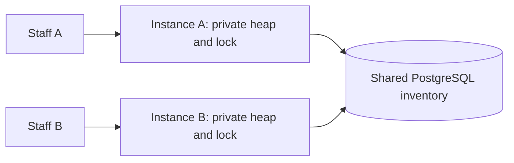
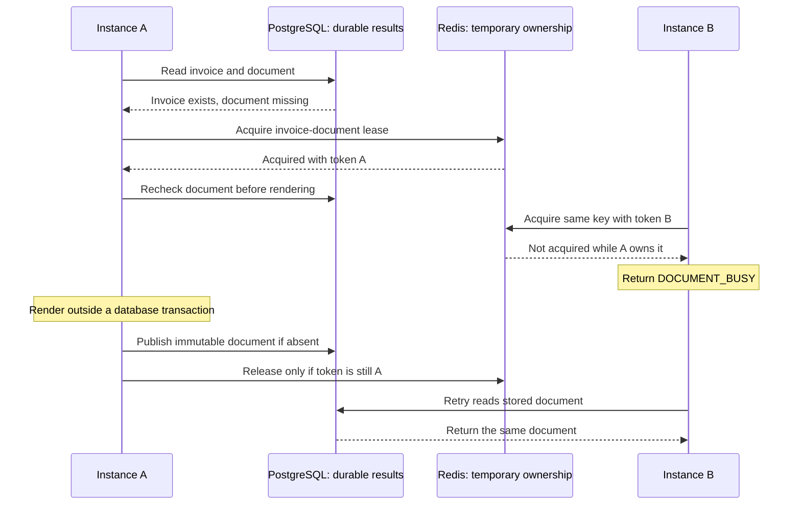

# Concurrency across application instances

Concurrency becomes distributed when operations in separate processes or machines compete over a shared rule. Each instance has its own heap, threads, and Java locks. A correct local counter does not make the combined system correct.

> Enforce the rule where all relevant operations meet. For shared database state, that is often the database you already use.

## From one JVM to a shared authority

Two warehouse staff members open the stock screen through different order-service instances. Both see stock 3. One corrects it to 10; the other submits an older screen setting it to 12. The business rule is **a correction must not silently replace a change made after its screen was loaded**.



The two local locks are like separate keys to separate doors: holding one does not block entry through the other. The shared database is where their writes actually meet. This analogy describes coordination scope; real database locks are transaction-managed mechanisms, not physical doors.

| Mechanism you learned | Scope | Shared rule it can protect |
| --- | --- | --- |
| `AtomicInteger` CAS | One shared Java object | Local capacity claims |
| `synchronized` or `ReentrantLock` | Threads using the same lock in one JVM | A multi-step in-memory update |
| Database conditional write | All writers reaching the same database record | Accept a correction only at its expected version |
| Database row lock and transaction | Conflicting database operations | Read, decide, write, and audit without a competing writer changing the protected rows |
| Shared coordination service | Participating clients using its protocol | Job ownership or leadership, with explicit failure handling |

Your [carrier capacity exercise](../practice/order-service/requirements/003-claim-local-capacity.md) allows two calls **per instance**. Three instances can make six calls in total. That is correct for protecting each instance's resources; a provider-wide quota is a different rule and requires a shared budget or an allocation protocol.

## A database version check is a distributed conditional decision

Add a version to the inventory row. The stock screen receives both the quantity and its version. A save includes the version the staff member actually saw.

| Step | Instance A | Instance B | Shared row |
| --- | --- | --- | --- |
| 1 | Reads stock 3, version 0 | Reads stock 3, version 0 | `(3, 0)` |
| 2 | Requests stock 10 only at version 0 | | `(10, 1)` after commit |
| 3 | | Requests stock 12 only at version 0 | Condition fails; remains `(10, 1)` |
| 4 | | Returns `409`; staff reloads and reconsiders | No silent overwrite |

The application supplies the expected version and handles rejection. The database must check that version and change both the stock and version in **one write**. Reading the version first and then updating unconditionally recreates the race. All inventory mutation paths must advance the version, including order reservations and warehouse adjustments.

This resembles Java CAS, but runs through a database transaction and network request. It does not mean the database avoids locks. Under PostgreSQL Read Committed, a competing row updater can wait and then recheck its condition against the updated row. [PostgreSQL concurrent updates](https://www.postgresql.org/docs/17/transaction-iso.html#XACT-READ-COMMITTED)

**A conflict is not permission to overwrite.** Automatically replacing the expected version with the latest version and resending the same absolute quantity defeats stale-edit protection. Reload and reconsider whether the correction still makes sense. Unlike a local counter increment, a staff member's business decision cannot always be recomputed automatically.

Practise this in [004 — Reject stale stock corrections across instances](../practice/order-service/requirements/004-distributed-stock-corrections.md). The API and version plumbing are supplied; your task is one conditional repository write.

## Choose the mechanism around the business rule

| Production situation | First mechanism to consider | What still needs application logic |
| --- | --- | --- |
| Reserve 2 units if enough stock remains | Conditional database deduction | Inspect affected rows and create the order in the same transaction |
| Save a correction based on an earlier screen | Optimistic database version check | Return conflict and require reconsideration |
| Calculate an adjustment and record exact before/after stock | Row lock in a short transaction | Consistent lock order and correct rollback boundaries |
| Prevent duplicate logical operations | Unique identity plus durable idempotency handling | Recognize repeats and recover the prior outcome |
| Enforce an invariant spanning several rows | Appropriate shared locks or Serializable transactions | Whole-transaction retry policy when required |
| Assign a long-running background job to a worker | Durable claim or lease | Renewal, recovery, and rejection of stale completion |

A separate distributed lock is not a prerequisite for every distributed system. Adding a lock in another service around a database write creates two protocols to reason about. Prefer enforcing a database-owned rule in that database when it can express it. See the existing [transaction mechanisms](../java/database-transactions-and-spring-transactional.md#5-choose-a-concurrency-tool) and [concurrent business transitions](state-machines-and-business-workflows.md#resolve-concurrent-decisions).

## Durable idempotency versus temporary ownership

Both mechanisms can return immediately with an existing result or a busy status. **Waiting is not their defining difference.** PostgreSQL uniqueness checks may themselves wait for a competing transaction. The distinction is what is protected and what survives completion.

| Question | Durable business identity / idempotency | Lock / lease |
| --- | --- | --- |
| What does the key identify? | One logical operation, such as invoice creation for an order | A resource that competing operations need, such as rendering that invoice's document |
| What does it protect? | Repeated requests must not repeat the business effect | Participating owners should not overlap while ownership is valid |
| After success | Keep the result so retries can find it | Release ownership so later work can enter |
| After a crash | Record and transaction state determine recovery | Transaction cleanup or lease expiry permits recovery |
| Does a busy response imply success? | No; inspect recorded operation status | No; it only indicates current ownership contention |

An operation key and a resource key can contain the same business ID. The important distinction is the protocol around them: a unique durable row that remembers an invoice is different from an expiring key that allows a worker to render it.

### One invoice despite repeated requests

Suppose customer 42 needs one November invoice. A retry or another scheduler instance must return the stored invoice rather than create another.

<details>
<summary>Show illustrative PostgreSQL invoice identity</summary>

These fragments describe an example table separate from the practice application's order invoices. They were not executed.

```sql
CREATE TABLE monthly_invoice_example (
    id BIGINT GENERATED ALWAYS AS IDENTITY PRIMARY KEY,
    customer_id BIGINT NOT NULL,
    billing_month DATE NOT NULL,
    amount_minor BIGINT NOT NULL,
    UNIQUE (customer_id, billing_month)
);

INSERT INTO monthly_invoice_example (customer_id, billing_month, amount_minor)
VALUES (42, DATE '2026-11-01', 10000)
ON CONFLICT (customer_id, billing_month) DO NOTHING
RETURNING id;
```

</details>

An inserted row supplies its ID. If nothing was inserted, read the existing invoice in a subsequent statement. With two concurrent requests, the uniqueness decision occurs in PostgreSQL; a preliminary application read cannot replace it. The record persists after the request, lock release, or process restart. [PostgreSQL conflict handling](https://www.postgresql.org/docs/17/sql-insert.html), [concurrent uniqueness checks](https://www.postgresql.org/docs/17/index-unique-checks.html)

| Step | Instance A | Instance B | Durable outcome |
| --- | --- | --- | --- |
| 1 | Attempts November invoice insert | Attempts the same business identity | Database resolves the unique-key conflict |
| 2 | Inserts invoice 701 and commits | Does not insert a second invoice | One invoice 701 |
| 3 | Response is lost; retries | Reads and returns invoice 701 | Retries still identify invoice 701 |

This is business-key deduplication for one database effect. A generic HTTP idempotency-key implementation also binds the key to request parameters, records processing/completion, and stores a recoverable result. Same key with different parameters is a conflict, not a new operation. Keeping only an “in progress” row without recovery can strand requests after a crash. See [safe repetition and unknown outcomes](reliable-asynchronous-operations.md#unknown-outcomes-and-safe-repetition) for external effects.

### A row lock protects a changing calculation

Now suppose invoice creation consumes customer credit. Read the customer's credit with `SELECT ... FOR UPDATE`, calculate usage, insert the invoice under its unique business identity, and deduct credit **only when this transaction created the invoice**. Commit these database effects together. A duplicate invoice request must not deduct credit again.

The row lock protects competing calculations until transaction completion. The invoice uniqueness rule remembers which invoice exists afterward. Neither replaces the other. Keep slow document rendering outside this transaction. Your existing [002 stock adjustment](../practice/order-service/requirements/002-lock-inventory-adjustments.md) practises the same read-decide-write locking boundary. [PostgreSQL row locks](https://www.postgresql.org/docs/17/explicit-locking.html#LOCKING-ROWS)

### A Redis lease reduces overlapping document rendering

The invoice is durable, but generating its downloadable document is expensive. Two instances can receive requests for the same missing document. Both need a common lock key; Java monitors in their separate JVMs cannot coordinate them.

<details>
<summary>Show illustrative Redis acquisition</summary>

This command illustrates the protocol, not a complete lock implementation; it was not executed. Replace `unique-owner-token` for every acquisition attempt.

```redis
SET lock:invoice-document:701 unique-owner-token NX PX 30000
```

</details>

`NX` means only if absent, and `PX` sets the lifetime in milliseconds as part of that same command. Release must atomically compare the stored owner token and delete only on a match. A separate `GET` followed by `DEL` can remove a newer owner's key if expiry occurs between the commands. With the exercise's Redis 7.4, use an atomic Lua script for conditional release. [Redis locking protocol](https://redis.io/docs/latest/develop/clients/patterns/distributed-locks/)



Recheck after acquiring: another worker may have published between the first read and acquisition. After completion, prefer reading the stored result before taking a lock. The durable document record answers “already completed”; Redis answers “someone currently owns this work.” If a database row already provides atomic job claiming and recovery, that can coordinate the work too; Redis is an architectural choice, not a requirement imposed by multiple instances.

This single-Redis lease is **best-effort duplicate-work suppression**. A long pause, lease expiry, or failover can allow overlapping workers. Owner-checked release prevents deleting another owner's lease; it does not fence a stale worker's writes. In the practice application, a unique, immutable document record prevents duplicate publication or replacement; duplicate rendering is acceptable. Mutable publication or nonrepeatable external effects require stronger resource-side protection and outcome handling.

Practise the separation in [005 — Create an invoice once and coordinate rendering](../practice/order-service/requirements/005-invoice-idempotency-and-redis-lease.md). The three gaps are durable invoice insertion, expiring lease acquisition, and atomic owner-checked release. The renderer, database publication guard, and API lifecycle are supplied.


## Failures make ownership different from a local lock

A remote operation may be slow, a worker may pause, or a connection may break after a write commits. Unlike a local method return, a timeout does not tell the caller whether the remote operation happened.

A **lease** grants ownership for a limited time so another worker can recover after a crash. Expiry does not physically stop the old worker:

| Step | Worker A | Worker B | Protected resource |
| --- | --- | --- | --- |
| 1 | Owns generation 4, then pauses | | Expects generation 4 |
| 2 | Still paused; lease expires | Takes generation 5 | Authority advances to generation 5 |
| 3 | Resumes and submits generation 4 | | Rejects stale completion |

The protection comes from checking ownership **at the resource's write boundary**, not just when a worker starts. A fencing protocol supplies an increasing ownership token and makes the protected resource reject old owners. A database task can instead guard its completion with the current claim generation. Without resource-side enforcement, an expired owner can still write late.

For example, etcd's lock API ties ownership to a lease and exposes an ownership key that can guard transactions inside etcd. That does not automatically guard writes to another database or carrier API. [etcd lock API](https://etcd.io/docs/v3.5/dev-guide/api_concurrency_reference_v3/)

These failure-handling details already have worked examples in [worker generations](reliable-asynchronous-operations.md#operation-identities-and-worker-generations) and [unknown external outcomes](reliable-asynchronous-operations.md#unknown-outcomes-and-safe-repetition). A carrier call that timed out may already have purchased a label; lock expiry or a new worker does not make another purchase safe.

If an instance cannot reach the authority that protects a strict shared rule, it should not approve the operation using its private snapshot. Returning unavailable or deferring work preserves the rule at an availability cost. A cached inventory value can help display a screen; the save still needs a guarded authoritative write.

## Review the boundary and the failure path

For exercise 004, review the saved SQL and trace two writes with the same expected version. Exactly one can change the row; the other must leave it unchanged. Then trace a sale between reading the screen and saving the correction. The sale's version advance must invalidate the correction.

A manual run through two processes on different ports demonstrates the scope more clearly than two threads sharing one Java lock. Keep the same database URL for both. This is a shared-database deployment exercise, not a multi-region database or a consensus implementation. Runtime demonstrations provide evidence; code review should also identify the actual atomic predicate, every participating writer, and conflict behavior.
