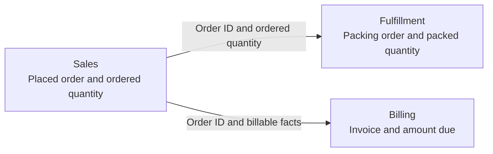
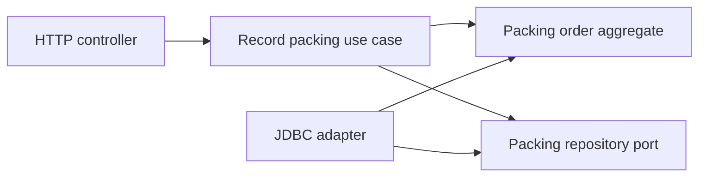

# Domain-driven design

An order for three units can be **placed** in Sales, **partially packed** in Fulfillment and **invoiced** in Billing at the same time. A shared `Order.status` would force those independent facts into one field. Domain-driven design (DDD) builds software around the language and rules people use to make business decisions.

## Strategic design

Start with a concrete conversation with domain experts. Ask what “complete” means, who can declare it and what happens when the work only partly succeeds. Write those examples in the **ubiquitous language**, the shared vocabulary used in conversations, tests and code within a bounded context.

A **bounded context** identifies where a model and its vocabulary apply. The diagram is a **context map**. Each arrow identifies data flowing across a relationship. Sales owns the order quantity. Fulfillment translates that fact into its packing target and owns packing progress. Sharing an ID lets teams reconcile records while each keeps its own meaning of progress. In a modular monolith these boundaries can be module APIs or adapters. Separate deployments add failure handling and independent release choices.

A **subdomain** is a part of the business problem. A core subdomain differentiates the business, a supporting subdomain serves it with organization-specific behavior and a generic subdomain can often use an existing solution. Packing could be core for a warehouse automation vendor and supporting for a retailer. Use that distinction to decide where close collaboration and custom modeling justify their cost. A bounded context is a boundary you design in the solution.

Cross-context relationships also need ownership. A customer–supplier relationship makes downstream needs part of upstream planning. A published language gives partners an explicit data contract. An anti-corruption layer translates foreign fields or meanings into the local model, such as converting a carrier's generic status codes into fulfillment outcomes. See [Eric Evans’s DDD Reference](https://www.domainlanguage.com/ddd/reference/).

## Tactical patterns

An **invariant** is a rule that must hold after a successful change. For packing, the recorded total stays between zero and the ordered quantity. It can advance, and submitting the same total again has the same effect. A correction would need its own business policy.

| Pattern | Role | Packing example |
|---|---|---|
| Entity | Has stable identity as its state changes | The packing order for order 42 |
| Value object | Describes a value by its attributes, usually immutably | A quantity with a unit of measure |
| Aggregate and root | Defines a consistency boundary and the entry point for changes | A packing order controls how its packed total advances |
| Repository | Loads and saves roots through a domain-facing contract | Load packing order 42 and persist its resulting state |
| Factory | Encapsulates creation when valid initialization needs several steps | Open a packing order with the accepted ordered quantity and zero progress |
| Domain service | Expresses a business decision that has no natural home on an entity or value object | Choose eligible packages for a group of items under packing rules |
| Domain event | Records a business fact in past tense | Packing Completed, emitted upon reaching the target if another context needs it |

Keep aggregates small enough to change independently. For example, including every order in a warehouse aggregate would make unrelated packing requests compete for the same write boundary. Concerned consumers can react to a committed packing-completion event. If delivery must survive process failure, persist the event with the state change using an [outbox](reliable-asynchronous-operations.md) and make its consumer safe to retry.

## Application architecture

DDD helps decide what the model means and where rules belong. **Ports and adapters** gives the model and its use cases a way to work with HTTP and storage. Read these arrows as source-code dependencies.

The controller translates an HTTP request into a use-case call and maps failures to HTTP responses. The application service coordinates loading, invoking the model and saving within a transaction. The aggregate decides whether a transition is allowed. The JDBC adapter implements the repository contract and handles rows and locking. At runtime the use case calls the JDBC adapter through the port because wiring supplies that implementation. See [Alistair Cockburn’s original ports-and-adapters article](https://alistair.cockburn.us/hexagonal-architecture).

A layered application can give the same domain model its own layer. Hexagonal architecture emphasizes the boundary between business logic and outside technology. A modular monolith can use either organization inside its modules. For a simple list or lookup, a direct read query returning a DTO often suffices. Reach for a behavioral model where business rules change or several entry points need to enforce the same decision. See [separation of concerns](separation-of-concerns-coupling-and-cohesion.md).

## Follow a command under contention

Order 42 needs three units packed. The command carries an absolute total, so a retry of “record 2” cannot add another two units.

| Step | Requested total | Stored total before | Result |
|---|---:|---:|---|
| First scan update | 2 | 0 | Store 2 |
| Same update retried | 2 | 2 | Keep 2 |
| Final scan update | 3 | 2 | Store 3, packing complete |
| Delayed scan update | 2 | 3 | Reject and keep 3 |

Two requests can both read 0 and each look valid. If 3 commits first and 2 then writes its stale decision, the total regresses. The aggregate protects the decision for the snapshot it receives. The application and storage must protect the read–decide–write sequence. In this lab, lock the existing Sales order row before reading packing state, even on the first update when the packing row is still absent. Keep the lock until commit. Every packing writer must follow that protocol. This makes requests for the same order wait and also couples packing writes to Sales writes on that row. A separate production packing store could instead create a packing record when it accepts the Sales order and use a version check on that record. See [state machines and business workflows](state-machines-and-business-workflows.md).

To verify the design, submit 2, retry 2, submit 3, then submit 2 again and read the saved result. For concurrent commands, try both lock acquisition orders. Either both writes succeed in ascending order or the lower request sees the higher stored total and fails. The final total should be 3 in both cases.

## Check your understanding

1. Why can Sales and Fulfillment use different models for order 42?

   

   
Show answer

   Sales owns the accepted purchase and quantity. Fulfillment owns the physical preparation and uses that quantity as a target. The same identity connects the facts while the local models express different decisions.

   

2. Two workers load the same packing total and choose different updates. Where does each part of the protection live?

   

   
Show answer

   The root protects rules for the state it sees. A lock held through commit or a conditional write using the loaded version prevents an older decision from overwriting a newer one. In the lock approach the second worker loads after waiting. In the version approach a failed write needs a fresh read and a new domain decision.

   

3. A reporting screen needs only the current packing totals for 100 orders. What would you build?

   

   
Show answer

   Use a bounded read query and return a projection. Loading 100 behavioral models adds work when there is no transition to evaluate. Keep writes routed through the aggregate and its consistency mechanism.

   

## Practice

Apply these ideas in [014 — Model packing progress](../practice/order-service/requirements/014-model-packing-progress.md).
