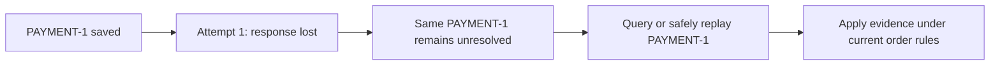
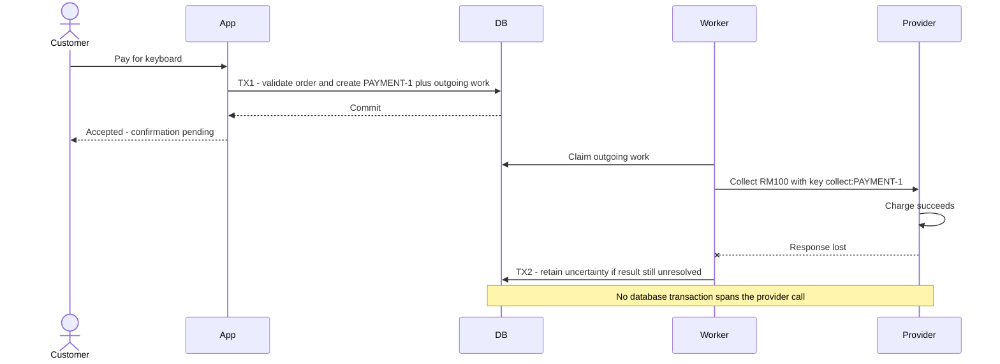
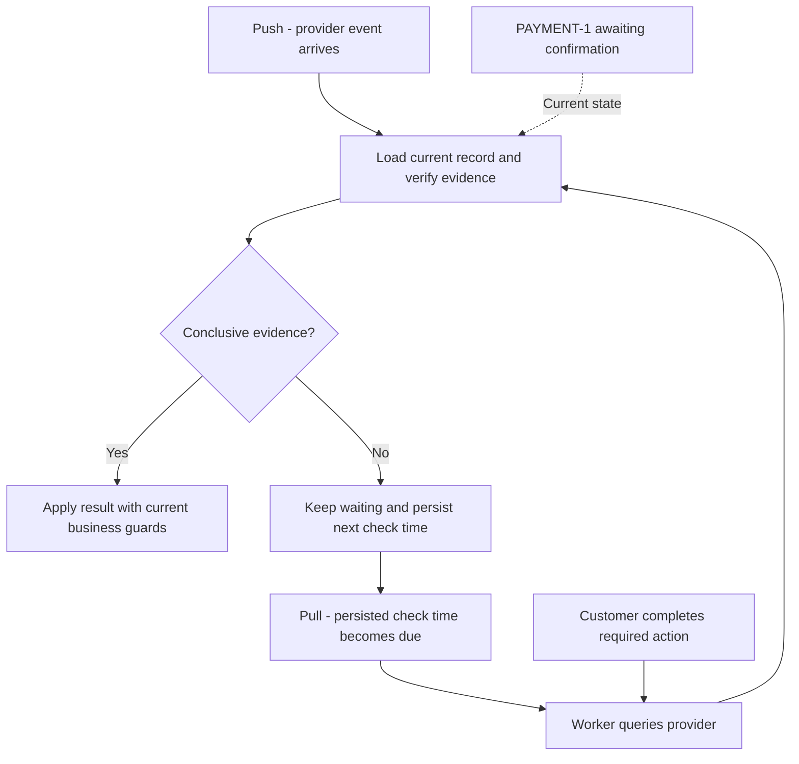
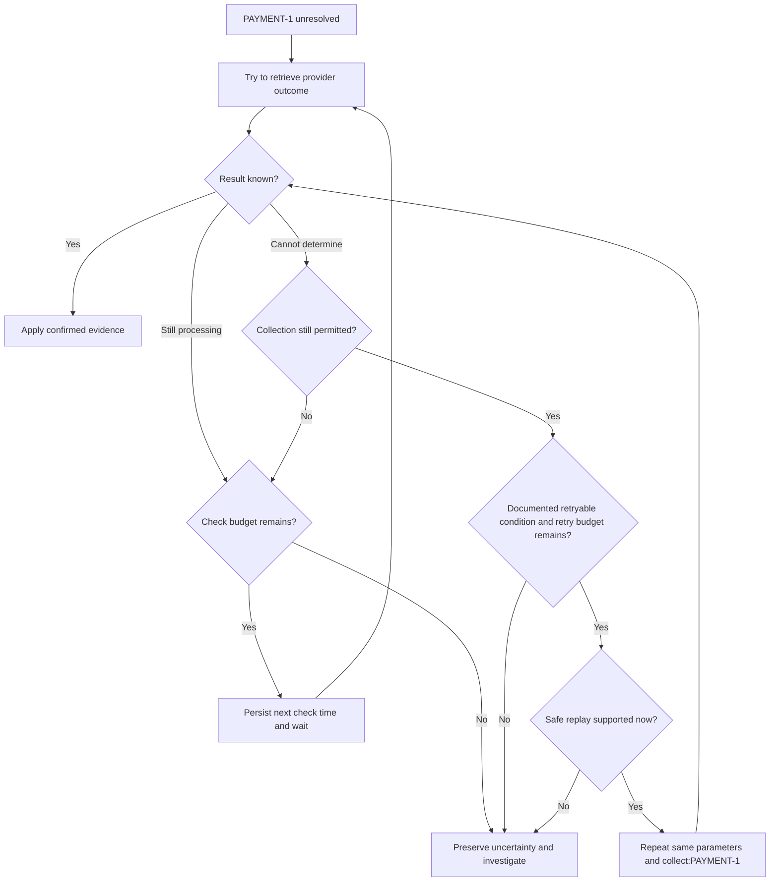
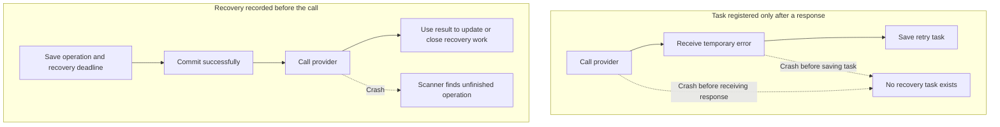
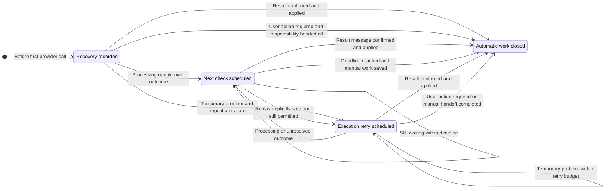
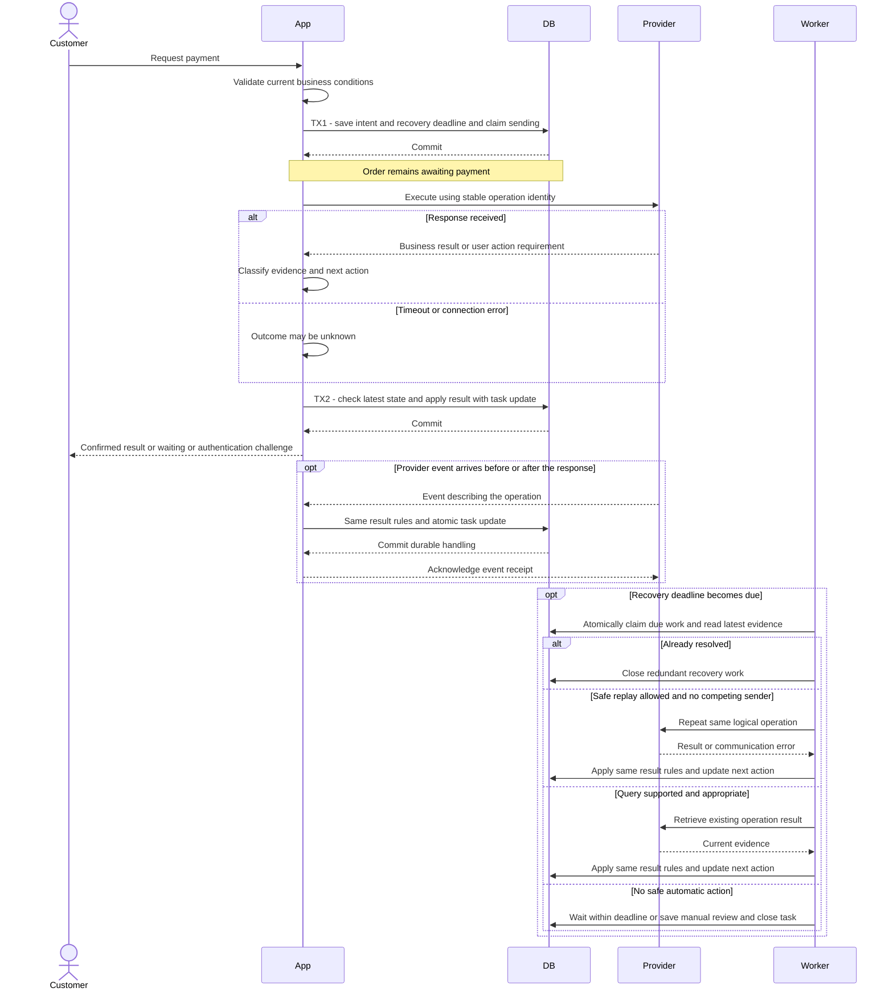
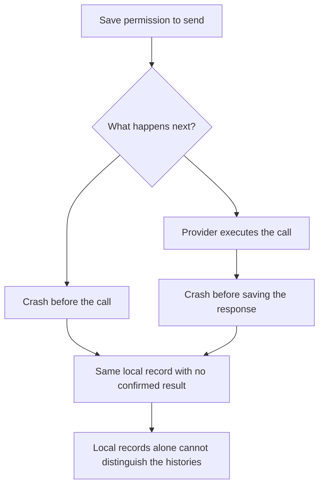
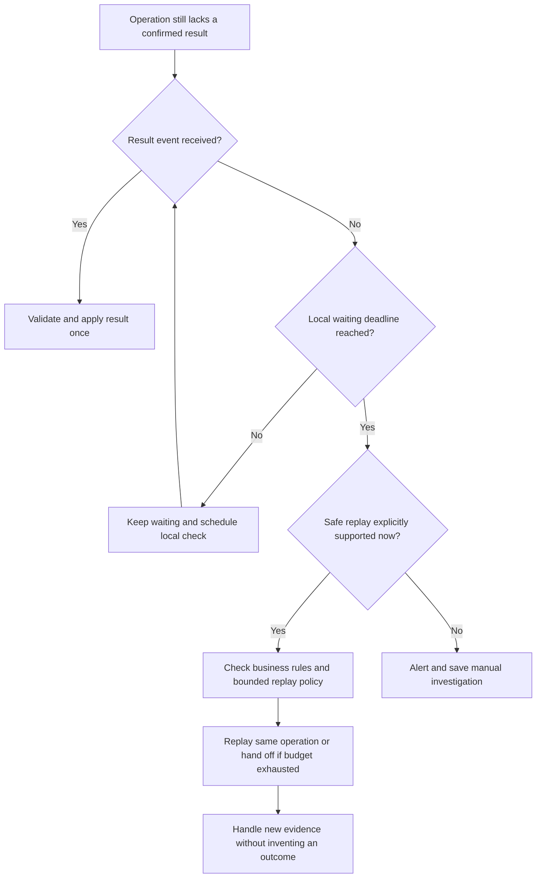
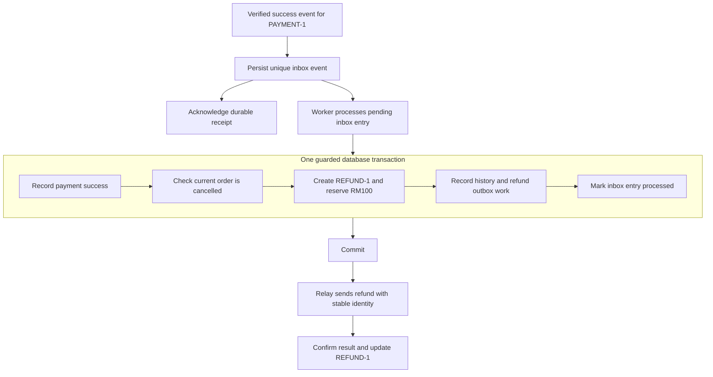

# Reliable asynchronous operations

An external call can succeed even when its response is lost. Reliable execution preserves the logical operation, records what remains unknown, and leaves durable work another process can resume.

This note explains **how execution survives delays, duplicates, and failures**. [State machines and business workflows](state-machines-and-business-workflows.md) owns business eligibility, guarded transitions, compensation policy, and competing order decisions.

## One payment across several attempts

The shared example is an RM100 keyboard order, ORDER-1. PAYMENT-1 collects RM100; REFUND-1 returns it if cancellation requires compensation. A network attempt is one execution attempt for an operation, not a new business payment.

The operation identity survives restarts and retries. A later PAYMENT-2 represents a new business collection and requires a new eligibility decision. Neither a timeout nor an exhausted retry budget provides that permission.

## Record intent and arrange waiting

### Record intent before external work

Persist intent before contacting the provider. Finish the local transaction, then send the request.

**Accepted is not paid. Timeout is not failed.** While payment is unresolved, block another collection or resume the existing operation. Enforce this atomically on the server; a disabled UI button is insufficient.

| Observation | Meaning | Action |
|---|---|---|
| Processing | Provider says work is ongoing | Await result |
| Requires action | Customer input is needed | Prompt for authentication or other required action |
| Awaiting confirmation | Outcome is unknown | Reconcile or safely replay the same operation |
| Confirmed success/failure | Evidence resolves this operation | Apply business rules |

Stripe exposes intermediate processing and customer-action states. [Payment lifecycle](https://docs.stripe.com/payments/paymentintents/lifecycle)

If a query fails after previously reporting processing, retain the last observation and its time. If a webhook already confirmed success, a later timeout handler must not overwrite it. State describes evidence, not the last network response alone.

Persist operation identity, provider correlation, request parameters/key, outcome or stage, version, observation time, attempt count, `nextAttemptAt`, and error details. These allow another process to resume.

### Make waiting resumable

A waiting payment is a persisted record, not a sleeping thread. A **wake-up** triggers a handler to reload it and see whether progress is possible.

| Method | Who initiates? | Benefit | Cost |
|---|---|---|---|
| Immediate response | Your original request | Fast path | May time out |
| Pull | Your scheduled worker | Controls check schedule | Query traffic and detection delay |
| Push | Provider webhook/event | Prompt updates | Duplicate/late delivery and receiver failures |
| Push with reconciliation | Events normally, queries for overdue work | Recovers gaps | Both paths must share result handling |

For our example, a durable timer can trigger a status check if no webhook arrives. Still processing? Persist a later check. Already resolved by a webhook? Skip redundant work. Merely setting `PENDING` schedules nothing.

In a push design, register an endpoint or subscription, verify the event, and correlate its provider ID to PAYMENT-1. A pushed event may contain the result or only an identifier requiring a query. Push describes who initiates delivery, not whether queries are forbidden. [Stripe webhooks](https://docs.stripe.com/webhooks)

If queries are unavailable, recovery depends on provider replay/delivery facilities or investigation. A **missing-message check** only reads local records after a deadline; it does not query or resend to the provider. If the result is still missing, alert or hand it to an operator. Reliable publication, delivery retries, and dead-letter handling reduce message loss, but do not establish a business result when no message arrives. Duplicate wake-ups must be harmless, and duplicate intermediate messages must not keep extending the original waiting deadline indefinitely.

## Unknown outcomes and safe repetition

### Leaving uncertainty safely

Uncertainty records missing knowledge. **Do not restore the old state just because time passed.** Restore the previous business condition only when you have established that doing so is safe; retain the operation and its history.

| Evidence or coordination | Safe action |
|---|---|
| Request is still local and atomic cancellation prevents every sender from executing it | Close the operation as cancelled before send |
| Provider definitively confirms this operation failed and cannot later succeed | Record failure; allow the next attempt if the order is still eligible |
| Provider confirms cancellation prevents further execution | Record cancellation and release related local reservations under policy |
| Provider confirms success | Apply success; compensate if the order no longer permits fulfillment |
| Timeout, missing callback, query error, or exhausted retries | Keep the outcome unresolved; reconcile or investigate |
| Provider query says not found but creation could still be in flight or visibility delayed | Keep uncertainty until the provider contract rules out late execution |

In our example, the order stayed `AWAITING_PAYMENT` while PAYMENT-1 was uncertain. Once failure is definitively confirmed, there is no order state to roll back: close PAYMENT-1 as `FAILED`, then a new PAYMENT-2 may be created. If you use an order-level `PAYMENT_PENDING`, an explicit transition back to `AWAITING_PAYMENT` can be valid after the same checks. If the order was cancelled meanwhile, do not restore it to awaiting payment.

An expired lease or a stopped worker is not proof that the external request was never sent. A pre-send cancellation must coordinate with the sending protocol; after a sender claims work, treat possible external execution explicitly. "Not found" is conclusive only when the provider's visibility and request-lifecycle guarantees make it so.

### Retry without creating another charge

Retry when **the problem may recover, repetition is safe, the action is still valid, and its retry budget remains**. First identify what you are repeating: a charge request, a status query, or a local transaction.

"May recover" is an evidence-based classification, not certainty. Ask: **can the cause disappear without changing this request?** Use the provider's documented error codes and retry hints before broad HTTP categories.

| Evidence | Interpretation |
|---|---|
| Explicit retry hint or documented temporary error | Good reason for a bounded retry under that contract |
| Rate limit or temporary contention | Waiting may remove the cause |
| Timeout or connection reset | Communication may recover, but the original business outcome remains unknown |
| Invalid input or permissions | Time alone usually does not correct the cause |
| Unrecognized error | Investigate/classify; allow only bounded safe retries if policy permits |

For example, Stripe exposes `Stripe-Should-Retry` guidance; its server errors can still leave side effects uncertain. A status code alone is not enough to establish safe repetition. [Stripe error classification](https://docs.stripe.com/error-low-level#the-stripe-should-retry-header)

In the keyboard example, a connection reset is a reason to expect communication might work next time, not evidence the charge failed. A retry budget limits how long to test that expectation. Repeated failures trigger diagnosis or deferred recovery, not unlimited attempts or a fabricated failure outcome. Classify recoverability and side-effect uncertainty separately.

**Retryable and unknown are different dimensions.** Retryable means another attempt may help; unknown means execution cannot be confirmed. An attempt can be both. Reclassify after every response or exception: a retry following a temporary rejection can time out and leave the outcome unknown. Unknown after the first send and unknown after a retry use the same recovery rules; keep the attempt history separately. Neither should erase an already confirmed result.

| Situation | What to repeat | When |
|---|---|---|
| Temporary connection failure or timeout sending payment | Same provider operation with the same key/parameters, if supported; alternatively query its outcome | After backoff, within provider guarantees, while collection remains permitted |
| Provider reports processing | Status check, not a new charge | On notification or the next scheduled check |
| Rate limit | Same permitted request | After provider retry guidance or capped backoff with jitter |
| Server error | Resolve outcome or replay only as documented | Do not assume the request had no effects or that replay will reexecute it |
| Version conflict or transactional deadlock | Local transaction: reload and reevaluate rules | With bounded retries; never blindly repeat external calls |
| Invalid input, missing permission, or confirmed business rejection | No unchanged automatic retry | Correct the cause or obtain a new permitted action first |
| Order cancelled while payment is unknown | Queries/reconciliation, not a fresh collection attempt | Continue resolving evidence; compensate if already charged |

In the keyboard example, retrying a status query asks what happened. Replaying `collect:PAYMENT-1` might execute a charge if the original never executed. Before sending, check whether collection is still permitted. If ORDER-1 is now cancelled, cancel unsent work safely and resolve any possibly sent request rather than blindly replaying collection.

Provider-specific guidance matters: Stripe API v1 can cache a server error, so replaying the same key may return that error again. Network retries use the same key and parameters within the documented window. [Stripe advanced error handling](https://docs.stripe.com/error-low-level)

The first request may have succeeded. When replay is permitted, repeat the **same logical operation**, not a new charge with a new identity.

| Action | Identity rule |
|---|---|
| Network retry or restart recovery | Same PAYMENT-1, same `collect:PAYMENT-1`, same parameters |
| New attempt after confirmed failure | New payment operation, for example PAYMENT-2 |
| Refund | Separate REFUND-1 and `refund:REFUND-1` |

Persist the key before sending. Deduplicate customer submissions and local effects too: provider idempotency does not protect your own ledger or fulfillment jobs.

Provider contracts limit safe replay. Stripe API v1 may replay saved errors and prune keys after at least 24 hours; API v2 differs. Do not assume keys protect an operation forever. [Idempotent requests](https://docs.stripe.com/api/idempotent_requests)

Retry temporary errors with bounded attempts/time and capped backoff plus jitter. Persist `nextAttemptAt`; avoid stacked retries at multiple layers. Invalid input needs correction. **Exhausting retries leaves an operational problem, not proof that payment failed.** [AWS retry guidance](https://aws.amazon.com/builders-library/timeouts-retries-and-backoff-with-jitter/)

## Operation identities and worker generations

Use each identity for the boundary it protects. A single field called `version` is easy to misinterpret when it mixes business revisions, payment identity, and execution ownership.

| Identifier | Stable across | Protects against |
|---|---|---|
| PAYMENT-1 and provider client reference | Network attempts and worker restarts | Losing correlation with the original collection |
| Idempotency key such as `collect:PAYMENT-1` | Permitted replays of identical parameters | Duplicate provider effects within its contract |
| Event ID | Redelivery of that event | Processing the same delivery twice |
| Worker claim generation | One ownership period only | A superseded worker committing local task completion |

Two distinct event IDs can report the same payment success. Event deduplication therefore does not replace business-effect deduplication by operation. Never apply a late PAYMENT-1 result as PAYMENT-2's result; retain genuine external evidence for reconciliation even when it cannot advance the current operation.

### A stale worker after takeover

| Snapshot | Durable task | Worker A | Worker B |
|---|---|---|---|
| 1 | Claim generation 4 | Starts work holding generation 4 | Idle |
| 2 | Lease expires; claim becomes generation 5 | May still be running | Claims recovery work |
| 3 | Completion requires current generation 5 | Generation-4 completion rejected | Can record its guarded completion |

The completion write must check the claim generation atomically. This protects local task ownership; it cannot stop an already-running external request. Worker B must examine evidence and provider guarantees before replaying. A lease expiring proves that ownership can change, not that PAYMENT-1 never executed.

The order's optimistic-lock version protects a different decision: [cancellation versus payment confirmation](state-machines-and-business-workflows.md#resolve-concurrent-decisions).

## Retry and recovery task lifecycle

Think of a recovery task as a persisted reminder with an owner, not a sleeping thread or proof of a business result.

| Evidence | Next work | What must remain durable? |
|---|---|---|
| Result confirmed | Apply current business rules | Result, local effects, and completion marker |
| Processing or unknown | Wait, query, or investigate | Original identity and next check/deadline |
| Temporary problem with safe repetition | Bounded retry | Same operation, parameters, and attempt history |
| Automatic budget exhausted | Durable handoff | Uncertainty and discoverable manual work |

**Save a way to find unfinished work before sending; decide whether to repeat the call after examining the evidence.**

### Register recovery before the first call

Registering a task only after a temporary error covers a narrower case than crash recovery:

The earlier record can be an existing outgoing-work row, an engine timer, or an operation with a deadline that a scanner reads. A new task type is unnecessary if an existing mechanism already makes unfinished work discoverable. Merely writing a status without a scanner, timer, or reliable delivery path does not arrange recovery.

Save intent and recovery tracking in the same database transaction when possible. If an external scheduler must be notified, use an outbox or another reliable handoff. Saving the operation and then independently registering a remote task leaves another crash gap between those writes.

A future check time prevents immediate recovery, but is not an execution lock. Atomically claim permission to send, prevent concurrent callers, and recheck whether the action is still allowed. Do not hold a database transaction open during the external request. An expired claim allows recovery work to be examined; it does not by itself make repeating the external effect safe.

### Keep business outcome separate from task progress

These are different questions, even if their answers live in existing records rather than new status columns:

| Concern | Question | Example |
|---|---|---|
| Order progress | What business step is allowed now? | Awaiting payment; cancelled; ready to fulfill |
| Provider evidence | What do we know about the external effect? | Processing confirmed; success confirmed; outcome unknown |
| Execution ownership | Who may send right now? | One caller has permission; competing callers must wait |
| Recovery work | What should happen next, and when? | Wait for a message; safely replay; alert an operator |

Do not add an order-level processing status solely to represent every network call. Existing business states can stay unchanged while task metadata records ownership, attempt history, and timing. However, removing a status must not remove the information needed to block duplicate execution or detect abandoned work.

The following diagram shows **task behavior**, not another order or payment state machine. Its labels can be represented by task fields and scheduling rules:

Closing automatic work only means that this mechanism has no more automatic action to perform. It does not mean the payment succeeded or failed. If an operator must continue, save a discoverable review item before closing the automatic task. If the user must act, the application needs an explicit way to show that requirement; do not silently discard it.

### Apply one result policy across every delivery path

The original response, a background replay, and a webhook can all describe the same operation. Use one result handler that checks current state and evidence, applies business rules, and updates recovery work. The caller decides how to present the result; it must not maintain a separate version of the payment rules.

If a webhook confirms payment while the synchronous call is still waiting, the later response must check the latest record. A timeout handler cannot replace success with unknown. A late processing event cannot reopen completed work. Different event IDs describing the same success must not schedule fulfillment twice.

For externally scheduled tasks, committing a database change and cancelling the scheduler job are not necessarily atomic. Mark the durable work completed with the business update, then let a late scheduler invocation read that marker and exit. Scheduler cancellation alone is not the correctness mechanism.

| Observation | Business handling | Task handling |
|---|---|---|
| Confirmed success | Apply success under current order rules | Close work with the result and local effects |
| Confirmed final failure | Record this operation as failed | Close work; a new operation requires a new permitted business decision |
| Provider confirms processing | Keep waiting for its result | Stop execution retries; retain a missing-message deadline |
| Temporary rejection with safe repetition | Keep the current operation open | Reschedule existing work with bounded backoff; do not create duplicate tasks |
| Unknown outcome after any attempt | Preserve uncertainty; do not restore eligibility for another charge | Query if available, replay only under explicit guarantees, or wait and investigate |
| User authentication required | Return a challenge through an active authenticated interaction | Stop unattended execution; arrange supported user action or investigation |
| Result cannot be interpreted | Keep raw evidence; do not guess a business outcome | Alert and retain recoverable work; fix interpretation before replaying execution |
| Retry budget exhausted | Do not invent success or failure | Stop execution; retain monitoring or make a durable manual handoff |
| Duplicate or stale intermediate result | Keep newer confirmed evidence | Do not reopen completed work, reset counters, or extend deadlines indefinitely |

When rescheduling, preserve the original operation identity, elapsed recovery time, and attempt history. Define whether an attempt counter counts actual sends or all scheduled checks; waiting for a message should not accidentally consume an execution retry. Duplicate task triggers must not grant a new budget.

A retryable response does not authorize every later retry. Recheck the current result, business eligibility, provider replay guarantees, and remaining budget before every send. If an attempt becomes unknown, follow the unknown-outcome rules rather than continuing the old retry decision.

### The boundary no local marker can remove

Consider two histories:

If the protocol requires a committed claim before every send, untouched queued work can be sent for the first time. Once a sender has permission, abandoned work may already have executed. Adding another local marker only moves the point at which a crash can leave uncertainty.

A queue, distributed lock, or workflow engine cannot commit atomically with an arbitrary external provider. They can preserve intent, coordinate workers, and detect missed progress. They cannot prove whether an unobservable external call executed. In particular, an expired lease must not be interpreted as proof that nothing was sent.

The provider may offer useful guarantees without calling them a retry API: an enforced unique client reference, lookup by a reference saved before the call, event replay, or authoritative reconciliation records. Investigate the actual contract rather than inferring it from the phrase "no retries."

If none is available, the choice remains:

| Policy | Benefit | Accepted risk |
|---|---|---|
| Do not repeat uncertain calls | Avoid introducing duplicate execution through recovery | A call that never arrived may remain unresolved until investigation |
| Repeat uncertain calls without deduplication | Increase the chance that an operation executes | The operation may execute more than once |

For costly or irreversible effects, escalation is often preferable to an unsafe automatic resend. This is an explicit business tradeoff, not a missing enum value.

### Recovery when there is no status query

A push-only provider changes the available recovery actions, not the meaning of uncertainty. Keep the immediate synchronous response as the fast path and the result event as another source of evidence. Local checks detect that nothing has arrived; they do not ask the provider anything.

On the publishing side, reliably save outgoing events with business results and retry delivery. On the receiving side, acknowledge only after durable handling, deduplicate business effects, and monitor dead letters. These mechanisms reduce loss but do not eliminate the need to detect overdue operations.

If no query, safe replay, event recovery, or authoritative records exist, automatic resolution may be impossible. An order can still expire or be cancelled under business policy while its payment remains unknown. Continue accepting late evidence: if success is later confirmed for a cancelled order, start the appropriate compensation. Closing an alert or automatic task must not disable that result path.

## Recover durable work after a crash

A database rollback cannot undo a completed external charge. The refund is **compensation**: a new business operation with its own uncertain outcomes.

The **inbox** makes incoming work durable; an inbox scanner or queue wakes its worker. The **outbox** commits outgoing work alongside the business decision. A crash after commit therefore leaves work another process can find. Delivery can repeat, so recipients still need idempotency. [AWS outbox pattern](https://docs.aws.amazon.com/prescriptive-guidance/latest/cloud-design-patterns/transactional-outbox.html)

| Interruption | Recovery |
|---|---|
| Payment intent saved before send | Deliver existing payment work |
| Charge completed but response lost | Resolve PAYMENT-1 using query or safe replay |
| Refund intent committed before send | Deliver existing refund outbox work |
| Refund sent before delivery record saved | Reuse refund identity within provider guarantees |
| Same result arrives again | Deduplicate delivery and business effect |

Different event IDs can describe the same payment success, so deduplicate business effects as well as event IDs. Late processing notifications must not regress confirmed success. Refund requests also need waiting, retries, and reconciliation until a result is confirmed. Stripe documents duplicate and unordered notifications. [Webhooks](https://docs.stripe.com/webhooks)

Workers claim work atomically. Leases permit takeover after a crash; claim generations/version checks reject stale local completions. External calls still need idempotency. For unresolved cases, manual review uses guarded operations and records actor, reason, and evidence rather than directly editing status.

## Verify recovery behavior

| Inject this failure | Required property |
|---|---|
| Lost response or restart during send | Original operation remains discoverable and unresolved |
| Duplicate response or event | No repeated business effect or regression of confirmed evidence |
| Crash after committing outgoing work | A worker can find and deliver it |
| Delivery succeeds before worker crashes | Redelivery preserves operation identity and safe repetition rules |
| Worker loses its lease | Stale local completion fails; external execution is still treated explicitly |
| Missing event with no query facility | Deadline creates investigation work, not fabricated failure |
| Retry budget exhausted | Preserve evidence and make a durable handoff |

Monitor unresolved age, due-task delay, retry counts, dead letters, and manual-review backlog. Failure injection should cover the gap before a call and the gap after external execution but before saving its result. Business transition and cancellation-race checks remain in the [workflow note](state-machines-and-business-workflows.md#verify-the-design-with-the-same-example).

## Check your understanding

1. The payment request timed out and all retries are exhausted. Can the order safely start PAYMENT-2?

   

   
Show answer

   Not from those observations alone. The original operation may have charged. Preserve its identity and resolve evidence before authorizing another collection. A closed automatic task is not a confirmed failed payment. [Provider error and replay semantics](https://docs.stripe.com/error-low-level)

   A charge could have completed just before the connection failed. Retrying with a new payment identity would then create a second logical collection. Ending the retry budget only stops automatic attempts; it does not establish the provider’s outcome. Keep the original operation discoverable for reconciliation or investigation, and permit a new collection only when evidence and current business rules allow it.

   

1. Worker A loses its lease and Worker B acquires a newer claim generation. Does that make repeating the charge safe?

   

   
Show answer

   No. The newer generation lets the database reject Worker A's stale task-completion write. It does not cancel A's provider request or prove the request never ran. B must resolve existing evidence or use a provider-supported safe replay of PAYMENT-1. A different worker is still recovering the same logical operation.

   

