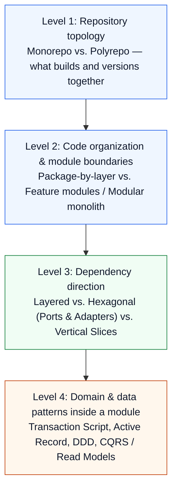
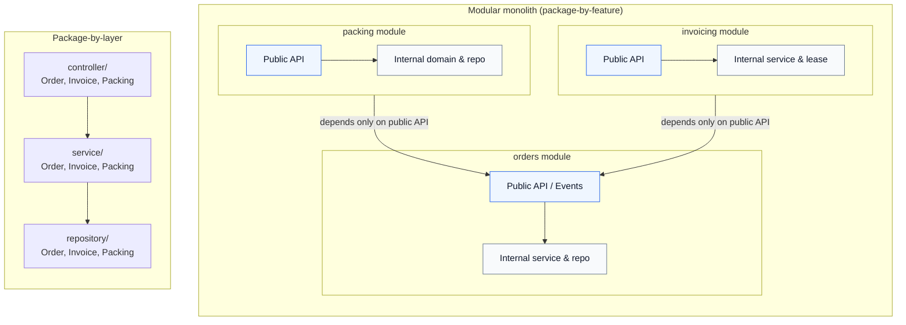
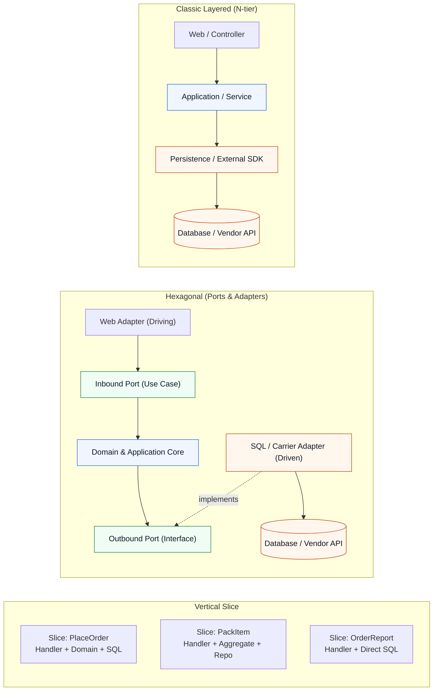
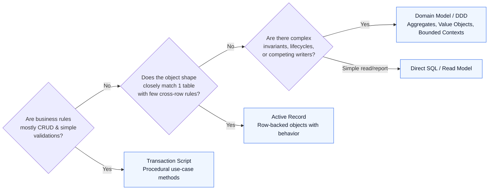
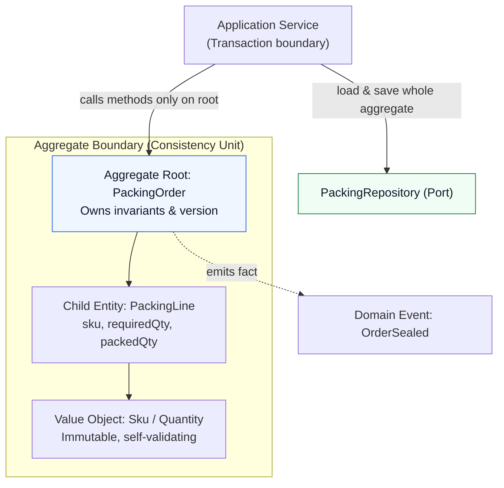
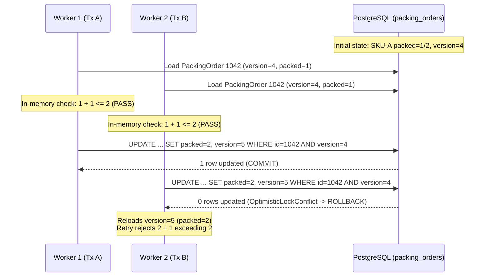
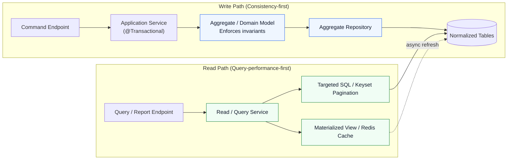
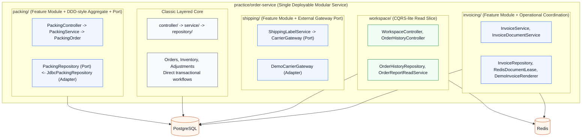

# Repository architecture and design patterns

**A repository's architecture decides where code lives, which modules may depend on which, and how business rules stay protected as a system grows.** Production codebases rarely succeed by forcing one pattern everywhere; they combine macro-level repository structure with targeted internal design patterns—such as Layered design, Ports and Adapters, Vertical Slices, CQRS, and Domain-Driven Design (DDD)—chosen to match the complexity of each capability.

> **Terminology note:** In this note, **repository architecture** means how an entire codebase (Git repository and its modules) is structured. That is distinct from the **Repository pattern**, a persistence abstraction discussed later in the data-access section.

## 1. Four levels of repository design

Teams often debate patterns like *Modular Monolith*, *Hexagonal Architecture*, *CQRS*, and *DDD* as if they were mutually exclusive choices. In reality, they answer questions at four different scales:



| Level | Core question | Typical choices | Consequence of getting it wrong |
|---|---|---|---|
| **1. Topology** | Which services and libraries share a Git history and CI pipeline? | Monorepo, polyrepo, multi-service repo | Coordinated lockstep releases across repos, or slow CI and blurred ownership in one repo |
| **2. Module layout** | How is code grouped, and what is hidden behind a module boundary? | Package-by-layer, package-by-feature, modular monolith | Every feature change touches the whole tree; modules read each other's internals |
| **3. Dependency direction** | Do business rules depend on frameworks and databases, or vice versa? | Layered (N-tier), Hexagonal / Clean / Onion, Vertical Slices | Vendor SDKs or ORM models leak into business rules; hard to test without booting infrastructure |
| **4. Internal design pattern** | How are business invariants and persistence modeled inside a module? | Transaction Script, Active Record, DDD, CQRS / Read Models | Either duplicated, drifting rules (too thin) or heavy boilerplate on simple CRUD (too heavy) |

**Key takeaway:** You choose at all four levels, whether intentionally or by accident. A single monorepo can house a modular monolith where one complex module uses Hexagonal + DDD, a simple configuration module uses Layered + Transaction Script, and a dashboard module uses direct SQL read models.

---

## 2. Repository topology and module boundaries

### Repository layout is not deployment topology

How code is stored in Git is independent of how it runs in production:

| Topology | What it optimizes for | Production tradeoffs |
|---|---|---|
| **Monorepo** | Atomic cross-module refactoring, shared conventions, one dependency graph | Requires scoped CI/build caching and clear code ownership (`CODEOWNERS`) so build times and review queues scale |
| **Polyrepo** | Hard repository-level access control, independent release lifecycles, isolated CI | Cross-service contract changes require versioned libraries, API backward compatibility, and multi-PR coordination |

A monorepo can still deploy multiple independent services, and multiple repositories can still form a **distributed monolith** if services share database tables or must be deployed in lockstep. The real runtime boundary is the **network, process, and data-ownership boundary**, not the Git folder.

### Organizing code inside a service: layers vs. feature modules

Think of organizing an office filing room:

- **Package-by-layer** files papers by *document type*: all invoices in one cabinet, all blueprints in another, all contracts in a third.
- **Package-by-feature / Modular Monolith** files papers by *project*: Project A has its own cabinet containing its blueprints, contracts, and invoices.

*Where the analogy stops:* physical cabinets separate papers naturally, whereas source folders do not stop code from importing another module's internals or querying another module's database tables. Software boundaries require explicit visibility and enforcement.



**Why package-by-layer degrades at scale:**

1. **Forced `public` visibility:** Because `OrderController`, `OrderService`, and `OrderRepository` live in different packages, their types and methods must be `public`. Once `OrderRepository` is `public`, nothing stops `InvoiceService` from calling it directly and bypassing `OrderService`'s rules.
2. **High change scatter:** Implementing one business capability opens files across 4–5 top-level directories, increasing merge conflicts across teams.
3. **Unclear data ownership:** Any service can join or mutate any table, making schema evolution risky.

**How production repositories actually enforce module boundaries:**

| Mechanism | What it enforces | What it cannot enforce alone |
|---|---|---|
| **Language visibility** (Java package-private, Go `internal/`, TypeScript barrel exports) | Prevents direct compilation against another module's internal classes | Does not stop raw SQL queries against another module's tables |
| **Build modules** (Maven/Gradle subprojects, workspace packages) | Enforces an acyclic module dependency graph at build time | Adds build configuration; requires discipline not to dump everything in a `common` module |
| **Architecture tests** (ArchUnit, Spring Modulith, ESLint boundary rules) | Fails CI when a forbidden package import or cycle is introduced | Checks code imports, not runtime coupling over shared DB tables or caches |
| **Database ownership** (separate schemas, distinct DB roles, or table-ownership conventions) | Prevents hidden cross-module joins and uncoordinated writes | Cross-module queries must move to APIs, events, or explicit read projections |

For the underlying principles behind why boundaries contain change, see [Separation of concerns, coupling, and cohesion](separation-of-concerns-coupling-and-cohesion.md).

---

## 3. Dependency direction: Layered, Hexagonal, and Vertical Slices

Once code is organized into modules, the next architectural decision is **which direction dependencies point** between business logic and infrastructure (HTTP frameworks, SQL drivers, message brokers, third-party APIs).



Read the arrows carefully: **solid arrows** mean source-code imports/calls; **dotted arrows** mean implementing an interface. In Layered architecture, dependencies point downward toward the database and SDKs. In Hexagonal architecture (also called Ports & Adapters, and closely related to Onion and Clean Architecture), the **Dependency Inversion Principle** reverses the lower arrow: the core defines the **port** (interface) in its own business vocabulary, and the infrastructure **adapter** implements it.

| Architectural style | Dependency direction | Strengths | Failure modes & costs | Best fit |
|---|---|---|---|---|
| **Layered (N-tier)** | Top-down (`Web -> Service -> Data`) | Low ceremony, familiar to every team, minimal mapping | ORM entities and vendor SDK exceptions leak into business logic; fat "god services" | Simple CRUD modules, early prototypes, thin workflows |
| **Hexagonal (Ports & Adapters) / Clean** | Inward toward domain core | Business rules testable without HTTP/DB; external vendors and storage are swappable behind contracts | High boilerplate if applied mechanically (pass-through ports, 3–4 DTO mappings per field) | Modules with non-trivial rules, volatile external integrations, or long lifespans |
| **Vertical Slice Architecture** | Self-contained per use case/request | High locality of change; each endpoint chooses its own internal simplicity or rigor | Shared business invariants can get duplicated across slices if not extracted into domain types | API-driven services with many distinct workflows and uneven complexity across endpoints |

### Worked example: isolating a flaky external integration

Consider creating a shipping label when an order is ready for dispatch.

- **Without an outbound port (Layered leak):** `ShippingLabelService` builds a vendor HTTP request (`CarrierApiRequest`), handles vendor error code `ERR_429_THROTTLE`, and parses vendor JSON inside the same method that updates the order status. Switching carriers—or writing fast unit tests for failure handling—requires editing or mocking the vendor SDK everywhere.
- **With an outbound port (Hexagonal boundary):** `ShippingLabelService` depends only on a narrow business contract (`CarrierGateway`). `FedExCarrierAdapter` translates domain inputs to vendor wire formats and maps vendor status codes to domain outcomes (e.g., `LabelIssued`, `RetryableCarrierFailure`, `RejectedAddress`).

<details>
<summary>Show Java example: outbound port and adapter for carrier integration</summary>

*Illustrative code; imports and supporting records are omitted and this snippet was not compiled or executed.*

```java
// Outbound port owned by the shipping module (no vendor types)
interface CarrierGateway {
    CarrierLabelResult requestLabel(LabelCommand command);
}

sealed interface CarrierLabelResult {
    record Issued(String trackingNumber, byte[] labelPdf) implements CarrierLabelResult {}
    record RetryableFailure(String reason) implements CarrierLabelResult {}
    record Rejected(String reason) implements CarrierLabelResult {}
}

// Application service depends only on the port, testable with an in-memory fake
class ShippingLabelService {
    private final CarrierGateway carrierGateway;

    ShippingLabelService(CarrierGateway carrierGateway) {
        this.carrierGateway = carrierGateway;
    }

    CarrierLabelResult issueLabel(LabelCommand command) {
        // Coordinates domain check, persistence intent, and gateway call
        return carrierGateway.requestLabel(command);
    }
}

// Infrastructure adapter at the edge: owns vendor SDK, auth headers, and status mapping
class ExternalCarrierAdapter implements CarrierGateway {
    private final VendorSdkClient sdk;

    @Override
    public CarrierLabelResult requestLabel(LabelCommand command) {
        VendorResponse response = sdk.createShipment(toVendorRequest(command));
        return switch (response.code()) {
            case 200 -> new CarrierLabelResult.Issued(response.trackingId(), response.pdfBytes());
            case 429, 503 -> new CarrierLabelResult.RetryableFailure("Carrier rate limited or unavailable");
            default -> new CarrierLabelResult.Rejected(response.errorMessage());
        };
    }
}
```

</details>

**Production nuance — what a port does *not* solve:** An interface isolates *code coupling*, not *runtime failure semantics*. If the carrier times out after issuing a label, a clean port does not prevent duplicate charges on retry—the application layer still needs idempotency keys, durable state transitions, and recovery policies. See [Reliable asynchronous operations](reliable-asynchronous-operations.md).

---

## 4. Modeling business logic inside a module: where DDD fits

Architectural boundaries organize *where* code sits, but they do not specify *how* business rules are written inside a module. **Domain-Driven Design (DDD)** is one major design pattern here—specifically designed for domains where business rules are complex, stateful, and expensive to get wrong. It sits on a spectrum alongside simpler patterns:



| Pattern | How it works | When it shines | When it breaks down |
|---|---|---|---|
| **Transaction Script** | One procedure per user action reads data, validates conditions, and writes updates | Simple workflows, CRUD, admin endpoints, glue code | Rules like "when is an order cancellable?" get duplicated across scripts and drift apart |
| **Active Record** | Each class wraps a database row and provides both persistence (`save()`) and domain methods | Rapid development when domain concepts map 1:1 to tables | Multi-table invariants, complex state machines, and testing without a database become painful |
| **Domain-Driven Design (DDD)** | Aligns module boundaries with business contexts (Strategic) and puts invariants inside Aggregates & Value Objects (Tactical) | High business complexity, strict invariants, evolving rules, multiple teams | Unnecessary mapping and ceremony on simple CRUD or reporting endpoints |
| **CQRS / Read Models** | Splits write logic (enforcing rules) from read queries (optimized projections) | Heavy filtering, joins, reporting, pagination, or caching alongside strict write rules | Extra synchronization or eventual-consistency complexity if read and write stores are separated |

### Strategic DDD: aligning module boundaries with business meaning

Before touching classes or patterns, Strategic DDD solves a macro-level repository problem: **the same word means different things in different parts of the business.**

Consider the word **"Order"** in an e-commerce repository:
- In **Ordering**, an `Order` owns customer ID, line prices, discounts, and stock reservation.
- In **Packing**, an `Order` (or `PackingOrder`) cares about SKUs, required quantities, packed quantities, and parcel seal status—not tax rates or promo codes.
- In **Invoicing**, an `Order` cares about taxable totals, billing address, and issued invoice numbers—not warehouse shelf locations.

If all three modules share one giant `Order` class and one mutable table schema, a billing column change can break warehouse packing code. DDD calls each coherent semantic boundary a **Bounded Context**, paired with a **Ubiquitous Language** (code names match domain terminology rather than generic technical labels).

When two bounded contexts communicate, **Context Mapping** keeps their models from leaking into each other—for example, using an **Anti-Corruption Layer (ACL)** (an adapter translating an external or legacy model into the local context's terms) or publishing narrow **integration events / DTOs** instead of exposing internal entities.

### Tactical DDD: protecting invariants inside a complex module

Inside a complex bounded context, tactical DDD groups rules and state into focused building blocks:



| Building block | Purpose | Concrete example |
|---|---|---|
| **Value Object** | Immutable concept defined by its attributes, not an ID; validates itself on construction | `Money(amount, currency)`, `Sku("WIDGET-01")` — prevents negative prices or raw `String` mix-ups |
| **Entity** | Object with a stable identity whose attributes change over time | `PackingLine` inside a packing order |
| **Aggregate & Aggregate Root** | Cluster of objects treated as one consistency unit; all external mutations go through the root to protect invariants | `PackingOrder` ensures `packedQty <= requiredQty` and blocks packing after `SEALED` |
| **Domain Service** | Stateless business rule that naturally spans multiple aggregates and belongs to neither | `AllocationPolicy` choosing which warehouse fulfills an order |
| **Repository (DDD pattern)** | Collection-like persistence contract scoped to an **Aggregate Root** (not one per SQL table) | `PackingRepository.findByOrderId(id)` / `save(packingOrder)` |
| **Domain Event** | Immutable record of a meaningful state transition that happened | `PackingOrderSealed(orderId, sealedAt)` triggering shipping label creation |

### Worked example: why an Aggregate needs both domain rules *and* database locking

Suppose Order `#1042` requires `2` units of `SKU-A` and has invariants:
1. `packedQty` can never exceed `requiredQty` (`2`).
2. Once `status == SEALED`, no further packing is allowed.
3. `seal()` is only allowed when every line has `packedQty == requiredQty`.

Follow what happens under **two concurrent warehouse scanners** when `SKU-A` currently has `packedQty = 1` and both scanners simultaneously submit `pack("SKU-A", 1)`:



**Distinguishing responsibilities (what is automatic vs. what you must build):**
- **The Aggregate Root (`PackingOrder`)** enforces the business rule *for a single loaded snapshot* in memory (`packedQty + delta <= requiredQty`). It runs in application code and is trivially unit-testable.
- **The Application Service & Database** enforce *single-writer atomicity* across concurrent processes using a transaction boundary plus either **optimistic locking** (`WHERE version = ?`, shown above) or **pessimistic row locking** (`SELECT ... FOR UPDATE` on the aggregate root row). Without that database concurrency check, two instances would both pass the in-memory check and silently corrupt the state (lost update or over-packing).

See [Concurrency across application instances](distributed-concurrency.md) and [State machines and business workflows](state-machines-and-business-workflows.md) for deeper concurrency and lifecycle guarantees.

<details>
<summary>Show Java example: rich Aggregate Root vs. anemic data bag</summary>

*Illustrative code; imports and persistence mapping are omitted and this snippet was not compiled or executed.*

```java
// Anemic model (anti-pattern for complex invariants):
// Any caller can set fields in any order and skip checks.
class AnemicPackingOrder {
    public String status;
    public Map<String, Integer> packedBySku;
    // Callers mutate packedBySku directly and set status = "SEALED" anywhere.
}

// Rich Aggregate Root: state changes only through intention-revealing methods
// that enforce invariants before mutating state.
class PackingOrder {
    private final long orderId;
    private final long version; // Checked by repository on save
    private PackingStatus status;
    private final Map<String, Integer> requiredBySku;
    private final Map<String, Integer> packedBySku;

    void packItem(String sku, int quantity) {
        if (status == PackingStatus.SEALED) {
            throw new IllegalStateException("Cannot pack a sealed order");
        }
        if (quantity <= 0) {
            throw new IllegalArgumentException("Quantity must be positive");
        }
        int required = requiredBySku.getOrDefault(sku, 0);
        int current = packedBySku.getOrDefault(sku, 0);
        if (current + quantity > required) {
            throw new IllegalStateException(
                "Over-packing " + sku + ": requested " + (current + quantity) + " of " + required
            );
        }
        packedBySku.put(sku, current + quantity);
    }

    void seal() {
        if (status == PackingStatus.SEALED) {
            return; // Idempotent or reject depending on domain rule
        }
        boolean allPacked = requiredBySku.entrySet().stream()
            .allMatch(e -> packedBySku.getOrDefault(e.getKey(), 0).equals(e.getValue()));
        if (!allPacked) {
            throw new IllegalStateException("Cannot seal order before all required items are packed");
        }
        this.status = PackingStatus.SEALED;
    }
}
```

</details>

**Production sizing rule for Aggregates:** Keep aggregates **small**—only include the entities that *must* be transactionally consistent together. Putting an entire `Customer` plus every `Order` they ever placed inside one Aggregate causes massive lock contention and memory overhead. Cross-aggregate references should normally use **IDs** rather than deep object graphs, with eventual consistency (e.g., via an outbox/event) between separate aggregates.

---

## 5. Data access patterns and separating reads from writes

One of the most common mistakes in repository design is assuming **every query must go through the same persistence pattern**.

| Data-access pattern | Scope | Typical use | Pitfall if misused |
|---|---|---|---|
| **Aggregate Repository** | Loads and saves one whole Aggregate Root by ID | Write commands that must enforce invariants (`packItem`, `cancelOrder`) | Loading full aggregates for list/search pages causes N+1 queries and wastes memory |
| **DAO / Table Gateway** | CRUD operations mapped closely to one table | Simple reference tables, lookup data, Transaction Script modules | Tempts callers to mutate multi-table invariants piecemeal without a central owner |
| **Read / Query Service (CQRS-lite)** | Executes targeted SQL joins, aggregations, or reads materialized views / caches into flat DTOs | Dashboards, order history pagination, reporting, search filters | Accidentally adding write side effects or duplicating complex write rules inside read queries |



**Production tradeoff — consistency vs. query speed:**
- **Same-database CQRS-lite** (read service queries the normalized tables directly via tuned SQL joins and DTO projections): **immediately consistent**, zero sync infrastructure, dramatically faster than loading aggregates. See [SQL optimisation](../database/sql-optimisation.md).
- **Precomputed projections / Materialized views / Caches**: handles heavy aggregations under high read load, but introduces **staleness / eventual consistency** and invalidation rules that the UI and API contract must tolerate.

---

## 6. Putting it together: a hybrid architecture in practice

Real production repositories rarely look like a textbook diagram of one single pattern. Instead, **different modules inside the same repository adopt different patterns according to their problem shape.**

The practice application in this repository ([`practice/order-service/`](../practice/order-service/README.md)) illustrates this pragmatic hybrid inside a single Spring Boot codebase (`dev.learning.orders`):



Notice why each choice fits its neighborhood:
- **Classic layers (`controller/`, `service/`, `repository/`)** keep straightforward order/inventory transactions easy to trace without unnecessary indirection.
- **`packing/`** groups its controller, service, domain model (`PackingOrder`), port (`PackingRepository`), and JDBC adapter (`JdbcPackingRepository`) in one feature package because packing has self-contained domain invariants and state rules.
- **`shipping/`** introduces an explicit outbound port (`CarrierGateway`) with a swappable implementation (`DemoCarrierGateway`) because external carrier APIs are volatile and must not leak into business logic.
- **`workspace/`** separates read-heavy history filtering and reporting (`OrderHistoryRepository`, `OrderReportReadService`) from write-side models so queries can optimize joins, pagination, materialized views, and caching independently.

### Decision guide: matching patterns to production symptoms

| Symptom you observe in the codebase | Pattern to introduce | Tradeoff to watch |
|---|---|---|
| One feature edit touches 5 packages and causes constant cross-team merge conflicts | Move toward **feature modules / modular monolith** with narrow public APIs | Requires boundary enforcement (visibility, ArchUnit) or modules collapse back into a tangle |
| Changing a vendor SDK or ORM breaks dozens of business classes and unit tests | Introduce **Ports & Adapters** at that volatile boundary | Do not create one-to-one interfaces for stable internal helper classes |
| The same business rule ("can this be cancelled/packed?") is duplicated across controllers/scripts and drifts | Extract a **Domain Model / Aggregate** owning that invariant | Pair in-memory invariant checks with DB transactions and optimistic/pessimistic locking |
| List, search, or report endpoints trigger N+1 queries or load huge object graphs | Introduce **CQRS-lite read services** with flat SQL projections (or materialized views/caches) | Separate read models add a second query path; cached projections introduce staleness |
| Two teams fight over incompatible changes to the same `Order` class | Split by **Bounded Context** and communicate via narrow contracts or events | Data duplication across contexts requires explicit sync or reconciliation strategy |

### How to verify repository architecture works

Good architecture produces observable evidence rather than pretty diagrams:
1. **Domain tests run fast without infrastructure:** Complex invariants (like packing rules or pricing) can be unit-tested in milliseconds with plain objects and in-memory fakes—no Spring context or Docker container required.
2. **Adapter contract tests isolate integration risk:** Persistence adapters and external gateway adapters are verified independently against real SQL/containers or wire mocks.
3. **Automated boundary checks guard against drift:** Package-private visibility, build-module dependencies, or automated architecture tests (e.g., ArchUnit / Spring Modulith) fail CI if someone imports another module's internals.
4. **Localized PR diffs:** Routine changes to a single business rule, vendor integration, or report query stay inside one module rather than rippling across the repository.

---

## Check your understanding

1. A team restructures its repository from `controller/`, `service/`, and `repository/` folders into `orders/`, `invoicing/`, and `packing/` folders, keeping every class `public` and sharing one PostgreSQL schema. Did they build a modular monolith with enforced boundaries?

   <details>
   <summary>Show answer</summary>

   No—they improved code navigation (package-by-feature), but they have not yet enforced module boundaries.

   Moving files into feature folders does not stop `InvoicingService` from importing `OrderRepository` directly or running ad-hoc SQL updates against `packing_orders` tables. Without enforcement—such as package-private visibility for internal classes, separate build modules, automated architecture tests (like ArchUnit or Spring Modulith) in CI, and table-ownership discipline—cross-module shortcuts will gradually turn the feature folders back into a tightly coupled tangle.

   </details>

2. You model `PackingOrder` as a strict DDD Aggregate Root whose `packItem()` method throws an exception if `packedQty + delta > requiredQty`. Unit tests pass 100%. Under production traffic with two API instances, a customer still ends up with 3 packed units for a 2-unit order. Why did the Aggregate Root fail to prevent this, and how do you fix it?

   <details>
   <summary>Show answer</summary>

   An Aggregate Root enforces invariants only within the single snapshot loaded into one thread's memory. It does not automatically serialize concurrent transactions across threads or application instances.

   In the failure scenario, Instance A and Instance B both read `packedQty = 1` at the same time. Both pass the in-memory check (`1 + 1 <= 2`) and both commit updates that overwrite or add on top of each other. To enforce the invariant in production, the persistence boundary must serialize conflicting writes to that aggregate root—for example, by adding a `version` column and checking `WHERE id = ? AND version = ?` (optimistic locking, causing the second writer to roll back and retry against the updated state) or locking the aggregate root row with `SELECT ... FOR UPDATE` inside a database transaction.

   </details>

3. A service uses DDD Aggregates for placing and modifying orders. A new admin screen needs a paginated list of the latest 50 orders showing customer name, supplier count, total amount, and invoice status. Should this endpoint load 50 `Order` aggregates via `OrderRepository`? What is the alternative and its tradeoff?

   <details>
   <summary>Show answer</summary>

   No. Loading 50 full `Order` aggregates (plus related invoice and supplier aggregates) forces the database and application to hydrate entire write-side object graphs just to render a flat table, commonly causing N+1 queries, excess memory usage, and awkward cross-aggregate joins.

   The alternative is a **CQRS-lite read/query service** that executes a targeted SQL query (with proper indexes and keyset pagination) returning a flat DTO/view directly for the screen. If the aggregation is still too expensive on live tables, you can move to a precomputed projection, materialized view, or cache. The tradeoff is maintaining a separate read query path—and if you introduce async projections or caching, accepting bounded staleness (eventual consistency) instead of read-your-own-writes immediacy.

   </details>

4. A team proposes refactoring an entire repository so that every single feature—including simple country-code lookup tables and static configuration endpoints—uses Hexagonal Architecture with separate inbound ports, outbound ports, domain entities, and three layers of DTO mappers. How would you evaluate this proposal?

   <details>
   <summary>Show answer</summary>

   This is over-engineering because it treats architectural patterns as a uniform religion instead of matching ceremony to complexity.

   Hexagonal Architecture and tactical DDD pay off when business rules are non-trivial, invariants must be protected, or external dependencies are volatile and costly to test. For simple CRUD or reference tables, separate ports, domain models, and mappers add files and indirection without protecting real invariants or hiding volatile logic—making routine changes slower rather than safer. A better approach is a **hybrid repository**: keep simple CRUD modules thin (Layered / Transaction Script), and apply Ports & Adapters or tactical DDD selectively to core modules with complex rules or volatile integrations.

   </details>

5. Why do teams often regret creating a single shared `Order` entity class used directly by Ordering, Packing, and Invoicing, and how does Strategic DDD address it?

   <details>
   <summary>Show answer</summary>

   A single shared `Order` class accumulates fields, nullable columns, validation rules, and lifecycle states from every department. Over time it becomes a high-coupling "God entity" where changing a tax field for Invoicing risks breaking serialization, queries, or tests in Packing, and no single team owns its invariants.

   Strategic DDD addresses this with **Bounded Contexts**: Ordering, Packing, and Invoicing each define their own focused model containing only the attributes and behavior meaningful to their responsibility (for example, `PackingOrder` tracks SKUs and packed counts, not discounts or billing addresses). Contexts share only narrow identifiers, explicit DTO contracts, or domain/integration events across their boundaries rather than sharing one mutable entity model.

   </details>

---

## References

- [Martin Fowler: Software Architecture Guide](https://martinfowler.com/architecture/)
- [Martin Fowler: Bounded Context](https://martinfowler.com/bliki/BoundedContext.html)
- [Martin Fowler: CQRS](https://martinfowler.com/bliki/CQRS.html)
- [Martin Fowler: Patterns of Enterprise Application Architecture (Catalog)](https://martinfowler.com/eaaCatalog/)
- [Alistair Cockburn: Hexagonal Architecture](https://alistair.cockburn.us/hexagonal-architecture/)
- [Jimmy Bogard: Vertical Slice Architecture](https://www.jimmybogard.com/vertical-slice-architecture/)
- Eric Evans, *Domain-Driven Design: Tackling Complexity in the Heart of Software* (Addison-Wesley, 2003)

*Illustrative Java snippets in this note were written as conceptual examples and were not compiled or executed.*
