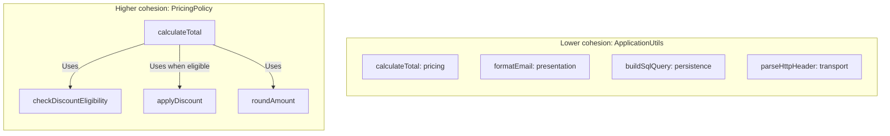
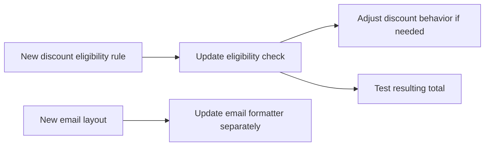
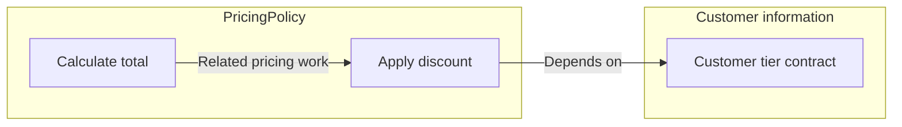
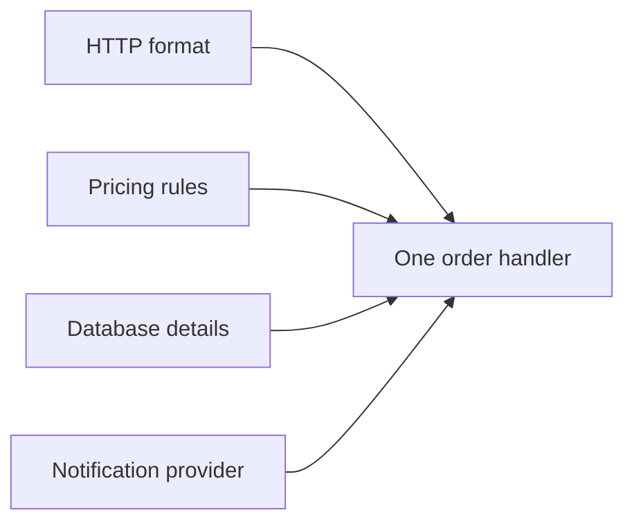
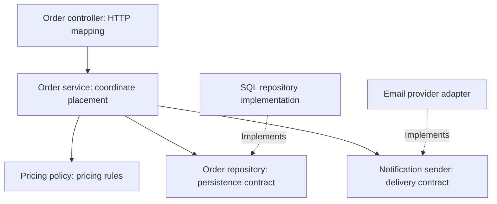

# Separation of concerns, coupling, and cohesion

Software design is partly about controlling the amount of knowledge needed to understand or change a system. Useful boundaries let you work on one responsibility without inspecting every implementation detail around it.

These principles apply to functions, classes, packages, modules, and services. Java examples illustrate them here, but the ideas are language-independent.

## Responsibilities and boundaries

A **concern** is an aspect of the problem: calculating a price, storing an order, presenting an HTTP response, or observing execution. A responsibility assigns ownership of some behavior or decision to a component.

**Separation of concerns** means distinguishing these aspects so that each can be understood and maintained with a clear focus. Dijkstra's discussion emphasizes examining aspects separately while recognizing their relationships. [On the role of scientific thought](https://www.cs.utexas.edu/~EWD/transcriptions/EWD04xx/EWD447.html)

In implementation, the separation needs a boundary and a contract. Moving code into different files does little if every file reads and modifies everyone else's internal state.

| Principle | Focus | Practical goal |
|---|---|---|
| Separation of concerns | Division of responsibilities | Give decisions and behavior a clear home |
| Cohesion | Relationships within a component | Keep closely related work together |
| Coupling | Dependencies between components | Control knowledge and change propagation across boundaries |

For example, a notification component should own provider-specific message construction and delivery. Its caller should know what notification it needs, not how to assemble a particular vendor's request.

A component can have several methods and still own one coherent responsibility. A pricing component might calculate totals, apply discounts, and round amounts. Those operations are connected by the same pricing rules. Splitting each into a separate component is not automatically better design.

## Cohesion within a component

**Cohesion is how well the contents of one component belong together.** For a class, examine its methods and data as a group: do they help accomplish one focused purpose?

Imagine a class as a box of tools. Pricing tools belong together because they calculate an order's price. An email formatter and a SQL builder may each be useful, but placing them in the same box does not give them a shared responsibility.



The left box groups unrelated jobs by convenience. The right box groups operations that contribute to calculating a price. The arrows illustrate collaboration within that component. Methods do not have to call each other to be cohesive: a shared purpose and consistent rules matter more than arrow count.

A change makes the distinction easier to see:



Eligibility, discounts, and totals are connected by the pricing decision. Email layout can vary independently. Giving pricing and email formatting separate homes makes that relationship visible.

High cohesion does not mean one method per class or the smallest possible class. Several methods can belong together when they enforce one coherent set of rules. It also does not mean code works in isolation: a cohesive pricing component can still depend on external data.

Grouping behavior with the state it protects can improve cohesion. For example, an order may expose a `cancel()` operation that checks whether cancellation is allowed. If callers instead set `status`, adjust totals, and release resources independently, the rule for a valid cancellation becomes scattered.

Cohesion is not identical to common change frequency: a feature can require changes in several legitimate components. Conversely, putting everything that shares one database table into a class does not guarantee a coherent responsibility. Ask whether the behavior belongs to one meaningful concept and whether its rules can be understood together.

Low cohesion can appear as:

- Unrelated methods using separate subsets of fields.
- A component name so broad that it accepts almost any new functionality.
- One business rule duplicated or distributed across controllers, services, and persistence code.

These are clues, not mechanical rules requiring an immediate split.

## Coupling across boundaries

**Coupling is dependence between parts of a system.** Components need to collaborate, so eliminating all coupling is not a useful goal. Fowler highlights change propagation and the direction of dependencies as important design considerations. [Reducing Coupling](https://martinfowler.com/ieeeSoftware/coupling.pdf)

Cohesion examines the contents **inside** a boundary; coupling examines dependence **across** boundaries:



The total and discount operations illustrate internal cohesion. Depending on a customer-tier contract introduces coupling to another component. These can coexist: pricing may have high cohesion while being tightly coupled to customer details if it reads their internal representation. Giving it only the tier it needs can reduce that knowledge dependency without changing its purpose.

Coupling includes more than imports or method calls:

| Dependency | Example | Change risk |
|---|---|---|
| Public contract | Caller uses `sendConfirmation(orderId)` | Contract changes affect callers |
| Internal representation | Caller reads a vendor response field directly | Provider changes leak into business code |
| Shared mutable state | Several components update a global map | Behavior depends on hidden participants |
| Execution order | Caller must initialize, authenticate, then send | Incorrect ordering causes failures |
| Runtime availability | Checkout waits synchronously for notifications | Notification outages can disrupt checkout |
| Shared interpretation | Two components independently encode a status rule | One changes while the other remains inconsistent |

Not every dependency has equal cost. A narrow, stable contract is often easier to depend on than rapidly changing implementation details. A method with one dependency can still be tightly coupled if that dependency exposes its entire internal model.

An interface reduces dependence on a concrete implementation only when it hides meaningful details. This contract still leaks provider knowledge:

```text
NotificationSender.send(VendorRequest) -> VendorResponse
```

A contract such as `sendOrderConfirmation(Confirmation)` can keep that knowledge inside an adapter. However, callers still depend on its meaning: delivery guarantees, errors, and whether the call blocks. An interface does not erase these dependencies.

Source dependency and runtime behavior also differ. A service may reference only a notification interface while still requiring a working notification provider to complete every request. Introducing a queue can change the availability relationship, but creates new dependencies on message contracts, ordering, and delivery behavior.

## Example: order placement

Imagine a method that reads HTTP input, calculates discounts, builds SQL, and constructs an email vendor's request. It owns several independent decisions, so changes to the API, business rules, storage, or provider all affect it.



The arrows here represent sources of change, not runtime calls. The problem is the concentration of unrelated knowledge, rather than merely the method's size.

One possible decomposition is:



Solid arrows show the contracts used during coordination; dotted arrows show implementation relationships. This is an illustrative design, not a required class layout.

The controller translates input and output. The service coordinates the use case. Pricing owns calculations and eligibility rules. Implementations behind persistence and notification contracts own technical details.

An illustrative Java operation, with supporting types omitted:

```java
public Order placeOrder(OrderRequest request) {
    Money total = pricing.calculate(request.items());
    Order order = repository.save(
        Order.create(request.items(), total)
    );
    notifications.sendConfirmation(order);
    return order;
}
```

The service knows the sequence required for order placement. That coordination is a legitimate responsibility. It does not need SQL syntax or vendor authentication details, but remains coupled to the contracts it calls.

| Change | Expected main impact | Evidence of a leaking boundary |
|---|---|---|
| Change HTTP response fields | Controller and response mapping | Pricing must understand response formatting |
| Add a discount rule | Pricing behavior and relevant tests | Several controllers implement the rule |
| Change persistence details | Repository implementation | Service builds queries or handles database-specific structures |
| Replace email provider | Notification implementation | Order logic interprets provider-specific response codes |

Some changes legitimately cross boundaries. If a new discount requires customer history, the coordination may need to supply additional information. Good design contains unnecessary propagation; it does not guarantee every feature touches one file.

The sketch also has a reliability decision: saving succeeds, but notification fails. Should the request fail? Should delivery be retried? Can a retry create another order? Separating classes does not answer these questions. The application still needs an explicit consistency and failure policy, which may involve transaction boundaries, idempotency, or durable delivery.

## Boundary selection and tradeoffs

Separation, cohesion, and coupling must be considered together. Splitting a component can improve focus while creating more interactions. Keeping tightly related behavior together can reduce coordination even when that component becomes larger.

| Cohesion | Coupling | Likely interpretation |
|---|---|---|
| High | Low | Focused responsibility with limited external knowledge |
| High | High | Focused behavior, but tightly tied to collaborators |
| Low | Low | Relatively isolated collection of unrelated behavior |
| Low | High | Unrelated responsibilities with broad dependencies |

These are qualitative observations, not a scorecard. Scope matters: a module may be cohesive as a business capability while containing smaller components with distinct technical roles.

Start with concrete changes and failures that the design needs to accommodate. Look for decisions that vary independently, information callers should not need, and invariants best maintained together. Introduce boundaries where they clarify those relationships.

Every boundary also has costs: more names, navigation, mapping, contracts, and coordination. A one-line pass-through class or an interface invented for an unlikely future replacement may add little value. Similarly, functions that merely look alike may encode different business rules; forcing them into a shared abstraction can couple unrelated change requests.

Technical layers such as controller/service/repository separate kinds of work. Feature modules such as orders/billing separate business capabilities. They can coexist: an orders module can contain its own HTTP mapping, rules, and persistence adapter. Neither arrangement guarantees good boundaries on its own.

These principles work within a single process. Moving components into services adds network and operational boundaries but can leave them tightly coupled through shared schemas, coordinated releases, or synchronous failure dependencies.

## Applying the principles

When reviewing an existing feature, identify its business decisions and technical details, then trace a realistic change through the code. Draw a small dependency diagram if the relationships are unclear. Inspect contracts for leaked representations and identify where rules are duplicated or ownership is ambiguous.

Choose a small refactoring that isolates a real source of change, then verify that behavior remains correct. Useful tests can exercise pricing without HTTP or a database and exercise a provider adapter independently of order rules. Mockability alone does not establish a good design; the contract and failure semantics still matter.

Tracing is an example of a concern that crosses many such boundaries. AOP offers a way to express surrounding behavior separately; its mechanisms are the next topic. See [request lifecycle and tracing](../production/production-request-lifecycle.md) for the production example and [Java agents](../java/java-agents.md) for one instrumentation mechanism.

## Check your understanding

1. Why can moving methods into separate files leave coupling unchanged?
2. Can a component have high cohesion and still depend heavily on others?
3. Which details can leak through an interface besides its method signature?
4. Why might splitting pricing into many tiny components make changes harder?
5. Which responsibility owns the save-success/notification-failure decision in the order example?
6. Pick a recent work change: which parts changed for necessary reasons, and which changed because details leaked?

## References

- [E. W. Dijkstra: On the role of scientific thought](https://www.cs.utexas.edu/~EWD/transcriptions/EWD04xx/EWD447.html)
- [Martin Fowler: Reducing Coupling](https://martinfowler.com/ieeeSoftware/coupling.pdf)
