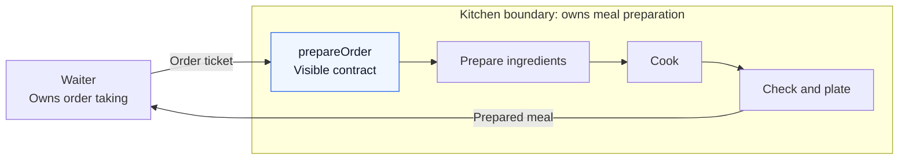
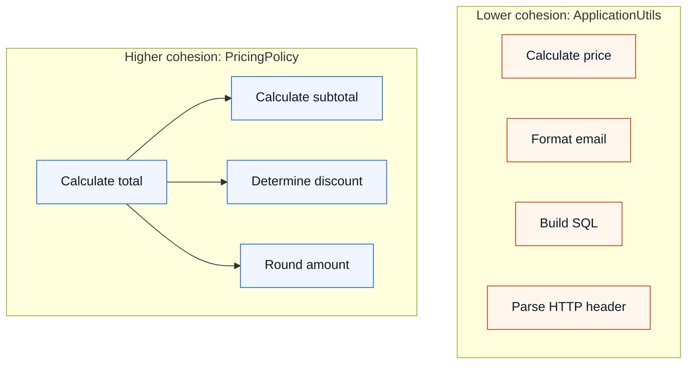
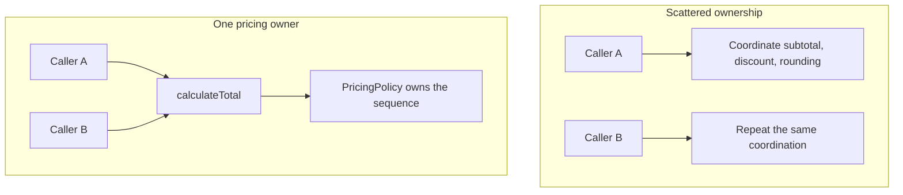
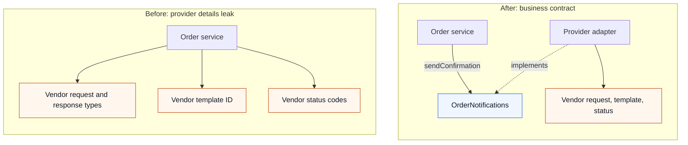
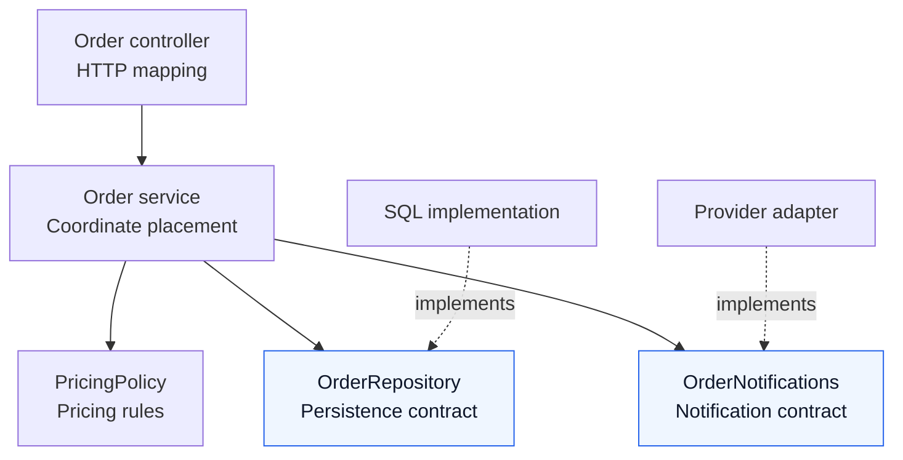
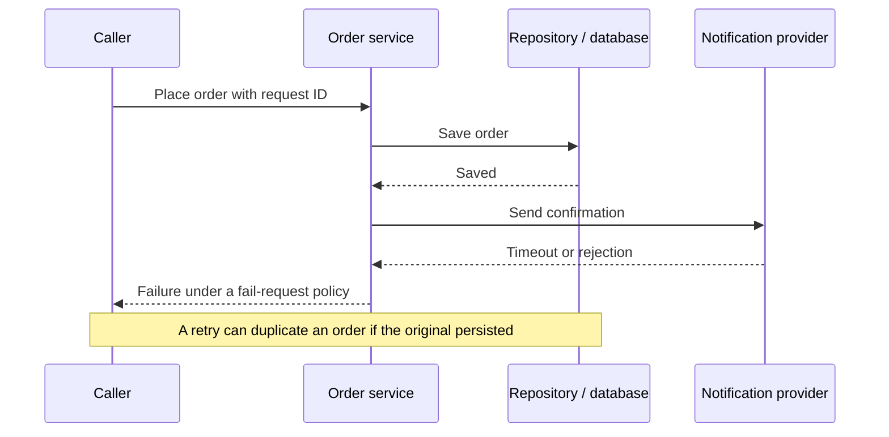

# Separation of concerns, coupling, and cohesion

**Give each decision a clear owner, keep related work together, and limit what collaborators need to know.** These ideas apply to functions, classes, modules, and services; the Java examples below are illustrative.

## One system, four questions

Think of a restaurant: the waiter submits an order; the kitchen decides how to prepare it. The useful boundary is the order ticket, not the physical distance between the workers.



Read the diagram at two scales: **inside the kitchen**, the steps share a purpose; **across the boundary**, the waiter requests an outcome without managing equipment.

| Concept | Question to ask | Restaurant mapping | Software mapping |
|---|---|---|---|
| Separation of concerns | Who owns this decision? | Kitchen prepares; cashier takes payment | Pricing owns discount rules; persistence owns storage details |
| Cohesion | Why do these things belong together? | Preparation, cooking, and plating make a meal | Subtotal, discounts, and rounding determine a price |
| Coupling | What must one part know about another? | Waiter knows the menu and order contract | Caller depends on inputs, results, errors, and timing |
| Abstraction | What is visible, and what is hidden? | Order ticket hides pans and stove controls | `calculateTotal` hides calculation steps |

A **concern** is an aspect of the problem; a **responsibility** gives behavior or a decision an owner. Dijkstra describes examining concerns separately while remembering their relationships. The diagram is a teaching analogy: software boundaries may also share memory, fail together, or run over a network. [Dijkstra’s original discussion](https://www.cs.utexas.edu/~EWD/transcriptions/EWD04xx/EWD447.html)

## Cohesion: zoom inside the boundary

A class is cohesive when its behavior and data serve one meaningful purpose. Compare a miscellaneous utility class with a pricing policy:



The arrows on the right show internal calls. The reason those methods belong together is the pricing rule, not the number of arrows. Cohesive methods need not call each other or use every field.

### Follow one price calculation

For two RM50 items and a 10% premium discount:


A change from 10% to 15% belongs to pricing and changes the result to RM85.00. An email layout change has a different owner. A new feature can legitimately touch both; cohesion does not promise one-file changes.

<details>
<summary>Expand Java example: one owner for the pricing sequence</summary>

Illustrative code; imports are omitted. `OrderItem` exposes `unitPrice()` and `quantity()`. Discount and rounding choices are example business rules.

```java
class PricingPolicy {
    BigDecimal calculateTotal(
            List<OrderItem> items, boolean premiumCustomer) {
        BigDecimal subtotal = calculateSubtotal(items);
        BigDecimal discount = calculateDiscount(subtotal, premiumCustomer);
        return subtotal.subtract(discount)
                       .setScale(2, RoundingMode.HALF_UP);
    }

    private BigDecimal calculateSubtotal(List<OrderItem> items) {
        return items.stream()
            .map(item -> item.unitPrice()
                .multiply(BigDecimal.valueOf(item.quantity())))
            .reduce(BigDecimal.ZERO, BigDecimal::add);
    }

    private BigDecimal calculateDiscount(
            BigDecimal subtotal, boolean premiumCustomer) {
        return premiumCustomer
            ? subtotal.multiply(new BigDecimal("0.10"))
            : BigDecimal.ZERO;
    }
}
```

</details>

Grouping behavior with the state it protects also helps: `order.cancel()` can check allowed status transitions, instead of callers independently setting fields and reconstructing cancellation rules. Sharing a database table alone does not establish cohesion.

| Clue | What to inspect before splitting |
|---|---|
| Methods use unrelated subsets of fields | Are several concepts mixed together? |
| A name such as `ApplicationUtils` accepts any new helper | Does the component have a clear purpose? |
| One rule is copied across controllers and services | Where should the authoritative decision live? |

These are review clues. High cohesion does not require one method per class, tiny classes, or independence from external data.

## Abstraction: expose the outcome, own the steps

A caller should be able to ask for a total without reconstructing the pricing algorithm:



If every caller must call subtotal, discount, and rounding interfaces in the right order, the abstraction still exposes too much coordination. Those collaborators can be separate internally when their rules vary independently; `PricingPolicy` owns their sequence.

**Cohesion explains why the steps belong together. Abstraction explains what the caller sees.** A concrete class can provide a useful abstraction; adding interfaces alone does not improve it.

## Coupling: trace what crosses the boundary

Coupling is dependence between parts. Collaboration requires some coupling; the useful question is how much knowledge and change must cross a boundary. Fowler emphasizes dependency relationships and how changes propagate. [Reducing Coupling](https://martinfowler.com/ieeeSoftware/coupling.pdf)

### Replace an email provider



Solid arrows show code dependencies; the dotted arrow shows implementation of a contract. At runtime, the configured adapter performs the send. A provider replacement can now stay inside the adapter **if the business contract remains valid**.

| Replacement detail | Before | After |
|---|---|---|
| Request format or template ID | Edit order service | Edit provider adapter |
| Provider’s accepted-status value | Order service interprets it | Adapter maps it to contract behavior |
| New business requirement: delivery receipt | Change callers and provider integration as needed | Contract may legitimately need to change |

Moving the vendor calls into another file is insufficient if the interface still exposes `VendorRequest` and `VendorResponse`.

<details>
<summary>Expand Java comparison: leaked types versus a business contract</summary>

Before: order code knows the vendor’s format and status vocabulary. Supporting types are illustrative.

```java
void notifyCustomer(Order order) {
    VendorEmailRequest request = new VendorEmailRequest();
    request.setTemplateId("template-order-123");
    request.setRecipient(order.customerEmail());
    request.setVariable("order_id", order.id());

    VendorEmailResponse response = vendorClient.send(request);
    if (!"accepted".equals(response.status())) {
        throw new IllegalStateException("Email rejected");
    }
}
```

After: the caller supplies business data; the implementation owns vendor translation.

```java
record OrderConfirmation(String orderId, String recipient) {}

interface OrderNotifications {
    void sendConfirmation(OrderConfirmation confirmation);
}

// Inside an order service with an injected OrderNotifications dependency:
void notifyCustomer(Order order) {
    notifications.sendConfirmation(
        new OrderConfirmation(order.id(), order.customerEmail())
    );
}
```

The adapter constructs the vendor request and interprets the response. The contract must still define errors and what “send” promises: acceptance by a provider is not proof of delivery to an inbox.

</details>

### A narrow interface still has dependencies

| Kind of coupling | Example | What can still go wrong? |
|---|---|---|
| Public contract | `sendConfirmation(confirmation)` | A signature or meaning changes |
| Representation | Caller reads a vendor field | Provider changes leak outward |
| Shared mutable state | Several components update a global map | Hidden participants affect behavior |
| Execution order | Initialize, authenticate, then send | A caller uses the wrong sequence |
| Availability | Checkout waits for notification | Provider outage interrupts checkout |
| Shared interpretation | Two components copy a status rule | Their interpretations drift |

One dependency can expose a large internal model. Many narrow dependencies can still impose difficult timing or failure requirements. Import count alone does not measure coupling.

A queue can reduce a synchronous availability dependency, but introduces message contracts, delivery semantics, and ordering decisions. Changing a code dependency does not automatically change runtime failure behavior.

## Put the boundaries together: order placement

A single handler that parses HTTP, computes discounts, builds SQL, and assembles vendor requests mixes four sources of change. One possible decomposition is:



Solid arrows identify collaborators used by the coordinator; dotted arrows identify implementations. These are code relationships, not a guarantee about runtime ordering or transaction scope. The layout is illustrative, not a mandatory controller/service/repository template.

```java
// Illustrative coordination; supporting types are omitted.
public Order placeOrder(OrderRequest request) {
    Money total = pricing.calculate(request.items());
    Order order = repository.save(
        Order.create(request.items(), total)
    );
    notifications.sendConfirmation(order);
    return order;
}
```

Owning this sequence is a legitimate responsibility. The service needs the contracts and their failure semantics, but not SQL syntax or vendor authentication details. This sketch uses a simplified notification signature; the earlier `OrderConfirmation` contract keeps the required input narrower.

| Change to trace | Main owner | Sign that a boundary leaks |
|---|---|---|
| HTTP response fields | Controller/mapping | Pricing formats HTTP responses |
| Discount eligibility | Pricing | Several controllers implement the same rule |
| Storage representation | Repository implementation | Service builds database-specific queries |
| Email provider | Provider adapter | Order logic checks vendor status codes |

If a discount now needs customer history, coordination may legitimately change to supply it. Boundaries contain unnecessary propagation, not every propagation.

### Walk through a partial failure



“Saved” is not proof of commit. The result depends on the transaction boundary and failure policy. Decide whether to fail the request, persist notification intent, retry delivery, and recognize duplicate requests. Class separation does not settle these decisions; the application/use-case boundary must coordinate them with persistence and delivery components. See [transactions, idempotency, and outbox delivery](../java/database-transactions-and-spring-transactional.md#6-failures-retries-and-external-systems).

## Choose boundaries by change and rules

| Cohesion inside | Coupling outside | Interpretation |
|---|---|---|
| High | Low | Focused purpose; limited external knowledge |
| High | High | Focused purpose; sensitive to collaborator details |
| Low | Low | Isolated collection of unrelated behavior |
| Low | High | Mixed responsibilities and broad dependencies |

These are qualitative observations, not scores. Scope matters: an orders module can be cohesive as a business capability while containing distinct HTTP, pricing, and persistence components.

| Decision | Useful test | Cost to consider |
|---|---|---|
| Split a component | Do its decisions vary independently? | More contracts, mapping, and navigation |
| Keep behavior together | Does it protect one rule or invariant? | Larger components need clear internal structure |
| Share an abstraction | Is this the same business rule, not just similar code? | Unrelated features may become coupled |
| Introduce an interface | Which meaningful detail does it hide? | A pass-through abstraction may add little |
| Move to a service | Is a network boundary justified? | Shared schemas, coordinated releases, latency, and failures |

Technical layers and feature modules can coexist: an orders module may contain its own controller, rules, and adapter. Neither folder structure nor moving code into separate files establishes good boundaries by itself.

To review a real feature, trace one likely change, inspect what crosses each boundary, and make the smallest refactoring that gives a decision a clear owner. Verify behavior: pricing should be exercisable without HTTP or a database; an adapter can be checked independently of order rules. Mockability is useful evidence, not proof of good design.

Tracing crosses many boundaries. AOP can express surrounding behavior separately; see [request lifecycle and tracing](../production/production-request-lifecycle.md) and [Java agents](../java/java-agents.md) for instrumentation context. These design principles do not require a framework.

## Check your understanding

1. A PricingPolicy has six related methods and reads a customer component’s database tables directly. Is its cohesion low?

   <details>
   <summary>Show answer</summary>

   Not necessarily. It may have high cohesion because its methods serve pricing, while having tight coupling to the customer component’s internal representation. Supplying the customer tier through a suitable contract can reduce that knowledge dependency.

   These are two separate measurements of the boundary. Internally, subtotal, discounts, and rounding all contribute to the price. Externally, reading another component’s table names and columns exposes pricing to storage changes. Changing that dependency can improve coupling while leaving the pricing methods and their shared purpose intact.

   </details>

1. You move vendor calls into an interface that takes VendorRequest. What improved, and what still leaks?

   <details>
   <summary>Show answer</summary>

   Implementation location changed, but the caller still depends on vendor types. A useful business contract also hides provider representation and defines outcomes, errors, and timing. It cannot erase every dependency.

   For example, changing providers may replace the recipient field or template identifier in VendorRequest. If order code still constructs that type, it must change too. A business input such as OrderConfirmation lets the adapter perform that translation. Callers still need to know whether sending blocks, which failures are possible, and what success means.

   </details>

1. Why can three tiny pricing interfaces make changes harder than one concrete PricingPolicy?

   <details>
   <summary>Show answer</summary>

   If callers must assemble the same subtotal/discount/rounding sequence, ownership is scattered. Keep coordination inside the policy; split internal collaborators when their rules justify it. More interfaces do not automatically create a better abstraction.

   Imagine two callers both applying discount before rounding. If the rule changes to require another eligibility check, each caller must learn the new sequence. One calculateTotal operation gives that decision a single home. Separate internal calculators can still be useful, but callers should not have to reconstruct the pricing policy from them.

   </details>

1. Who owns the save-success/notification-failure decision?

   <details>
   <summary>Show answer</summary>

   The application/use-case boundary coordinates the consistency and failure policy. Persistence and delivery implementations enforce their respective contracts. Neither component can infer the complete business outcome alone.

   A repository can report whether its write completed, and a notification adapter can report a delivery attempt. Neither knows whether the business accepts an order without an immediate email. The use case chooses that policy and its transaction boundary; for durable later delivery, it can commit an outbox intent with the order. Retrying order placement also needs an explicit duplicate-request policy.

   </details>

For a recent work change, mark which edits were required by the business feature and which existed only because implementation details leaked. In the restaurant analogy, identify the responsibility owner, related internal work, cross-boundary dependency, and visible contract separately.

## References

- [E. W. Dijkstra: On the role of scientific thought](https://www.cs.utexas.edu/~EWD/transcriptions/EWD04xx/EWD447.html)
- [Martin Fowler: Reducing Coupling](https://martinfowler.com/ieeeSoftware/coupling.pdf)

*Java snippets are illustrative and were not compiled or executed.*
