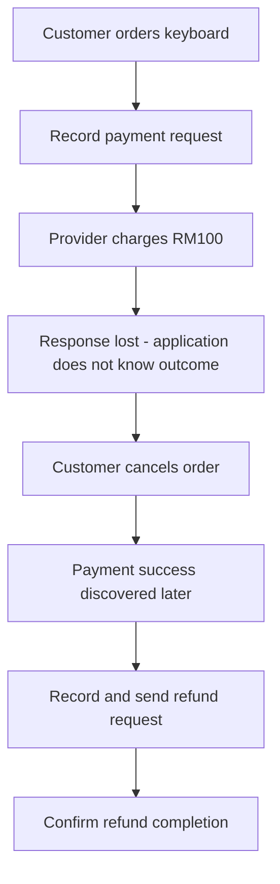
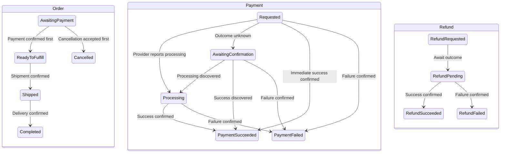
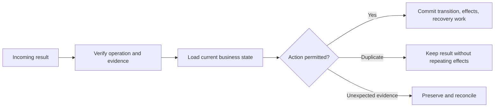
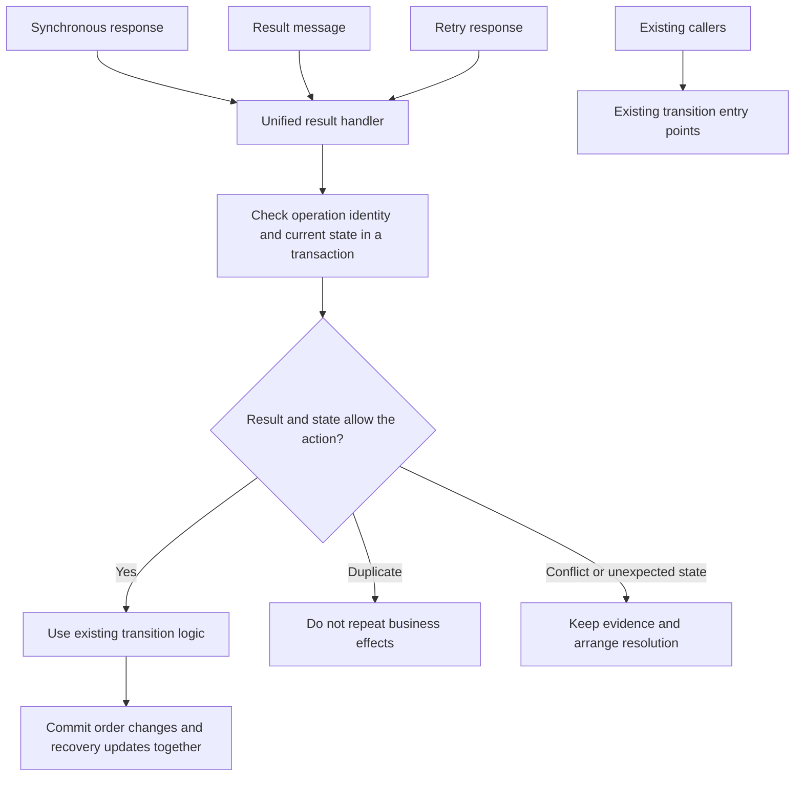
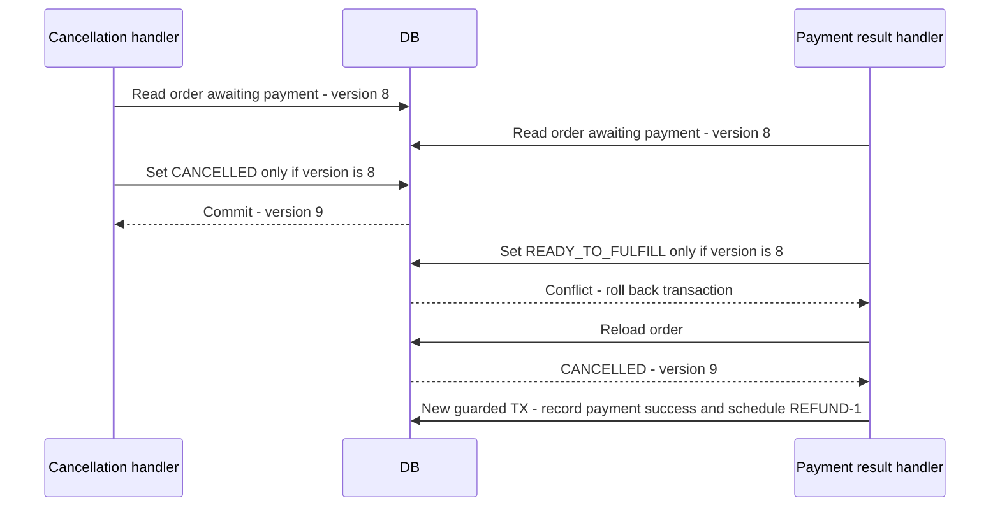
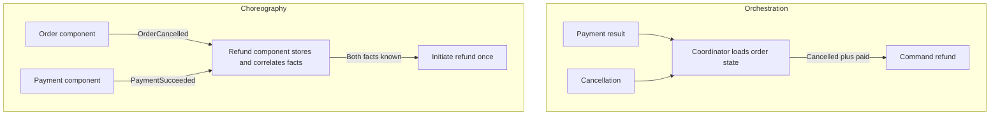
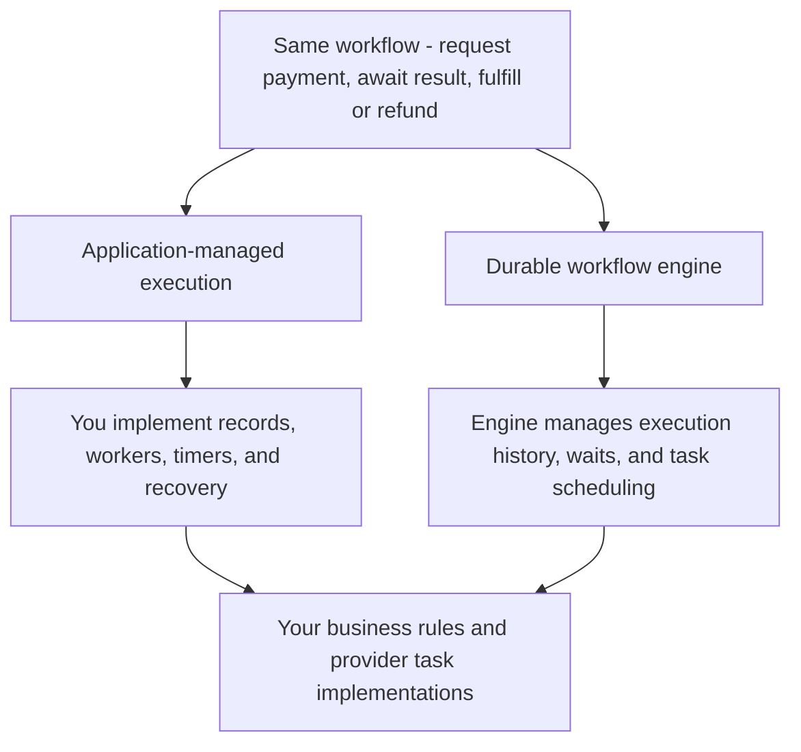

# State machines and business workflows

A payment can finish after your request times out—or after the customer cancels. This is a **long-running asynchronous business workflow**: several business steps must progress despite waiting, uncertain outcomes, and crashes.

This note explains **which business actions are valid**. Its companion, [Reliable asynchronous operations](reliable-asynchronous-operations.md), explains retries, operation identities, durable tasks, and crash recovery.

**Core principle: record what you know, preserve uncertainty, and make the next step recoverable.** Protect safety while waiting, and provide a way to make progress.

## The example we will follow

A customer orders a **RM100 keyboard**. The provider charges successfully, but its response is lost. The customer cancels. We later discover payment success and refund it.



Read the same operation through the workflow:

| Snapshot | Order | Payment evidence | Refund | Next permitted work |
|---|---|---|---|---|
| Intent committed | Awaiting payment | Requested | None | Send existing operation |
| Response lost | Awaiting payment | Unknown | None | Resolve evidence; block a second collection |
| Cancellation accepted | Cancelled | Still unknown | None | Reconcile any possibly sent request |
| Success discovered | Cancelled | Succeeded | Requested | Refund the confirmed charge |
| Refund confirmed | Cancelled | Succeeded | Succeeded | Record completion |

The three lifecycles describe different facts; cancelling the order does not prove that the charge stopped. The table illustrates this note’s policy, not a provider-specific API.

We use three readable identities throughout:

| Record | Identity | What it tracks |
|---|---|---|
| Order | `ORDER-1` | Purchase and fulfillment |
| Payment operation | `PAYMENT-1` | Collecting RM100 |
| Refund operation | `REFUND-1` | Returning RM100 |

Our policy: fulfill only after confirmed payment; accept cancellation while awaiting payment; refund a payment confirmed after cancellation. Confirmation of payment also schedules fulfillment, so cancellation afterward requires a different policy. The states below describe our application, not an exact provider API.

## State machines and good state design

A **state machine** defines current states, allowed transitions, and the conditions protecting them. Separate order, payment, and refund because they represent different facts.



These are three separate lifecycles; the workflow connects them. At the end of our example, the order is cancelled, payment succeeded, and refund succeeded. That is a consistent history: refunding does not erase the charge.

| Concept | Keyboard example |
|---|---|
| Command | `PayOrder`: a request that can be rejected |
| Event | `PaymentSucceeded`: verified evidence of a fact |
| Guard | Correct order, amount, currency, and eligible current state |
| Transition | Order changes from awaiting payment to ready to fulfill |
| Effect | Schedule fulfillment |
| Invariant | Never schedule fulfillment without confirmed payment under this policy |

### From a diagram to a transition decision

An arrow summarizes a rule; the implementation must also specify its evidence and effects. Read each row as current facts plus an input, checked together before committing a decision.

| Current order | Input and guard | Next order | Other committed facts or intent |
|---|---|---|---|
| Awaiting payment | Verified success for the matching RM100 payment | Ready to fulfill | Record payment success and fulfillment intent once |
| Awaiting payment | Cancellation accepted before payment confirmation wins | Cancelled | Record cancellation; preserve unresolved payment tracking |
| Cancelled | Verified success for the matching payment | Cancelled | Record payment success and reserve/create refund intent once |
| Ready to fulfill | Duplicate confirmation of the same payment success | Ready to fulfill | No second fulfillment effect |
| Any | Network timeout without conclusive provider evidence | Unchanged by timeout alone | Preserve uncertainty and recovery work |

For example, `Cancelled + PaymentSucceeded` does not require an order transition to record the charge. The payment lifecycle advances while the order stays cancelled. The workflow connects those facts by creating a refund obligation. This avoids forcing every external event into an order-status change.

### Designing useful states

Define each state by its meaning and allowed actions, not by an enum's position or the last API response.

| Design rule | Keyboard example |
|---|---|
| Describe one clear situation | `REQUESTED` means intent is durable; it does not mean charged |
| Separate fact from uncertainty | Provider processing is known; an unknown outcome is a lack of evidence |
| Split independently changing lifecycles | Order can be cancelled while payment has succeeded |
| Add a state when it changes permitted behavior or recovery | Unresolved payment blocks a second collection and needs reconciliation |
| Keep details as data when they do not change behavior | Last error and observation time need not become new states |
| Define outgoing transitions and evidence | Only confirmed failure permits closing the uncertain operation as failed |

For each state, specify its meaning, eligible commands, transition guards, and how waiting ends. Use amounts and constraints for partial payments/refunds; statuses alone cannot enforce balance rules. Start with explicit transition methods, use a table for many combinations, and consider the State pattern when substantial behavior varies by state.

Separate **business progress, provider evidence, and recovery work**. An existing order state can remain unchanged while a task stores execution ownership, attempt count, and the next check time. You do not need another business status for every technical step, but you still need enough durable information to prevent concurrent sends and find unfinished work. A task finishing does not necessarily mean the business operation finished.

Keep state diagrams focused on states and the evidence permitting transitions. Put scheduling, retry limits, and alerts in a sequence diagram or scenario table. An action that leaves the business state unchanged does not need another state merely to make it visible in the diagram.

## Business decisions and compensation

### Own and protect the rules

**One owner per rule** means handlers reuse operations such as `requestPayment`, `applyPaymentResult`, and `cancelOrder`. Grouping related state and rules supports high cohesion; avoiding independent copies gives each rule one authoritative implementation. The owner can be a module with collaborators. See [separation of concerns and cohesion](separation-of-concerns-coupling-and-cohesion.md).

### Submission eligibility and operation identity

A submission is a command, so the server must decide whether it is currently permitted. Clicking Pay again does not automatically authorize another payment operation.

| Current facts | Business decision | Execution handoff |
|---|---|---|
| PAYMENT-1 is unresolved; order still eligible | Block a second collection | Resume tracking PAYMENT-1; replay only if safe |
| PAYMENT-1 definitively failed and cannot later succeed; order still eligible | A new collection may be permitted | Create PAYMENT-2 with a new identity |
| Payment already succeeded | Do not collect again | Return the known result; avoid duplicate fulfillment |
| Order cancelled; payment unresolved | Do not initiate another collection | Resolve PAYMENT-1 and compensate if charged |
| Customer action required | Permit only the provider-supported continuation | Preserve correlation and arrange an authenticated interaction |

Make the eligibility check and creation of the active operation atomic. Otherwise two submissions can both see an eligible order and create competing collections. Recheck eligibility before a delayed send; permission when work was queued may no longer apply.

For the RM100 keyboard: a timeout leaves PAYMENT-1 unresolved. A second click resumes that operation. Only conclusive failure plus a still-eligible order permits PAYMENT-2. See [retry and identity rules](reliable-asynchronous-operations.md#retry-without-creating-another-charge) for how to execute that decision safely.

### Rollback versus a corrective transition

**Record first means record intent, not premature success.** Before the provider call, PAYMENT-1 is `REQUESTED` and ORDER-1 remains `AWAITING_PAYMENT`. Only confirmed evidence permits recording payment success.

| When the problem occurs | What to do | Keyboard example |
|---|---|---|
| Before the local transaction commits | Roll back that transaction | Creating payment work fails: neither PAYMENT-1 nor its outgoing work commits |
| After commit, before any send can occur | Apply a guarded cancellation transition | Cancel queued collection only if workers are atomically prevented from claiming/sending it |
| Provider confirms this payment operation failed | Record failure in a new transaction | PAYMENT-1 becomes `FAILED`; order can remain awaiting payment for another attempt |
| Send outcome is unknown | Preserve uncertainty and resolve it | Do not delete PAYMENT-1 or start another charge merely because of a timeout |
| Charge succeeded but the order was cancelled | Start compensation | Keep payment success and create REFUND-1 |

Once a local transaction commits, a later transaction changes its result; it cannot retroactively roll back that commit. Some local changes can be reversed through an explicit transition, such as releasing a reservation. Check current state, preserve history, and prevent races with other work. External effects require the provider's cancellation or compensation operation.

## Safe result handling

### Enforce transition rules at the result entry point

A result handler can enforce a state machine without introducing a workflow engine or changing a legacy entity globally. Start with one controlled entry point for provider responses, messages, and retry results. The transition policy belongs there until the application can safely centralize it more broadly.



A result selects a candidate reaction; the current state and evidence decide whether it is allowed. Confirmed success after cancellation still records payment success, but starts compensation rather than fulfillment.

<details>
<summary>Expand permission checks, legacy-writer limits, and Java handler</summary>

#### Dispatch and permission are separate decisions

A `switch` selects which result logic to run. It does not establish whether changing the current order is allowed. Make the permission check explicit before applying the selected action:

```text
Current state + incoming result + operation identity + business context
    -> check whether the action is allowed
    -> apply the transition and local effects
    -> update recovery work in the same transaction
```

For example, success while the order awaits payment can schedule fulfillment. The same success after cancellation must still be recorded as payment success, but schedules compensation instead. Never discard an external financial fact merely because the order is no longer in the expected state.

The previous state is not automatically an input to every decision. If arrivals from two paths mean the same thing, one current-state handler is sufficient. If the paths imply different permissions, obligations, or evidence, preserve that distinction in explicit state or operation context. Do not rely on reconstructing an undocumented rule from a history log.

| Check | What it prevents |
|---|---|
| Result belongs to the expected operation | An old request result being applied to a newer request |
| Current order state allows the action | Success scheduling fulfillment after cancellation |
| Evidence is sufficient for the transition | Timeout being interpreted as confirmed failure |
| User-action result has the required provider guarantee | Restoring submission eligibility while execution may still happen |
| Database check and update are coordinated | Concurrent handlers both advancing the same order |
| Local effects and recovery updates commit together | Order marked complete while required follow-up is lost |

For stale or mismatched results, distinguish duplicate delivery from new evidence of an external effect. A stale success may require reconciliation or compensation even when it must not advance the current operation.

#### Add rules without unexpectedly breaking old callers

Adding validation to a shared `setStatus` method can change every existing caller. If the only code you control is the new result entry point, enforce the new rules there first and reuse the existing transition methods for node updates, history, and outgoing work.



This is a limited guarantee: requests through the new handler obey its policy. Existing writers do not become protected merely because the new path has a lock or validation. Inventory the other writers that can modify the same records before claiming that the whole application enforces the rule.

| Change | Effect on existing behavior |
|---|---|
| Add checks to the new result handler | Changes handling through that entry point |
| Reuse existing transition operations | Preserves their node updates, history, and local effects; verify their assumptions |
| Add validation to a shared entity setter | Can reject transitions previously used by old callers |
| Add a database constraint | Affects all writes, including legacy paths and maintenance scripts |
| Add version checks to all writers | Coordinates concurrent updates, but requires each writer to handle conflicts |

#### Java example: one handler with small result methods

For a few stable result types, a `switch` with named methods is sufficient. Separate handler classes become useful when individual cases have substantial logic or different dependencies; replacing a short switch with a registry does not itself improve correctness.

This Spring-style example shows the boundary, not a complete application. Repository and helper methods stand for existing application operations. They must participate in the same database transaction; the helper names describe the behavior their implementations must provide.

```java
@Transactional
public void handle(ProviderResult result) {
    Order order = orders.findByIdForUpdate(result.orderId());

    if (!matchesOperation(order, result)) {
        // Save evidence for reconciliation; a stale charge may still be real.
        reviews.recordMismatchedResult(order, result);
        return;
    }

    if (order.isFinished()) {
        // Identical resolved result: no duplicate effect.
        // New success after cancellation: record payment and arrange compensation.
        // Conflicting evidence: save an investigation item, do not overwrite.
        handleFinishedOrder(order, result);
        return;
    }

    if (!order.isAwaitingPayment()) {
        // Do not silently drop an external result in an unexpected state.
        reviews.recordUnexpectedState(order, result);
        return;
    }

    switch (result.code()) {
        case SUCCESS -> {
            existingTransitions.confirmPaymentAndAdvance(order, result);
            tasks.complete(result.operationId());
        }
        case FINAL_FAILURE -> {
            existingTransitions.recordFailureAndAdvance(order, result);
            tasks.complete(result.operationId());
        }
        case TEMPORARY_ERROR ->
            tasks.retryOnlyIfSafeOtherwiseReview(order, result);
        case PROCESSING ->
            tasks.waitForMessage(result.operationId());
        case UNKNOWN ->
            tasks.recoverUnknownWithoutAssumingFailure(order, result);
        case USER_ACTION_REQUIRED ->
            handleUserActionUnderProviderContract(order, result);
    }
}
```

The user-action helper must check what the provider guarantees before restoring eligibility for submission. If no execution can occur until authentication, it can use a supported user interaction path. Otherwise it preserves uncertainty and hands off for resolution. A message can record that the user must act, but cannot display a challenge through a closed HTTP request.

Use validation of operation correlation, amount, currency, and result authenticity before accepting provider evidence. The example's status checks do not replace those checks. The method must be called through Spring's transactional proxy; invoking it internally without an active transaction does not establish the intended transaction boundary. External provider calls happen before or after this local transaction, never while holding its row lock.

#### Check current state when writing, not only when routing

An in-memory check followed by an unconditional update is vulnerable to another writer changing the order in between. A database row lock protects the read-and-update transaction, but does not force every legacy writer to honor the business rule. For example, a legacy caller can read before the lock is acquired and later overwrite with stale data after the lock is released.

Where appropriate, use an expected state or version in the update itself:

<details>
<summary>Show conditional SQL update</summary>

```sql
UPDATE orders
SET status = :next_status,
    version = version + 1
WHERE id = :order_id
  AND status = :expected_status
  AND version = :expected_version;
```

</details>

Require exactly one affected row. Zero means the assumption no longer holds: roll back dependent local changes, reload, and reevaluate. Do not blindly retry the old decision or repeat an external call. This update should sit behind the existing transition operation if direct SQL would bypass required history or node effects.

A conditional update protects the write that uses it. A later unconditional legacy update can still overwrite that value. Strong application-wide protection requires cooperating writers, suitable database constraints where the rule can be expressed, or a single authoritative transition owner. Until then, document the new handler's scope rather than promising global enforcement.

#### Choose an execution tool after defining the rules

Current-state dispatch, transition validation, and workflow execution are separate concerns. A handler chooses the business reaction; a state machine defines allowed changes; an execution runtime arranges durable waits, retries, and resumption. A workflow engine can provide that runtime, but cannot decide provider semantics or eliminate unknown external outcomes.

For an existing system with working persistence, scheduling, and message consumption, first connect them through the unified handler and explicit task lifecycle. Consider another engine when implementing and maintaining many waits, branches, compensations, and recovery paths becomes a recurring burden. Whether transitions depend on the previous state is not the deciding criterion.

</details>

### Resolve concurrent decisions

Now the customer cancels. Cancellation and payment confirmation might both read the same old order state. Their checks must be protected by storage-level concurrency control.



The losing handler reloads and **reevaluates the decision**. It does not repeat its old action with an updated version. If confirmation wins first, our policy rejects simple cancellation because fulfillment is scheduled.

| Mechanism | Purpose |
|---|---|
| Atomic version/state condition | Protect competing transitions |
| Row lock in a short transaction | Serialize decisions on shared records |
| Unique constraint | Prevent duplicate identities/effects |
| Appropriate locks or serializable transaction | Protect rules spanning several records |

For refunds, also reserve the amount atomically against the refundable balance. Distinct refund IDs alone cannot stop two handlers refunding the same RM100. Process-local locks do not coordinate multiple servers. [PostgreSQL transaction isolation](https://www.postgresql.org/docs/current/transaction-iso.html)

Three deadlines have different meanings: HTTP timeout ends waiting for a response; provider processing expectations trigger checks; an order reservation deadline can cancel the order. None proves collection stopped. Expiry, like cancellation, can require a refund if success is discovered later.

### What the order version protects

An order version is a revision of stored business state. It is different from a payment identity or a worker claim generation.

| Value | Example | Meaning |
|---|---|---|
| Order version | ORDER-1 version 8 becomes 9 | Another decision changed the order; reload and reevaluate |
| Payment identity | PAYMENT-1 remains PAYMENT-1 across retries | These requests concern the same logical collection |
| Worker claim generation | Claim 4 becomes 5 | A newer worker owns the local recovery task |

Incrementing an order version does not create a new payment, and a new worker claim does not authorize another charge. The [reliability note](reliable-asynchronous-operations.md#operation-identities-and-worker-generations) explains correlation and stale-worker protection. For database implementation, see [concurrency tools](../java/database-transactions-and-spring-transactional.md#5-choose-a-concurrency-tool).

The result handler must commit required follow-up intent with its business decision. The companion note shows [inbox/outbox delivery and crash recovery](reliable-asynchronous-operations.md#recover-durable-work-after-a-crash), including the refund sequence.

## Choosing how to coordinate the workflow

The business model and execution mechanisms play different roles. These terms describe different parts of it:

| Level | Question | Concept |
|---|---|---|
| Business model | Which changes are valid? | State machines and guards |
| Complete process | How do payment, cancellation, and refund connect? | Workflow: operations plus coordination rules |
| Information delivery | How does the result arrive? | Push/pull |
| Decision ownership | Who decides the next cross-step action? | Orchestration/choreography |
| Execution machinery | Who persists waits, dispatches tasks, and resumes progress? | Your application or a workflow engine |

### Orchestration and choreography

The result has arrived. Someone must now decide whether to fulfill or refund. **Orchestration** puts that cross-step decision in a coordinator. **Choreography** distributes reactions among event subscribers.



| Orchestration | Choreography |
|---|---|
| One place tracks the overall sequence | Participants own local event reactions |
| Easier to follow the complete flow | More event dependencies to trace as the flow grows |
| Coordinator owns cross-step decisions | Refund component owns eligibility in this example |

Both still need durable state, retries, and concurrency protection. A pushed webhook can wake an orchestrator; push does not automatically mean choreography. Choreography must correlate facts regardless of arrival order. [Saga orchestration](https://docs.aws.amazon.com/prescriptive-guidance/latest/cloud-design-patterns/saga-orchestration.html), [saga choreography](https://docs.aws.amazon.com/prescriptive-guidance/latest/cloud-design-patterns/saga-choreography.html)

### State machine, workflow, and workflow engine

A **state machine is the model**. A **workflow combines business operations with coordination rules**, potentially across several state machines. A **workflow engine is the runtime** executing a workflow definition.



For our lost response, your application can persist a next-check time and scan for due work. An engine can provide a durable timer and resume a task when it fires. You still define what the provider evidence means and use stable identities for external effects. Temporal uses execution history to recover progress. [Workflow execution](https://docs.temporal.io/workflow-execution)

A transition library may validate states without providing durability. An engine's successful task execution does not itself prove business payment success. Engines add operational and versioning constraints as they take over execution machinery.

The general scenario is an **asynchronous business workflow** with distributed coordination and potentially eventual consistency. Accept-now/respond-later is asynchronous request-reply. Coordinating committed steps through compensations is a **saga**; waiting alone is not enough to make it one. [Asynchronous request-reply](https://learn.microsoft.com/en-us/azure/architecture/patterns/asynchronous-request-reply)

## Verify the design with the same example

| Inject this failure | Required property |
|---|---|
| Repeated pay submission | No second active collection |
| Lost response | Preserve uncertainty and recover PAYMENT-1 |
| Cancellation/result race | One valid order decision and explicit compensation |
| Duplicate or late event | No repeated effect or state regression |
| Crash after refund decision | REFUND-1 remains discoverable |
| Concurrent refund requests | Reserved/completed refunds stay within balance |
| Retry exhaustion or stale worker | No invented result or overwritten newer decision |
| Crash before send or before saving its response | Recovery work survives; possible execution is not mistaken for a definitely unsent request |
| Missing result message and no query capability | Local deadline triggers an alert or investigation, not fabricated failure |
| Background attempt requires user action | Automatic execution stops; no assumed live connection or invented failure |

Transition tests check rules; database integration tests check atomicity/concurrency; failure injection checks recovery. Monitor unresolved age, retries, conflicts, pending work age, and review backlog. Keep transition history with identity, time, actor, and reason; a history log alone is not event sourcing.

For each arrow in the diagrams, ask: **what evidence permits it, what commits together, and how does another process resume it after a crash?**

## Check your understanding

1. A success webhook arrives after cancellation. Should the handler discard it as an invalid transition?

   <details>
   <summary>Show answer</summary>

   No. Record the verified external fact. Under this note’s policy, the cancelled order stays cancelled and a separate refund operation compensates for the charge. The current state changes the next action, not the truth of the evidence.

   Separate accepting evidence from choosing a transition. The evidence says money was collected; the order state says fulfillment is no longer permitted. Discarding the evidence hides a real obligation to return the money. Record the payment and the required refund work durably, with duplicate protection so repeated notifications do not create repeated refunds.

   </details>

1. Does adding a workflow engine remove the need for payment identities and guards?

   <details>
   <summary>Show answer</summary>

   No. An engine can persist waits and execution progress. Business rules, provider semantics, safe repetition, and concurrency protection still need explicit design.

   For example, an engine can wake a payment check after a persisted timer expires. Your task implementation still needs to decide whether to query the existing payment or safely replay it, and whether cancellation has changed what is permitted. Durable execution progress does not establish the outcome of an external call whose response was lost.

   </details>

*SQL and Java snippets are illustrative and were not executed during this note update.*
