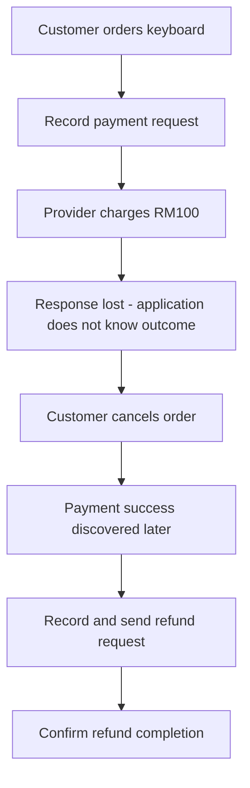
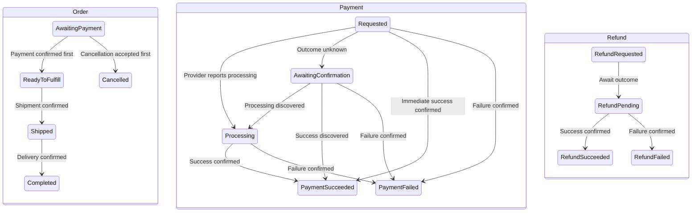
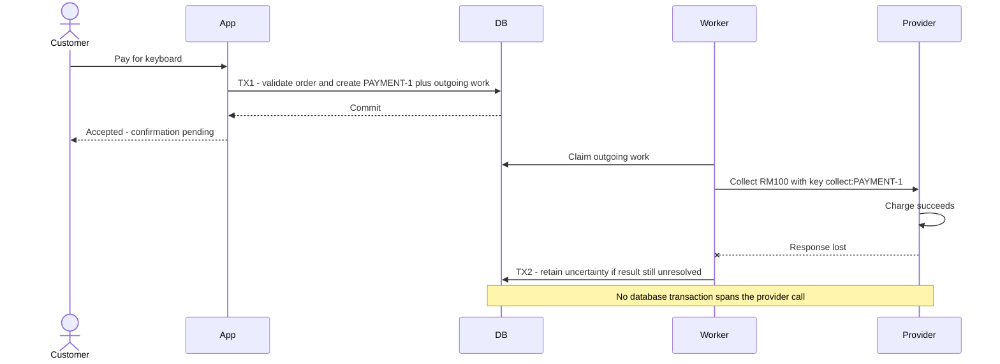
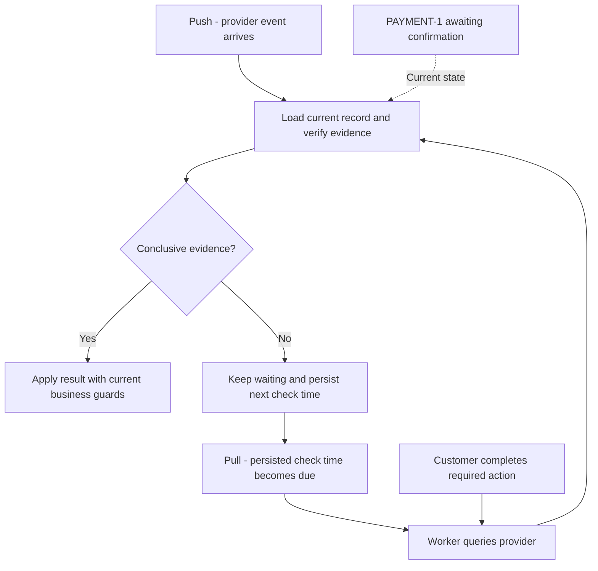
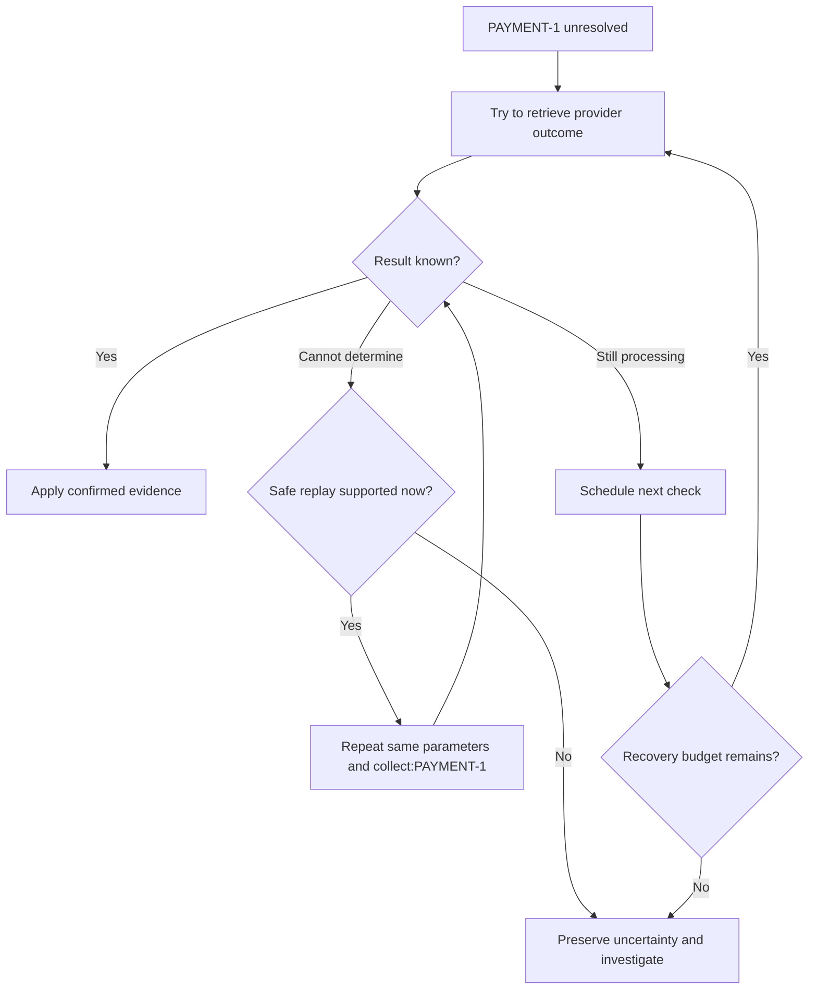
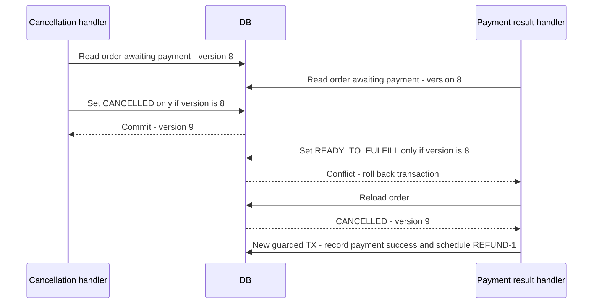
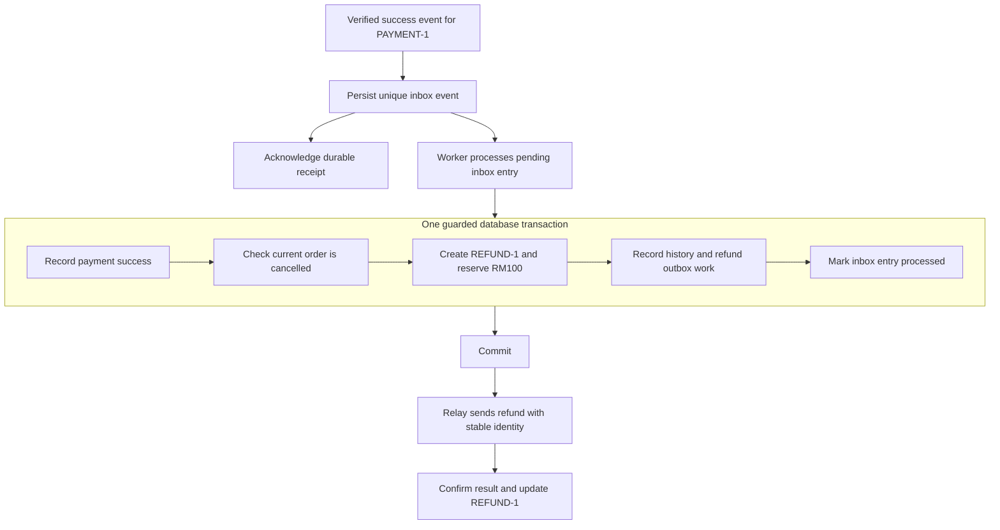
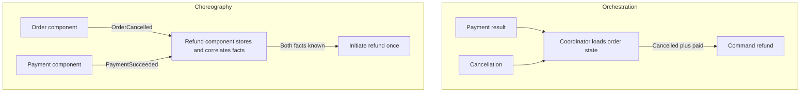
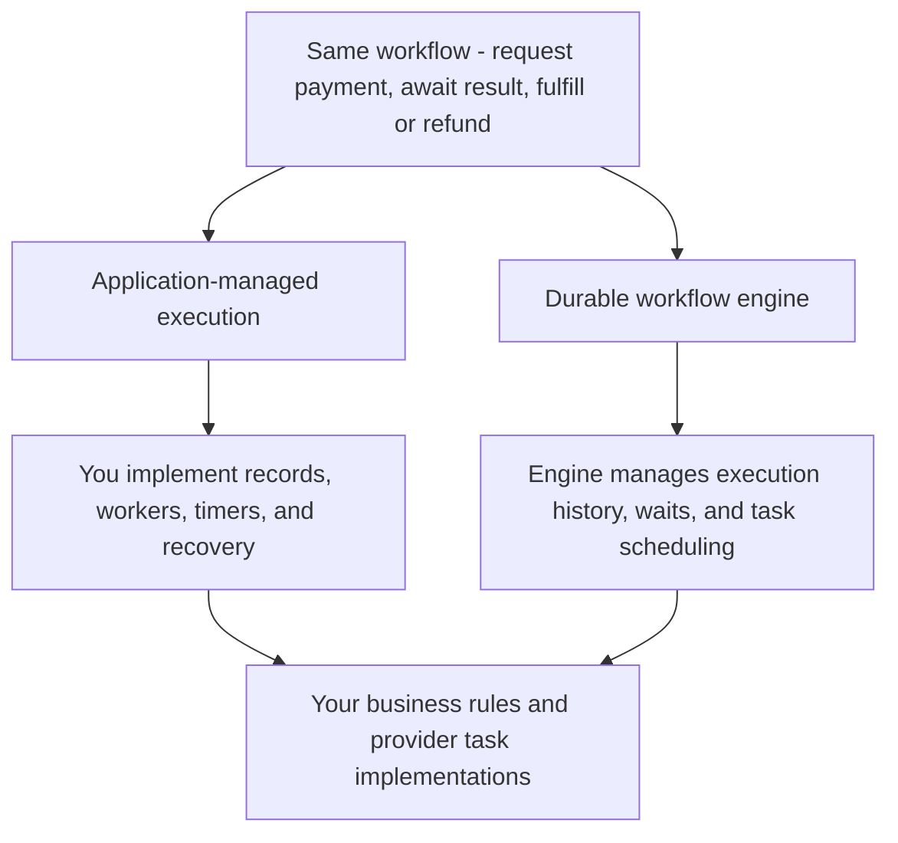

# State machines and business workflows

A payment can finish after your request times out—or after the customer cancels. This is a **long-running asynchronous business workflow**: several business steps must progress despite waiting, uncertain outcomes, and crashes.

**Core principle: record what you know, preserve uncertainty, and make the next step recoverable.** Protect safety while waiting, and provide a way to make progress.

## The example we will follow

A customer orders a **RM100 keyboard**. The provider charges successfully, but its response is lost. The customer cancels. We later discover payment success and refund it.

We use three readable identities throughout:

| Record | Identity | What it tracks |
|---|---|---|
| Order | `ORDER-1` | Purchase and fulfillment |
| Payment operation | `PAYMENT-1` | Collecting RM100 |
| Refund operation | `REFUND-1` | Returning RM100 |

Our policy: fulfill only after confirmed payment; accept cancellation while awaiting payment; refund a payment confirmed after cancellation. Confirmation of payment also schedules fulfillment, so cancellation afterward requires a different policy. The states below describe our application, not an exact provider API.

## 1. State machines and good state design

A **state machine** defines current states, allowed transitions, and the conditions protecting them. Separate order, payment, and refund because they represent different facts.

These are three separate lifecycles; the workflow connects them. At the end of our example, the order is cancelled, payment succeeded, and refund succeeded. That is a consistent history: refunding does not erase the charge.

| Concept | Keyboard example |
|---|---|
| Command | `PayOrder`: a request that can be rejected |
| Event | `PaymentSucceeded`: verified evidence of a fact |
| Guard | Correct order, amount, currency, and eligible current state |
| Transition | Order changes from awaiting payment to ready to fulfill |
| Effect | Schedule fulfillment |
| Invariant | Never schedule fulfillment without confirmed payment under this policy |

### Designing useful states

Define each state by its meaning and allowed actions, not by an enum's position or the last API response.

| Design rule | Keyboard example |
|---|---|
| Describe one clear situation | `REQUESTED` means intent is durable; it does not mean charged |
| Separate fact from uncertainty | Provider processing is known; an unknown outcome is a lack of evidence |
| Split independently changing lifecycles | Order can be cancelled while payment has succeeded |
| Add a state when it changes permitted behavior or recovery | Unresolved payment blocks a second collection and needs reconciliation |
| Keep details as data when they do not change behavior | Last error and observation time need not become new states |
| Define outgoing transitions and evidence | Only confirmed failure permits closing the uncertain operation as failed |

For each state, specify its meaning, eligible commands, transition guards, and how waiting ends. Use amounts and constraints for partial payments/refunds; statuses alone cannot enforce balance rules. Start with explicit transition methods, use a table for many combinations, and consider the State pattern when substantial behavior varies by state.

## 2. Production practices for transitions

### Own and protect the rules

**One owner per rule** means handlers reuse operations such as `requestPayment`, `applyPaymentResult`, and `cancelOrder`. Grouping related state and rules supports high cohesion; avoiding independent copies gives each rule one authoritative implementation. The owner can be a module with collaborators. See [separation of concerns and cohesion](separation-of-concerns-coupling-and-cohesion.md).

### Record intent before external work

Persist intent before contacting the provider. Finish the local transaction, then send the request.

**Accepted is not paid. Timeout is not failed.** While payment is unresolved, block another collection or resume the existing operation. Enforce this atomically on the server; a disabled UI button is insufficient.

| Observation | Meaning | Action |
|---|---|---|
| Processing | Provider says work is ongoing | Await result |
| Requires action | Customer input is needed | Prompt for authentication or other required action |
| Awaiting confirmation | Outcome is unknown | Reconcile or safely replay the same operation |
| Confirmed success/failure | Evidence resolves this operation | Apply business rules |

Stripe exposes intermediate processing and customer-action states. [Payment lifecycle](https://docs.stripe.com/payments/paymentintents/lifecycle)

If a query fails after previously reporting processing, retain the last observation and its time. If a webhook already confirmed success, a later timeout handler must not overwrite it. State describes evidence, not the last network response alone.

Persist operation identity, provider correlation, request parameters/key, outcome or stage, version, observation time, attempt count, `nextAttemptAt`, and error details. These allow another process to resume.

### Make waiting resumable

A waiting payment is a persisted record, not a sleeping thread. A **wake-up** triggers a handler to reload it and see whether progress is possible.

| Method | Who initiates? | Benefit | Cost |
|---|---|---|---|
| Immediate response | Your original request | Fast path | May time out |
| Pull | Your scheduled worker | Controls check schedule | Query traffic and detection delay |
| Push | Provider webhook/event | Prompt updates | Duplicate/late delivery and receiver failures |
| Push with reconciliation | Events normally, queries for overdue work | Recovers gaps | Both paths must share result handling |

For our example, a durable timer can trigger a status check if no webhook arrives. Still processing? Persist a later check. Already resolved by a webhook? Skip redundant work. Merely setting `PENDING` schedules nothing.

In a push design, register an endpoint or subscription, verify the event, and correlate its provider ID to PAYMENT-1. A pushed event may contain the result or only an identifier requiring a query. Push describes who initiates delivery, not whether queries are forbidden. [Stripe webhooks](https://docs.stripe.com/webhooks)

If queries are unavailable, recovery depends on provider replay/delivery facilities or investigation. Duplicate wake-ups must be harmless.

## 3. Failure handling and recovery

### Rollback versus a corrective transition

**Record first means record intent, not premature success.** Before the provider call, PAYMENT-1 is `REQUESTED` and ORDER-1 remains `AWAITING_PAYMENT`. Only confirmed evidence permits recording payment success.

| When the problem occurs | What to do | Keyboard example |
|---|---|---|
| Before the local transaction commits | Roll back that transaction | Creating payment work fails: neither PAYMENT-1 nor its outgoing work commits |
| After commit, before any send can occur | Apply a guarded cancellation transition | Cancel queued collection only if workers are atomically prevented from claiming/sending it |
| Provider confirms this payment operation failed | Record failure in a new transaction | PAYMENT-1 becomes `FAILED`; order can remain awaiting payment for another attempt |
| Send outcome is unknown | Preserve uncertainty and resolve it | Do not delete PAYMENT-1 or start another charge merely because of a timeout |
| Charge succeeded but the order was cancelled | Start compensation | Keep payment success and create REFUND-1 |

Once a local transaction commits, a later transaction changes its result; it cannot retroactively roll back that commit. Some local changes can be reversed through an explicit transition, such as releasing a reservation. Check current state, preserve history, and prevent races with other work. External effects require the provider's cancellation or compensation operation.

### Leaving uncertainty safely

Uncertainty records missing knowledge. **Do not restore the old state just because time passed.** Restore the previous business condition only when you have established that doing so is safe; retain the operation and its history.

| Evidence or coordination | Safe action |
|---|---|
| Request is still local and atomic cancellation prevents every sender from executing it | Close the operation as cancelled before send |
| Provider definitively confirms this operation failed and cannot later succeed | Record failure; allow the next attempt if the order is still eligible |
| Provider confirms cancellation prevents further execution | Record cancellation and release related local reservations under policy |
| Provider confirms success | Apply success; compensate if the order no longer permits fulfillment |
| Timeout, missing callback, query error, or exhausted retries | Keep the outcome unresolved; reconcile or investigate |
| Provider query says not found but creation could still be in flight or visibility delayed | Keep uncertainty until the provider contract rules out late execution |

In our example, the order stayed `AWAITING_PAYMENT` while PAYMENT-1 was uncertain. Once failure is definitively confirmed, there is no order state to roll back: close PAYMENT-1 as `FAILED`, then a new PAYMENT-2 may be created. If you use an order-level `PAYMENT_PENDING`, an explicit transition back to `AWAITING_PAYMENT` can be valid after the same checks. If the order was cancelled meanwhile, do not restore it to awaiting payment.

An expired lease or a stopped worker is not proof that the external request was never sent. A pre-send cancellation must coordinate with the sending protocol; after a sender claims work, treat possible external execution explicitly. "Not found" is conclusive only when the provider's visibility and request-lifecycle guarantees make it so.

### Retry without creating another charge

Retry when **the problem may recover, repetition is safe, the action is still valid, and its retry budget remains**. First identify what you are repeating: a charge request, a status query, or a local transaction.

"May recover" is an evidence-based classification, not certainty. Ask: **can the cause disappear without changing this request?** Use the provider's documented error codes and retry hints before broad HTTP categories.

| Evidence | Interpretation |
|---|---|
| Explicit retry hint or documented temporary error | Good reason for a bounded retry under that contract |
| Rate limit or temporary contention | Waiting may remove the cause |
| Timeout or connection reset | Communication may recover, but the original business outcome remains unknown |
| Invalid input or permissions | Time alone usually does not correct the cause |
| Unrecognized error | Investigate/classify; allow only bounded safe retries if policy permits |

For example, Stripe exposes `Stripe-Should-Retry` guidance; its server errors can still leave side effects uncertain. A status code alone is not enough to establish safe repetition. [Stripe error classification](https://docs.stripe.com/error-low-level#the-stripe-should-retry-header)

In the keyboard example, a connection reset is a reason to expect communication might work next time, not evidence the charge failed. A retry budget limits how long to test that expectation. Repeated failures trigger diagnosis or deferred recovery, not unlimited attempts or a fabricated failure outcome. Classify recoverability and side-effect uncertainty separately.

| Situation | What to repeat | When |
|---|---|---|
| Temporary connection failure or timeout sending payment | Same provider operation with the same key/parameters, if supported; alternatively query its outcome | After backoff, within provider guarantees, while collection remains permitted |
| Provider reports processing | Status check, not a new charge | On notification or the next scheduled check |
| Rate limit | Same permitted request | After provider retry guidance or capped backoff with jitter |
| Server error | Resolve outcome or replay only as documented | Do not assume the request had no effects or that replay will reexecute it |
| Version conflict or transactional deadlock | Local transaction: reload and reevaluate rules | With bounded retries; never blindly repeat external calls |
| Invalid input, missing permission, or confirmed business rejection | No unchanged automatic retry | Correct the cause or obtain a new permitted action first |
| Order cancelled while payment is unknown | Queries/reconciliation, not a fresh collection attempt | Continue resolving evidence; compensate if already charged |

In the keyboard example, retrying a status query asks what happened. Replaying `collect:PAYMENT-1` might execute a charge if the original never executed. Before sending, check whether collection is still permitted. If ORDER-1 is now cancelled, cancel unsent work safely and resolve any possibly sent request rather than blindly replaying collection.

Provider-specific guidance matters: Stripe API v1 can cache a server error, so replaying the same key may return that error again. Network retries use the same key and parameters within the documented window. [Stripe advanced error handling](https://docs.stripe.com/error-low-level)

The first request may have succeeded. When replay is permitted, repeat the **same logical operation**, not a new charge with a new identity.

| Action | Identity rule |
|---|---|
| Network retry or restart recovery | Same PAYMENT-1, same `collect:PAYMENT-1`, same parameters |
| New attempt after confirmed failure | New payment operation, for example PAYMENT-2 |
| Refund | Separate REFUND-1 and `refund:REFUND-1` |

Persist the key before sending. Deduplicate customer submissions and local effects too: provider idempotency does not protect your own ledger or fulfillment jobs.

Provider contracts limit safe replay. Stripe API v1 may replay saved errors and prune keys after at least 24 hours; API v2 differs. Do not assume keys protect an operation forever. [Idempotent requests](https://docs.stripe.com/api/idempotent_requests)

Retry temporary errors with bounded attempts/time and capped backoff plus jitter. Persist `nextAttemptAt`; avoid stacked retries at multiple layers. Invalid input needs correction. **Exhausting retries leaves an operational problem, not proof that payment failed.** [AWS retry guidance](https://aws.amazon.com/builders-library/timeouts-retries-and-backoff-with-jitter/)

### Resolve concurrent decisions

Now the customer cancels. Cancellation and payment confirmation might both read the same old order state. Their checks must be protected by storage-level concurrency control.

The losing handler reloads and **reevaluates the decision**. It does not repeat its old action with an updated version. If confirmation wins first, our policy rejects simple cancellation because fulfillment is scheduled.

| Mechanism | Purpose |
|---|---|
| Atomic version/state condition | Protect competing transitions |
| Row lock in a short transaction | Serialize decisions on shared records |
| Unique constraint | Prevent duplicate identities/effects |
| Appropriate locks or serializable transaction | Protect rules spanning several records |

For refunds, also reserve the amount atomically against the refundable balance. Distinct refund IDs alone cannot stop two handlers refunding the same RM100. Process-local locks do not coordinate multiple servers. [PostgreSQL transaction isolation](https://www.postgresql.org/docs/current/transaction-iso.html)

Three deadlines have different meanings: HTTP timeout ends waiting for a response; provider processing expectations trigger checks; an order reservation deadline can cancel the order. None proves collection stopped. Expiry, like cancellation, can require a refund if success is discovered later.

### Recover durable work after a crash

A database rollback cannot undo a completed external charge. The refund is **compensation**: a new business operation with its own uncertain outcomes.

The **inbox** makes incoming work durable; an inbox scanner or queue wakes its worker. The **outbox** commits outgoing work alongside the business decision. A crash after commit therefore leaves work another process can find. Delivery can repeat, so recipients still need idempotency. [AWS outbox pattern](https://docs.aws.amazon.com/prescriptive-guidance/latest/cloud-design-patterns/transactional-outbox.html)

| Interruption | Recovery |
|---|---|
| Payment intent saved before send | Deliver existing payment work |
| Charge completed but response lost | Resolve PAYMENT-1 using query or safe replay |
| Refund intent committed before send | Deliver existing refund outbox work |
| Refund sent before delivery record saved | Reuse refund identity within provider guarantees |
| Same result arrives again | Deduplicate delivery and business effect |

Different event IDs can describe the same payment success, so deduplicate business effects as well as event IDs. Late processing notifications must not regress confirmed success. Refund requests also need waiting, retries, and reconciliation until a result is confirmed. Stripe documents duplicate and unordered notifications. [Webhooks](https://docs.stripe.com/webhooks)

Workers claim work atomically. Leases permit takeover after a crash; claim generations/version checks reject stale local completions. External calls still need idempotency. For unresolved cases, manual review uses guarded operations and records actor, reason, and evidence rather than directly editing status.

## 4. Choosing how to coordinate the workflow

We have now built the whole workflow. These terms describe different parts of it:

| Level | Question | Concept |
|---|---|---|
| Business model | Which changes are valid? | State machines and guards |
| Complete process | How do payment, cancellation, and refund connect? | Workflow: operations plus coordination rules |
| Information delivery | How does the result arrive? | Push/pull |
| Decision ownership | Who decides the next cross-step action? | Orchestration/choreography |
| Execution machinery | Who persists waits, dispatches tasks, and resumes progress? | Your application or a workflow engine |

### Orchestration and choreography

The result has arrived. Someone must now decide whether to fulfill or refund. **Orchestration** puts that cross-step decision in a coordinator. **Choreography** distributes reactions among event subscribers.

| Orchestration | Choreography |
|---|---|
| One place tracks the overall sequence | Participants own local event reactions |
| Easier to follow the complete flow | More event dependencies to trace as the flow grows |
| Coordinator owns cross-step decisions | Refund component owns eligibility in this example |

Both still need durable state, retries, and concurrency protection. A pushed webhook can wake an orchestrator; push does not automatically mean choreography. Choreography must correlate facts regardless of arrival order. [Saga orchestration](https://docs.aws.amazon.com/prescriptive-guidance/latest/cloud-design-patterns/saga-orchestration.html), [saga choreography](https://docs.aws.amazon.com/prescriptive-guidance/latest/cloud-design-patterns/saga-choreography.html)

### State machine, workflow, and workflow engine

A **state machine is the model**. A **workflow combines business operations with coordination rules**, potentially across several state machines. A **workflow engine is the runtime** executing a workflow definition.

For our lost response, your application can persist a next-check time and scan for due work. An engine can provide a durable timer and resume a task when it fires. You still define what the provider evidence means and use stable identities for external effects. Temporal uses execution history to recover progress. [Workflow execution](https://docs.temporal.io/workflow-execution)

A transition library may validate states without providing durability. An engine's successful task execution does not itself prove business payment success. Engines add operational and versioning constraints as they take over execution machinery.

The general scenario is an **asynchronous business workflow** with distributed coordination and potentially eventual consistency. Accept-now/respond-later is asynchronous request-reply. Coordinating committed steps through compensations is a **saga**; waiting alone is not enough to make it one. [Asynchronous request-reply](https://learn.microsoft.com/en-us/azure/architecture/patterns/asynchronous-request-reply)

## Verify the design with the same example

| Inject this failure | Required property |
|---|---|
| Repeated pay submission | No second active collection |
| Lost response | Preserve uncertainty and recover PAYMENT-1 |
| Cancellation/result race | One valid order decision and explicit compensation |
| Duplicate or late event | No repeated effect or state regression |
| Crash after refund decision | REFUND-1 remains discoverable |
| Concurrent refund requests | Reserved/completed refunds stay within balance |
| Retry exhaustion or stale worker | No invented result or overwritten newer decision |

Transition tests check rules; database integration tests check atomicity/concurrency; failure injection checks recovery. Monitor unresolved age, retries, conflicts, pending work age, and review backlog. Keep transition history with identity, time, actor, and reason; a history log alone is not event sourcing.

For each arrow in the diagrams, ask: **what evidence permits it, what commits together, and how does another process resume it after a crash?**
