# State machines and business workflows

A payment can finish after your request times out—or after the customer cancels. This is a **long-running asynchronous business workflow**: several business steps must progress despite waiting, uncertain outcomes, and crashes.

**Core principle: record what you know, preserve uncertainty, and make the next step recoverable.** Protect safety while waiting, and provide a way to make progress.

## The example we will follow

A customer orders a **RM100 keyboard**. The provider charges successfully, but its response is lost. The customer cancels. We later discover payment success and refund it.

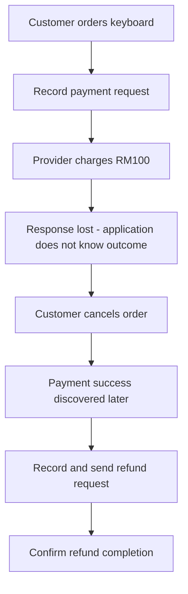

We use three readable identities throughout:

| Record | Identity | What it tracks |
|---|---|---|
| Order | `ORDER-1` | Purchase and fulfillment |
| Payment operation | `PAYMENT-1` | Collecting RM100 |
| Refund operation | `REFUND-1` | Returning RM100 |

Our policy: fulfill only after confirmed payment; accept cancellation while awaiting payment; refund a payment confirmed after cancellation. Confirmation of payment also schedules fulfillment, so cancellation afterward requires a different policy. The states below describe our application, not an exact provider API.

## 1. State machines and good state design


A **state machine** defines current states, allowed transitions, and the conditions protecting them. Separate order, payment, and refund because they represent different facts.

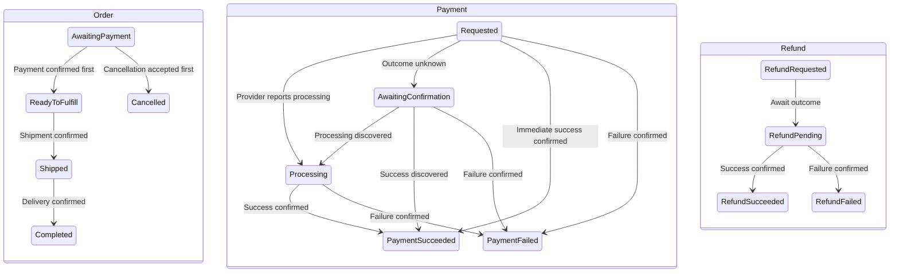

These are three separate lifecycles; the workflow connects them. At the end of our example, the order is cancelled, payment succeeded, and refund succeeded. That is a consistent history: refunding does not erase the charge.

| Concept | Keyboard example |
|---|---|
| Command | `PayOrder`: a request that can be rejected |
| Event | `PaymentSucceeded`: verified evidence of a fact |
| Guard | Correct order, amount, currency, and eligible current state |
| Transition | Order changes from awaiting payment to ready to fulfill |
| Effect | Schedule fulfillment |
| Invariant | Never schedule fulfillment without confirmed payment under this policy |

### Designing useful states

Define each state by its meaning and allowed actions, not by an enum's position or the last API response.

| Design rule | Keyboard example |
|---|---|
| Describe one clear situation | `REQUESTED` means intent is durable; it does not mean charged |
| Separate fact from uncertainty | Provider processing is known; an unknown outcome is a lack of evidence |
| Split independently changing lifecycles | Order can be cancelled while payment has succeeded |
| Add a state when it changes permitted behavior or recovery | Unresolved payment blocks a second collection and needs reconciliation |
| Keep details as data when they do not change behavior | Last error and observation time need not become new states |
| Define outgoing transitions and evidence | Only confirmed failure permits closing the uncertain operation as failed |

For each state, specify its meaning, eligible commands, transition guards, and how waiting ends. Use amounts and constraints for partial payments/refunds; statuses alone cannot enforce balance rules. Start with explicit transition methods, use a table for many combinations, and consider the State pattern when substantial behavior varies by state.

Separate **business progress, provider evidence, and recovery work**. An existing order state can remain unchanged while a task stores execution ownership, attempt count, and the next check time. You do not need another business status for every technical step, but you still need enough durable information to prevent concurrent sends and find unfinished work. A task finishing does not necessarily mean the business operation finished.

Keep state diagrams focused on states and the evidence permitting transitions. Put scheduling, retry limits, and alerts in a sequence diagram or scenario table. An action that leaves the business state unchanged does not need another state merely to make it visible in the diagram.

## 2. Production practices for transitions

### Own and protect the rules

**One owner per rule** means handlers reuse operations such as `requestPayment`, `applyPaymentResult`, and `cancelOrder`. Grouping related state and rules supports high cohesion; avoiding independent copies gives each rule one authoritative implementation. The owner can be a module with collaborators. See [separation of concerns and cohesion](separation-of-concerns-coupling-and-cohesion.md).

### Record intent before external work


Persist intent before contacting the provider. Finish the local transaction, then send the request.

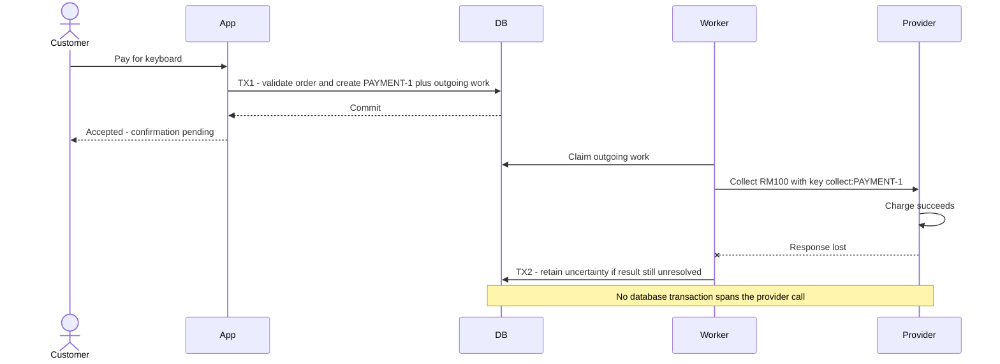

**Accepted is not paid. Timeout is not failed.** While payment is unresolved, block another collection or resume the existing operation. Enforce this atomically on the server; a disabled UI button is insufficient.

| Observation | Meaning | Action |
|---|---|---|
| Processing | Provider says work is ongoing | Await result |
| Requires action | Customer input is needed | Prompt for authentication or other required action |
| Awaiting confirmation | Outcome is unknown | Reconcile or safely replay the same operation |
| Confirmed success/failure | Evidence resolves this operation | Apply business rules |

Stripe exposes intermediate processing and customer-action states. [Payment lifecycle](https://docs.stripe.com/payments/paymentintents/lifecycle)

If a query fails after previously reporting processing, retain the last observation and its time. If a webhook already confirmed success, a later timeout handler must not overwrite it. State describes evidence, not the last network response alone.

Persist operation identity, provider correlation, request parameters/key, outcome or stage, version, observation time, attempt count, `nextAttemptAt`, and error details. These allow another process to resume.

### Make waiting resumable


A waiting payment is a persisted record, not a sleeping thread. A **wake-up** triggers a handler to reload it and see whether progress is possible.

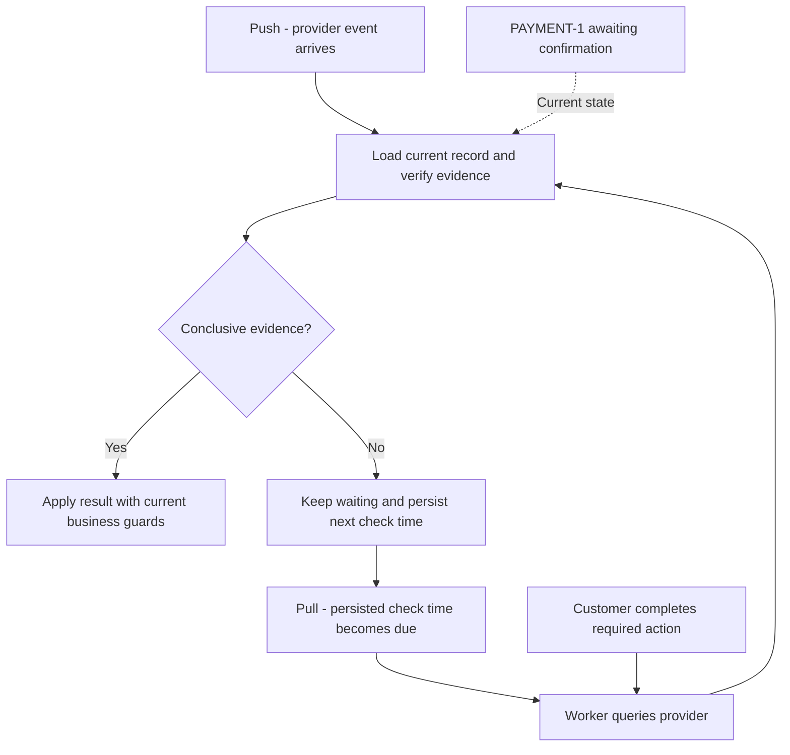

| Method | Who initiates? | Benefit | Cost |
|---|---|---|---|
| Immediate response | Your original request | Fast path | May time out |
| Pull | Your scheduled worker | Controls check schedule | Query traffic and detection delay |
| Push | Provider webhook/event | Prompt updates | Duplicate/late delivery and receiver failures |
| Push with reconciliation | Events normally, queries for overdue work | Recovers gaps | Both paths must share result handling |

For our example, a durable timer can trigger a status check if no webhook arrives. Still processing? Persist a later check. Already resolved by a webhook? Skip redundant work. Merely setting `PENDING` schedules nothing.

In a push design, register an endpoint or subscription, verify the event, and correlate its provider ID to PAYMENT-1. A pushed event may contain the result or only an identifier requiring a query. Push describes who initiates delivery, not whether queries are forbidden. [Stripe webhooks](https://docs.stripe.com/webhooks)

If queries are unavailable, recovery depends on provider replay/delivery facilities or investigation. A **missing-message check** only reads local records after a deadline; it does not query or resend to the provider. If the result is still missing, alert or hand it to an operator. Reliable publication, delivery retries, and dead-letter handling reduce message loss, but do not establish a business result when no message arrives. Duplicate wake-ups must be harmless, and duplicate intermediate messages must not keep extending the original waiting deadline indefinitely.

## 3. Failure handling and recovery

### Rollback versus a corrective transition


**Record first means record intent, not premature success.** Before the provider call, PAYMENT-1 is `REQUESTED` and ORDER-1 remains `AWAITING_PAYMENT`. Only confirmed evidence permits recording payment success.

| When the problem occurs | What to do | Keyboard example |
|---|---|---|
| Before the local transaction commits | Roll back that transaction | Creating payment work fails: neither PAYMENT-1 nor its outgoing work commits |
| After commit, before any send can occur | Apply a guarded cancellation transition | Cancel queued collection only if workers are atomically prevented from claiming/sending it |
| Provider confirms this payment operation failed | Record failure in a new transaction | PAYMENT-1 becomes `FAILED`; order can remain awaiting payment for another attempt |
| Send outcome is unknown | Preserve uncertainty and resolve it | Do not delete PAYMENT-1 or start another charge merely because of a timeout |
| Charge succeeded but the order was cancelled | Start compensation | Keep payment success and create REFUND-1 |

Once a local transaction commits, a later transaction changes its result; it cannot retroactively roll back that commit. Some local changes can be reversed through an explicit transition, such as releasing a reservation. Check current state, preserve history, and prevent races with other work. External effects require the provider's cancellation or compensation operation.

### Leaving uncertainty safely

Uncertainty records missing knowledge. **Do not restore the old state just because time passed.** Restore the previous business condition only when you have established that doing so is safe; retain the operation and its history.

| Evidence or coordination | Safe action |
|---|---|
| Request is still local and atomic cancellation prevents every sender from executing it | Close the operation as cancelled before send |
| Provider definitively confirms this operation failed and cannot later succeed | Record failure; allow the next attempt if the order is still eligible |
| Provider confirms cancellation prevents further execution | Record cancellation and release related local reservations under policy |
| Provider confirms success | Apply success; compensate if the order no longer permits fulfillment |
| Timeout, missing callback, query error, or exhausted retries | Keep the outcome unresolved; reconcile or investigate |
| Provider query says not found but creation could still be in flight or visibility delayed | Keep uncertainty until the provider contract rules out late execution |

In our example, the order stayed `AWAITING_PAYMENT` while PAYMENT-1 was uncertain. Once failure is definitively confirmed, there is no order state to roll back: close PAYMENT-1 as `FAILED`, then a new PAYMENT-2 may be created. If you use an order-level `PAYMENT_PENDING`, an explicit transition back to `AWAITING_PAYMENT` can be valid after the same checks. If the order was cancelled meanwhile, do not restore it to awaiting payment.

An expired lease or a stopped worker is not proof that the external request was never sent. A pre-send cancellation must coordinate with the sending protocol; after a sender claims work, treat possible external execution explicitly. "Not found" is conclusive only when the provider's visibility and request-lifecycle guarantees make it so.

### Retry without creating another charge

Retry when **the problem may recover, repetition is safe, the action is still valid, and its retry budget remains**. First identify what you are repeating: a charge request, a status query, or a local transaction.

"May recover" is an evidence-based classification, not certainty. Ask: **can the cause disappear without changing this request?** Use the provider's documented error codes and retry hints before broad HTTP categories.

| Evidence | Interpretation |
|---|---|
| Explicit retry hint or documented temporary error | Good reason for a bounded retry under that contract |
| Rate limit or temporary contention | Waiting may remove the cause |
| Timeout or connection reset | Communication may recover, but the original business outcome remains unknown |
| Invalid input or permissions | Time alone usually does not correct the cause |
| Unrecognized error | Investigate/classify; allow only bounded safe retries if policy permits |

For example, Stripe exposes `Stripe-Should-Retry` guidance; its server errors can still leave side effects uncertain. A status code alone is not enough to establish safe repetition. [Stripe error classification](https://docs.stripe.com/error-low-level#the-stripe-should-retry-header)

In the keyboard example, a connection reset is a reason to expect communication might work next time, not evidence the charge failed. A retry budget limits how long to test that expectation. Repeated failures trigger diagnosis or deferred recovery, not unlimited attempts or a fabricated failure outcome. Classify recoverability and side-effect uncertainty separately.

**Retryable and unknown are different dimensions.** Retryable means another attempt may help; unknown means execution cannot be confirmed. An attempt can be both. Reclassify after every response or exception: a retry following a temporary rejection can time out and leave the outcome unknown. Unknown after the first send and unknown after a retry use the same recovery rules; keep the attempt history separately. Neither should erase an already confirmed result.

| Situation | What to repeat | When |
|---|---|---|
| Temporary connection failure or timeout sending payment | Same provider operation with the same key/parameters, if supported; alternatively query its outcome | After backoff, within provider guarantees, while collection remains permitted |
| Provider reports processing | Status check, not a new charge | On notification or the next scheduled check |
| Rate limit | Same permitted request | After provider retry guidance or capped backoff with jitter |
| Server error | Resolve outcome or replay only as documented | Do not assume the request had no effects or that replay will reexecute it |
| Version conflict or transactional deadlock | Local transaction: reload and reevaluate rules | With bounded retries; never blindly repeat external calls |
| Invalid input, missing permission, or confirmed business rejection | No unchanged automatic retry | Correct the cause or obtain a new permitted action first |
| Order cancelled while payment is unknown | Queries/reconciliation, not a fresh collection attempt | Continue resolving evidence; compensate if already charged |

In the keyboard example, retrying a status query asks what happened. Replaying `collect:PAYMENT-1` might execute a charge if the original never executed. Before sending, check whether collection is still permitted. If ORDER-1 is now cancelled, cancel unsent work safely and resolve any possibly sent request rather than blindly replaying collection.

Provider-specific guidance matters: Stripe API v1 can cache a server error, so replaying the same key may return that error again. Network retries use the same key and parameters within the documented window. [Stripe advanced error handling](https://docs.stripe.com/error-low-level)

The first request may have succeeded. When replay is permitted, repeat the **same logical operation**, not a new charge with a new identity.

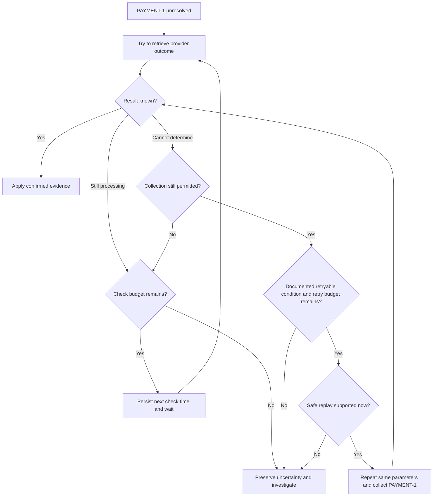

| Action | Identity rule |
|---|---|
| Network retry or restart recovery | Same PAYMENT-1, same `collect:PAYMENT-1`, same parameters |
| New attempt after confirmed failure | New payment operation, for example PAYMENT-2 |
| Refund | Separate REFUND-1 and `refund:REFUND-1` |

Persist the key before sending. Deduplicate customer submissions and local effects too: provider idempotency does not protect your own ledger or fulfillment jobs.

Provider contracts limit safe replay. Stripe API v1 may replay saved errors and prune keys after at least 24 hours; API v2 differs. Do not assume keys protect an operation forever. [Idempotent requests](https://docs.stripe.com/api/idempotent_requests)

Retry temporary errors with bounded attempts/time and capped backoff plus jitter. Persist `nextAttemptAt`; avoid stacked retries at multiple layers. Invalid input needs correction. **Exhausting retries leaves an operational problem, not proof that payment failed.** [AWS retry guidance](https://aws.amazon.com/builders-library/timeouts-retries-and-backoff-with-jitter/)

### Retry and recovery task lifecycle

**Save a way to find unfinished work before sending; decide whether to repeat the call after examining the evidence.** A recovery task is not an instruction to keep calling until success.

#### Register recovery before the first call

Registering a task only after a temporary error covers a narrower case than crash recovery:

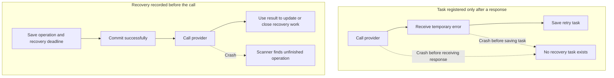

The earlier record can be an existing outgoing-work row, an engine timer, or an operation with a deadline that a scanner reads. A new task type is unnecessary if an existing mechanism already makes unfinished work discoverable. Merely writing a status without a scanner, timer, or reliable delivery path does not arrange recovery.

Save intent and recovery tracking in the same database transaction when possible. If an external scheduler must be notified, use an outbox or another reliable handoff. Saving the operation and then independently registering a remote task leaves another crash gap between those writes.

A future check time prevents immediate recovery, but is not an execution lock. Atomically claim permission to send, prevent concurrent callers, and recheck whether the action is still allowed. Do not hold a database transaction open during the external request. An expired claim allows recovery work to be examined; it does not by itself make repeating the external effect safe.

#### Keep business outcome separate from task progress

These are different questions, even if their answers live in existing records rather than new status columns:

| Concern | Question | Example |
|---|---|---|
| Order progress | What business step is allowed now? | Awaiting payment; cancelled; ready to fulfill |
| Provider evidence | What do we know about the external effect? | Processing confirmed; success confirmed; outcome unknown |
| Execution ownership | Who may send right now? | One caller has permission; competing callers must wait |
| Recovery work | What should happen next, and when? | Wait for a message; safely replay; alert an operator |

Do not add an order-level processing status solely to represent every network call. Existing business states can stay unchanged while task metadata records ownership, attempt history, and timing. However, removing a status must not remove the information needed to block duplicate execution or detect abandoned work.

The following diagram shows **task behavior**, not another order or payment state machine. Its labels can be represented by task fields and scheduling rules:

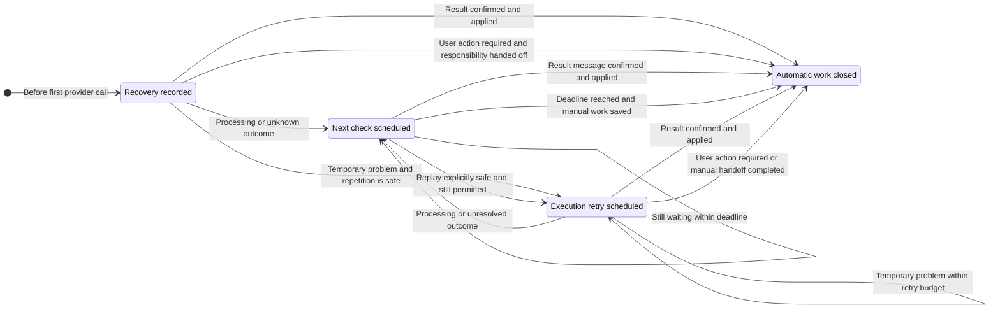

Closing automatic work only means that this mechanism has no more automatic action to perform. It does not mean the payment succeeded or failed. If an operator must continue, save a discoverable review item before closing the automatic task. If the user must act, the application needs an explicit way to show that requirement; do not silently discard it.

#### Apply one result policy across every delivery path

The original response, a background replay, and a webhook can all describe the same operation. Use one result handler that checks current state and evidence, applies business rules, and updates recovery work. The caller decides how to present the result; it must not maintain a separate version of the payment rules.

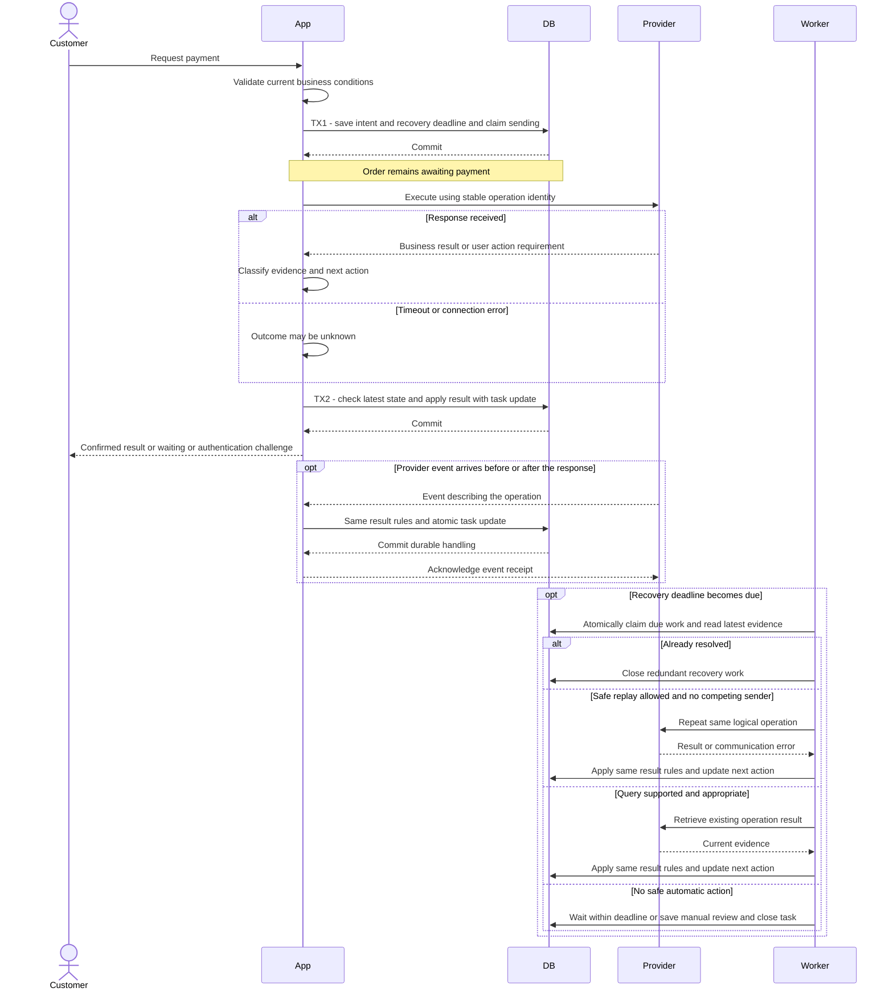

If a webhook confirms payment while the synchronous call is still waiting, the later response must check the latest record. A timeout handler cannot replace success with unknown. A late processing event cannot reopen completed work. Different event IDs describing the same success must not schedule fulfillment twice.

For externally scheduled tasks, committing a database change and cancelling the scheduler job are not necessarily atomic. Mark the durable work completed with the business update, then let a late scheduler invocation read that marker and exit. Scheduler cancellation alone is not the correctness mechanism.

| Observation | Business handling | Task handling |
|---|---|---|
| Confirmed success | Apply success under current order rules | Close work with the result and local effects |
| Confirmed final failure | Record this operation as failed | Close work; a new operation requires a new permitted business decision |
| Provider confirms processing | Keep waiting for its result | Stop execution retries; retain a missing-message deadline |
| Temporary rejection with safe repetition | Keep the current operation open | Reschedule existing work with bounded backoff; do not create duplicate tasks |
| Unknown outcome after any attempt | Preserve uncertainty; do not restore eligibility for another charge | Query if available, replay only under explicit guarantees, or wait and investigate |
| User authentication required | Return a challenge through an active authenticated interaction | Stop unattended execution; arrange supported user action or investigation |
| Result cannot be interpreted | Keep raw evidence; do not guess a business outcome | Alert and retain recoverable work; fix interpretation before replaying execution |
| Retry budget exhausted | Do not invent success or failure | Stop execution; retain monitoring or make a durable manual handoff |
| Duplicate or stale intermediate result | Keep newer confirmed evidence | Do not reopen completed work, reset counters, or extend deadlines indefinitely |

When rescheduling, preserve the original operation identity, elapsed recovery time, and attempt history. Define whether an attempt counter counts actual sends or all scheduled checks; waiting for a message should not accidentally consume an execution retry. Duplicate task triggers must not grant a new budget.

A retryable response does not authorize every later retry. Recheck the current result, business eligibility, provider replay guarantees, and remaining budget before every send. If an attempt becomes unknown, follow the unknown-outcome rules rather than continuing the old retry decision.

#### The boundary no local marker can remove

Consider two histories:

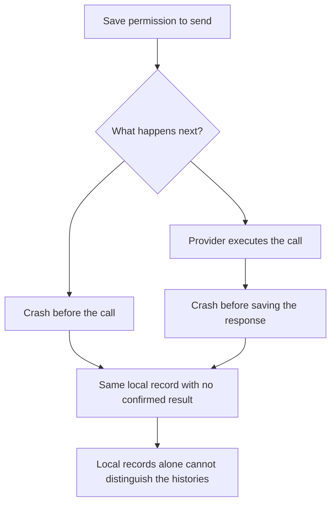

If the protocol requires a committed claim before every send, untouched queued work can be sent for the first time. Once a sender has permission, abandoned work may already have executed. Adding another local marker only moves the point at which a crash can leave uncertainty.

A queue, distributed lock, or workflow engine cannot commit atomically with an arbitrary external provider. They can preserve intent, coordinate workers, and detect missed progress. They cannot prove whether an unobservable external call executed. In particular, an expired lease must not be interpreted as proof that nothing was sent.

The provider may offer useful guarantees without calling them a retry API: an enforced unique client reference, lookup by a reference saved before the call, event replay, or authoritative reconciliation records. Investigate the actual contract rather than inferring it from the phrase "no retries."

If none is available, the choice remains:

| Policy | Benefit | Accepted risk |
|---|---|---|
| Do not repeat uncertain calls | Avoid introducing duplicate execution through recovery | A call that never arrived may remain unresolved until investigation |
| Repeat uncertain calls without deduplication | Increase the chance that an operation executes | The operation may execute more than once |

For costly or irreversible effects, escalation is often preferable to an unsafe automatic resend. This is an explicit business tradeoff, not a missing enum value.

#### Recovery when there is no status query

A push-only provider changes the available recovery actions, not the meaning of uncertainty. Keep the immediate synchronous response as the fast path and the result event as another source of evidence. Local checks detect that nothing has arrived; they do not ask the provider anything.

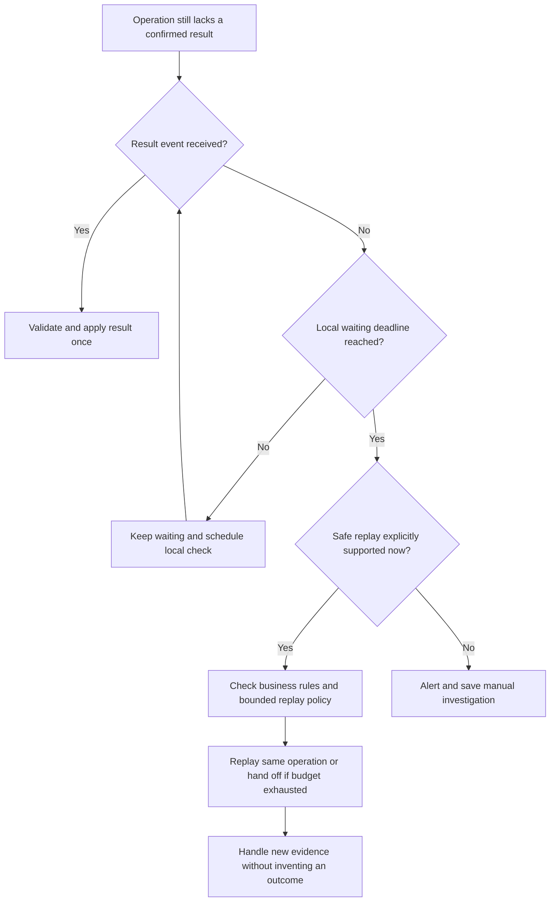

On the publishing side, reliably save outgoing events with business results and retry delivery. On the receiving side, acknowledge only after durable handling, deduplicate business effects, and monitor dead letters. These mechanisms reduce loss but do not eliminate the need to detect overdue operations.

If no query, safe replay, event recovery, or authoritative records exist, automatic resolution may be impossible. An order can still expire or be cancelled under business policy while its payment remains unknown. Continue accepting late evidence: if success is later confirmed for a cancelled order, start the appropriate compensation. Closing an alert or automatic task must not disable that result path.

### Enforce transition rules at the result entry point

A result handler can enforce a state machine without introducing a workflow engine or changing a legacy entity globally. Start with one controlled entry point for provider responses, messages, and retry results. The transition policy belongs there until the application can safely centralize it more broadly.

#### Dispatch and permission are separate decisions

A `switch` selects which result logic to run. It does not establish whether changing the current order is allowed. Make the permission check explicit before applying the selected action:

```text
Current state + incoming result + operation identity + business context
    -> check whether the action is allowed
    -> apply the transition and local effects
    -> update recovery work in the same transaction
```

For example, success while the order awaits payment can schedule fulfillment. The same success after cancellation must still be recorded as payment success, but schedules compensation instead. Never discard an external financial fact merely because the order is no longer in the expected state.

The previous state is not automatically an input to every decision. If arrivals from two paths mean the same thing, one current-state handler is sufficient. If the paths imply different permissions, obligations, or evidence, preserve that distinction in explicit state or operation context. Do not rely on reconstructing an undocumented rule from a history log.

| Check | What it prevents |
|---|---|
| Result belongs to the expected operation | An old request result being applied to a newer request |
| Current order state allows the action | Success scheduling fulfillment after cancellation |
| Evidence is sufficient for the transition | Timeout being interpreted as confirmed failure |
| User-action result has the required provider guarantee | Restoring submission eligibility while execution may still happen |
| Database check and update are coordinated | Concurrent handlers both advancing the same order |
| Local effects and recovery updates commit together | Order marked complete while required follow-up is lost |

For stale or mismatched results, distinguish duplicate delivery from new evidence of an external effect. A stale success may require reconciliation or compensation even when it must not advance the current operation.

#### Add rules without unexpectedly breaking old callers

Adding validation to a shared `setStatus` method can change every existing caller. If the only code you control is the new result entry point, enforce the new rules there first and reuse the existing transition methods for node updates, history, and outgoing work.

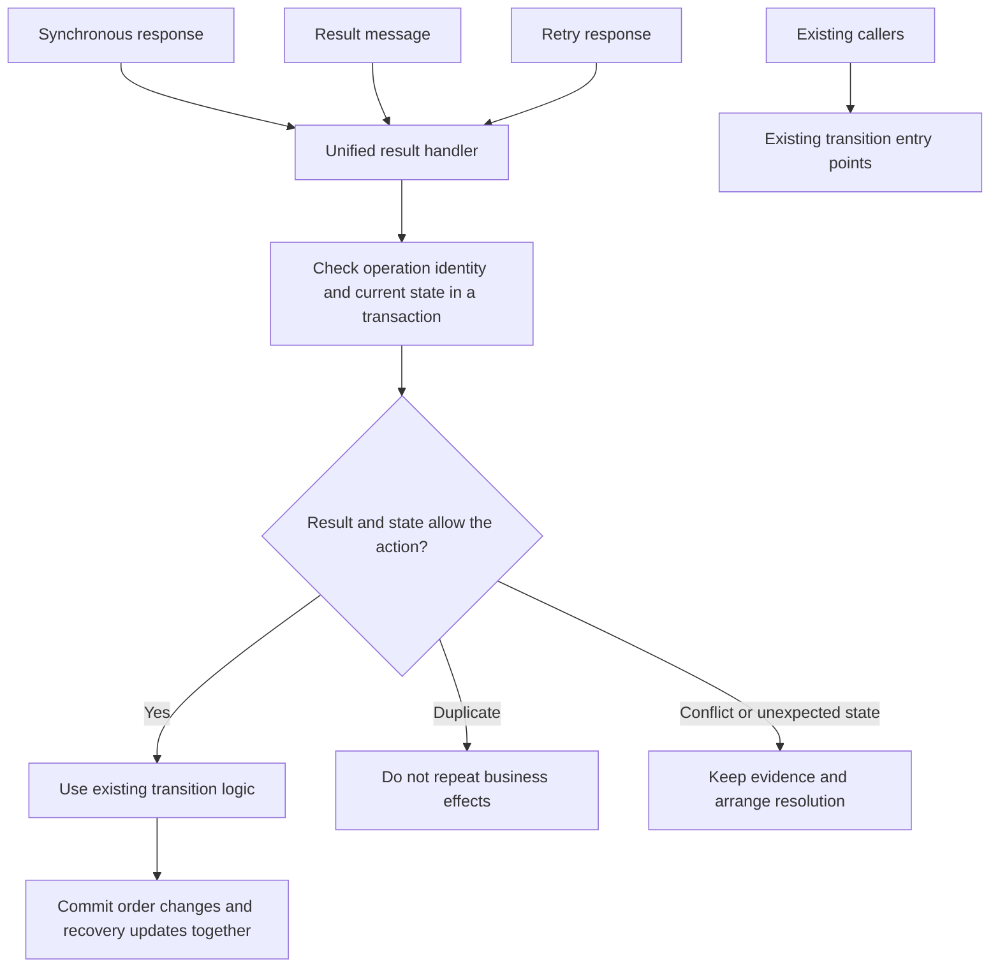

This is a limited guarantee: requests through the new handler obey its policy. Existing writers do not become protected merely because the new path has a lock or validation. Inventory the other writers that can modify the same records before claiming that the whole application enforces the rule.

| Change | Effect on existing behavior |
|---|---|
| Add checks to the new result handler | Changes handling through that entry point |
| Reuse existing transition operations | Preserves their node updates, history, and local effects; verify their assumptions |
| Add validation to a shared entity setter | Can reject transitions previously used by old callers |
| Add a database constraint | Affects all writes, including legacy paths and maintenance scripts |
| Add version checks to all writers | Coordinates concurrent updates, but requires each writer to handle conflicts |

#### Java example: one handler with small result methods

For a few stable result types, a `switch` with named methods is sufficient. Separate handler classes become useful when individual cases have substantial logic or different dependencies; replacing a short switch with a registry does not itself improve correctness.

This Spring-style example shows the boundary, not a complete application. Repository and helper methods stand for existing application operations. They must participate in the same database transaction; the helper names describe the behavior their implementations must provide.

```java
@Transactional
public void handle(ProviderResult result) {
    Order order = orders.findByIdForUpdate(result.orderId());

    if (!matchesOperation(order, result)) {
        // Save evidence for reconciliation; a stale charge may still be real.
        reviews.recordMismatchedResult(order, result);
        return;
    }

    if (order.isFinished()) {
        // Identical resolved result: no duplicate effect.
        // New success after cancellation: record payment and arrange compensation.
        // Conflicting evidence: save an investigation item, do not overwrite.
        handleFinishedOrder(order, result);
        return;
    }

    if (!order.isAwaitingPayment()) {
        // Do not silently drop an external result in an unexpected state.
        reviews.recordUnexpectedState(order, result);
        return;
    }

    switch (result.code()) {
        case SUCCESS -> {
            existingTransitions.confirmPaymentAndAdvance(order, result);
            tasks.complete(result.operationId());
        }
        case FINAL_FAILURE -> {
            existingTransitions.recordFailureAndAdvance(order, result);
            tasks.complete(result.operationId());
        }
        case TEMPORARY_ERROR ->
            tasks.retryOnlyIfSafeOtherwiseReview(order, result);
        case PROCESSING ->
            tasks.waitForMessage(result.operationId());
        case UNKNOWN ->
            tasks.recoverUnknownWithoutAssumingFailure(order, result);
        case USER_ACTION_REQUIRED ->
            handleUserActionUnderProviderContract(order, result);
    }
}
```

The user-action helper must check what the provider guarantees before restoring eligibility for submission. If no execution can occur until authentication, it can use a supported user interaction path. Otherwise it preserves uncertainty and hands off for resolution. A message can record that the user must act, but cannot display a challenge through a closed HTTP request.

Use validation of operation correlation, amount, currency, and result authenticity before accepting provider evidence. The example's status checks do not replace those checks. The method must be called through Spring's transactional proxy; invoking it internally without an active transaction does not establish the intended transaction boundary. External provider calls happen before or after this local transaction, never while holding its row lock.

#### Check current state when writing, not only when routing

An in-memory check followed by an unconditional update is vulnerable to another writer changing the order in between. A database row lock protects the read-and-update transaction, but does not force every legacy writer to honor the business rule. For example, a legacy caller can read before the lock is acquired and later overwrite with stale data after the lock is released.

Where appropriate, use an expected state or version in the update itself:

```sql
UPDATE orders
SET status = :next_status,
    version = version + 1
WHERE id = :order_id
  AND status = :expected_status
  AND version = :expected_version;
```

Require exactly one affected row. Zero means the assumption no longer holds: roll back dependent local changes, reload, and reevaluate. Do not blindly retry the old decision or repeat an external call. This update should sit behind the existing transition operation if direct SQL would bypass required history or node effects.

A conditional update protects the write that uses it. A later unconditional legacy update can still overwrite that value. Strong application-wide protection requires cooperating writers, suitable database constraints where the rule can be expressed, or a single authoritative transition owner. Until then, document the new handler's scope rather than promising global enforcement.

#### Choose an execution tool after defining the rules

Current-state dispatch, transition validation, and workflow execution are separate concerns. A handler chooses the business reaction; a state machine defines allowed changes; an execution runtime arranges durable waits, retries, and resumption. A workflow engine can provide that runtime, but cannot decide provider semantics or eliminate unknown external outcomes.

For an existing system with working persistence, scheduling, and message consumption, first connect them through the unified handler and explicit task lifecycle. Consider another engine when implementing and maintaining many waits, branches, compensations, and recovery paths becomes a recurring burden. Whether transitions depend on the previous state is not the deciding criterion.

### Resolve concurrent decisions


Now the customer cancels. Cancellation and payment confirmation might both read the same old order state. Their checks must be protected by storage-level concurrency control.

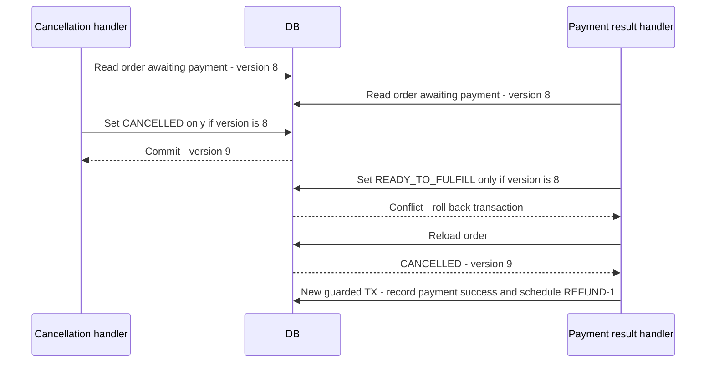

The losing handler reloads and **reevaluates the decision**. It does not repeat its old action with an updated version. If confirmation wins first, our policy rejects simple cancellation because fulfillment is scheduled.

| Mechanism | Purpose |
|---|---|
| Atomic version/state condition | Protect competing transitions |
| Row lock in a short transaction | Serialize decisions on shared records |
| Unique constraint | Prevent duplicate identities/effects |
| Appropriate locks or serializable transaction | Protect rules spanning several records |

For refunds, also reserve the amount atomically against the refundable balance. Distinct refund IDs alone cannot stop two handlers refunding the same RM100. Process-local locks do not coordinate multiple servers. [PostgreSQL transaction isolation](https://www.postgresql.org/docs/current/transaction-iso.html)

Three deadlines have different meanings: HTTP timeout ends waiting for a response; provider processing expectations trigger checks; an order reservation deadline can cancel the order. None proves collection stopped. Expiry, like cancellation, can require a refund if success is discovered later.

### Recover durable work after a crash


A database rollback cannot undo a completed external charge. The refund is **compensation**: a new business operation with its own uncertain outcomes.

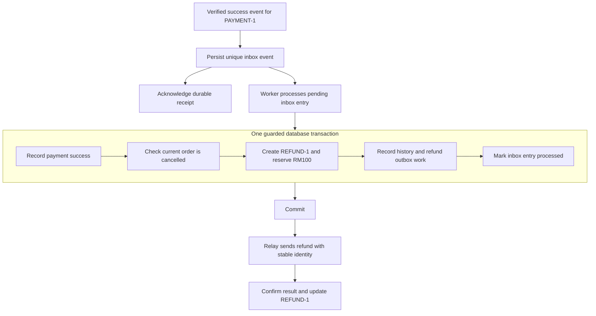

The **inbox** makes incoming work durable; an inbox scanner or queue wakes its worker. The **outbox** commits outgoing work alongside the business decision. A crash after commit therefore leaves work another process can find. Delivery can repeat, so recipients still need idempotency. [AWS outbox pattern](https://docs.aws.amazon.com/prescriptive-guidance/latest/cloud-design-patterns/transactional-outbox.html)

| Interruption | Recovery |
|---|---|
| Payment intent saved before send | Deliver existing payment work |
| Charge completed but response lost | Resolve PAYMENT-1 using query or safe replay |
| Refund intent committed before send | Deliver existing refund outbox work |
| Refund sent before delivery record saved | Reuse refund identity within provider guarantees |
| Same result arrives again | Deduplicate delivery and business effect |

Different event IDs can describe the same payment success, so deduplicate business effects as well as event IDs. Late processing notifications must not regress confirmed success. Refund requests also need waiting, retries, and reconciliation until a result is confirmed. Stripe documents duplicate and unordered notifications. [Webhooks](https://docs.stripe.com/webhooks)

Workers claim work atomically. Leases permit takeover after a crash; claim generations/version checks reject stale local completions. External calls still need idempotency. For unresolved cases, manual review uses guarded operations and records actor, reason, and evidence rather than directly editing status.

## 4. Choosing how to coordinate the workflow


We have now built the whole workflow. These terms describe different parts of it:

| Level | Question | Concept |
|---|---|---|
| Business model | Which changes are valid? | State machines and guards |
| Complete process | How do payment, cancellation, and refund connect? | Workflow: operations plus coordination rules |
| Information delivery | How does the result arrive? | Push/pull |
| Decision ownership | Who decides the next cross-step action? | Orchestration/choreography |
| Execution machinery | Who persists waits, dispatches tasks, and resumes progress? | Your application or a workflow engine |

### Orchestration and choreography

The result has arrived. Someone must now decide whether to fulfill or refund. **Orchestration** puts that cross-step decision in a coordinator. **Choreography** distributes reactions among event subscribers.

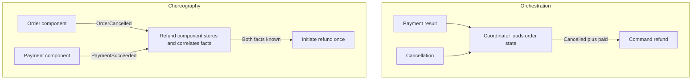

| Orchestration | Choreography |
|---|---|
| One place tracks the overall sequence | Participants own local event reactions |
| Easier to follow the complete flow | More event dependencies to trace as the flow grows |
| Coordinator owns cross-step decisions | Refund component owns eligibility in this example |

Both still need durable state, retries, and concurrency protection. A pushed webhook can wake an orchestrator; push does not automatically mean choreography. Choreography must correlate facts regardless of arrival order. [Saga orchestration](https://docs.aws.amazon.com/prescriptive-guidance/latest/cloud-design-patterns/saga-orchestration.html), [saga choreography](https://docs.aws.amazon.com/prescriptive-guidance/latest/cloud-design-patterns/saga-choreography.html)

### State machine, workflow, and workflow engine

A **state machine is the model**. A **workflow combines business operations with coordination rules**, potentially across several state machines. A **workflow engine is the runtime** executing a workflow definition.

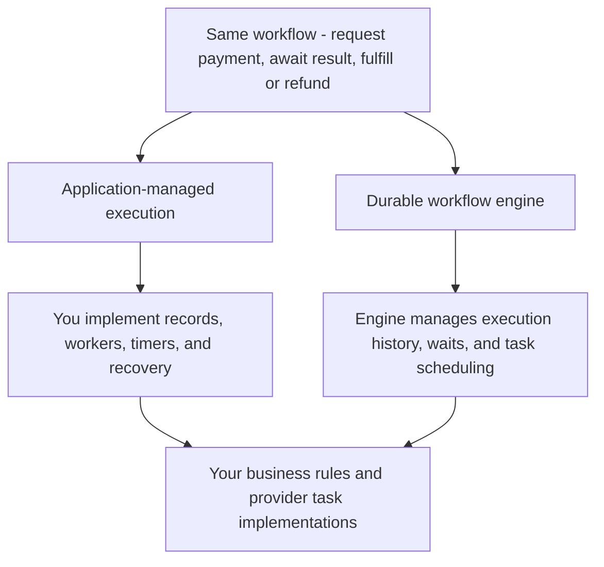

For our lost response, your application can persist a next-check time and scan for due work. An engine can provide a durable timer and resume a task when it fires. You still define what the provider evidence means and use stable identities for external effects. Temporal uses execution history to recover progress. [Workflow execution](https://docs.temporal.io/workflow-execution)

A transition library may validate states without providing durability. An engine's successful task execution does not itself prove business payment success. Engines add operational and versioning constraints as they take over execution machinery.

The general scenario is an **asynchronous business workflow** with distributed coordination and potentially eventual consistency. Accept-now/respond-later is asynchronous request-reply. Coordinating committed steps through compensations is a **saga**; waiting alone is not enough to make it one. [Asynchronous request-reply](https://learn.microsoft.com/en-us/azure/architecture/patterns/asynchronous-request-reply)

## Verify the design with the same example


| Inject this failure | Required property |
|---|---|
| Repeated pay submission | No second active collection |
| Lost response | Preserve uncertainty and recover PAYMENT-1 |
| Cancellation/result race | One valid order decision and explicit compensation |
| Duplicate or late event | No repeated effect or state regression |
| Crash after refund decision | REFUND-1 remains discoverable |
| Concurrent refund requests | Reserved/completed refunds stay within balance |
| Retry exhaustion or stale worker | No invented result or overwritten newer decision |
| Crash before send or before saving its response | Recovery work survives; possible execution is not mistaken for a definitely unsent request |
| Missing result message and no query capability | Local deadline triggers an alert or investigation, not fabricated failure |
| Background attempt requires user action | Automatic execution stops; no assumed live connection or invented failure |

Transition tests check rules; database integration tests check atomicity/concurrency; failure injection checks recovery. Monitor unresolved age, retries, conflicts, pending work age, and review backlog. Keep transition history with identity, time, actor, and reason; a history log alone is not event sourcing.

For each arrow in the diagrams, ask: **what evidence permits it, what commits together, and how does another process resume it after a crash?**
